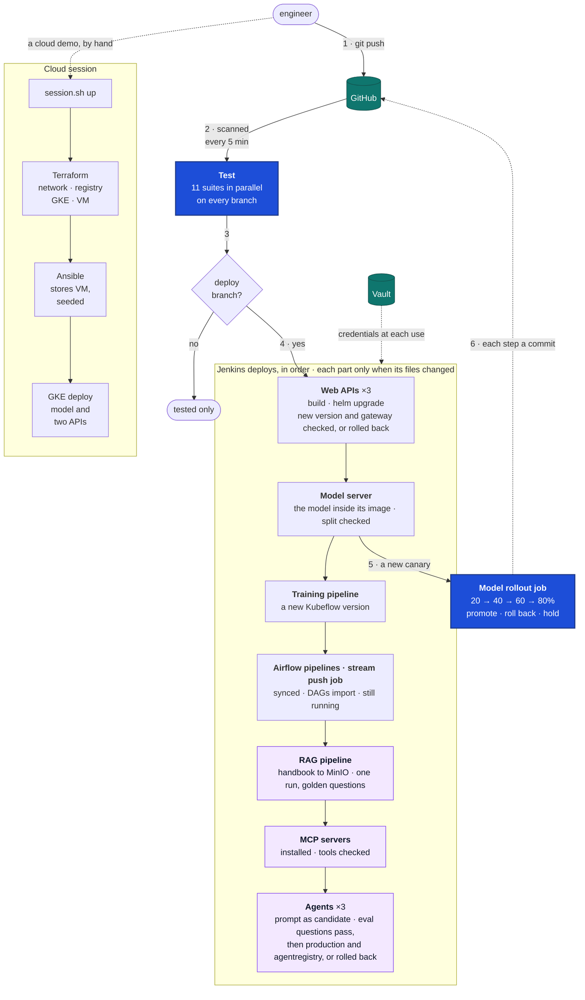

# FraudStream

**An end-to-end fraud detection platform that runs on a laptop.** Messy batch and
streaming transactions go in. A tested, autoscaled, CI/CD-deployed fraud detection model comes
out, with data quality, lineage and event-time correctness kept intact along the way.

A fraud detection model is only as good as the pipelines feeding it. Real transaction data has
late records, duplicates, schema changes, spikes and skew, so this project generates
those problems on purpose and builds the whole MLOps loop around handling them.

## Contents

- [Highlights](#highlights)
- [How it fits together](#how-it-fits-together): the two platforms, and the CI/CD pipeline
- [What's inside](#whats-inside): every part, with its doc
- [Novel ideas](#novel-ideas)
- [Quick start](#quick-start)
- [Tests](#tests)
- [Repository layout](#repository-layout)

## Highlights

- **One lakehouse, two engines.** Spark (batch) and Flink (streaming) write to the same
  Iceberg catalog on MinIO, and Trino queries both. A fraud label that arrives weeks late
  joins the exact streaming features from that moment with a single query.
- **Event-time streaming done properly.** Flink dedupes, windows and handles late data
  using a watermark calibrated from measured p95 delay, not a guess.
- **Point-in-time-safe features.** Eight explicit leakage rules, and a Feast store (Redis
  online, Iceberg offline) so training and serving see the same features.
- **Real orchestration and governance.** Asset-driven Airflow DAGs with validation gates
  that stop bad data early. DataHub shows lineage, contracts and quality results.
- **Reproducible ML.** Distributed XGBoost on Kubeflow. Every model in MLflow is linked to
  the Iceberg snapshot of the exact rows it trained on.
- **Production-style serving.** KServe with the model inside its image, an inference API
  and a drift API on Kubernetes, with KEDA autoscaling and automatic Helm rollback.
- **A real front door.** Every API sits behind an NGINX gateway with its own domain,
  HTTPS from a local CA, basic auth and a per-client rate limit. CI checks all four after
  each deploy and rolls back an API left open.
- **One vault for every secret.** HashiCorp Vault holds every password, key and token, and
  nothing in the repository does. Each reader logs in as itself and reads only its own
  entries, and every read is in the audit log.
- **Cloud in one command.** Terraform and Ansible bring the serving path up on GKE and
  take it down again, with a budget and a leftover check so a forgotten session can't
  run up a bill. A payment scored in the cloud matches the laptop to the last decimal.
- **Watched, not guessed.** Every payment leaves a trace, a log line and a count. A daily
  pipeline checks the model's inputs against its training data without waiting for
  labels, and starts retraining when they move.
- **Never swapped blind.** A new model version takes a share of real traffic next to the
  served one. A Jenkins job steps it up, rolls it back when it is unhealthy, and stops
  for a person when it behaves differently. Every step is a commit.
- **Tested with numbers.** 100% line and branch coverage on both APIs, 86% mutation score,
  property-based tests, and a load test judged against an SLA fixed in advance.
- **CI/CD.** Jenkins tests every branch and deploys the deploy branch, the MCP servers and
  the agents included. Every image is tagged with its commit, and an agent's prompt
  reaches production only after its eval questions pass.
- **Measured, not claimed.** Spark AQE and Flink chaining experiments are captured from
  the runtime UIs, with before and after numbers.

## How it fits together

### The data and ML platform



A payment's way to a score is **P**; everything else feeds it,
watches it or ships it.

| Flow | What moves |
|---|---|
| **B** batch | the offline CSVs from MinIO through Spark's bronze, silver and gold, into Iceberg and PostgreSQL |
| **S** streaming | live events through Kafka and Flink: clean transactions and features into Iceberg, late events to their own topic |
| **C** change data capture | PostgreSQL's changes through Debezium into Kafka |
| **O** orchestration | the engineer starts the DAGs; Airflow runs the Spark jobs and the replay producer |
| **G** governance | schemas and lineage into DataHub |
| **I** inspection | an engineer's SQL on PostgreSQL and Trino |
| **F** features | offline features from Iceberg, materialized into Redis; window features pushed online |
| **T** training | point-in-time features to distributed training on Kubeflow, the model registered in MLflow |
| **P** payment | one payment through the gateway, its online features, a score from the model, then the drift check |
| **M** monitoring | the drift check and retraining on drift; metrics, logs and traces into Prometheus, Elasticsearch and Jaeger |
| **A** A/B testing | a new model version's share of traffic, set and promoted |
| **D** delivery | a push, tested, built and deployed by Jenkins |
| **K** cloud | Terraform and Ansible bring the serving path up on Google Cloud |
| **V** security | every secret from Vault |

### The LLM platform


The ML layer decides; the LLM layer explains. The fraud detection model scores every
payment, and nothing in the LLM layer can change that score. An analyst asks the
coordinator why a payment was flagged. The coordinator asks two sandboxed specialists,
and they answer from the same features and the same model, through MCP tools.

| Flow | What moves |
|---|---|
| **Q** question | the analyst's question to the coordinator, then through the A2A gateway to a specialist restored for this conversation |
| **L** LLM | every agent's chat completions through the LLM gateway and llm-d to Qwen3 on llama.cpp |
| **M** MCP tools | a specialist's tool calls through the MCP gateway to the servers, the APIs and the stores |
| **R** RAG | the handbook, model cards and feature pages, chunked and embedded daily into Iceberg and pgvector |
| **D** delivery | an agent's prompt and manifest, deployed only when its eval questions pass |
| **O** observability | the gateways' metrics and traces, and the dashboards on them |
| **V** security | every key from Vault, synced into its namespace |

### From a push to production



1. **Push.** Every branch is pushed to GitHub.
2. **Scan.** Jenkins finds new commits every five minutes.
3. **Test.** All 11 test suites run in parallel, on every branch.
4. **Deploy.** On the deploy branch, each part deploys only when its own files changed, and
   checks itself after. An API answers with the new version and passes the gateway check,
   or Helm rolls it back. An agent's prompt reaches production only when its eval
   questions pass. The MCP servers go before the agents that use them.
5. **Canary.** A new model version starts the rollout job.
6. **Rollout.** It steps the canary up while it behaves like production, and commits each
   step, so Git always says what the cluster serves.

The purple stages deploy the LLM platform. Jenkins reads every credential from Vault at
the moment a step uses it. The cloud session is started by hand, when a demo is due:
Terraform, then Ansible, then the GKE deploy ([25](docs/ml/25_infrastructure_as_code.md)).

## What's inside

| Area | What it does | Docs                                                                                                                                                                                      |
|---|---|-------------------------------------------------------------------------------------------------------------------------------------------------------------------------------------------|
| **Data engineering** | | |
| Data generators | 510,000 offline rows and 512,500 stream events with controlled duplicates, late and out-of-order data, skew and schema change | [01_offline_data_generator.md](docs/data_engineering/01_offline_data_generator.md)<br>[02_streaming_data_generator.md](docs/data_engineering/02_streaming_data_generator.md)                                                |
| Bronze, Silver, Gold | Raw preserved, then cleaned and deduplicated, then a star schema with daily aggregates. Written to Iceberg and PostgreSQL | [03_bronze_ingestion.md](docs/data_engineering/03_bronze_ingestion.md)<br>[04_silver_transactions.md](docs/data_engineering/04_silver_transactions.md)<br>[05_gold_tables.md](docs/data_engineering/05_gold_tables.md)                       |
| Feature engineering | Velocity, merchant risk, amount anomaly, device/IP reuse and late-arrival features | [06_feature_engineering.md](docs/data_engineering/06_feature_engineering.md)                                                                                                                               |
| Flink streaming | Validation, dedup, five-minute windows, late-event handling and alerts | [07_flink_streaming_pipeline.md](docs/data_engineering/07_flink_streaming_pipeline.md)<br>[08_flink_window_processing.md](docs/data_engineering/08_flink_window_processing.md)                                              |
| Orchestration | Three Airflow DAGs linked by validated data assets | [09_orchestration_flow.md](docs/data_engineering/09_orchestration_flow.md)<br>[10_airflow_workflow_demonstration.md](docs/data_engineering/10_airflow_workflow_demonstration.md)                                            |
| Governance | DataHub catalog, lineage, contracts and assertions; database ERDs; quality report | [11_data_governance_datahub.md](docs/data_engineering/11_data_governance_datahub.md)<br>[12_database_schema.md](docs/data_engineering/12_database_schema.md)<br>[13_data_quality_report.md](docs/data_engineering/13_data_quality_report.md) |
| Lakehouse and CDC | Iceberg on MinIO, Trino, and Debezium change capture | [14_lakehouse_iceberg.md](docs/data_engineering/14_lakehouse_iceberg.md)<br>[15_change_data_capture.md](docs/data_engineering/15_change_data_capture.md)                                                                    |
| Performance | Measured Spark and Flink tuning | [silver_job_optimization.md](docs/data_engineering/optimization/spark/silver_job_optimization.md)<br>[streaming_job_optimization.md](docs/data_engineering/optimization/flink/streaming_job_optimization.md)                |
| **ML platform** | | |
| Feature store | Feast with Redis online store and incremental materialization | [16_feature_store.md](docs/ml/16_feature_store.md)                                                                                                                                           |
| Model training | XGBoost against a logistic baseline, split by date, and a Kubeflow pipeline | [17_ml_training.md](docs/ml/17_ml_training.md)<br>[18_ml_pipeline.md](docs/ml/18_ml_pipeline.md)                                                                                                |
| Versioning | MLflow registry tied to Iceberg data snapshots | [19_versioning.md](docs/ml/19_versioning.md)                                                                                                                                                 |
| Kubernetes platform | Ingress with HTTPS, KEDA, Knative, and KServe | [20_local_k8s_platform.md](docs/ml/20_local_k8s_platform.md)                                                                                                                                 |
| Web APIs | Inference and drift detection, with Helm rollout and rollback | [21_web_apis.md](docs/ml/21_web_apis.md)                                                                                                                                                     |
| Testing | Coverage, mutation, property-based and load testing | [22_validation_and_verification.md](docs/ml/22_validation_and_verification.md)                                                                                                               |
| CI/CD | Jenkins pipeline with a before and after of a real deploy, and the agents deployed through their eval questions | [23_ci_cd.md](docs/ml/23_ci_cd.md)                                                                                                                                                           |
| Gateway | NGINX with a domain, HTTPS, basic auth and a rate limit in front of every web API | [24_gateway.md](docs/ml/24_gateway.md)                                                                                                                                                       |
| Infrastructure as code | Terraform stacks for GKE, a VM, a registry and state; Ansible roles that configure and seed the VM; one command to start and end a cloud session | [25_infrastructure_as_code.md](docs/ml/25_infrastructure_as_code.md)                                                                                                                         |
| Observability | Request, model and compute metrics in Prometheus and Grafana, logs in Elasticsearch and Kibana, traces in Jaeger, and a daily drift pipeline that retrains on drift | [26_observability.md](docs/ml/26_observability.md) |
| A/B testing | A new model runs as a KServe canary next to the served one, compared on real traffic without labels, and stepped up, promoted or rolled back by commits, by hand or by a Jenkins job | [27_ab_testing.md](docs/ml/27_ab_testing.md) |
| Secrets | One HashiCorp Vault holds every password, key and token. Each reader logs in as itself and reads only its own: External Secrets for each namespace, Jenkins, Airflow, Ansible and the GKE deploy | [28_security.md](docs/ml/28_security.md) |
| **LLM layer** | | |
| LLM inference platform | Qwen3 on llama.cpp behind llm-d and agentgateway: keys, limits, PII masking, telemetry, benchmark | [29_llm_inference_platform.md](docs/llm/29_llm_inference_platform.md) |
| RAG data pipeline | The handbook, model cards and feature dictionary, chunked and embedded daily into Iceberg and Feast's pgvector store, checked and governed | [30_rag_pipeline.md](docs/llm/30_rag_pipeline.md) |
| Context API and MCP servers | Features, chunks and search by id; two MCP servers behind agentgateway with a key and tool policy per agent | [31_context_api_and_mcp.md](docs/llm/31_context_api_and_mcp.md) |
| Agents | kagent with one global model config, the context agent with its prompt from MLflow, KEDA on calls in flight, agentregistry, both UIs behind NGINX | [32_agent_platform_and_context_agent.md](docs/llm/32_agent_platform_and_context_agent.md) |
| Risk agent and coordinator | The risk agent scores a payment and cites the handbook; the coordinator delegates through agentgateway as the A2A gateway with a key, allow-list and rate limit; six eval questions | [33_risk_agent_and_coordinator.md](docs/llm/33_risk_agent_and_coordinator.md) |
| Agent fleet | The context and risk agents sandboxed in gVisor on Agent Substrate: every conversation restored in about 2 s from a golden snapshot, many conversations on three shared workers | [34_agent_fleet.md](docs/llm/34_agent_fleet.md) |
| A/B tests for LLMs and agents | A new LLM version and a cheaper model for the risk agent take a weighted share of traffic at the LLM and A2A gateways, side by side on one dashboard, judged on failures, latency and golden questions | [35_ab_testing.md](docs/llm/35_ab_testing.md) |

## Novel ideas

Two technologies the platform doesn't use yet, each aimed at a weakness measured on the
running platform, in [36_novel_ideas.md](docs/ideas/36_novel_ideas.md):

- **A graph database finds fraud rings.** Ten shared devices carry 28.6% of all fraud, and
  a payment on one is 25 times as likely to be fraud. The model never sees a device, so
  it catches only 15% of that fraud. Memgraph, reading from Kafka, turns shared devices
  and IPs into ring features for the model and a tool the risk agent can cite.
- **Argo CD and Argo Rollouts deploy from Git.** The cluster pulls its state from Git
  instead of Jenkins pushing it, and Argo Rollouts steps the model's canary with its own
  analysis, replacing 613 lines of the platform's own rollout code. The manifests are
  valid against Argo's schemas, and their four checks run on this platform's Prometheus.

## Quick start

You need Docker with Compose, Java, and [`uv`](https://docs.astral.sh/uv/) (root project
targets Python 3.14). Flink, Airflow, DataHub, Feast and the ML pieces each run in their
own isolated environment, because their Python versions don't match.

```bash
uv sync --extra kafka --extra spark --extra storage

# infrastructure: Vault first, then everything else with its passwords from Vault
./infra/vault/unseal.sh
vault login -method=userpass username=operator
. infra/vault/env.sh
docker compose up -d minio minio-bucket-init postgres postgres-schema-init kafka kafka-topic-init kafka-ui

# generate data, then build the layers
PYTHONPATH=src python -m fraudstream.generators.offline_transactions
PYTHONPATH=src python -m fraudstream.generators.streaming_transactions
PYTHONPATH=src python -m fraudstream.jobs.bronze.ingest_transactions
PYTHONPATH=src python -m fraudstream.jobs.silver.transactions
PYTHONPATH=src python -m fraudstream.jobs.gold.transactions
```

Prefer orchestration? Start Airflow and trigger `fraudstream_raw_to_bronze` at
`http://localhost:18081`. The other DAGs follow on their own.

```bash
[ -z "${AIRFLOW_PROJECT_DIR:-}" ] || ./cicd/sync_airflow.sh "$AIRFLOW_PROJECT_DIR"
docker compose --profile orchestration up --build -d \
  airflow-db airflow-init airflow-api-server airflow-dag-processor airflow-scheduler
```

Everything else has its own run instructions in the docs above: Flink
([07](docs/data_engineering/07_flink_streaming_pipeline.md#run-locally)), Trino
([15](docs/data_engineering/14_lakehouse_iceberg.md#trino-querying-iceberg-tables)), DataHub
([11](docs/data_engineering/11_data_governance_datahub.md)), Feast ([17](docs/ml/16_feature_store.md)) and
the Kubernetes stack ([21](docs/ml/20_local_k8s_platform.md)). Add `--spark-ui` to any Spark
job, or `--flink-ui` to the Flink job, to watch it run. Stop the services with
`docker compose down`.

| Service | URL |
|---|---|
| Kafka UI | `http://localhost:18080` |
| Airflow | `http://localhost:18081` |
| Flink UI | `http://localhost:8081` |
| MinIO console | `http://localhost:19001` |
| DataHub | `http://localhost:9002` |
| Inference API | `https://inference.fraudstream.localhost` (gateway password) |
| Drift detection API | `https://drift-detection.fraudstream.localhost` (gateway password) |
| kagent UI, to ask the agents | `https://kagent.fraudstream.localhost` (gateway password) |
| Agent registry | `https://agentregistry.fraudstream.localhost` (gateway password) |
| PostgreSQL | `localhost:5432`, database `fraudstream` |

Every login is in Vault (`https://localhost:8200/ui`); `vault kv get -mount=secret platform/postgres` shows one.

## Tests

```bash
PYTHONPATH=src python -m unittest discover -s tests/unit -p 'test_*.py'
```

The API suites, mutation tests and load test are covered in
[doc 22](docs/ml/22_validation_and_verification.md), and CI runs all of them
([doc 23](docs/ml/23_ci_cd.md)).

## Repository layout

```text
fraudstream/
├── agents/                   # Isolated Python 3.12 agent prompts for MLflow, and the A2A check
├── airflow/                  # Airflow DAGs, shared configuration, and local runtime
├── api/                      # Isolated Python 3.12 web APIs: inference, drift detection, context
│   └── loadtest/             # Locust load tests and their SLA checks
├── cicd/                     # Jenkins image and its configuration, and the deploy and check scripts
├── configs/                  # Generator configs and measured Flink latency profile
├── data/                     # Local raw source/stream generator output and job JSON summaries
├── datahub/                  # Isolated DataHub runtime, contracts, lineage, and assertions
├── docs/                     # Detailed implementation documentation
│   ├── data_engineering/     # Generators, Bronze/Silver/Gold, Flink, Airflow, DataHub, lakehouse
│   ├── ml/                   # Feature store, training, serving, CI/CD, gateway, IaC, observability, security
│   ├── llm/                  # The LLM layer: serving, RAG, MCP, agents and their A/B tests
│   └── ideas/                # Novel ideas, each shown to work on the running platform
├── feature_store/            # Isolated Python 3.12 Feast runtime, feature repo, and push job
├── flink/                    # Isolated Python 3.12 PyFlink runtime and connector location
├── images/                   # Architecture and captured UI evidence
├── infra/
│   ├── ansible/              # Playbook and roles that set up and seed the stores VM on GCP
│   ├── debezium/             # The CDC connector's settings
│   ├── mlflow/               # The MLflow server image
│   ├── postgres/             # PostgreSQL schema initialization SQL
│   ├── pgvector/             # pgvector initialization SQL for the LLM layer's Postgres
│   ├── terraform/            # Terraform modules and one stack per piece of the GCP setup
│   ├── trino/                # Trino's catalogs
│   ├── vault/                # Vault: its Compose file, TLS, policies, setup and checks
│   └── session.sh            # Start, end and check a cloud session
├── k8s/                      # kind cluster bootstrap, service images, pipeline RBAC
│   ├── agents/               # kagent, the three agents, the A2A gateway, agentregistry, the agent fleet
│   ├── apis/                 # Helm values for the web APIs, and their secrets from Vault
│   ├── charts/               # One Helm chart shared by the web APIs
│   ├── gateway/              # The Kubeflow Pipelines UI behind the gateway
│   ├── gke/                  # Platform, deploy scripts and manifests for GKE
│   ├── llm/                  # llm-d, the llama.cpp model servers and the LLM gateway
│   ├── mcp/                  # The MCP servers and the MCP gateway
│   ├── models/               # KServe InferenceService for the fraud detection model, and its rollout policy
│   ├── observability/        # Prometheus, Grafana, Jaeger, ELK, dashboards, and their routes
│   ├── platform/             # Settings for the ingress, cert-manager, metrics-server, and KServe
│   ├── rbac/                 # Lets the training pipeline start Kubeflow Trainer jobs
│   ├── secrets/              # External Secrets and Vault's token reviewer
│   └── smoke/                # Checks for ingress, HTTPS, KEDA, and Knative
├── mcp_servers/              # Isolated Python 3.12 MCP servers: fraud-context and fraud-risk
├── ml/                       # Isolated Python 3.12 training runtime, notebook, and saved model
├── monitoring/               # Isolated Python 3.12 drift check, retrain trigger, and canary rollout
├── pipelines/                # Isolated Python 3.12 Kubeflow Pipelines definition and submitter
├── rag/                      # Isolated Python 3.12 RAG pipeline, handbook, Feast project, golden questions
├── reports/                  # Generated human-readable reports and load test results
├── serving/                  # Isolated Python 3.12 predictor that serves the fraud detection model on KServe
├── src/fraudstream/          # Python source code
│   ├── generators/           # Offline and streaming generators
│   ├── jobs/                 # Spark, Flink, and shared MinIO/PostgreSQL warehouse helpers
│   ├── orchestration/        # Reusable Airflow validation functions
│   ├── producers/            # Kafka replay producer
│   └── reports/              # Data-quality report generator
├── tests/unit/               # Unit tests
├── docker-compose.yml        # Every local service; Vault's own file is included
├── Jenkinsfile               # The CI/CD pipeline
├── main.py
├── pyproject.toml
└── uv.lock
```

Generated data is reproducible output. Change the generator or its config and
regenerate instead of editing partitions by hand.
