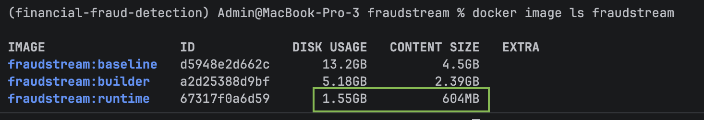
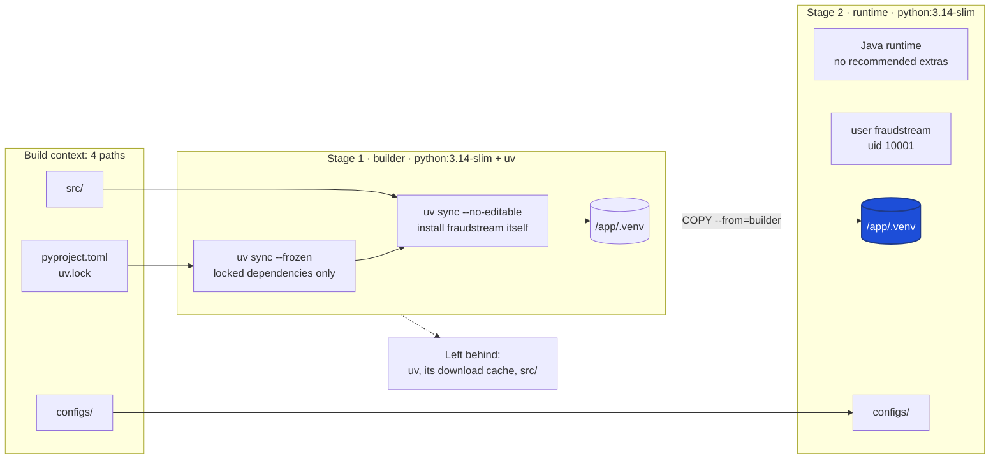

# Docker

The batch image holds the generators and Spark jobs as command-line tools:
Python, the `fraudstream` package with its locked dependencies, and the Java
runtime Spark needs. It's built from [`Dockerfile`](../../Dockerfile).

To show what that Dockerfile saves, [`Dockerfile.baseline`](../../Dockerfile.baseline)
builds the same image the straightforward way: the full Python image, one
stage, `COPY . .`, then `pip install`. Both images run the same commands. The
optimized one is **8.5× smaller on disk and 7.5× smaller to push or pull**.



| Image | Disk usage | Content size | Context sent to Docker | Runs as |
|---|---|---|---|---|
| `fraudstream:baseline` | 13.2 GB | 4.5 GB | 5.60 GB, in 116 s | root |
| `fraudstream:builder` (stage 1 only) | 5.18 GB | 2.39 GB | | root |
| `fraudstream:runtime` | **1.55 GB** | **604 MB** | about 1 MB | `fraudstream` (uid 10001) |

The two size columns measure different things:

- **Content size** is the compressed layers, which is what a registry stores
  and a cluster node downloads.
- **Disk usage** adds the unpacked copy Docker keeps to run containers. For the
  runtime image, that's 604 MB compressed plus about 950 MB unpacked, the sum
  of the layers below.

## How the image is built



The first stage has everything needed to install the package. The second
stage starts again from a clean slim image and takes only the finished
virtual environment from the first, plus the config files. The build tools and
caches stay in the first stage, and the final image never contains them.

## Where the size went

`docker history` lists every layer with its unpacked size. Lined up by what
each layer holds:

| What the layer holds | Baseline | Runtime | Saved | Why |
|---|---|---|---|---|
| Debian and Python | 1.10 GB | 164 MB | 940 MB | slim base image |
| Repository files | 5.86 GB (`COPY . .`) | 37 kB (`configs/`) | 5.86 GB | copy only what runs, and send only that to Docker |
| Python packages | 1.52 GB (`pip install`) | 566 MB (the venv) | 950 MB | built in a stage that's thrown away |
| Java runtime | 230 MB | 220 MB | 10 MB | no recommended packages, no package lists |
| **Unpacked total** | **8.7 GB** | **950 MB** | | |

The baseline's base-image layers are 155 + 51.6 + 200 + 592 + 20.2 + 83.5 MB;
the slim image's are 108 + 9.66 + 46.3 MB.

## Each optimization

### 1. A slim base image: saves 940 MB

Both stages start from `python:3.14-slim-bookworm`
([`Dockerfile:3`](../../Dockerfile#L3), [`Dockerfile:31`](../../Dockerfile#L31)).
The full `python:3.14-bookworm` image the baseline uses
([`Dockerfile.baseline:2`](../../Dockerfile.baseline#L2)) carries compilers,
header files and hundreds of Debian packages for building C extensions. Every
dependency here installs from a ready-built wheel, so none of that is needed.

Both stages use the *same* slim image on purpose. The virtual environment
points at `/usr/local/bin/python`, so it only works when copied onto an image
with Python at that exact path.

### 2. Two stages: the build tools never reach the final image

The first stage, `builder`, installs uv and the packages. The second stage,
`runtime`, starts from a fresh image ([`Dockerfile:31`](../../Dockerfile#L31))
and copies in only the finished virtual environment
([`Dockerfile:54`](../../Dockerfile#L54)).

Built on its own, the builder stage is **2.39 GB** compressed against the
runtime's **604 MB**. Everything in between stays behind in the first stage:

- the uv binary;
- uv's download cache, which keeps a second copy of every package, including
  the several hundred MB of PySpark;
- the source tree.

The baseline has no second stage, so pip's layer keeps the same kind of
leftovers: 1.52 GB, against 566 MB for the venv that's actually used.

Two settings make the venv safe to move between stages:

- **`--no-editable`** ([`Dockerfile:28`](../../Dockerfile#L28)) installs
  `fraudstream` into the venv as a normal package. An editable install would
  only point back at `/app/src`, which the runtime stage doesn't have.
- **`UV_LINK_MODE=copy`** ([`Dockerfile:9`](../../Dockerfile#L9)) makes uv
  copy files into the venv instead of linking them to its cache, so the venv
  doesn't depend on a cache that stays behind.

### 3. Send and copy only what runs: saves 5.86 GB

The baseline sends the whole repository to Docker and copies all of it in
([`Dockerfile.baseline:9`](../../Dockerfile.baseline#L9)). That includes MLflow
runs, Flink's jars and the virtual environments of other sub-projects, such
as `rag/.venv` and `serving/.venv`. Docker spent **116 seconds** receiving 5.60 GB before the build
even began, and 5.86 GB of it ended up in the image.

The optimized build fixes this in two places:

- **What reaches Docker.** [`Dockerfile.dockerignore`](../../Dockerfile.dockerignore)
  excludes everything (`*`, line 2), then lets back in just the four paths the
  image copies (lines 3–6). BuildKit uses a `<Dockerfile>.dockerignore` instead
  of the shared `.dockerignore` for that one Dockerfile.
  - The shared `.dockerignore` has to stay broad, because the Airflow and
    feature store images also build from the repository root and need other
    folders.
  - Those four paths come to about 1 MB. The log shows only 2.41 kB transferred
    because BuildKit sends just the files that changed since its previous
    build.
- **What enters the image.** The runtime copies only the venv and `configs/`
  ([`Dockerfile:54`](../../Dockerfile#L54),
  [`Dockerfile:55`](../../Dockerfile#L55)): 37 kB of repository files instead
  of 5.86 GB.

### 4. Locked dependencies, installed before the source

- **Locked versions.** `uv sync --frozen` installs exactly the versions in
  `uv.lock` and fails if the lock is out of date
  ([`Dockerfile:17`](../../Dockerfile#L17)). uv itself is pinned to 0.8.15
  ([`Dockerfile:6`](../../Dockerfile#L6)), and
  `UV_PYTHON_DOWNLOADS=never` ([`Dockerfile:10`](../../Dockerfile#L10)) keeps
  it on the image's own Python. The baseline's `pip install` picks whatever
  versions are newest on the day it builds, so two builds of the same commit
  can differ.
- **Dependencies first.** The packages are installed from just `pyproject.toml`
  and `uv.lock` ([`Dockerfile:16`](../../Dockerfile#L16)), with
  `--no-install-project` ([`Dockerfile:21`](../../Dockerfile#L21)). Only after
  that is `src/` copied in and the project installed on top
  ([`Dockerfile:23`](../../Dockerfile#L23)).

  Docker reuses a layer until something it depends on changes. A code change
  therefore reruns only the last, small install. The 566 MB of packages is
  rebuilt only when the lock file changes. In the baseline, `COPY . .` comes
  before `pip install`, so editing any file in the repository reinstalls
  everything.

### 5. Java without extras: saves 10 MB

`--no-install-recommends` skips the packages Debian only suggests alongside
Java, and `rm -rf /var/lib/apt/lists/*` deletes the package index in the same
layer ([`Dockerfile:35`](../../Dockerfile#L35)–[`37`](../../Dockerfile#L37)).
The index has to be deleted in the same `RUN`; deleting it in a later layer
would hide the files without making the image any smaller. The saving is
small here, 230 → 220 MB, because the headless Java runtime has few
recommended packages.

### 6. Bytecode compiled once, at build time

`UV_COMPILE_BYTECODE=1` ([`Dockerfile:8`](../../Dockerfile#L8)) compiles every
installed module to `.pyc` while the image is built. Every container then
starts without compiling them again. `PYTHONDONTWRITEBYTECODE=1`
([`Dockerfile:41`](../../Dockerfile#L41)) stops Python from trying to write
new `.pyc` files at run time, which the non-root user couldn't do anyway.

This makes containers start faster. It doesn't make the image smaller.

### 7. A non-root user

The image creates a `fraudstream` user with a fixed id, 10001, and no login
shell ([`Dockerfile:44`](../../Dockerfile#L44)). It hands `/app` to that user
([`Dockerfile:58`](../../Dockerfile#L58)) and switches to it
([`Dockerfile:61`](../../Dockerfile#L61)). A process that breaks out of the
container then lands as an unprivileged user, not as root. The fixed id makes
file ownership on mounted folders predictable.

## Both images work

Each image runs the same tool. Only the optimized one does it as a normal user:

```text
$ docker run --rm fraudstream:baseline sh -c 'id; java -version 2>&1 | head -1; fraudstream-generate-offline --help | head -2'
uid=0(root) gid=0(root) groups=0(root)
openjdk version "17.0.21" 2026-10-20
usage: fraudstream-generate-offline [-h] [--config CONFIG]
                                    [--output-dir OUTPUT_DIR]

$ docker run --rm fraudstream:runtime sh -c 'id; java -version 2>&1 | head -1; fraudstream-generate-offline --help | head -2'
uid=10001(fraudstream) gid=10001(fraudstream) groups=10001(fraudstream)
openjdk version "17.0.21" 2026-10-20
usage: fraudstream-generate-offline [-h] [--config CONFIG]
                                    [--output-dir OUTPUT_DIR]
```

## Measure it yourself

```bash
docker build --no-cache --progress=plain -f Dockerfile.baseline -t fraudstream:baseline . 2>&1 | tee /tmp/baseline-build.log
docker build --no-cache --progress=plain -t fraudstream:runtime . 2>&1 | tee /tmp/runtime-build.log
docker build --target builder -t fraudstream:builder .
grep "transferring context" /tmp/baseline-build.log /tmp/runtime-build.log
docker image ls fraudstream
docker history fraudstream:baseline
docker history fraudstream:runtime
```

## Where things are

| What | Where |
|---|---|
| Optimized Dockerfile | [`Dockerfile`](../../Dockerfile) |
| What its build sends to Docker | [`Dockerfile.dockerignore`](../../Dockerfile.dockerignore) |
| Baseline, for comparison | [`Dockerfile.baseline`](../../Dockerfile.baseline) |
| Locked dependencies | [`uv.lock`](../../uv.lock), [`pyproject.toml`](../../pyproject.toml) |
| Shared ignore file for the other images | [`.dockerignore`](../../.dockerignore) |
| Screenshot | [`images/docker/`](../../images/docker/) |
