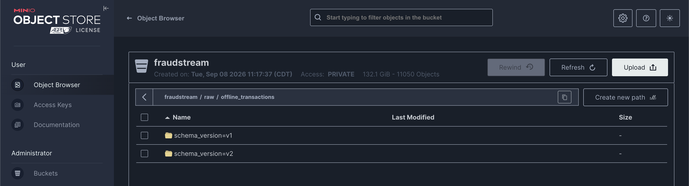
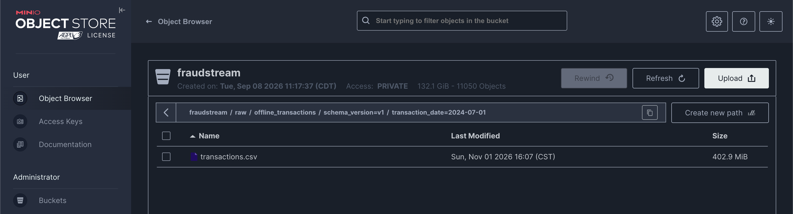
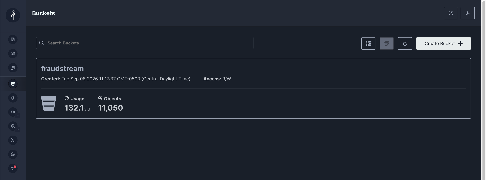
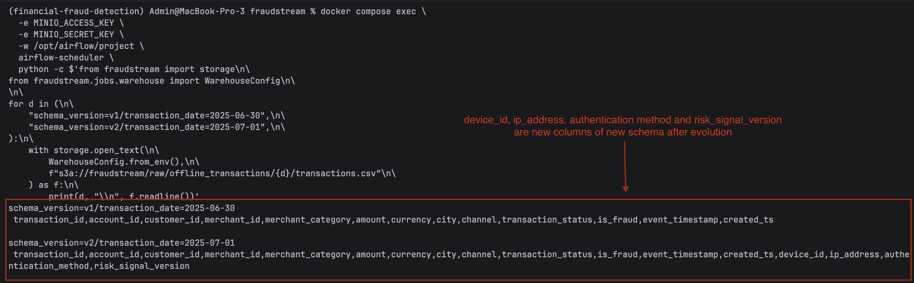
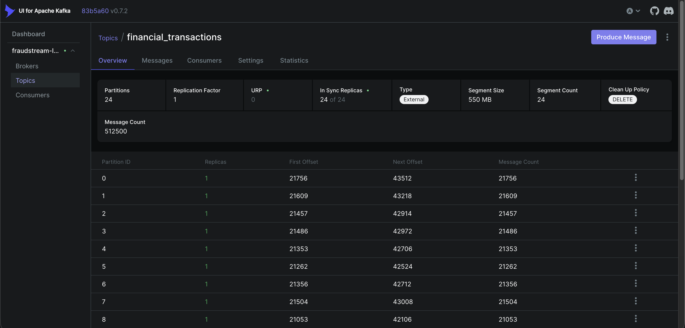
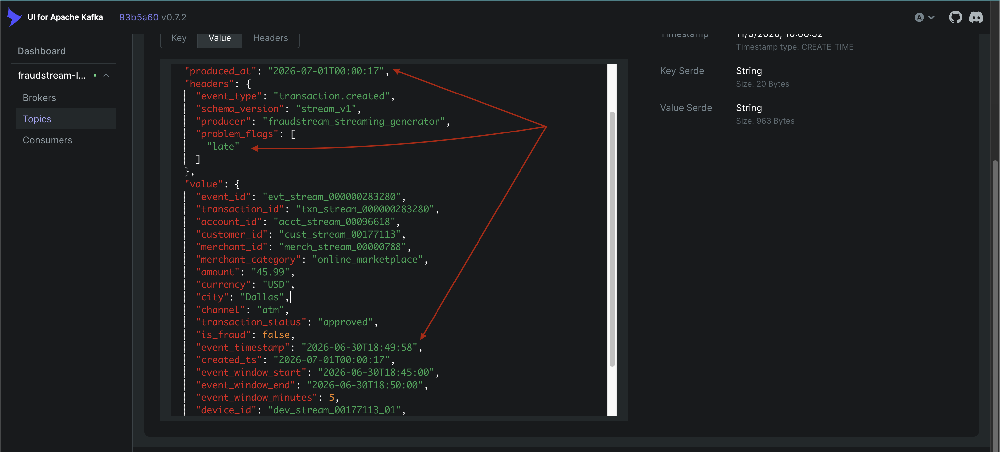
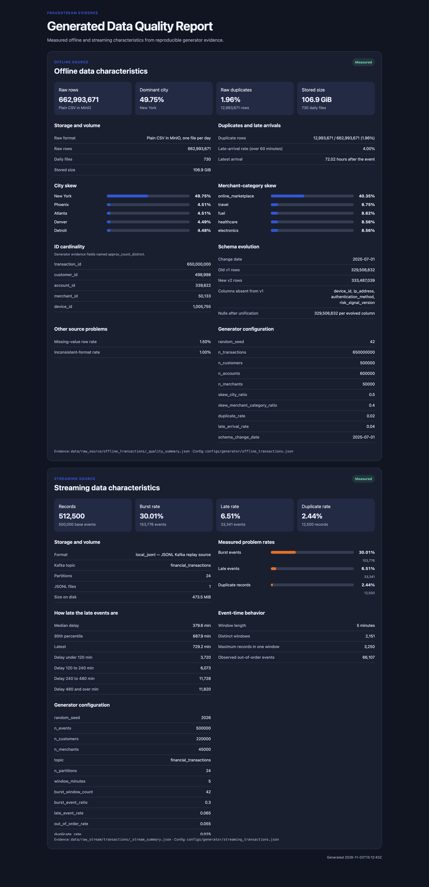

# Data Generator

The pipelines need data with real problems in it, so two generators make it on
purpose. The **offline** one writes two years of a bank's card payments as CSV
files in MinIO: 663 million rows, 115 GB. The **online** one writes a log of
payment events that a replay producer sends to Kafka, the way a payment service
would. Both are seeded, so every run produces the same data.

## What they simulate

| Problem | Offline (CSV in MinIO) | Online (events in Kafka) |
|---|---|---|
| Skew | Half the rows are in New York, 40% are `online_marketplace` | Bursts: 30% of events land in 42 five-minute windows |
| High cardinality | 650 million transaction ids, ~500,000 customers, ~1 million devices | 500,000 event ids, 220,000 customers |
| Schema evolution | Files from 2025-07-01 gain four columns | — |
| Duplicates | Each row repeated with probability 2% | 2.5% of events sent twice, up to 10 minutes apart |
| Late data | 4% of rows written over an hour after the payment | 6.5% of events arrive 46 minutes to 12 hours late |
| Out-of-order data | Rows shuffled within each daily file | 5.5% of events 6–45 minutes behind the stream |
| Messy fields | Blank ids and cities, padded or upper-case cities, lower-case currency, upper-case status | — |
| Fraud and drift | 1.55% fraud, fraud rings sharing devices; amounts drift up from 2026-05-01 | Fraud labels and fraud rings |

## Offline data

### How it's made

The generator builds one day at a time, 100,000 rows per chunk, and uploads each
finished day as one CSV, so memory stays flat however big the run. Six worker
processes build six days at once. Each day draws from its own random stream,
seeded by its date, so the data is identical whatever the worker count.

```bash
. infra/vault/env.sh   # MinIO credentials
PYTHONPATH=src uv run --extra storage python -m fraudstream.generators.offline_transactions --workers 6
```

In the platform it's the first task of the raw-to-Bronze pipeline,
`generate_raw_source`, inside the Airflow container.

The files go to MinIO, standing in for a store owned by another team: the
pipelines only read from it, pulling each day into Bronze.

```text
s3a://fraudstream/raw/offline_transactions/
  schema_version=v1/transaction_date=2024-07-01/transactions.csv   ... 365 days
  schema_version=v2/transaction_date=2025-07-01/transactions.csv   ... 365 days
s3a://fraudstream/raw/transaction_labels/
  transaction_date=YYYY-MM-DD/transaction_labels.csv               # transaction_id, is_fraud, event_timestamp
```

The two schema versions sit side by side under `raw/offline_transactions`:



Inside, one folder per day holds that day's file. 2024-07-01 is a burst day, so its
file is one of the largest, 402.9 MiB:



The fraud label also gets its own table, so the features never carry the answer,
and training joins it in by `transaction_id`.

Next to the data, the generator writes its evidence locally:
`_manifest.json` (every file it wrote), `_quality_summary.json` and `.csv` (what it
counted as it wrote). A Spark job then reads all the files once to count what the
generator can't hold in memory, distinct ids and the real columns of each schema,
and writes `_data_profile.json`:

```bash
docker compose exec -w /opt/airflow/project -e MINIO_ACCESS_KEY -e MINIO_SECRET_KEY \
  airflow-scheduler python -m fraudstream.jobs.profile_raw_transactions --master "local[8]"
```

### What the offline data looks like

All numbers below are measured from the files, from 2024-07-01 to 2026-06-30.

**Volume.**

| | |
|---|---:|
| Rows | 662,993,671 (650,000,000 + 12,993,671 duplicates) |
| Stored size | 114.8 GB (106.9 GiB), plain CSV |
| Files | 730, one per day |
| Labels | 650,000,000 rows, another 730 files |

The bucket shows 132.1 GiB in 11,050 objects: the transactions, the label files and
the lakehouse tables.



**Skew.**

| Column | Top value | Share | Next value |
|---|---|---:|---:|
| `city` | New York | 49.75% | Phoenix, 4.51% |
| `merchant_category` | `online_marketplace` | 40.35% | `travel`, 8.75% |

Time is skewed too: 60 burst days hold 24.74% of all rows, and the evening hours
17:00–19:59 carry 23% of a day's payments.

**Cardinality** (distinct values ÷ rows):

| Column | Distinct |   Ratio |
|---|---:|--------:|
| `transaction_id` | 650,000,000 |     98% |
| `device_id` (`v2` rows only) | 1,005,755 |    0.3% |
| `customer_id` | 498,998 |  0.075% |
| `account_id` | 339,622 |  0.051% |
| `merchant_id` | 50,133 | 0.0076% |

`transaction_id` is unique except for its duplicates; the others repeat many times
per value, which is what joins and group-bys have to cope with. Each customer draws
one account at random from 600,000, so about 340,000 accounts are used. The
transaction count is exact; the others are estimated within about 1%.

**Schema before and after evolution.**

| | `v1` (before) | `v2` (after) |
|---|---|---|
| Dates | 2024-07-01 to 2025-06-30 | 2025-07-01 to 2026-06-30 |
| Rows | 329,506,632 | 333,487,039 |
| Columns | 13 | 17 |

Both have `transaction_id`, `account_id`, `customer_id`, `merchant_id`,
`merchant_category`, `amount`, `currency`, `city`, `channel`,
`transaction_status`, `is_fraud`, `event_timestamp` and `created_ts`. `v2` adds
`device_id`, `ip_address`, `authentication_method` and `risk_signal_version`.

The header lines of the last `v1` day and the first `v2` day show the four new
columns arriving overnight:



**Duplicates.** 12,993,671 rows (1.96%) repeat an earlier `transaction_id`, in the
same daily file.

**Other problems.**

| Problem | Rows | Rate |
|---|---:|---:|
| Late: `created_ts` over 60 minutes after `event_timestamp`, at most 72 hours | 26,528,610 | 4.00% |
| A missing field | 9,940,790 | 1.50% |
| An odd format | 6,623,552 | 1.00% |
| Fraud | 10,275,362 | 1.55% |

From 2026-05-01, amounts ramp up to 1.6× by the end: the mean amount goes from
\$96.30 before to \$124.68 after, to give the drift detector something to find.

## Online data

### How it's made

The streaming generator writes a 7-day log of 500,000 payments, starting
2026-07-01, the day after the offline data ends. Each line is one Kafka message in
publish order:

```bash
PYTHONPATH=src uv run python -m fraudstream.generators.streaming_transactions
# data/raw_stream/transactions/topic=financial_transactions/events.jsonl, 477 MB
```

A replay producer then sends the log to the `financial_transactions` topic, keyed by
customer, across 24 partitions:

```bash
docker compose up -d kafka kafka-topic-init kafka-ui
PYTHONPATH=src uv run --extra kafka python -m fraudstream.producers.stream_replay \
  --bootstrap-servers localhost:9093 --topic financial_transactions --events-per-second 5000
```

`--time-mode produced_at --speed-factor 3600` replays the log's real gaps, one hour
per second.

After a replay, Kafka holds all 512,500 messages, about 21,500 per partition, in
550 MB of segments:



Each event has two times. `event_timestamp` is when the payment happened, and Flink
windows on it. `produced_at` is when it was published, and lateness is measured
against it. This one happened at 18:49 and arrived at 00:00, over five hours late:

```json
{
  "topic": "financial_transactions",
  "partition_key": "cust_stream_00177113",
  "produced_at": "2026-07-01T00:00:17",
  "headers": {"event_type": "transaction.created", "problem_flags": ["late"]},
  "value": {
    "event_id": "evt_stream_000000283280",
    "event_timestamp": "2026-06-30T18:49:58",
    "event_window_start": "2026-06-30T18:45:00",
    "amount": "45.99",
    "...": "..."
  }
}
```

The same message in Kafka UI, with `produced_at`, the `late` flag and
`event_timestamp`:



`problem_flags` is there for checking only; Flink decides lateness from its own
watermarks.

### What the online data looks like

**Volume.** 512,500 messages: 500,000 events plus 12,500 duplicates, 477 MB.

**Late events.** 33,341 events (6.51%) arrive more than 45 minutes after they
happened. Which ones is random: any event can be late. How late:

| Delay | Events |
|---|---:|
| Under 2 hours | 3,720 |
| 2–4 hours | 6,073 |
| 4–8 hours | 11,728 |
| 8 hours and over | 11,820 |

The median late event is 6.3 hours late (380 minutes), the 95th percentile 11.5
hours (688 minutes), and the latest 729 minutes: a duplicate of a 12-hour-late
event, resent 9 minutes later.

**Duplicates.** 12,500 messages (2.44%) repeat an `event_id` already sent, 1 second
to 10 minutes after the first.

**Out of order.** 26,323 events are generated 6–45 minutes behind the stream. With
the late events, 66,107 events have an event time more than one window behind the
newest seen so far.

**Bursts.** 153,776 events (30.01%) fall in 42 burst windows. The stream spans 2,151
five-minute windows, the busiest holding 3,250 events.

## The data-quality report

One HTML page shows both datasets' numbers, read from the evidence files; it doesn't
rescan the data:

```bash
PYTHONPATH=src uv run python -m fraudstream.reports.data_quality --dataset all --output reports/data_quality_report.html
```

[](../../images/generator/07_data_quality_report.png)

## Test it

```bash
PYTHONPATH=src uv run --extra spark --extra storage --extra kafka python -m unittest \
  tests.unit.test_offline_transactions tests.unit.test_profile_raw_transactions \
  tests.unit.test_streaming_transactions tests.unit.test_stream_replay tests.unit.test_data_quality_report
```

## Where things are

| What | Where |
|---|---|
| Offline generator | [`src/fraudstream/generators/offline_transactions.py`](../../src/fraudstream/generators/offline_transactions.py) |
| Its settings | [`configs/generator/offline_transactions.json`](../../configs/generator/offline_transactions.json) |
| Spark profile of the raw files | [`src/fraudstream/jobs/profile_raw_transactions.py`](../../src/fraudstream/jobs/profile_raw_transactions.py) |
| Reading and writing MinIO | [`src/fraudstream/storage.py`](../../src/fraudstream/storage.py) |
| Online generator | [`src/fraudstream/generators/streaming_transactions.py`](../../src/fraudstream/generators/streaming_transactions.py) |
| Its settings | [`configs/generator/streaming_transactions.json`](../../configs/generator/streaming_transactions.json) |
| Replay to Kafka | [`src/fraudstream/producers/stream_replay.py`](../../src/fraudstream/producers/stream_replay.py) |
| Data-quality report | [`src/fraudstream/reports/data_quality.py`](../../src/fraudstream/reports/data_quality.py) |
| Offline evidence | [`data/raw_source/offline_transactions/`](../../data/raw_source/offline_transactions/) |
| Online evidence | [`data/raw_stream/transactions/`](../../data/raw_stream/transactions/) |
| Tests | [`tests/unit/test_offline_transactions.py`](../../tests/unit/test_offline_transactions.py), [`test_profile_raw_transactions.py`](../../tests/unit/test_profile_raw_transactions.py), [`test_streaming_transactions.py`](../../tests/unit/test_streaming_transactions.py), [`test_stream_replay.py`](../../tests/unit/test_stream_replay.py), [`test_data_quality_report.py`](../../tests/unit/test_data_quality_report.py) |
| Screenshots | [`images/generator/`](../../images/generator/) |
