# Processing Jobs

Two engines clean the data the generators made. **Spark** works through the
offline CSVs in batches, Bronze to Silver to Gold, and Airflow runs each step.
**Flink** reads the payment events from Kafka as they arrive and turns them
into five-minute features. Each problem the generators planted, such as skew,
schema change, duplicates and late events, is handled in code, and each fix
is measured against a run without it.

## How the jobs fit together

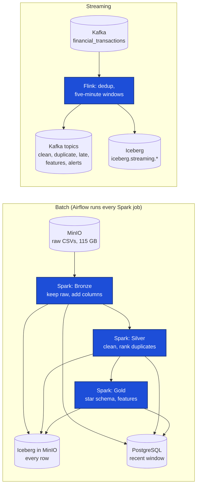

| Airflow DAG · task | Job | Reads | Writes to Iceberg | Copy in PostgreSQL |
|---|---|---|---|---|
| `fraudstream_raw_to_bronze` · `ingest_bronze` | `jobs.bronze.ingest_transactions` | CSVs in MinIO | `bronze.raw_transactions` | newest 1 day |
| `fraudstream_bronze_to_silver_gold` · `build_silver` | `jobs.silver.transactions` | Bronze | `silver.stg_transactions`, `silver.stg_transaction_quality_issues` | newest 1 day |
| `fraudstream_bronze_to_silver_gold` · `build_core_gold` | `jobs.gold.transactions` | Silver | `gold.dim_*`, `gold.fact_*` | facts: newest 7 days; dimensions: all |
| `fraudstream_offline_features` · `build_offline_features` | `jobs.gold.offline_features` | Gold facts | `gold.feat_customer_rolling`, `feat_customer_total_orders_90d`, `feat_merchant_risk_rolling` | newest 7 days |
| `fraudstream_offline_features` · `build_transaction_labels` | `jobs.gold.transaction_labels` | label CSVs | `gold.transaction_labels` | newest 7 days |

Iceberg keeps all 650 million rows. PostgreSQL only serves the dashboards and
the API, so each job copies just a recent window into it
([`warehouse.py:299`](../../src/fraudstream/jobs/warehouse.py#L299)). This keeps
the database small and the copy quick. The window sizes are Airflow Variables
(`fraudstream_postgres_days_*`), so all three DAGs share them.

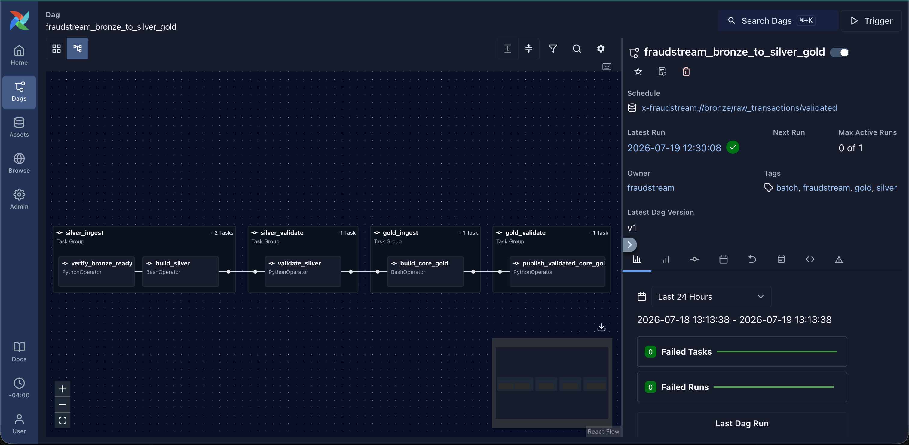

Each Spark task is a `BashOperator` built by
[`spark_job_command`](../../airflow/include/fraudstream_airflow/dag_helpers.py#L83),
for example [`build_silver`](../../airflow/dags/bronze_to_silver_gold.py#L43).
Its log in Airflow is the job's own output, ending with the summary of rows read
and written.

## Spark

### How to read Spark UI

1. **Stages** tab: find the stage with the largest **Shuffle Read**. Spark has
   to move data between tasks there, for a sort, a group or a join, and that's
   where problems show.
2. Open the stage and compare **Median** and **Max** in *Summary Metrics*. If
   the max task is far above the median, the data is skewed. Any **Spill** means
   tasks ran out of memory and wrote to disk.
3. **Event Timeline** shows each task as a bar. A few long bars next to many
   short ones is skew; even bars mean the work was evenly split.
4. **SQL / DataFrame** shows how long each query took from start to end.

### Baseline: the Silver job without tuning

Silver ranks every row by `transaction_id`, so it can keep one row per payment.
That ranking needs a shuffle and a sort of all 663 million Bronze rows. The
baseline uses Spark's defaults: 200 shuffle partitions and adaptive execution
(AQE) off.

```bash
docker compose exec airflow-scheduler python -m fraudstream.jobs.silver.transactions \
  --spark-conf spark.sql.adaptive.enabled=false --spark-conf spark.sql.shuffle.partitions=200
```

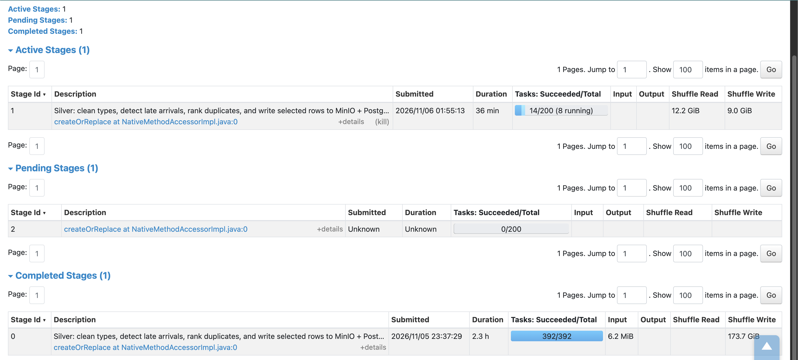

**What to look at:** the read stage (0) took 2.3 h and wrote 173.7 GiB of
shuffle data. The sort stage (1) then finished only 14 of its 200 tasks in 36
minutes. With 200 partitions, each task holds about 0.93 GB of shuffle input:
more than its memory, so it spills. An earlier run with the same settings
recorded the per-task cost: a median of **665 s**, **8.02 GB** spilled from
memory and **1.84 GB** written to disk, *per task*. It stopped at 409 of 777
tasks when the Mac ran out of disk.

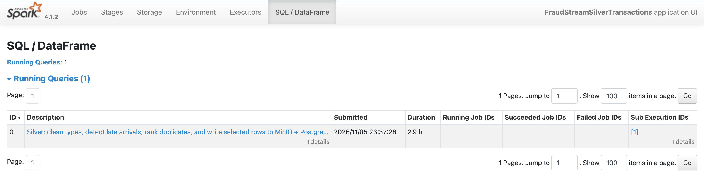
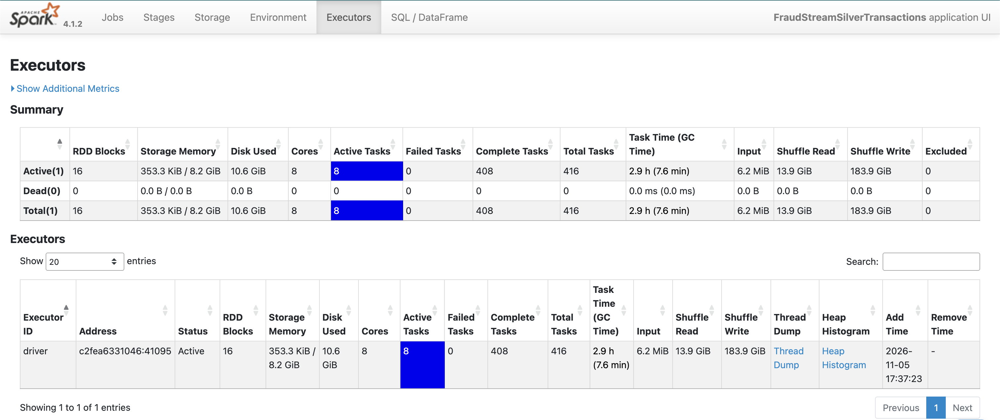

At 665 s per task and 8 tasks at a time, the sort stage alone would take about
**4.6 h**, so the baseline was stopped before it finished.

### Tuned: smaller partitions and adaptive execution

The code doesn't change. Only the settings do, passed with the repeatable
`--spark-conf` flag ([`spark_settings.py:33`](../../src/fraudstream/jobs/spark_settings.py#L33)):

| Setting | Baseline | Tuned | Why |
|---|---|---|---|
| `spark.sql.shuffle.partitions` | 200 | 800 | about 113 MiB per task instead of 0.93 GB, so far less spill |
| `spark.sql.adaptive.enabled` | false | true | Spark resizes partitions using the real sizes it saw |
| `spark.sql.adaptive.advisoryPartitionSizeInBytes` | — | 128m | the size AQE aims for |
| `spark.sql.adaptive.skewJoin.enabled` | — | true | Spark's default once AQE is on; splits a skewed join partition (see Skew) |

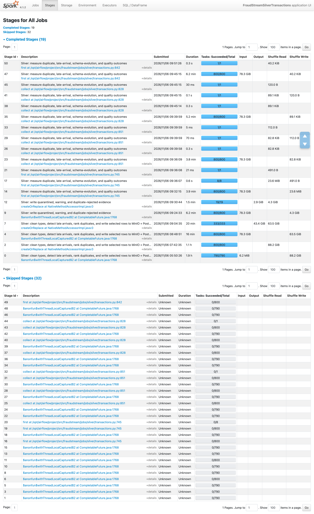
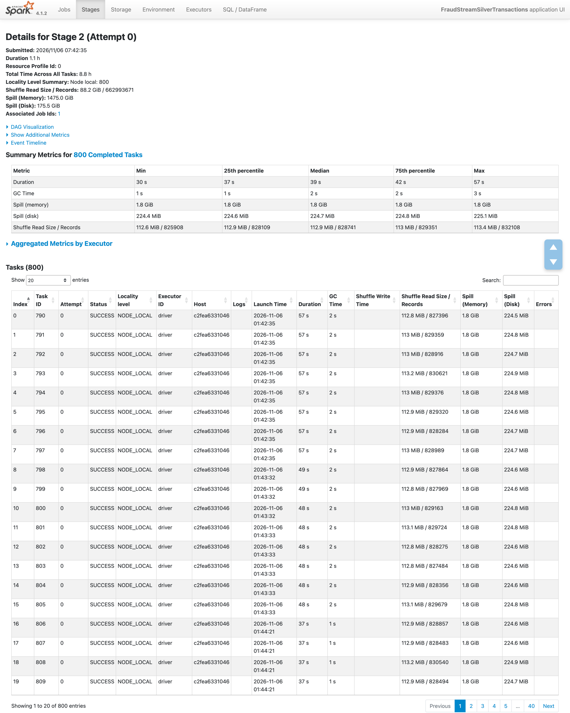

**What to look at:** in the *Summary Metrics* table, tasks run 30–57 s and all
800 are close to the median, so the work is even. Each task spills 1.8 GiB from
memory and 225 MiB to disk, against 8 GB and 1.8 GB in the baseline.

| Sort stage, per task | Baseline (200 partitions) | Tuned (800, AQE) |
|---|---|---|
| Median time | 665 s | **39 s** (17× faster) |
| Spill from memory | 8.02 GB | 1.8 GiB |
| Spill to disk | 1.84 GB | 225 MiB |
| Whole stage | ~4.6 h (estimated, stopped) | **1.1 h** |
| Whole Silver write | stopped after 2.9 h | **3.6 h**, finished |

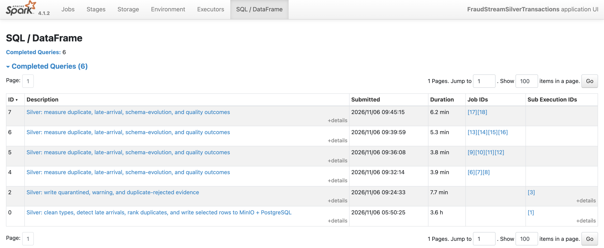
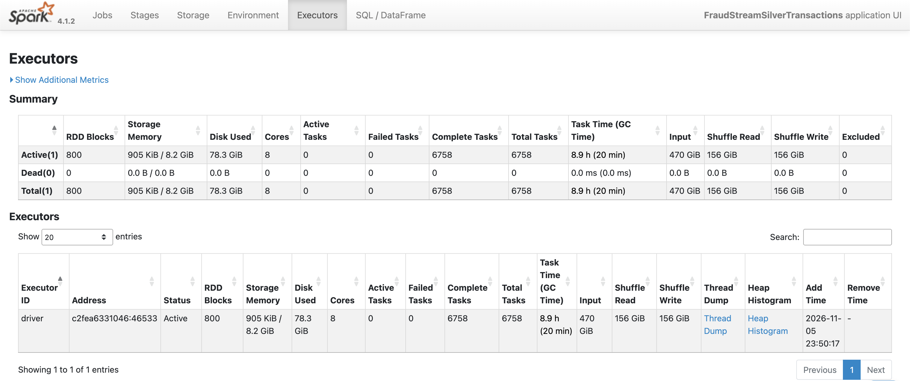

### Skew

The data has two hot values. **Half** the rows are in New York, and 40% are
`online_marketplace`. Joining transactions to `dim_city` and
`dim_merchant_category` sends every New York row to the same task. The
benchmark ([`skew_benchmark.py`](../../src/fraudstream/jobs/gold/skew_benchmark.py))
runs this join four ways over all 650 million Silver rows, and only the skew
handling changes between runs ([`strategy_conf`, line 56](../../src/fraudstream/jobs/gold/skew_benchmark.py#L56)):

| Strategy | What it does | Join stage: tasks | Median task | Max task | Rows in the biggest task | Stage time |
|---|---|---|---|---|---|---|
| Baseline | plain shuffle join, AQE and broadcast off | 200 | 18 ms | **1.0 h** | 325 million | 1.3 h (run 2 h 21 m) |
| Adaptive | AQE splits partitions it sees are too big | 944 | 6 s | **28 s** | 995,429 | 14 min (run ~40 min) |
| Salted | random salt 0–15 spreads each key over 16 tasks ([line 74](../../src/fraudstream/jobs/gold/skew_benchmark.py#L74)) | 200 | 57 s | 37 min | 42.5 million | 57 min |
| Broadcast | copies the small dimension to every task, so nothing is shuffled | 404 | 7 s | **14 s** | 2.0 million | **6.4 min** |

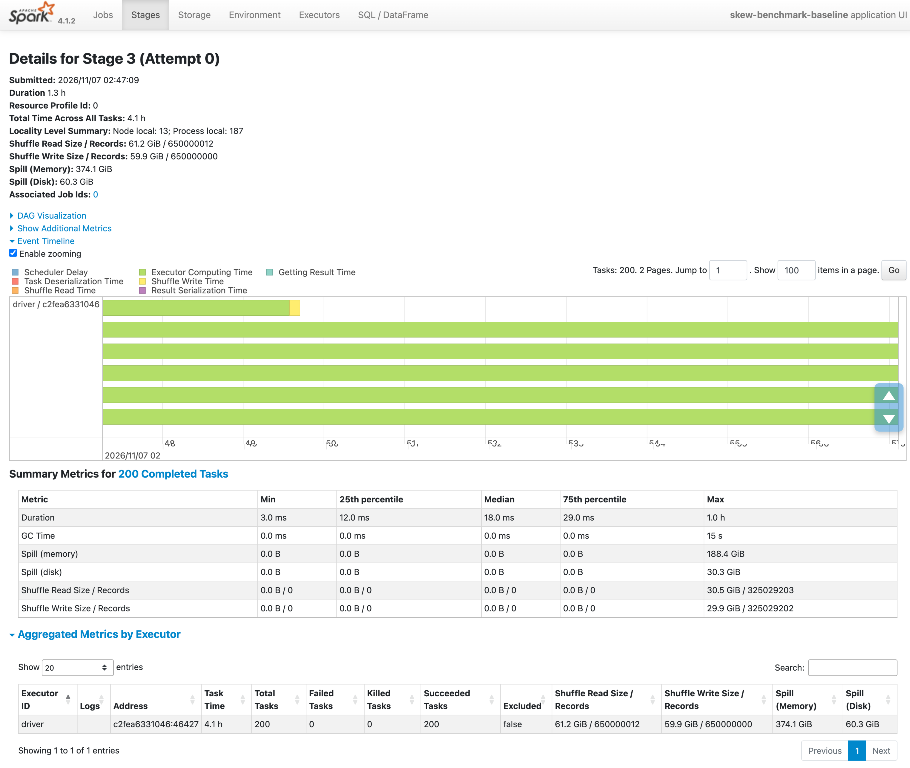

**What to look at:** in the *Event Timeline* (zoomed in), a few bars run for
the whole hour while the rest are too short to see. The join is keyed by city,
and there are only a few dozen cities, so most of the 200 tasks get no rows at
all: the median task read 0 rows in 18 ms. The biggest task read
**325,029,203 rows**, every New York row, and ran for **1.0 h**. It also
spilled 188.4 GiB from memory and 30.3 GiB to disk on its own, so the stage
takes as long as that one task.

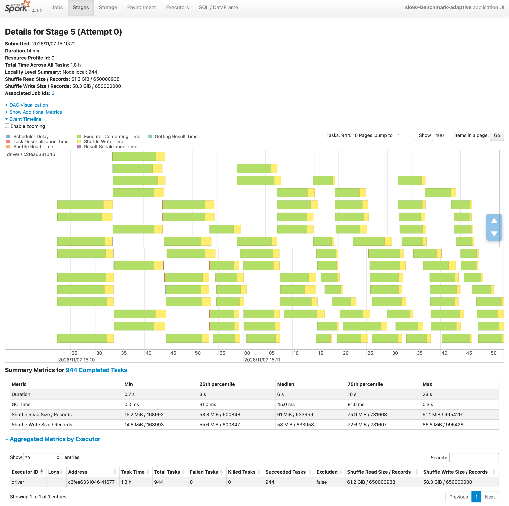

**What to look at:** AQE turned 200 partitions into 944, because it split the
skewed ones. On the timeline every bar is short and about the same length.

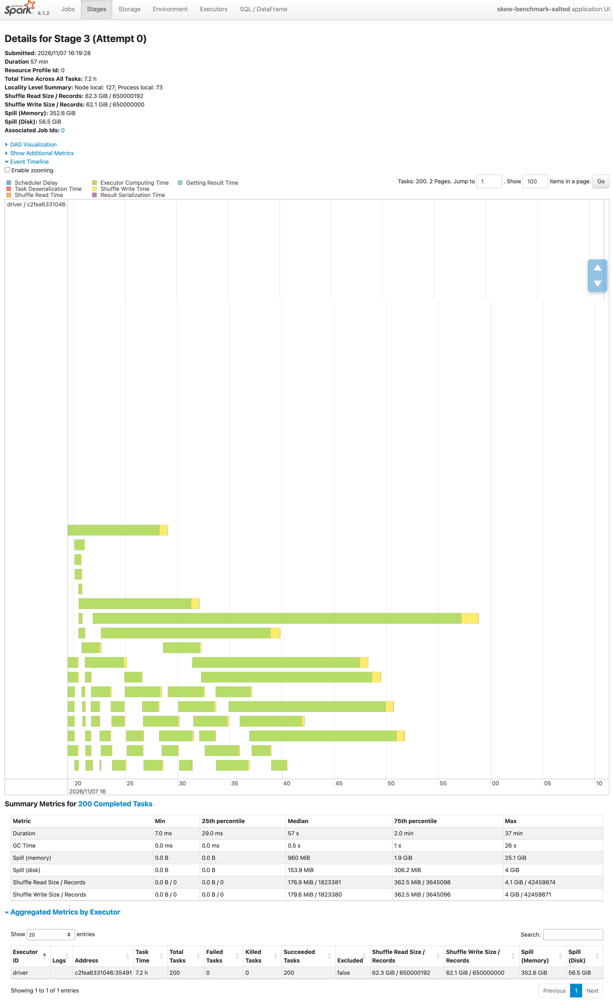

**What to look at:** salting helps, but the timeline still has a few very long
bars. Sixteen salt values split New York's 325 million rows into pieces of
about 20 million each, which is still far bigger than an average task.

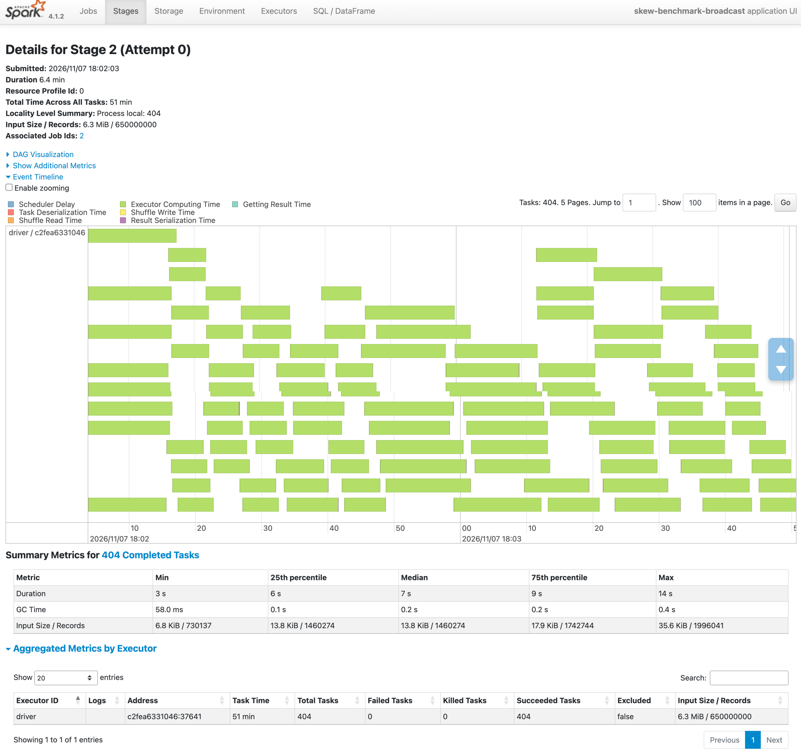

**Which one ships, and why.** The pipeline runs with AQE on, skew join on, and
the default broadcast threshold. The dimensions are small, so Spark broadcasts
them on its own, which is the fastest case here. Where the other side is too
big to broadcast, AQE splits the hot partitions instead, as in the adaptive
run. Salting isn't used: it needs extra join code, it copies the dimension 16
times, and it still left a 37-minute task.

### Schema evolution

From 2025-07-01 the source files have four extra columns: `device_id`,
`ip_address`, `authentication_method` and `risk_signal_version`. Bronze was
first loaded with the year-one (v1) files only. The year-two (v2) files were
then appended. Before writing, the job compares the incoming columns with the
table's
([`evolve_table_schema`, `ingest_transactions.py:401`](../../src/fraudstream/jobs/bronze/ingest_transactions.py#L401)):

- **A new column** is added with `ALTER TABLE … ADD COLUMNS`. Iceberg only
  changes the table's metadata, so no old file is rewritten.
- **A column whose type changed** stops the job before anything is written, so
  a bad file can't corrupt the table.
- **A column that's missing** is never dropped. Old rows simply read it as
  null.

Silver adds the same four columns as nulls when Bronze doesn't have them yet
([`silver/transactions.py:660`](../../src/fraudstream/jobs/silver/transactions.py#L660)).
It also only checks v2 rows for the v2 fields
([line 509](../../src/fraudstream/jobs/silver/transactions.py#L509)), so v1
rows aren't flagged for columns they never had.

| Before: 27 columns, v1 only | After: 31 columns |
|---|---|
| 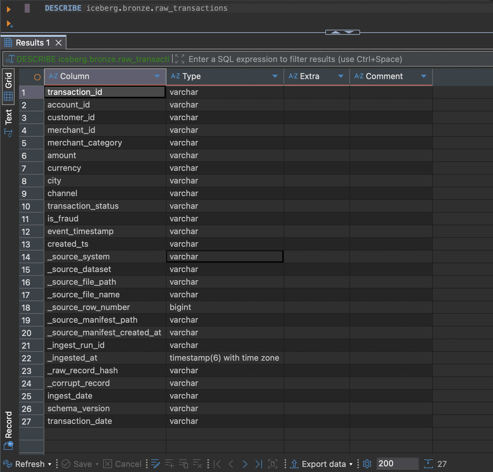 | 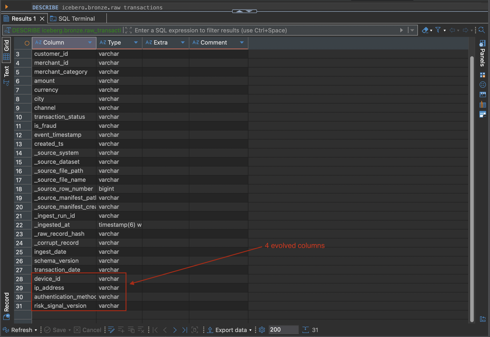 |

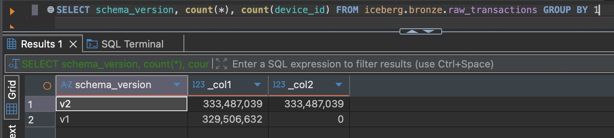

**What to look at:** 333,487,039 v2 rows, every one with a `device_id`.
329,506,632 v1 rows, none with one, and none of them rewritten.

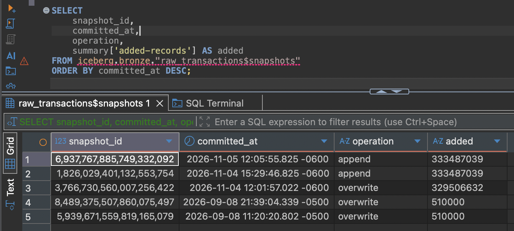

The snapshot history shows the v1 load (`overwrite`, 329,506,632 rows) and the
v2 appends that followed (`append`, 333,487,039 rows). Each one is a version of
the table you can still query.

### Duplicates

About 2% of the source rows are written twice. Silver keeps exactly one row per
`transaction_id`
([`_rank_transactions_for_deduplication`, `silver/transactions.py:554`](../../src/fraudstream/jobs/silver/transactions.py#L554)).
It ranks the copies inside each id with these rules, in order:

1. a clean row beats a quarantined one;
2. a row whose core fields parse beats one whose don't;
3. the newest `source_created_at`, then `_ingested_at`, wins;
4. the source row number, the row's hash and its file path break any tie left,
   so every run picks the same row.

Rank 1 goes to `silver.stg_transactions`. The other copies aren't thrown away:
they go to `silver.stg_transaction_quality_issues` with
`_silver_record_action = 'duplicate_rejected'`
([line 633](../../src/fraudstream/jobs/silver/transactions.py#L633)), so you can
always see what was dropped and why.

| Bronze: 662,993,671 rows | Silver: 650,000,000 rows |
|---|---|
| 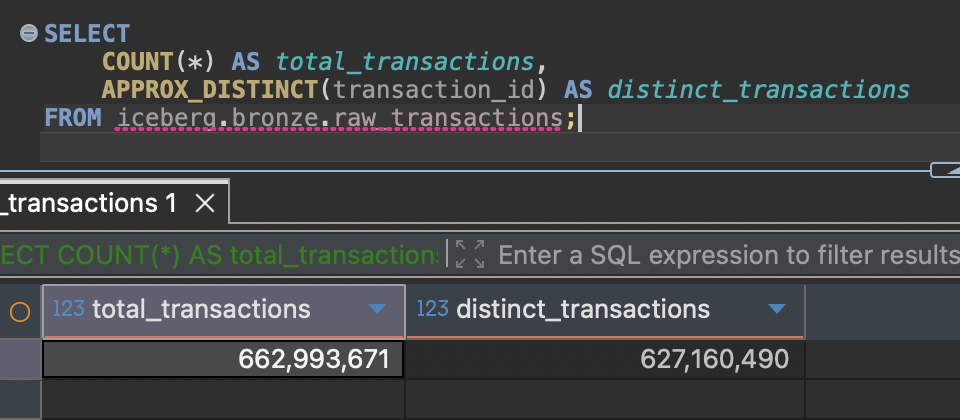 | 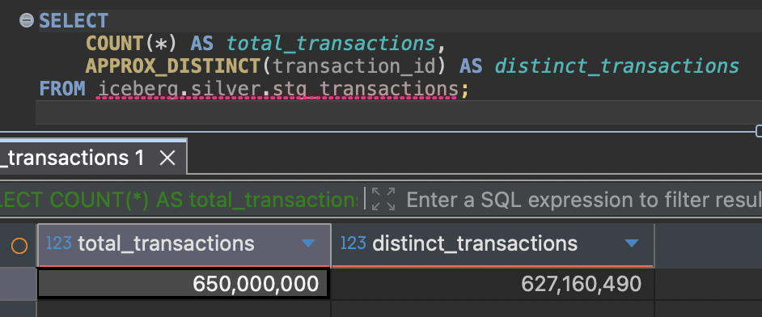 |

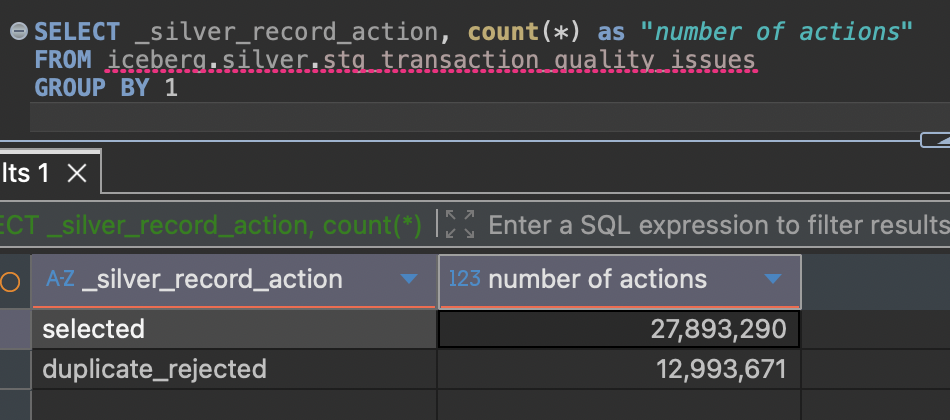

**What to look at:** 662,993,671 − 12,993,671 = **650,000,000**, so every
duplicate was removed (a duplicate rate of 1.96%). `APPROX_DISTINCT` is
Trino's estimate, accurate to about 2%, which is why it shows 627 million on
both tables. The exact count is the 650,000,000 rows in Silver, all with
distinct ids.

### Gold, features and labels

Each job ends by writing a JSON summary of what it built. Below are the three
summaries from the tuned runs. The repeated Spark event-log settings are left
out, and each table is on one line.

**Gold** (`jobs.gold.transactions --core-only --from-date 2026-03-03`, 2 h 37 m).
It builds the star schema from the newest 120 days of Silver
([`transactions.py:546`](../../src/fraudstream/jobs/gold/transactions.py#L546)):

```json
{
  "silver_table": "iceberg.silver.stg_transactions",
  "build_scope": "core",
  "from_date": "2026-03-03",
  "spark_conf": {"spark.sql.adaptive.enabled": "true", "spark.sql.shuffle.partitions": "800",
                 "spark.sql.adaptive.advisoryPartitionSizeInBytes": "128m"},
  "processed_at": "2026-11-06T23:37:21Z",
  "completed_at": "2026-11-07T02:14:15Z",
  "fact_transaction_count": 111016430,
  "tables": [
    {"table_name": "dim_date",                       "row_count": 120,       "postgres_rows": 120},
    {"table_name": "dim_city",                       "row_count": 12,        "postgres_rows": 12},
    {"table_name": "dim_channel",                    "row_count": 4,         "postgres_rows": 4},
    {"table_name": "dim_quality_issue",              "row_count": 13,        "postgres_rows": 13},
    {"table_name": "dim_merchant_category",          "row_count": 8,         "postgres_rows": 8},
    {"table_name": "dim_customer",                   "row_count": 500000,    "postgres_rows": 500000},
    {"table_name": "dim_account",                    "row_count": 339325,    "postgres_rows": 339325},
    {"table_name": "dim_merchant",                   "row_count": 50001,     "postgres_rows": 50001},
    {"table_name": "fact_transactions",              "row_count": 111016430, "postgres_rows": 7060952},
    {"table_name": "fact_transaction_quality_issue", "row_count": 5108913,   "postgres_rows": 324224},
    {"table_name": "fact_customer_daily",            "row_count": 47433594,  "postgres_rows": 2800932},
    {"table_name": "fact_account_daily",             "row_count": 34688929,  "postgres_rows": 2040099},
    {"table_name": "fact_merchant_daily",            "row_count": 6000119,   "postgres_rows": 350007},
    {"table_name": "fact_city_category_daily",       "row_count": 11520,     "postgres_rows": 672},
    {"table_name": "fact_device_ip_daily",           "row_count": 171862823, "postgres_rows": 10671914}
  ]
}
```

**What to look at:**

- `dim_date` has 120 rows, one for each day from `from_date`.
- The dimensions go to PostgreSQL whole: `row_count` equals `postgres_rows`.
- The facts keep only their newest 7 days in PostgreSQL. For example,
  `fact_transactions` has 111,016,430 rows in Iceberg and 7,060,952 in
  PostgreSQL.

**Offline features** (`jobs.gold.offline_features`, 15 min):

```json
{
  "processed_at": "2026-11-07T18:52:50Z",
  "completed_at": "2026-11-07T19:07:58Z",
  "source_fact_transaction_count": 111016430,
  "tables": [
    {"table_name": "feat_customer_rolling",          "row_count": 47433594, "postgres_rows": 2800932},
    {"table_name": "feat_customer_total_orders_90d", "row_count": 47433594, "postgres_rows": 2800932},
    {"table_name": "feat_merchant_risk_rolling",     "row_count": 5999999,  "postgres_rows": 350000}
  ]
}
```

**What to look at:**

- The features read the same 111,016,430 Gold facts.
- Each customer feature table has one row per customer per day, the same
  47,433,594 rows as `fact_customer_daily`.

**Labels** (`jobs.gold.transaction_labels`, 10 min):

```json
{
  "labels_uri": "s3a://fraudstream/raw/transaction_labels",
  "iceberg_table": "iceberg.gold.transaction_labels",
  "row_count": 650000000,
  "distinct_transaction_id_count": 650000000,
  "fraud_row_count": 10073566,
  "postgres_rows": 7060952,
  "processed_at": "2026-11-07T19:11:45Z",
  "completed_at": "2026-11-07T19:21:55Z"
}
```

**What to look at:**

- There is exactly one label per payment: 650,000,000 rows, all with distinct
  ids.
- 1.55% of the payments are fraud.
- PostgreSQL keeps 7,060,952 labels, the same count as the 7 days of
  `fact_transactions` there.

### How the tuned settings reach Airflow

The Airflow Variable `fraudstream_spark_conf`
([`variables.json:16`](../../airflow/config/variables.json#L16)) holds the tuned
settings as JSON:

```json
{"spark.sql.adaptive.enabled": "true", "spark.sql.adaptive.skewJoin.enabled": "true",
 "spark.sql.shuffle.partitions": "800", "spark.sql.adaptive.advisoryPartitionSizeInBytes": "128m"}
```

[`spark_job_command`](../../airflow/include/fraudstream_airflow/dag_helpers.py#L76)
turns each entry into a `--spark-conf` flag when the task runs. The
`spark_conf` in the Gold summary above shows them arriving (those runs came
before `skewJoin.enabled` was added to the Variable; it is Spark's default
once AQE is on anyway). Every Spark task
in every DAG gets the same settings. Changing them is one Variable edit, with no
code change and no new deploy.

## Flink

The replayed log holds 512,500 messages in `financial_transactions`: 500,000
payments, plus 12,500 sent twice.

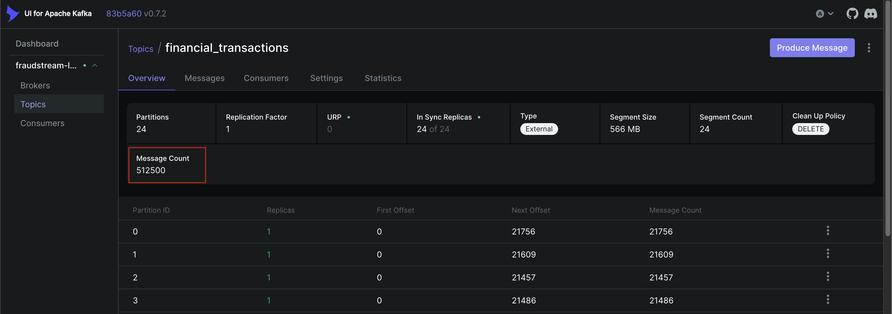

The job ([`build_streaming_feature_topology`, `runtime.py:245`](../../src/fraudstream/jobs/flink/runtime.py#L245))
runs in this order:

1. read Kafka;
2. stamp each event with its own time and the watermark;
3. check its fields;
4. drop duplicates by event id;
5. count each customer's and each merchant's payments in five-minute windows;
6. write the features and alerts.

Each event type has its own Kafka topic: clean, duplicate, invalid, late,
customer and merchant features, and alerts. With the Iceberg sink on, the clean
rows and features also go to `iceberg.streaming.*`.

### How to read Flink UI

- The **job graph** shows one box per task. **Backpressured** means the box is
  waiting on the box after it. **Busy** means it's working. A red box is busy
  near 100%: that's the bottleneck.
- Click a box. **Detail** shows Records Received and Records Sent. Records Sent
  counts records sent to the next boxes *and* records written to Kafka by sinks
  chained inside the box.
- **Watermarks** shows how far event time has reached in each subtask. A window
  closes once the watermark passes its end.
- **Metrics** charts any number over time. The Kafka source's `pendingRecords`
  tells you whether the job keeps up.

### Baseline: throughput

With parallelism 1 and operator chaining off
([`benchmark profiles`, `transactions.py:200`](../../src/fraudstream/jobs/flink/transactions.py#L200)),
every operator is its own task. This was measured earlier, on a copy of the same
stream.

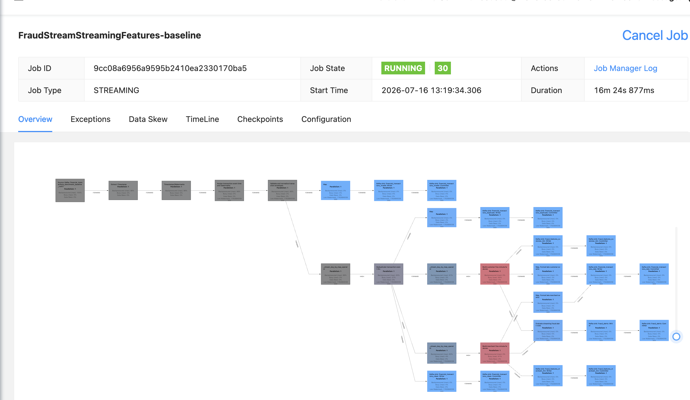
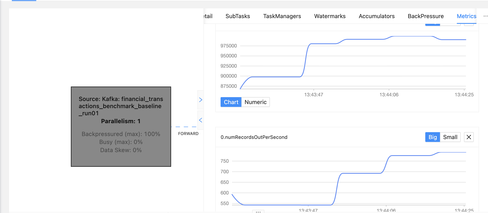
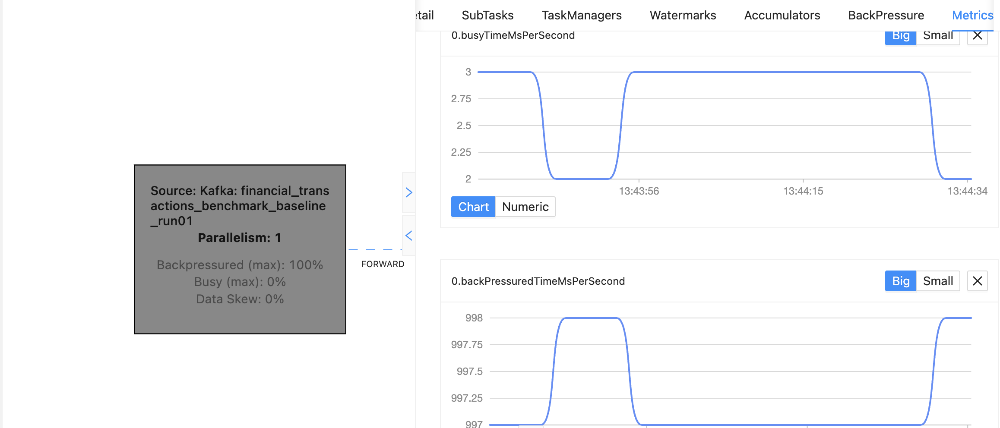

**What to look at:** the source does work for only 2–3 ms of each second. The
rest of the time it waits on the single-threaded chain after it. Pending records
climb from about 580,000 to almost 1 million, so the job falls further behind.

**The fix:** chaining on and parallelism 4, which are now the defaults
([`transactions.py:84`](../../src/fraudstream/jobs/flink/transactions.py#L84)).
Chaining merges operators that pass records one-to-one into one task, so a
record isn't serialized again for every operator. Parallelism runs four copies
of each chain.

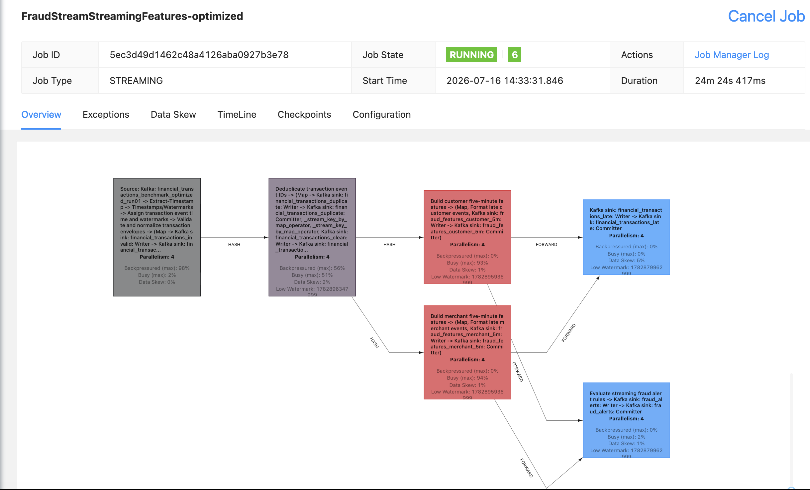
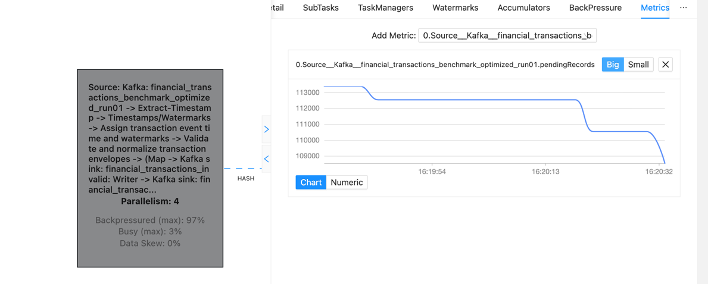

| | Baseline | Tuned |
|---|---|---|
| Boxes in the job graph | 30 | 6 (80% fewer) |
| Parallelism | 1 | 4 |
| Kafka backlog | grows, 580,000 → ~990,000 | drains, 113,400 → 108,500 in 38 s |
| Busiest box | source blocked 998 ms/s | window boxes 92–95% busy |

The window boxes are now the limit (they're red), and that's the work this job
exists to do.

### Late arrivals

A window can only close once Flink believes no more of its events will arrive.
The **watermark** expresses that belief: "newest event time seen, minus a
delay". An event whose window has already closed, plus an allowed lateness, is
**too late**. It goes to the late topic `financial_transactions_late` instead of
being lost
([`side_output_late_data`, `runtime.py:448`](../../src/fraudstream/jobs/flink/runtime.py#L448)).

Two runs used the same job and the same 512,500 messages. Only the watermark
changed:

| | Baseline (no tolerance) | Measured |
|---|---|---|
| Watermark delay | 1 s ([`no_tolerance_latency_profile.json`](../../configs/flink/no_tolerance_latency_profile.json)) | **11,900 s**: the 95th percentile of how late events really arrive ([`streaming_latency_profile.json`](../../configs/flink/streaming_latency_profile.json)) |
| Allowed lateness | 0 | 40 min |
| Writes to Iceberg | no (its Kafka topics end in `_baseline`) | yes |

The delay is measured, not guessed.
[`measure_watermark_latency`](../../src/fraudstream/jobs/flink/watermark_calibration.py#L134)
reads the log and takes, for each event, the arrival time minus the event time:
50% arrive within 68 s, 95% within 11,900 s, and 99% within 37,032 s.

**Baseline.**

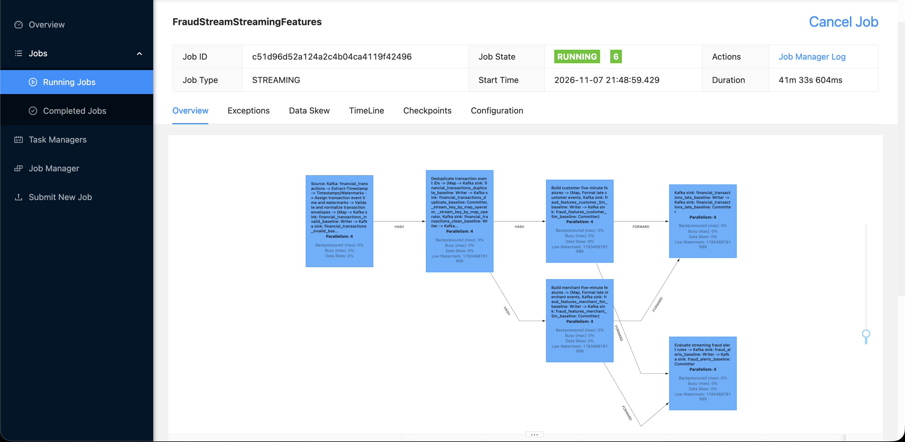

Both window boxes received all 500,000 deduplicated events:

| Customer window | Merchant window |
|---|---|
| 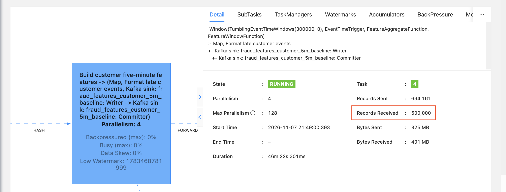 | 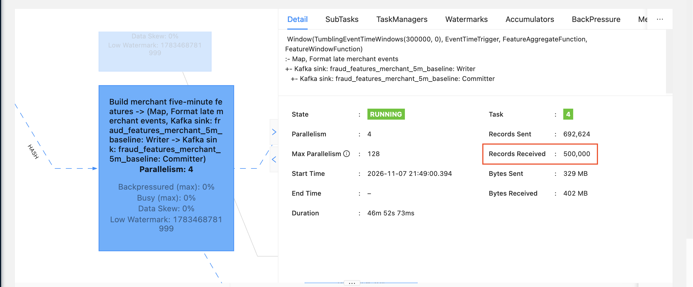 |

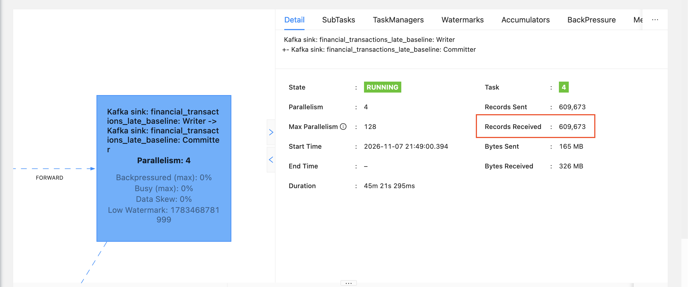

Each event goes into two windows, one per customer and one per merchant, so at
most 1,000,000 records can be late. In the baseline **609,673 (61%)** were too
late. Half the events arrive more than 68 s after they happen, and a 1 s
watermark gives them no room.

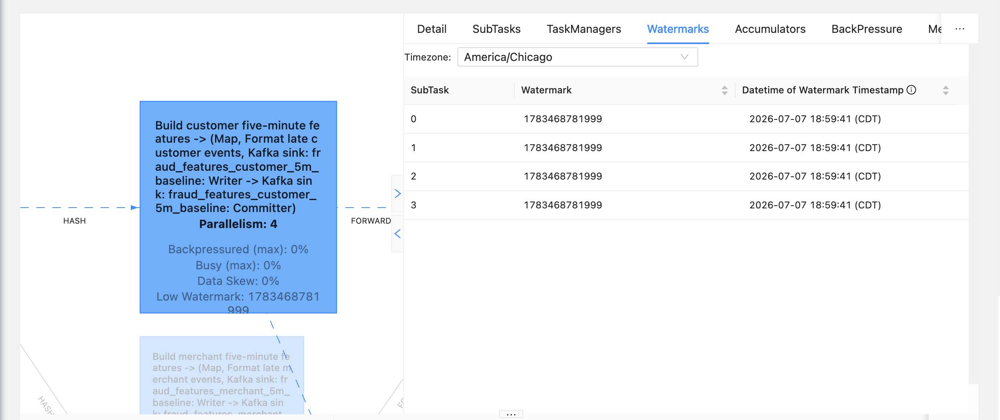

**Measured.**

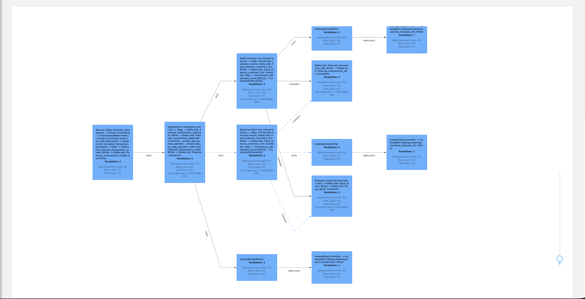
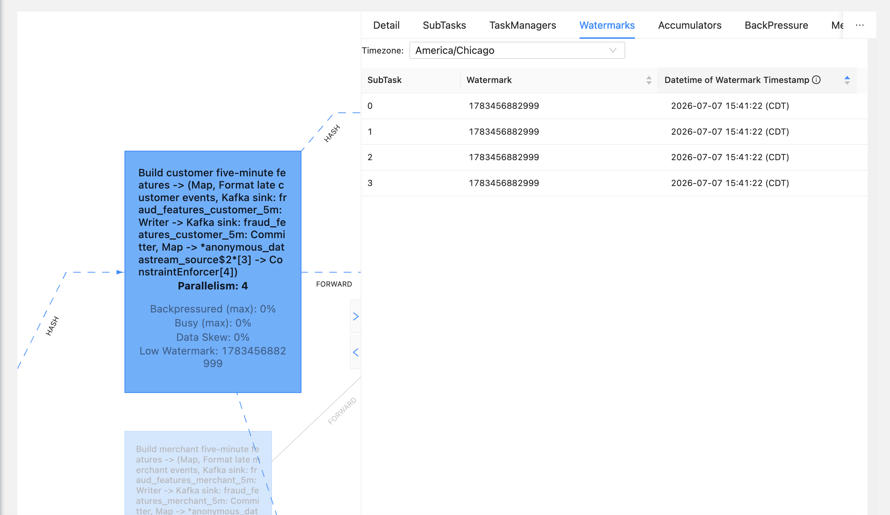

**What to look at, comparing the two Watermarks pictures:** the newest event in
the log is 2026-07-07 23:59:43 UTC (18:59:43 CDT). At the end of the baseline the
watermark sits 1 s behind it (18:59:41). In the measured run it sits 11,900 s
behind it (15:41:22), so late events have about 3.3 hours to arrive.

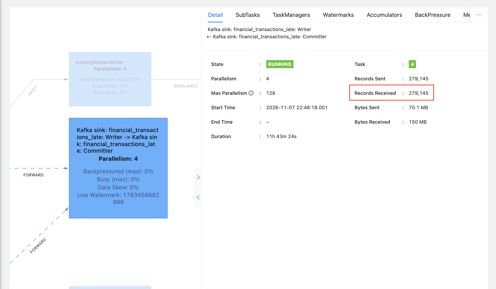

When an event is late but still within the allowed lateness, Flink fires its
window again. The second output carries `is_correction: true`
([`FeatureWindowFunction`, `runtime.py:173`](../../src/fraudstream/jobs/flink/runtime.py#L173)),
and it has the same `feature_id` as the first output. Iceberg stores feature
rows by `feature_id`, so the correction replaces the old row
([`iceberg_sink.py:341`](../../src/fraudstream/jobs/flink/iceberg_sink.py#L341)).

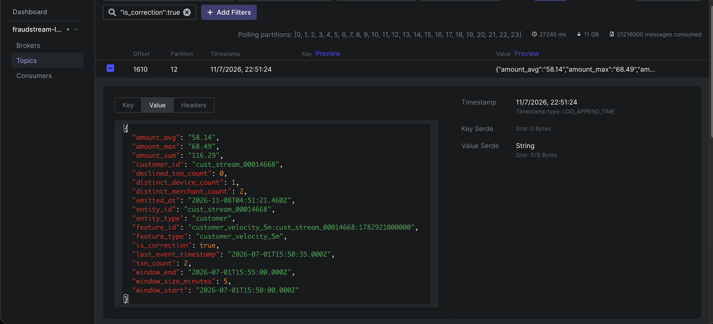

The two runs' counts come from
[`topic_counts`](../../src/fraudstream/jobs/flink/topic_counts.py). It reads
only committed records, so it gives the true counts. Kafka UI's counts also
include the markers Kafka adds to each transaction, which is why the UI shows
612,036 for the baseline's late topic, not 609,673.

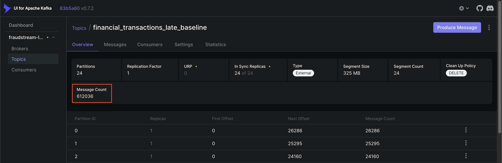

| Baseline | Measured |
|---|---|
| 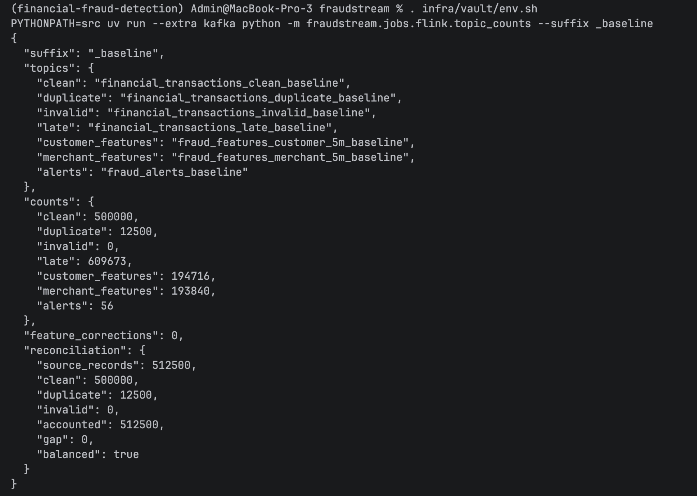 | 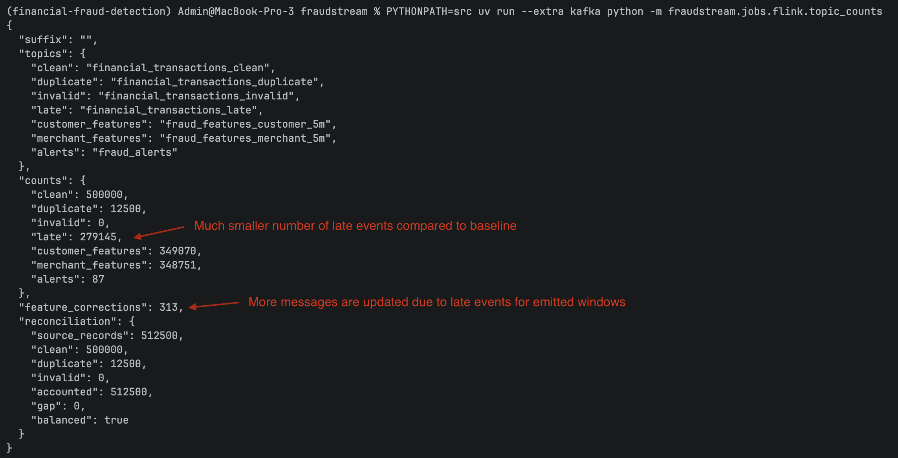 |

| Count | Baseline | Measured | Change |
|---|---|---|---|
| Too-late records | 609,673 (61%) | **279,145 (28%)** | 54% fewer |
| Feature rows written | 388,556 | **697,821** | +80% |
| Corrections (`is_correction`) | 0 | 313 | windows fixed by late events |
| Fraud alerts | 56 | 87 | +55% |
| clean + duplicate + invalid = source | 512,500 ✓ | 512,500 ✓ | nothing lost in either run |

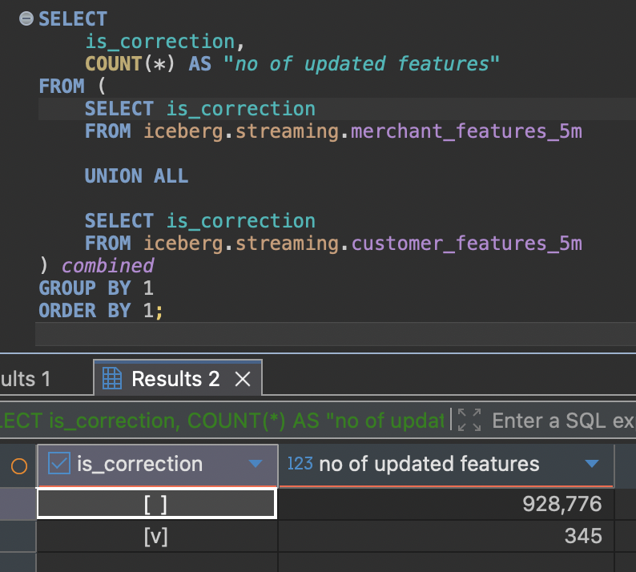

The Iceberg tables hold 345 corrected windows. That's more than this run's 313,
because the tables are kept between runs and still have rows from earlier ones.

**The cost:** the windows of the last ~3.3 hours of event time never close
until newer events arrive, so their features come later.

**What's left:** with a 95th-percentile delay, about 5% of events should still
be too late. Replaying the log in order shows exactly that: 24,891 of 500,000
events. The measured run had 28%. The likely cause is that the watermark is set
*after* the source
([`runtime.py:270`](../../src/fraudstream/jobs/flink/runtime.py#L270)). Each
source subtask reads six partitions from the backlog in batches. One
partition's batch can push the subtask's newest event time hours ahead of its
other partitions, and their events then count as late. Passing the watermark
strategy to `from_source`
([line 261](../../src/fraudstream/jobs/flink/runtime.py#L261)) would give each
partition its own watermark.

### Duplicates in the stream

2.44% of the messages, 12,500 of 512,500, are sent twice, up to 10 minutes
apart. The job groups events by `event_id` and keeps the first copy in Flink
state for 24 hours
([`DeduplicateTransactionFunction`, `runtime.py:86`](../../src/fraudstream/jobs/flink/runtime.py#L86)).
A later copy goes to `financial_transactions_duplicate`. It's labelled
`identical_replay` when its contents match the first copy, or
`duplicate_payload_conflict` when they don't. The state expires on a timer
(line 142), so memory stays bounded.

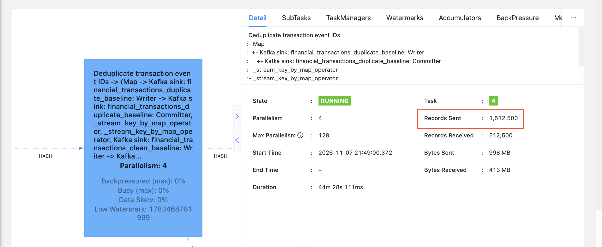

**What to look at:** the dedup box received **512,500**, and each window box
received **500,000**. The 12,500 in between are the duplicates. They don't
reach the windows, so no payment is counted twice.

The dedup box's 1,512,500 Records Sent isn't a mistake. It's 500,000 to each
window box, plus 500,000 written to the clean topic, plus 12,500 written to the
duplicate topic, by the sinks chained inside the box.

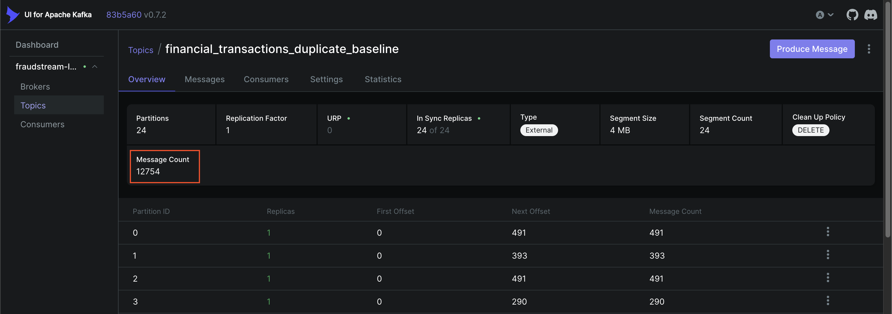

`topic_counts` reads exactly 12,500 duplicates in both runs. Kafka UI shows
12,754, because it also counts the transaction markers.

### Window processing

Both feature streams come from one function
([`_build_feature_window`, `runtime.py:436`](../../src/fraudstream/jobs/flink/runtime.py#L436)):

```python
features = (
    events.key_by(key_selector, key_type=Types.STRING())               # one window per customer (or merchant)
    .window(TumblingEventTimeWindows.of(Time.minutes(5)))               # 00:00–00:05, 00:05–00:10, … by event time
    .allowed_lateness(config.allowed_lateness_minutes * 60 * 1_000)     # keep each window 40 min after it closes
    .side_output_late_data(late_output)                                 # anything later goes to the late topic
    .aggregate(
        FeatureAggregateFunction(entity_type),                          # running count, sum, max, distinct ids
        window_function=FeatureWindowFunction(entity_type),             # adds window times and is_correction
        ...
    )
)
```

- `key_by` sends every event of a customer to the same task, so that task holds
  the customer's whole window.
- `TumblingEventTimeWindows` cuts time into fixed five-minute slots that don't
  overlap, by when the payment *happened*, not when it arrived.
- `aggregate` updates a small running total as each event arrives, instead of
  keeping all events until the window closes. When the window closes,
  `FeatureWindowFunction` (line 173) adds the window's start and end and the
  `feature_id`. It sets `is_correction` from a per-window flag: false the first
  time the window fires, true when a late event fires it again. `clear`
  (line 204) deletes the flag when the window is finally purged.
- `allowed_lateness` and `side_output_late_data` together decide what happens
  to a late event. Within 40 minutes it updates the window. After that it goes
  to the late topic
  ([`LateRecordFunction`, line 220](../../src/fraudstream/jobs/flink/runtime.py#L220)),
  so nothing disappears without a record.

The customer window outputs, among others, `txn_count`, `amount_sum`,
`amount_avg`, `amount_max`, `distinct_merchant_count` and
`distinct_device_count`. The merchant window outputs the merchant's equivalents.
The alert rules read these.

## Run it

```bash
. infra/vault/env.sh   # MinIO and PostgreSQL credentials
# Spark, inside the Airflow container (or trigger the DAGs)
docker compose exec -e MINIO_ACCESS_KEY -e MINIO_SECRET_KEY -e POSTGRES_USER -e POSTGRES_PASSWORD \
  airflow-scheduler python -m fraudstream.jobs.gold.skew_benchmark --strategy adaptive
# Flink: measured run, then the baseline, then count both
PYTHONPATH=src uv run --project flink --python 3.12 python -m fraudstream.jobs.flink.transactions --flink-ui
PYTHONPATH=src uv run --extra kafka python -m fraudstream.jobs.flink.topic_counts
```

## Where things are

| What | Where |
|---|---|
| Bronze ingest and schema evolution | [`src/fraudstream/jobs/bronze/ingest_transactions.py`](../../src/fraudstream/jobs/bronze/ingest_transactions.py) |
| Silver cleaning and duplicates | [`src/fraudstream/jobs/silver/transactions.py`](../../src/fraudstream/jobs/silver/transactions.py) |
| Gold, offline features, labels | [`src/fraudstream/jobs/gold/`](../../src/fraudstream/jobs/gold/) |
| Skew benchmark | [`src/fraudstream/jobs/gold/skew_benchmark.py`](../../src/fraudstream/jobs/gold/skew_benchmark.py) |
| `--spark-conf` flag | [`src/fraudstream/jobs/spark_settings.py`](../../src/fraudstream/jobs/spark_settings.py) |
| PostgreSQL window | [`src/fraudstream/jobs/warehouse.py`](../../src/fraudstream/jobs/warehouse.py) |
| Airflow DAGs and Variables | [`airflow/dags/`](../../airflow/dags/), [`airflow/config/variables.json`](../../airflow/config/variables.json) |
| Flink job graph, dedup, windows | [`src/fraudstream/jobs/flink/runtime.py`](../../src/fraudstream/jobs/flink/runtime.py) |
| Flink settings and records | [`src/fraudstream/jobs/flink/transactions.py`](../../src/fraudstream/jobs/flink/transactions.py) |
| Watermark measurement | [`src/fraudstream/jobs/flink/watermark_calibration.py`](../../src/fraudstream/jobs/flink/watermark_calibration.py), [`configs/flink/`](../../configs/flink/) |
| Topic counter | [`src/fraudstream/jobs/flink/topic_counts.py`](../../src/fraudstream/jobs/flink/topic_counts.py) |
| Flink Iceberg tables | [`src/fraudstream/jobs/flink/iceberg_sink.py`](../../src/fraudstream/jobs/flink/iceberg_sink.py) |
| Screenshots | [`images/jobs/offline/`](../../images/jobs/offline/), [`images/jobs/online/`](../../images/jobs/online/) |
