# Data Storage

Every row lives in **Iceberg tables on MinIO**: 663 million in Bronze, 650
million in Silver, and the Gold star schema and features built from them.
**PostgreSQL** holds only a recent window of each table, for the dashboards and
the API. The two stores are tuned differently. Iceberg is tuned by how its
files are laid out, PostgreSQL by indexes. Each technique below is measured
before and after on the real data.

## Where each zone lives

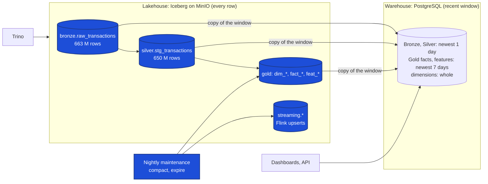

| Zone | Iceberg table(s) | Partitioned by | Set in | In PostgreSQL |
|---|---|---|---|---|
| Bronze | `bronze.raw_transactions` | `ingest_date`, `schema_version`, `transaction_date` | [`bronze/ingest_transactions.py:111`](../../src/fraudstream/jobs/bronze/ingest_transactions.py#L111) | newest 1 day |
| Silver | `silver.stg_transactions`, `stg_transaction_quality_issues` | `event_date`; `quality_status` | [`silver/transactions.py:674`](../../src/fraudstream/jobs/silver/transactions.py#L674) | newest 1 day |
| Gold facts | `gold.fact_transactions`, `fact_*_daily` | `event_date` or `feature_date` | [`gold/transactions.py:1528`](../../src/fraudstream/jobs/gold/transactions.py#L1528) | newest 7 days |
| Gold dimensions | `gold.dim_*` | none (small) | [`gold/transactions.py:1520`](../../src/fraudstream/jobs/gold/transactions.py#L1520) | whole |
| Gold features | `gold.feat_*` | `feature_date` (except `feat_customer_total_orders_90d`) | [`gold/offline_features.py:265`](../../src/fraudstream/jobs/gold/offline_features.py#L265) | newest 7 days |
| Streaming | `streaming.clean_transactions`, `customer_features_5m`, `merchant_features_5m` | none; upserted by key | [`flink/iceberg_sink.py:341`](../../src/fraudstream/jobs/flink/iceberg_sink.py#L341) | none |

Each job writes the window to PostgreSQL itself
([`jobs/warehouse.py:299`](../../src/fraudstream/jobs/warehouse.py#L299)),
so the database stays small enough to index, while Iceberg keeps the full history.

## Lakehouse

Iceberg stores a table as Parquet files plus metadata that records, for each
file, its partition and the smallest and largest value of every column. A query
engine like Trino reads that metadata first and skips every file that can't hold
a match. Inside a file, each **row group** (a block of rows) has the same kind of
range, so it can be skipped too. All three techniques work by giving Trino more
to skip, and all three run from one job
([`maintenance/iceberg_tables.py:206`](../../src/fraudstream/jobs/maintenance/iceberg_tables.py#L206)):

```bash
python -m fraudstream.jobs.maintenance.iceberg_tables \
  --compact iceberg.streaming.customer_features_5m \
  --zorder iceberg.silver.stg_transactions=customer_id,merchant_id \
  --expire iceberg.streaming.customer_features_5m
```

Each action runs only on the tables named for it. The nightly Airflow DAG
`fraudstream_lakehouse_maintenance`
([`dags/lakehouse_maintenance.py:42`](../../airflow/dags/lakehouse_maintenance.py#L42))
compacts the three streaming tables and the three `feat_` tables at 02:00 UTC,
then expires their old snapshots.

<!-- Screenshot to add: the DAG's Graph view after one run, saved as images/airflow/lakehouse_maintenance_graph.png -->
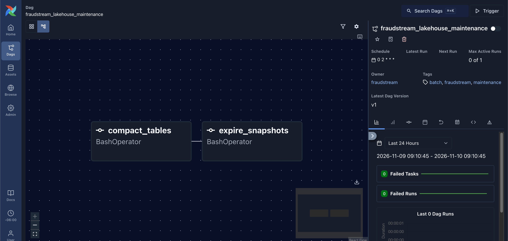

### Partitioning

Silver is partitioned by `event_date`, one folder per day. A filter on the date
lets Trino drop whole days from the metadata alone, before it opens any file.
The same customer lookup, with and without a March filter:

| With `event_date` in March | Without |
|---|---|
| 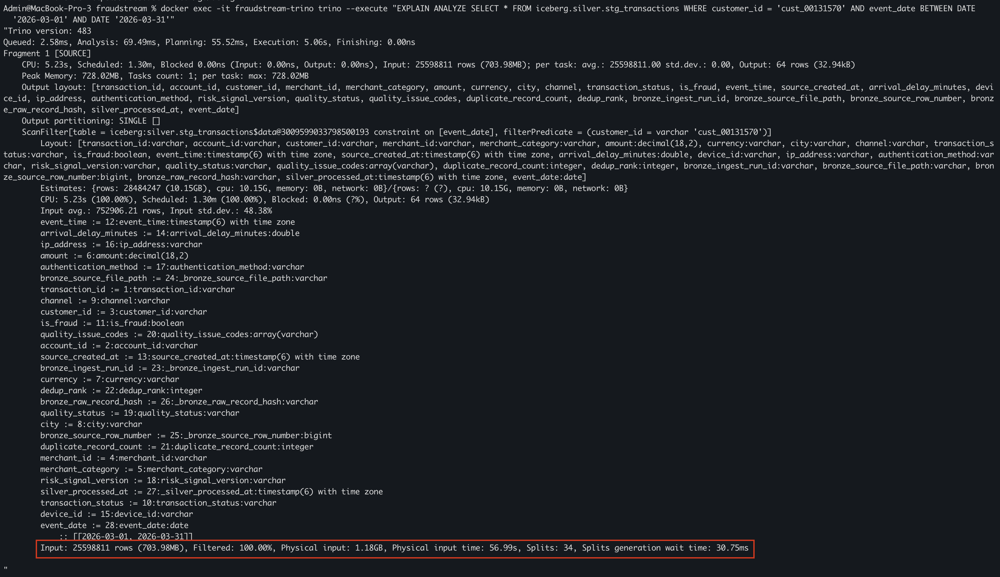 | 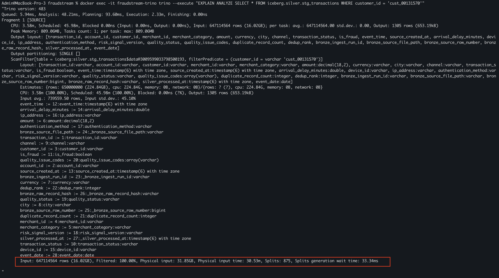 |

| | With the date filter | Without | |
|---|---|---|---|
| Rows read | 25.6 million | 647 million | 25× fewer |
| Physical input | 1.18 GB | 31.85 GB | 27× less |
| Splits (pieces of files) | 34 | 875 | |
| Execution | 5.06 s | 2.33 min | 28× faster |

**The cost:** none at read time. Each daily write lands in its own folder, and a
query that doesn't filter on the date gets no help, as the right-hand picture shows.

### Compaction

Flink commits a few small files to each streaming table at every checkpoint.
After one replay, `customer_features_5m` had 640 data files averaging 0.08 MiB.
A query has to open every one of them. Compaction
([`maintenance/iceberg_tables.py:80`](../../src/fraudstream/jobs/maintenance/iceberg_tables.py#L80))
merges them into files of up to 128 MiB, and applies the delete files Flink's
upserts left behind while it rewrites.

| Before | After |
|---|---|
| 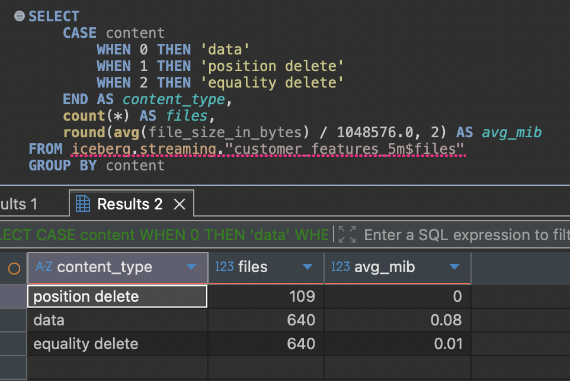 | 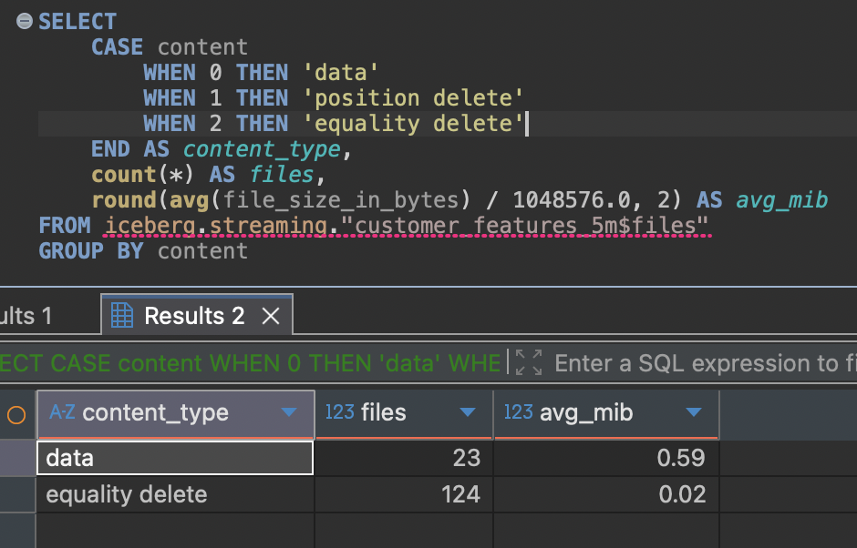 |
| 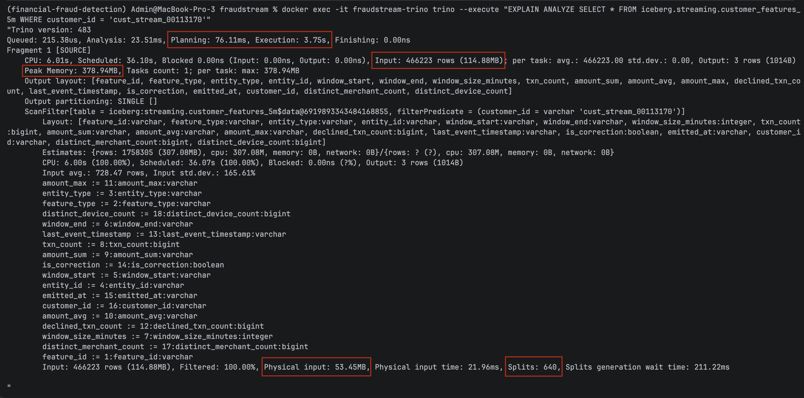 | 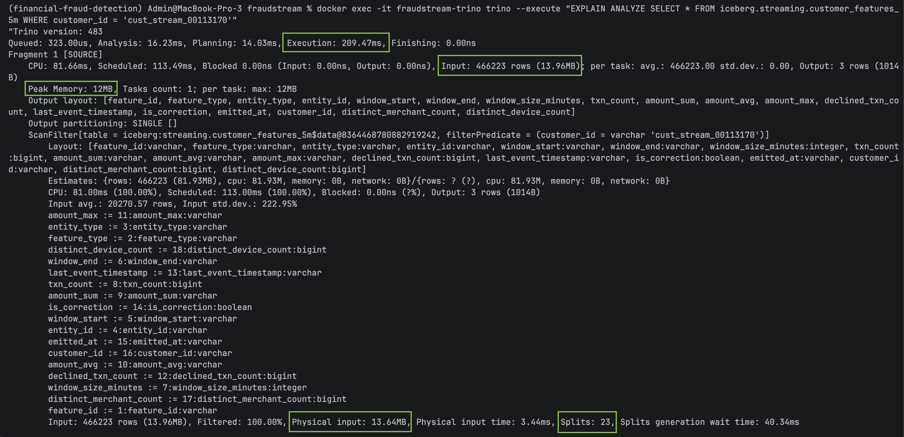 |

| `customer_features_5m` | Before | After |
|---|---|---|
| Data files | 640 (0.08 MiB avg) | **23** (0.59 MiB avg) |
| Position delete files | 109 | **0** |
| Equality delete files | 640 | 124 |
| Physical input | 53.45 MB | 13.64 MB |
| Peak memory | 378.94 MB | 12 MB |
| Execution | 3.75 s | **209 ms** (18× faster) |

The other two streaming tables went the same way: 660 → 13 and 640 → 21 data files.

**What's left:** 124 equality delete files. They tell Iceberg "drop the row with
this key from older files". Every data file was rewritten after them (sequence
number 320 against 114–169), so they no longer apply to any row and results are
correct. Iceberg's cleanup option (`remove-dangling-deletes`) should have
dropped them but didn't. They're 0.02 MiB each, so the cost is opening 124 tiny
files per query.

**The cost:** compaction rewrites the table's data, which takes Spark time, and
keeps the old files until their snapshots expire. That's why expiry runs right
after it ([`maintenance/iceberg_tables.py:130`](../../src/fraudstream/jobs/maintenance/iceberg_tables.py#L130)).

### Z-order

A customer's payments are spread across every day's file, and within a file the
rows are in arrival order, so each row group holds almost every customer.
Z-order rewrites the rows so that ones with close values of the chosen columns
sit together. Then each row group covers a narrow range of customers, and a
lookup skips the rest
([`maintenance/iceberg_tables.py:101`](../../src/fraudstream/jobs/maintenance/iceberg_tables.py#L101)).
It ran on March only (`--zorder-where`), about 26 million rows.

It took three runs to work, and each run fixed one thing:

| Customer lookup, March | Rows read | Physical input | Splits | Execution |
|---|---|---|---|---|
| Before z-order | 28.5 M | 1.50 GB | 37 | 3.17 s |
| 1. Z-order, default settings | 25.6 M | 1.18 GB | 34 | 2.63 s |
| 2. + 8 MiB row groups | 9.2 M | 763 MB | 548 | 1.95 s |
| 3. + whole ids (16 bytes) | **3.3 M** | **327 MB** | 548 | **811 ms** |

1. **One row group per day.** A day of Silver is about 40 MB, and Iceberg's
   default row group is 128 MiB, so each day was a single block. Reordering rows
   inside one block lets nothing be skipped.
2. **Small row groups.** The z-order now writes 8 MiB row groups
   ([`maintenance/iceberg_tables.py:50`](../../src/fraudstream/jobs/maintenance/iceberg_tables.py#L50)),
   so each day has many blocks to skip. It then restores the table's own
   setting, because the unsorted daily Silver writes would only lose
   compression with small row groups.
3. **Whole ids.** Iceberg z-orders text by its first 8 bytes by default. Every
   customer id starts `cust_00`, so it saw only six coarse groups. It now reads
   16 bytes ([`maintenance/iceberg_tables.py:52`](../../src/fraudstream/jobs/maintenance/iceberg_tables.py#L52)),
   the whole id.

| Before | After all three |
|---|---|
| 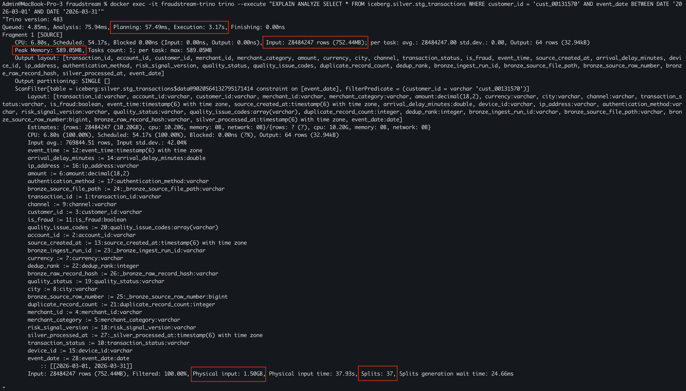 | 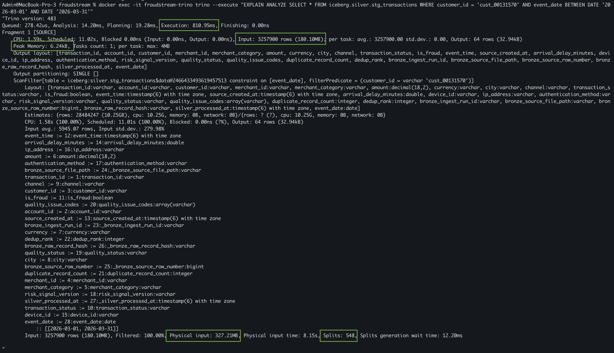 |

The steps in between:
[first z-order](../../images/lakehouse/zorder/02_explain_after.png),
[small row groups](../../images/lakehouse/zorder/03_customer_after_small_row_groups.png).

**Result:** a customer lookup reads 9× fewer rows and 4.6× less data, and runs
3.9× faster.

**Merchant lookups didn't improve.** The same z-order covers `merchant_id`, but
a merchant lookup still reads all 28.5 million rows. Z-order interleaves the two
columns, and with our id formats the customer digits take all the ordering a
day's few row groups can hold. A table that is only ever looked up by customer
would be better served by a plain sort on `customer_id`.

| Merchant: first z-order | Small row groups | Whole ids |
|---|---|---|
| 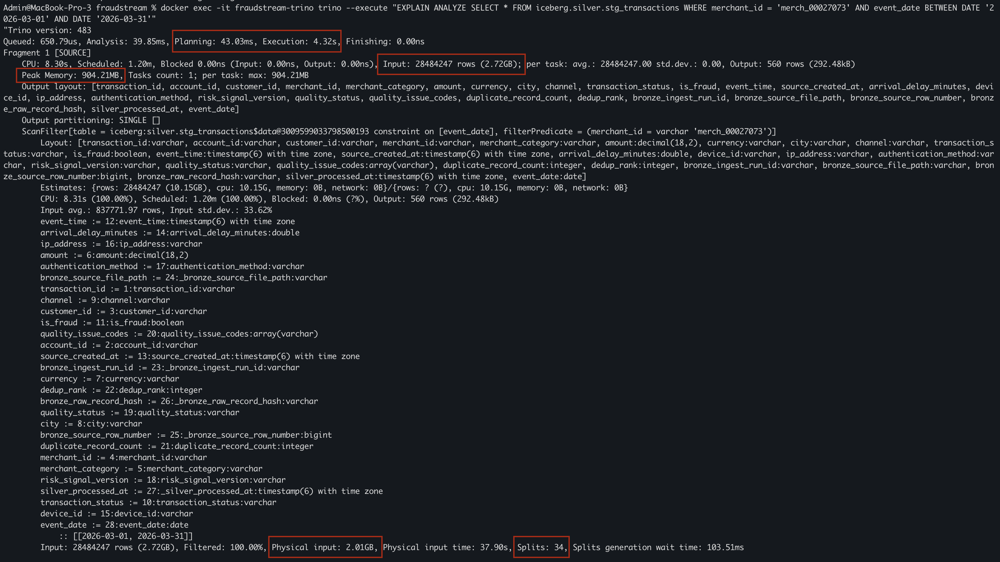 | 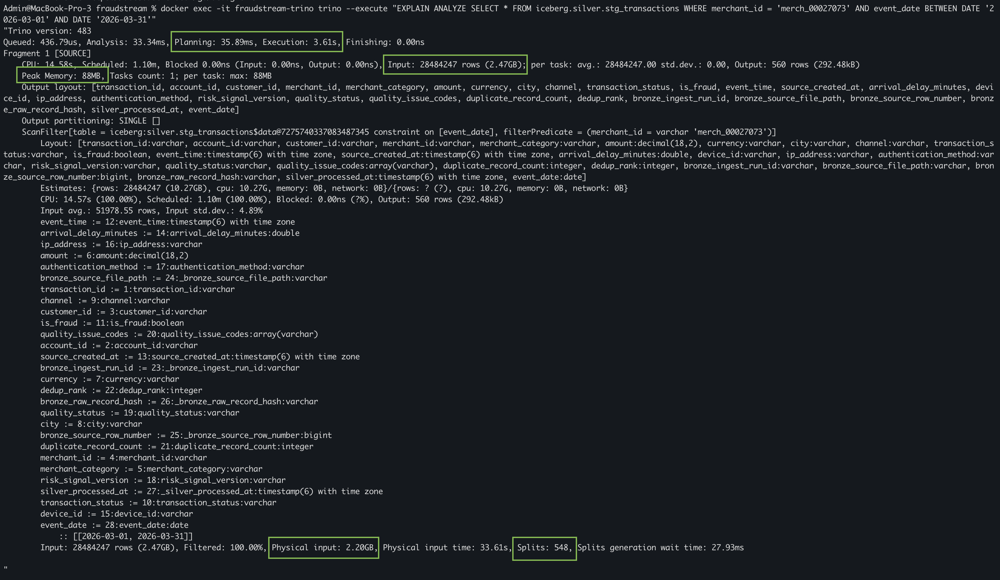 | 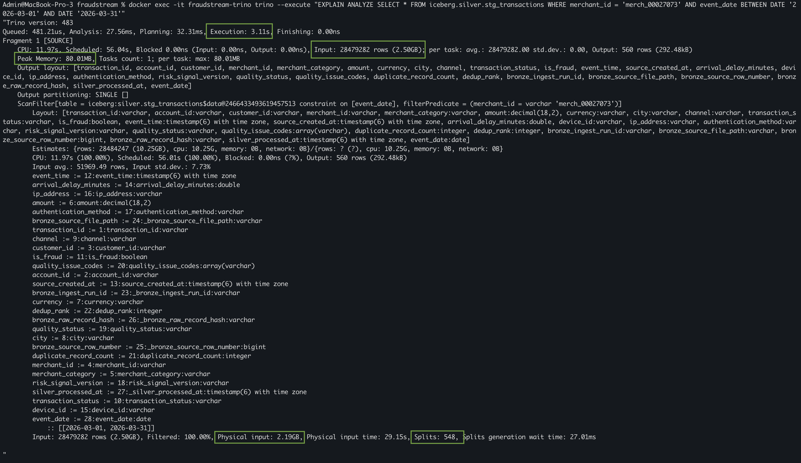 |

**The cost:** the rewrite sorts the whole month again (2.2 GB rewritten).
Small row groups mean more splits for Trino to schedule (34 → 548), and the
merchant query read slightly more bytes (2.01 → 2.19 GB).

## Warehouse

PostgreSQL holds the windows the dashboards and the API read. Each lookup they
make has an index built for it in the schema
([`init/001_create_fraudstream_schema.sql:370`](../../infra/postgres/init/001_create_fraudstream_schema.sql#L370)).
For example, a customer's recent payments:

```sql
CREATE INDEX IF NOT EXISTS ix_fact_transactions_customer_event_time
    ON gold.fact_transactions (customer_key, event_time);
```

The index is sorted by customer first, then by time. A query for one customer's
newest 50 payments jumps to that customer and reads the last 50 entries in
order, with no scan of the 7 days of facts and no sort step
([`init/001_create_fraudstream_schema.sql:373`](../../infra/postgres/init/001_create_fraudstream_schema.sql#L373)).

| Lookup | Index |
|---|---|
| A customer's newest payments | `ix_fact_transactions_customer_event_time` (`customer_key`, `event_time`) |
| A merchant's newest payments | `ix_fact_transactions_merchant_event_time` (`merchant_key`, `event_time`) |
| Totals for one day | `ix_fact_transactions_event_date` |
| A customer's current row | `ux_dim_customer_current`, unique on `customer_id` where `is_current` |
| A transaction's quality issues | `ix_stg_quality_issues_transaction_id` |

The benchmark
([`benchmarks/index_benchmark.sql:33`](../../infra/postgres/benchmarks/index_benchmark.sql#L33))
runs each lookup with `EXPLAIN (ANALYZE, BUFFERS)` once with its index, and once
inside a transaction that drops the index and rolls back, so nothing is changed.
It also prints each index's size.

```bash
docker compose exec -T postgres psql -U "$POSTGRES_USER" -d fraudstream -f - \
  < infra/postgres/benchmarks/index_benchmark.sql > data/benchmarks/index_benchmark.txt
```

Results on the 7-day window (7.06 million facts), from
`data/benchmarks/index_benchmark.txt`. A buffer is one 8 KB page read from
memory or disk.

| Lookup | Without the index | With it | Faster | Buffers without → with | Index size |
|---|---|---|---|---|---|
| A customer's newest payments | Parallel Seq Scan + Sort, 335.4 ms | Index Scan Backward, **0.075 ms** | ~4,500× | 336,256 → 13 | 301 MB |
| A merchant's newest payments | Parallel Seq Scan + Sort, 345.9 ms | Index Scan Backward, **0.122 ms** | ~2,800× | 336,256 → 53 | 275 MB |
| A customer's current row | Parallel Seq Scan, 70.0 ms | Index Scan, **0.050 ms** | ~1,400× | 11,391 → 4 | 15 MB + 24 MB |
| A transaction's quality issues | Seq Scan, 48.7 ms | Index Scan, **0.030 ms** | ~1,600× | 3,340 → 4 | 2.4 MB |
| Totals for one day | Parallel Seq Scan, 383.2 ms | Parallel Seq Scan, 393.1 ms | none | 336,182 → 336,182 | 44 MB |

**What to look at:**

- **The lookups by key:** without the index, PostgreSQL reads the whole table
  (about 2.7 GB of pages) to find 15 rows, then sorts them. With it, it reads
  13 pages and the rows come out already in time order, so there's no Sort step.
- **The current customer:** PostgreSQL used `ix_dim_customer_natural_history`
  rather than `ux_dim_customer_current`, because both start with `customer_id`.
  That's why the "without" run drops both.
- **Totals for one day:** PostgreSQL ignores the index even when it's there.
  One day is 730,137 rows, a tenth of the window, and reading the whole table in
  order is cheaper than jumping to a tenth of its rows one by one. That index
  costs 44 MB and gains nothing at this window size.

**The cost:** the three indexes measured on `fact_transactions` take 620 MB, and every load
has to write each of them. That's one reason PostgreSQL holds only a window.

## Schema design

### The tables in each zone

| Zone | Prefix | What it holds |
|---|---|---|
| Bronze | `raw_` | Source rows as they came, plus ingest columns (`_ingested_at`, source file, row hash) |
| Silver | `stg_` | Cleaned, typed, one row per `transaction_id`; quarantined and duplicate rows go to `stg_transaction_quality_issues` |
| Gold | `dim_`, `fact_` | A star schema: `fact_transactions` at its centre, with customer, account, merchant, category, city, channel, date and quality-issue dimensions, plus daily facts per customer, account, merchant, city and device |
| Gold | `feat_` | Point-in-time feature tables for training and Feast |

| Bronze | Silver |
|---|---|
| 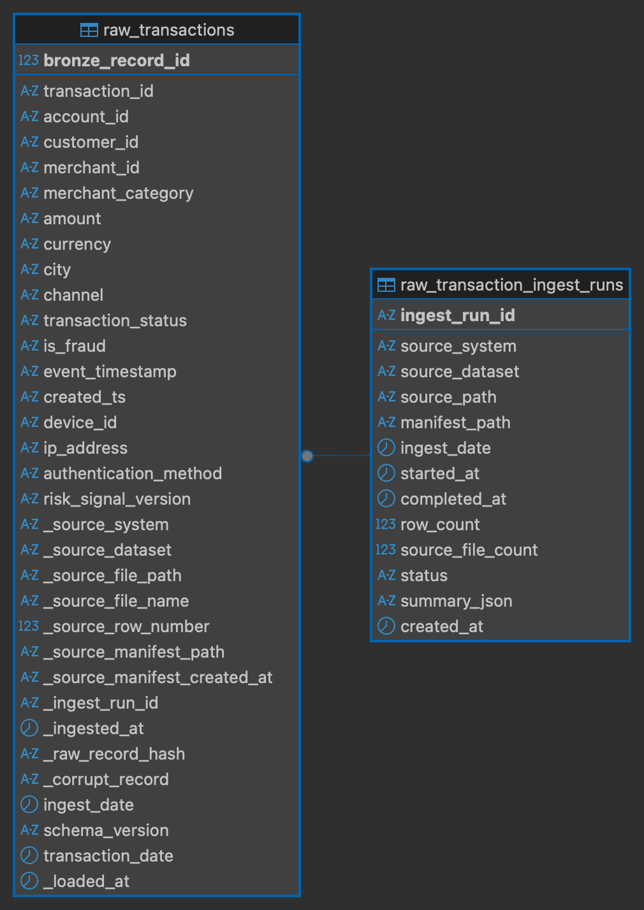 | 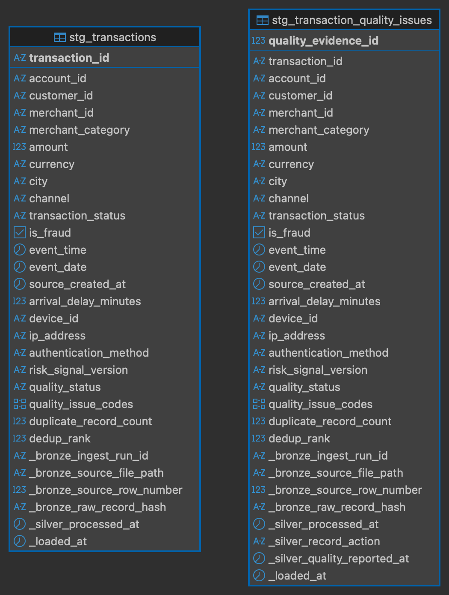 |

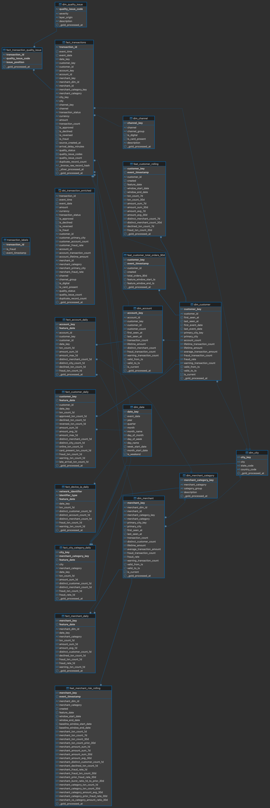

### History on `dim_customer`

`dim_customer` has the columns of a type 2 slowly changing dimension:
`valid_from_ts`, `valid_to_ts` and `is_current`. A unique index on `customer_id`,
only over the rows where `is_current` is true
([`init/001_create_fraudstream_schema.sql:268`](../../infra/postgres/init/001_create_fraudstream_schema.sql#L268)),
makes sure a customer has at most one current row.

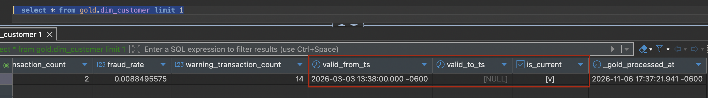

Gold is rebuilt in full on every run, so today each customer has exactly one
version: `valid_from_ts` is when the customer was first seen, `valid_to_ts` is
null and `is_current` is true
([`gold/transactions.py:877`](../../src/fraudstream/jobs/gold/transactions.py#L877)).
The table is ready for history, but no version has been closed yet.

### Feature timestamps

Every `feat_` table carries two times. `event_timestamp` is when the feature
value was true; Feast uses it to join each training row to the feature as it was
at that moment, never a later one. `created` is when the row was written, so a
recomputed value can be told apart from the old one.

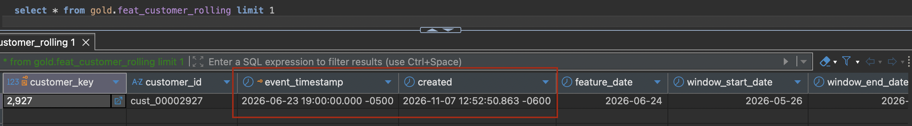

### Naming

Table names start with the zone's prefix: `raw_`, `stg_`, `dim_`, `fact_` or `feat_`.
A few tables don't, each for a reason:

| Table | Why it keeps its name |
|---|---|
| `gold.transaction_labels` | The fraud labels come from their own source files, not from the payments, and only training reads them. The ML dataset code and Feast already use this name. |
| `streaming.clean_transactions`, `customer_features_5m`, `merchant_features_5m` | Flink writes these, named for what the stream job emits. The `streaming` namespace already marks the zone. |
| `feature_store.stream_customer_features_5m`, `stream_merchant_features_5m` | Feast's landing tables for streamed features, named by the feature store, which owns them. |
| `metadata.*`, `ml.training_data`, `rag.*` | Run logs, training sets and document chunks: not layers of the data model. |

## Where things are

| What | Where |
|---|---|
| Maintenance job (compact, z-order, expire) | [`src/fraudstream/jobs/maintenance/iceberg_tables.py`](../../src/fraudstream/jobs/maintenance/iceberg_tables.py) |
| Nightly maintenance DAG | [`airflow/dags/lakehouse_maintenance.py`](../../airflow/dags/lakehouse_maintenance.py) |
| Old snapshot and orphan file cleanup | [`src/fraudstream/jobs/remove_orphan_files.py`](../../src/fraudstream/jobs/remove_orphan_files.py) |
| PostgreSQL window | [`src/fraudstream/jobs/warehouse.py`](../../src/fraudstream/jobs/warehouse.py) |
| PostgreSQL schema and indexes | [`infra/postgres/init/001_create_fraudstream_schema.sql`](../../infra/postgres/init/001_create_fraudstream_schema.sql) |
| Index benchmark | [`infra/postgres/benchmarks/index_benchmark.sql`](../../infra/postgres/benchmarks/index_benchmark.sql) |
| Maintenance tests | [`tests/unit/test_iceberg_maintenance.py`](../../tests/unit/test_iceberg_maintenance.py) |
| Screenshots | [`images/lakehouse/`](../../images/lakehouse/), [`images/schema/`](../../images/schema/) |
