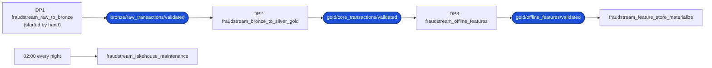
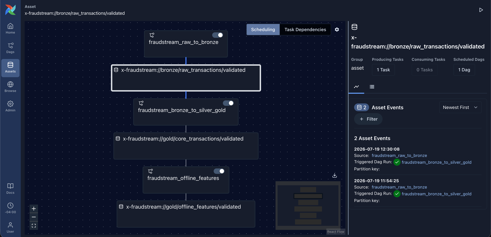
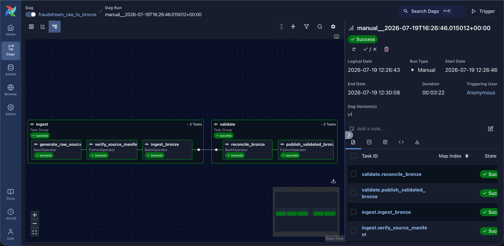
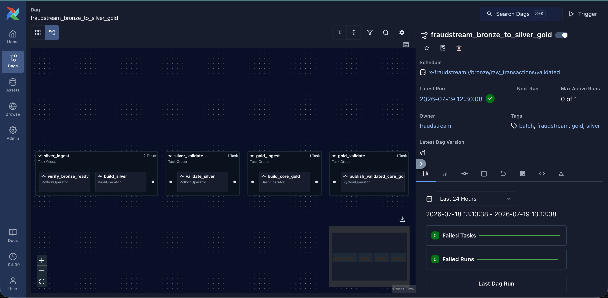
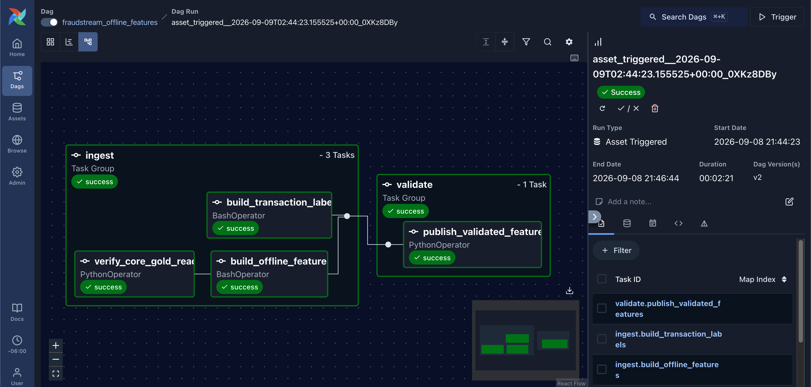
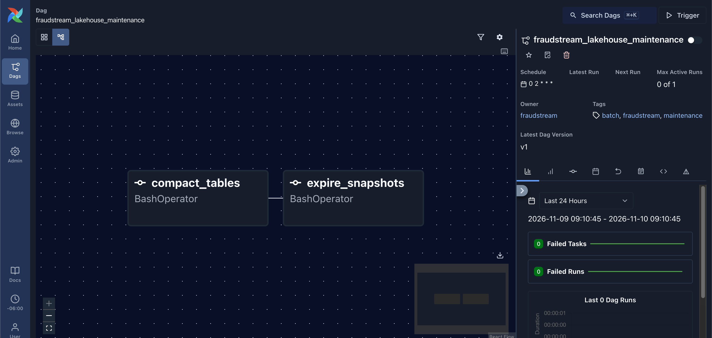
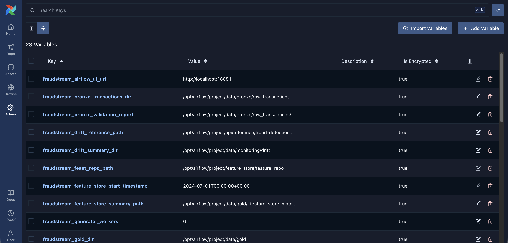
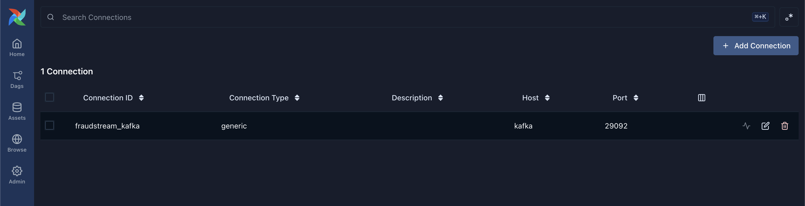

# Data Pipeline Orchestration

Airflow runs the batch side of the platform as **three pipelines**, one DAG
each. No pipeline is scheduled on a clock. Each one starts when the one before
it publishes a **validated data asset**, and an asset is published only after
its data passes a check. A bad run stops where it went wrong and never feeds the
next pipeline. A fourth DAG, nightly maintenance, keeps the Iceberg tables
small and fast.



The assets are declared once in
[`fraudstream_airflow/assets.py:6`](../../airflow/include/fraudstream_airflow/assets.py#L6).
DP1 starts by hand because generating 650 million rows is a deliberate act, not
a daily one. DP2 is scheduled on DP1's asset at
[`dags/bronze_to_silver_gold.py:26`](../../airflow/dags/bronze_to_silver_gold.py#L26),
and DP3 on DP2's at
[`dags/offline_features.py:25`](../../airflow/dags/offline_features.py#L25).



## Ingest, then validate

Every pipeline has the same two stages, shown as task groups in the Graph view:

- **Ingest** first checks that its input is the one the last pipeline
  validated, then runs the Spark jobs.
- **Validate** reads the summary each job wrote and checks that the row counts
  add up. Only the last task of this stage publishes the asset.

Every check is a plain Python function in
[`orchestration/validation.py`](../../src/fraudstream/orchestration/validation.py)
that raises an error when a number is off, so the same check runs in the unit
tests and in Airflow. Checks run with `retries=0`: running a check again on
the same data gives the same answer. Spark jobs keep the default retry, once
after 2 minutes, because they can fail for a passing reason such as memory.

All Spark tasks share the `fraudstream_spark` pool, which has **1 slot**, so two
jobs never fight over the container's memory
([`fraudstream_airflow/dag_helpers.py:14`](../../airflow/include/fraudstream_airflow/dag_helpers.py#L14)).

## DP1: raw → Bronze



| Task | What it does | Reads | Writes | What stops it |
|---|---|---|---|---|
| `ingest.generate_raw_source` ([`dags/raw_to_bronze.py:35`](../../airflow/dags/raw_to_bronze.py#L35)) | Generates one CSV per day, plus the labels | the generator config | `raw/offline_transactions/`, `raw/transaction_labels/` in MinIO; the manifest | the generator fails |
| `ingest.verify_source_manifest` ([`dags/raw_to_bronze.py:49`](../../airflow/dags/raw_to_bronze.py#L49)) | Checks every file in the manifest exists in MinIO and isn't empty | the manifest, MinIO | nothing | a missing or empty file; file count differs from the quality summary; zero rows ([`orchestration/validation.py:24`](../../src/fraudstream/orchestration/validation.py#L24)) |
| `ingest.ingest_bronze` ([`dags/raw_to_bronze.py:58`](../../airflow/dags/raw_to_bronze.py#L58)) | Loads the CSVs into Bronze as they are | raw CSVs | `iceberg.bronze.raw_transactions`; newest day in PostgreSQL | the Spark job fails |
| `validate.reconcile_bronze` ([`dags/raw_to_bronze.py:81`](../../airflow/dags/raw_to_bronze.py#L81)) | Re-reads the source and Bronze and compares them | raw CSVs, Bronze | the Bronze validation report | the job fails |
| `validate.publish_validated_bronze` ([`dags/raw_to_bronze.py:97`](../../airflow/dags/raw_to_bronze.py#L97)) | Publishes the Bronze asset | the report | the asset | report not passed; Bronze rows ≠ source rows; a source file missing from Bronze ([`orchestration/validation.py:79`](../../src/fraudstream/orchestration/validation.py#L79)) |

## DP2: Bronze → Silver → Gold



| Task | What it does | Reads | Writes | What stops it |
|---|---|---|---|---|
| `silver_ingest.verify_bronze_ready` ([`dags/bronze_to_silver_gold.py:33`](../../airflow/dags/bronze_to_silver_gold.py#L33)) | Repeats DP1's last check, so a stale or failed report can't start Silver | the Bronze report | nothing | same as DP1's publish check |
| `silver_ingest.build_silver` ([`dags/bronze_to_silver_gold.py:42`](../../airflow/dags/bronze_to_silver_gold.py#L42)) | Cleans, deduplicates and quarantines | Bronze | `iceberg.silver.stg_transactions`, quality issues; summary and quality report | the Spark job fails |
| `silver_validate.validate_silver` ([`dags/bronze_to_silver_gold.py:62`](../../airflow/dags/bronze_to_silver_gold.py#L62)) | Checks every Bronze row is accounted for | the Silver summary and quality report | nothing | input ≠ kept + quarantined + duplicates; kept ≠ valid + warning; the two files disagree ([`orchestration/validation.py:104`](../../src/fraudstream/orchestration/validation.py#L104)) |
| `gold_ingest.build_core_gold` ([`dags/bronze_to_silver_gold.py:73`](../../airflow/dags/bronze_to_silver_gold.py#L73)) | Builds dimensions, facts and daily aggregates | Silver | `iceberg.gold.dim_*`, `fact_*`; newest 7 days in PostgreSQL | the Spark job fails |
| `gold_validate.publish_validated_core_gold` ([`dags/bronze_to_silver_gold.py:91`](../../airflow/dags/bronze_to_silver_gold.py#L91)) | Publishes the core Gold asset | the Gold and Silver summaries | the asset | a core table missing; fact rows ≠ Silver rows, or ≠ the Silver rows read when Gold is built from a date ([`orchestration/validation.py:140`](../../src/fraudstream/orchestration/validation.py#L140)) |

## DP3: offline features



| Task | What it does | Reads | Writes | What stops it |
|---|---|---|---|---|
| `ingest.verify_core_gold_ready` ([`dags/offline_features.py:32`](../../airflow/dags/offline_features.py#L32)) | Repeats DP2's last check | the Gold and Silver summaries | nothing | same as DP2's publish check |
| `ingest.build_offline_features` ([`dags/offline_features.py:43`](../../airflow/dags/offline_features.py#L43)) | Computes point-in-time rolling features | Gold facts | `iceberg.gold.feat_*`; newest 7 days in PostgreSQL | the Spark job fails |
| `ingest.build_transaction_labels` ([`dags/offline_features.py:59`](../../airflow/dags/offline_features.py#L59)) | Loads the fraud labels for training | raw labels | `iceberg.gold.transaction_labels` | the Spark job fails |
| `validate.publish_validated_features` ([`dags/offline_features.py:79`](../../airflow/dags/offline_features.py#L79)) | Publishes the features asset, which starts the feature store load | the feature and Gold summaries | the asset | a feature table missing; the features were built from a different number of facts than Gold holds ([`orchestration/validation.py:173`](../../src/fraudstream/orchestration/validation.py#L173)) |

A check logs the counts it compared, and a failed check names the numbers that
disagree, so the log alone says what went wrong. Here is the Silver check on
the full dataset:

```text
$ airflow tasks test fraudstream_bronze_to_silver_gold silver_validate.validate_silver
[info] Done. Returned value was: {'input_rows': 662993671, 'output_rows': 650000000}
[info] Task instance state updated  new_state=success
```

The 12,993,671 rows between the two numbers are the duplicates Silver removed
and the rows it quarantined. The check passes only when those add up exactly.

## Nightly maintenance

`fraudstream_lakehouse_maintenance` runs at 02:00. `compact_tables` merges the
small files that Flink and the feature builds leave, then `expire_snapshots`
drops the old snapshots so the replaced files can be deleted
([`dags/lakehouse_maintenance.py:52`](../../airflow/dags/lakehouse_maintenance.py#L52)).
[Data Storage](04_data_storage.md#compaction) has the measurements.



## Variables, Connections and secrets

No DAG writes a path, host or password into its own code. Each kind of value
has one home:

| What | Where it lives | How it gets into Airflow |
|---|---|---|
| Folders, MinIO URIs, Spark master and settings, PostgreSQL windows, write mode | **Variables** in [`airflow/config/variables.json`](../../airflow/config/variables.json) | `airflow-init` imports them on every start ([`scripts/initialize.sh:6`](../../airflow/scripts/initialize.sh#L6)) |
| PostgreSQL, MinIO, pgvector and gateway logins | **Connections** `postgres`, `minio`, `pgvector`, `gateway`, stored in Vault under `secret/platform/` | Airflow's Vault secrets backend reads them when a task renders, logged in with its own AppRole ([`docker-compose.yml:22`](../../docker-compose.yml#L22)) |
| Kafka address | Connection `fraudstream_kafka` in [`airflow/config/connections.json`](../../airflow/config/connections.json) | `airflow-init` imports it; it holds no secret |
| The Spark pool | `fraudstream_spark`, its size from the `fraudstream_spark_pool_slots` Variable | `airflow-init` imports it ([`config/bootstrap.py:47`](../../airflow/config/bootstrap.py#L47)) |

Tasks reach a credential only through a template such as
`{{ conn.postgres.password }}`, which Airflow fills in at run time and masks in
logs ([`fraudstream_airflow/dag_helpers.py:18`](../../airflow/include/fraudstream_airflow/dag_helpers.py#L18)).
The Vault Connections never show in Admin → Connections, because Airflow
doesn't copy them into its own database. Two tests keep it that way: no DAG
mentions a password, and every Variable a DAG reads exists in
`variables.json`, with no host or data folder written into a DAG.

Airflow stores each Variable encrypted with its Fernet key, which itself comes from Vault.





## Where things are

| What | Where |
|---|---|
| DAGs | [`airflow/dags/`](../../airflow/dags/) |
| Data assets | [`airflow/include/fraudstream_airflow/assets.py`](../../airflow/include/fraudstream_airflow/assets.py) |
| Shared settings, credentials, commands | [`airflow/include/fraudstream_airflow/dag_helpers.py`](../../airflow/include/fraudstream_airflow/dag_helpers.py) |
| Validation checks | [`src/fraudstream/orchestration/validation.py`](../../src/fraudstream/orchestration/validation.py) |
| Variables and Connections | [`airflow/config/`](../../airflow/config/) |
| Start-up import | [`airflow/scripts/initialize.sh`](../../airflow/scripts/initialize.sh) |
| Vault secrets backend | [`docker-compose.yml`](../../docker-compose.yml) |
| DAG tests | [`tests/unit/test_dag_helpers.py`](../../tests/unit/test_dag_helpers.py) |
| Screenshots | [`images/airflow/`](../../images/airflow/) |
