# Data Governance

DataHub is the platform's catalog. It answers three questions about every table
the batch pipelines write:

- **What is there?** Every table in PostgreSQL, with its columns.
- **Where did it come from?** Lineage from each Airflow pipeline to the tables it reads and writes.
- **Can I trust it?** Each pipeline's checks, shown as assertions on the tables they check.

Nothing here is typed in by hand in the DataHub UI. Two scripts fill DataHub
from the repository and from the summaries the jobs write, so running them
again brings DataHub back in line with the data.

## Architecture

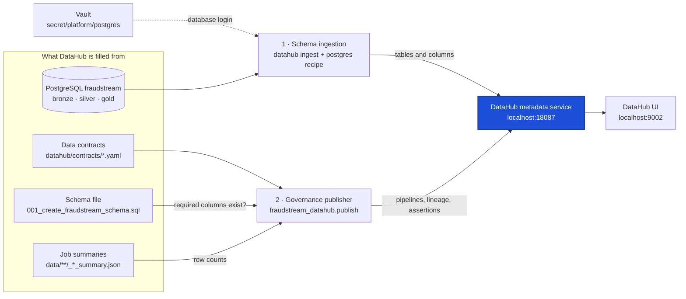

The work is split in two because the two halves know different things:

- **Schema ingestion** asks PostgreSQL what tables and columns exist. It uses
  DataHub's own PostgreSQL connector, so no project code is involved.
- **The governance publisher** is project code. It knows what PostgreSQL can't
  tell: which pipeline writes which table, what each table promises in its
  contract, and whether the latest run kept that promise. It works out each
  check from the same summary files the Airflow checks read
  ([Data Pipeline Orchestration](05_data_pipeline_orchestration.md#ingest-then-validate)),
  so DataHub and Airflow can't disagree about a run.

Both halves name a table the same way, so the publisher's lineage and checks
land on the tables the ingestion created. That name is DataHub's URN, built in
[`fraudstream_datahub/model.py:34`](../../datahub/src/fraudstream_datahub/model.py#L34):

```text
urn:li:dataset:(urn:li:dataPlatform:postgres,fraudstream-local.fraudstream.gold.fact_transactions,PROD)
                platform                     instance          database    schema table          env
```

The instance `fraudstream-local` and the env `PROD` are set once, in the recipe
([`recipes/postgres.dhub.yaml:8`](../../datahub/recipes/postgres.dhub.yaml#L8)).

## Setting up DataHub

**1. Start DataHub.** It runs as its own Docker stack, outside the platform's
`docker-compose.yml`, so starting or stopping it never touches the pipelines:

```bash
./datahub/scripts/start.sh
```

[`scripts/start.sh:8`](../../datahub/scripts/start.sh#L8) runs DataHub's
quickstart, pinned to version 1.6.0. The metadata service listens on port
**18087** ([`scripts/start.sh:6`](../../datahub/scripts/start.sh#L6)), and
the UI is at `http://localhost:9002`.

**2. Bring in the tables and columns.** Log in to Vault once, then run the
publish script:

```bash
vault login -method=userpass username=operator
./datahub/scripts/publish.sh
```

- **Login:** the script reads the database login from Vault, so it's never
  written in the repository or typed on the command line
  ([`scripts/publish.sh:10`](../../datahub/scripts/publish.sh#L10)).
- **Recipe:** it then runs the PostgreSQL recipe
  ([`scripts/publish.sh:17`](../../datahub/scripts/publish.sh#L17)). The recipe
  takes in the `bronze`, `silver`, `gold` and `metadata` schemas, tables and
  views, without profiling
  ([`recipes/postgres.dhub.yaml:10`](../../datahub/recipes/postgres.dhub.yaml#L10)).

The script then runs the publisher on the repository's own folder. That
publishes the pipelines and lineage, plus checks against whatever summaries the
repository holds.

**3. Publish the checks against the real data.** Airflow runs from a deploy
folder, so the summaries of the full runs live there and not in the
repository. Running the publisher again inside the Airflow container, against
that folder, replaces the checks with the real numbers:

```bash
./cicd/sync_airflow.sh /path/to/fraudstream-deploy
docker compose exec airflow-scheduler bash -c 'PYTHONPATH=/opt/airflow/project/datahub/src /home/airflow/datahub/bin/python -m fraudstream_datahub.publish --project-root /opt/airflow/project --server "$DATAHUB_GMS_URL" --ui-url http://localhost:9002'
```

Three things make that work:

- **Its own Python environment.** The Airflow image installs DataHub's
  client into it ([`airflow/Dockerfile:25`](../../airflow/Dockerfile#L25)), so
  its dependencies never clash with Airflow's.
- **The address of DataHub.** `DATAHUB_GMS_URL` points the container at the
  metadata service on the host
  ([`docker-compose.yml:44`](../../docker-compose.yml#L44)).
- **The files the publisher reads.** The sync copies the contracts and the
  PostgreSQL schema file into the deploy folder, next to the code
  ([`cicd/sync_airflow.sh:13`](../../cicd/sync_airflow.sh#L13)).

**4. Check the result.** The publisher prints a report with the number of
datasets, contracts and assertions, and how many passed.

### What the publisher does, in order

| Step | What happens | Code |
|---|---|---|
| Read the contracts | One YAML file per pipeline | [`model.py:319`](../../datahub/src/fraudstream_datahub/model.py#L319) |
| Check them against the schema | Every table a contract names must exist in the schema file, with every required column. A contract that has drifted from the database stops the publish before anything reaches DataHub. | [`model.py:447`](../../datahub/src/fraudstream_datahub/model.py#L447) |
| Work out each check | Each rule names a check function, which reads the job summaries and returns pass or fail with the numbers it compared | [`model.py:405`](../../datahub/src/fraudstream_datahub/model.py#L405), registry at [`model.py:691`](../../datahub/src/fraudstream_datahub/model.py#L691) |
| Write the tables | Description, owner, layer, contract and validation status as properties | [`publish.py:111`](../../datahub/src/fraudstream_datahub/publish.py#L111) |
| Write the pipelines | One pipeline and one job per Airflow DAG, linked to the DAG in Airflow, with its inputs and outputs | [`publish.py:125`](../../datahub/src/fraudstream_datahub/publish.py#L125) |
| Write the lineage | One edge from each input table to each output table | [`publish.py:155`](../../datahub/src/fraudstream_datahub/publish.py#L155) |
| Write the checks | One assertion per rule, on the table it checks, then that run's result | [`publish.py:163`](../../datahub/src/fraudstream_datahub/publish.py#L163), [`publish.py:184`](../../datahub/src/fraudstream_datahub/publish.py#L184) |

Each assertion's URN comes from its rule's ID, such as
`urn:li:assertion:fraudstream-bronze-row-reconciliation`, so publishing again
adds a new result to the same assertion instead of creating a second one. The
assertion's history then shows every run.

### A data contract

A contract states what a pipeline's tables promise. This is the whole contract
of the raw → Bronze pipeline
([`contracts/raw_to_bronze.contract.yaml`](../../datahub/contracts/raw_to_bronze.contract.yaml)):

```yaml
datasets:
  - name: fraudstream.bronze.raw_transactions
    grain: one source record per Bronze row, including deliberate duplicates
    requiredFields: [transaction_id, event_timestamp, _ingest_run_id, _source_file_path, _raw_record_hash]
qualityRules:
  - id: bronze-row-reconciliation
    target: fraudstream.bronze.raw_transactions
    description: Source and Bronze row counts must be equal and greater than zero.
    evaluator: bronze_row_reconciliation
    severity: HIGH
```

- **`requiredFields`** is checked against the schema file when publishing.
- **`evaluator`** names the check function that works out the rule.
- **`description`** is what DataHub shows as the assertion's name.

## The lineage the publisher declares

The lineage is declared once in code, per pipeline
([`model.py:232`](../../datahub/src/fraudstream_datahub/model.py#L232)), so
it can't drift from the DAGs. This is what the three pipelines record:

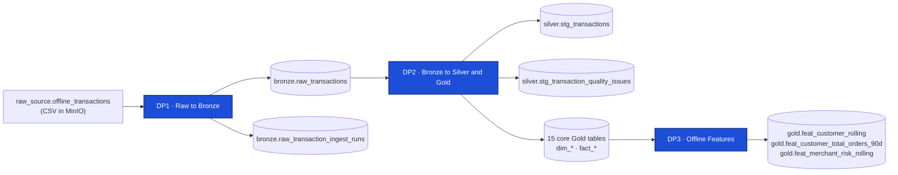

DP3 reads four Gold tables: `fact_transactions`, `fact_customer_daily`,
`fact_account_daily` and `fact_merchant_daily`.

## The tables of each zone

DataHub groups the tables as PostgreSQL does: instance `fraudstream-local`,
database `fraudstream`, then one folder per schema. A green tick next to a
table means its checks passed in the latest publish.

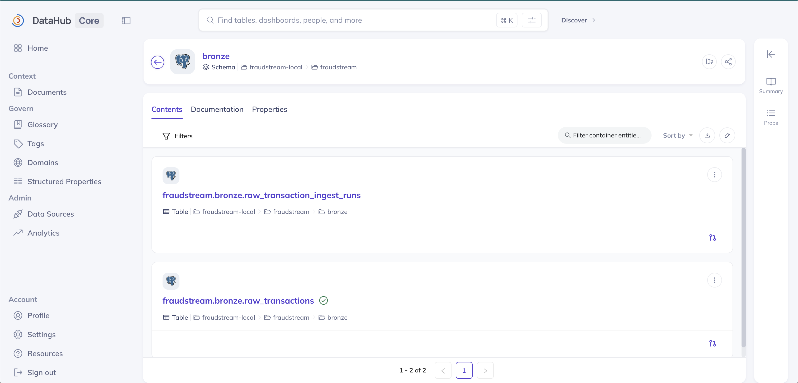

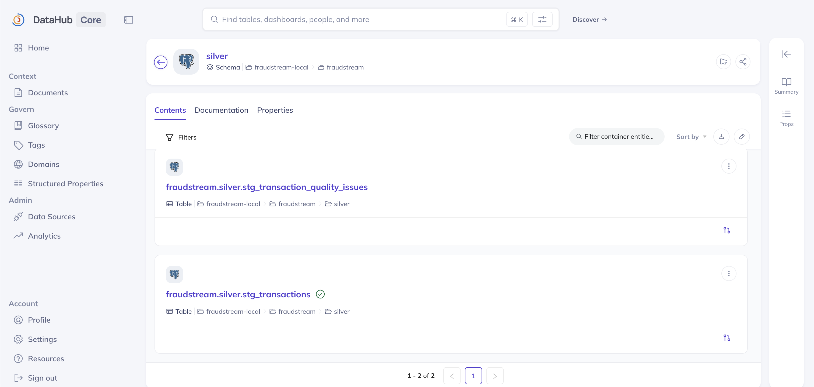

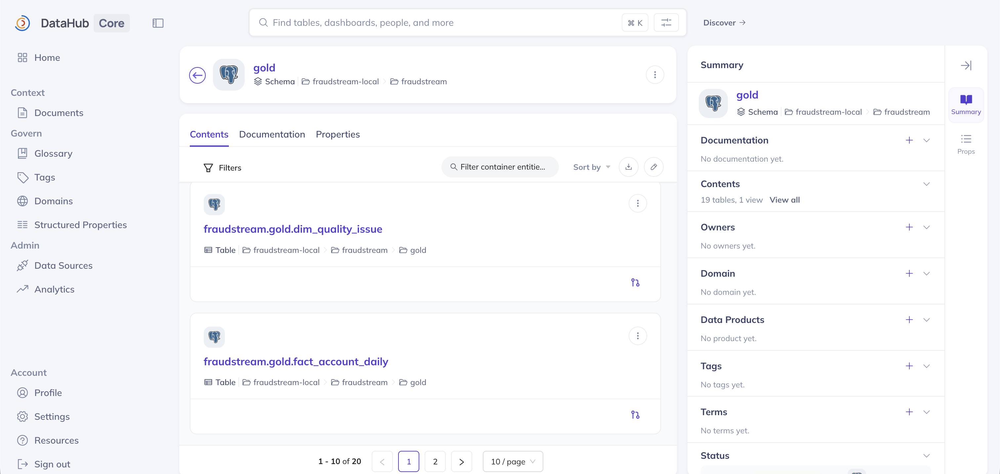

| Schema | In DataHub | What it holds |
|---|---|---|
| `bronze` | 2 tables | the raw rows as loaded, and one row per load |
| `silver` | 2 tables | cleaned, deduplicated rows, and the quality problems found |
| `gold` | 19 tables, 1 view | 15 core tables (8 dimensions, 7 facts), 3 feature tables, `transaction_labels`, and the `obt_transaction_enriched` view |

## DP1: raw → Bronze

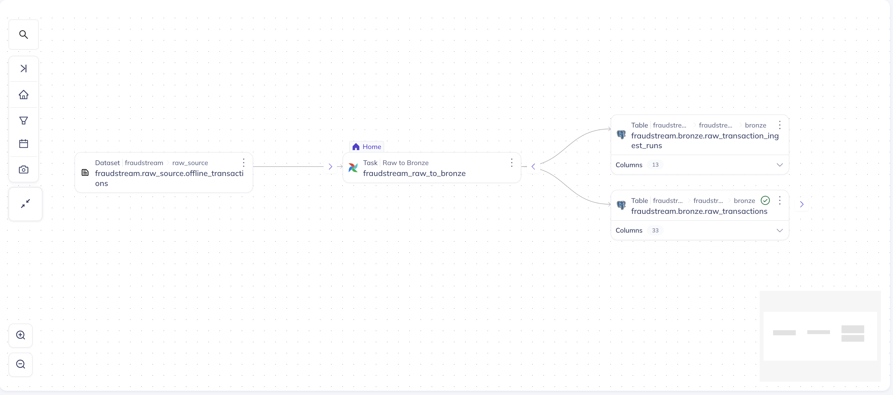

The pipeline reads the raw CSVs and writes the Bronze table and its load log.
Both checks sit on `bronze.raw_transactions` and read the Bronze validation
report ([`model.py:532`](../../datahub/src/fraudstream_datahub/model.py#L532)):

| Check | Passes when | Latest run |
|---|---|---|
| Row reconciliation | source rows = Bronze rows, and more than zero | 662,993,671 = 662,993,671 |
| Source file coverage | every source CSV appears in Bronze's file metadata | 730 = 730 |

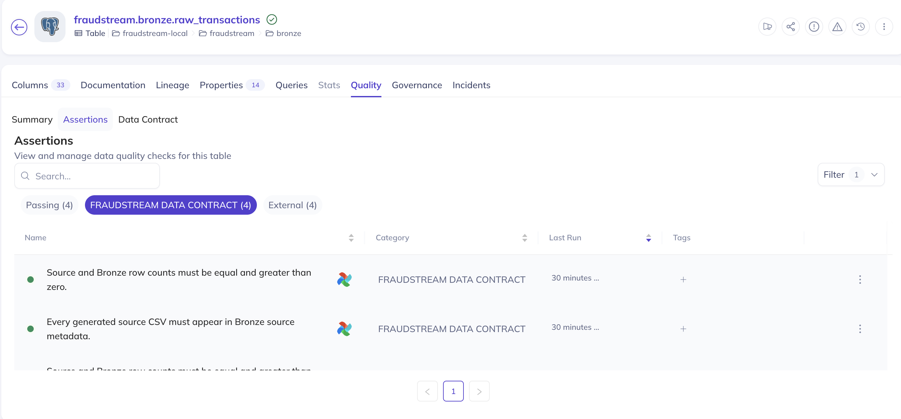

## DP2: Bronze → Silver → Gold

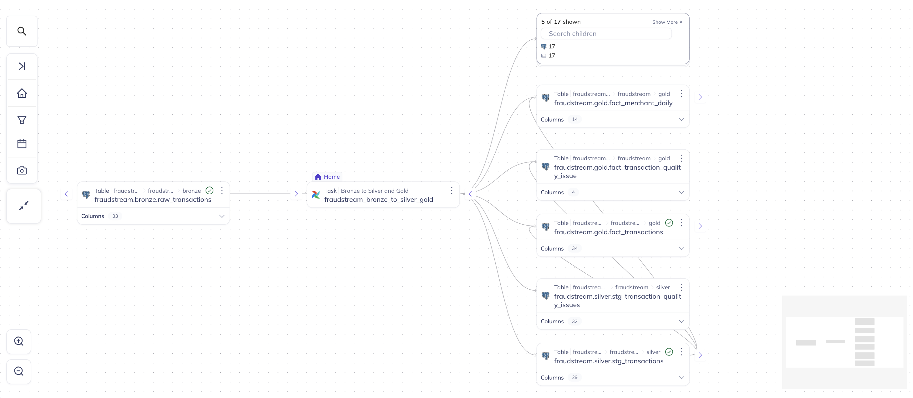

The pipeline reads Bronze and writes 17 tables: 2 in Silver and 15 in Gold.
DataHub shows the first few and folds the rest under "Show More". Two checks
sit on Silver and two on Gold
([`model.py:558`](../../datahub/src/fraudstream_datahub/model.py#L558)):

| Table | Check | Passes when | Latest run |
|---|---|---|---|
| `silver.stg_transactions` | Row accounting | every Bronze row is kept, quarantined or removed as a duplicate | 662,993,671 = 650,000,000 kept + 12,993,671 duplicates + 0 quarantined |
| `silver.stg_transactions` | Status accounting | every kept row is valid or a warning | 650,000,000 = 622,106,710 valid + 27,893,290 warning |
| `gold.fact_transactions` | Grain | one fact row per Silver row read | 111,016,430 = 111,016,430 |
| `gold.fact_transactions` | Completeness | all 15 core tables exist and hold rows | 15 of 15 |

Gold was built from 2026-03-03 onwards, so it covers the newest Silver rows,
not all 650 million. The Gold job records how many Silver rows it read
([`gold/transactions.py:551`](../../src/fraudstream/jobs/gold/transactions.py#L551)),
and the grain check compares the facts with that number
([`model.py:586`](../../datahub/src/fraudstream_datahub/model.py#L586)).

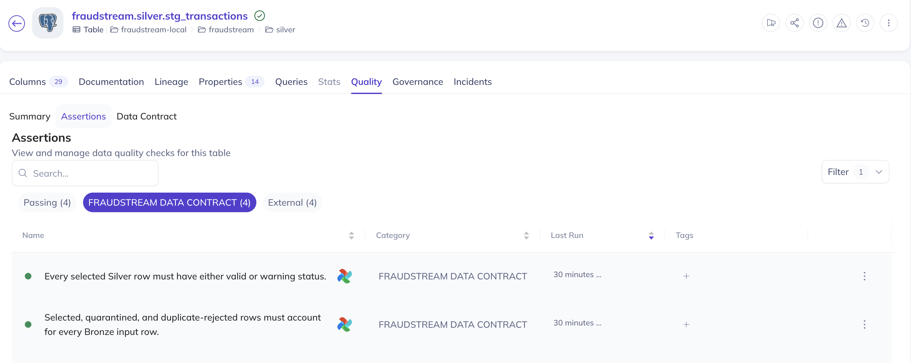

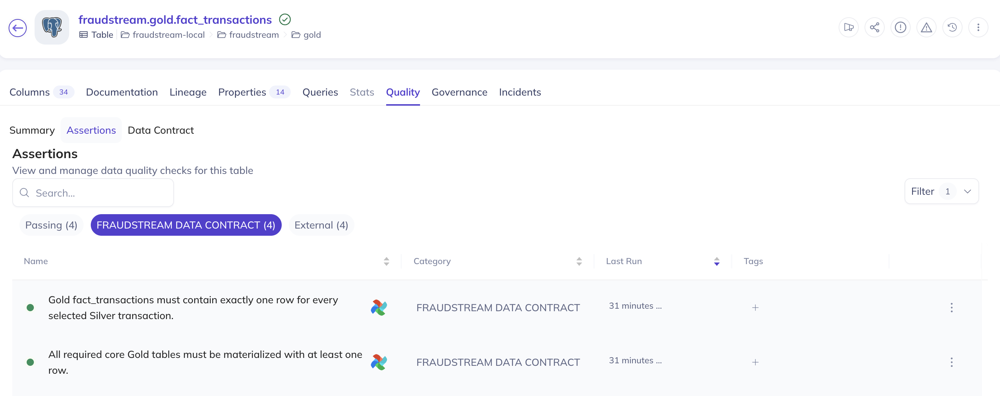

## DP3: offline features

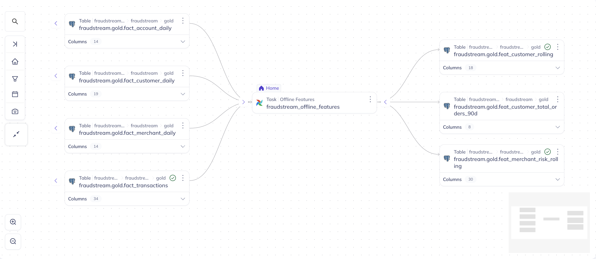

The pipeline reads four Gold fact tables and writes the three feature tables.
Each of its two checks sits on the table it's about
([`model.py:613`](../../datahub/src/fraudstream_datahub/model.py#L613)):

| Table | Check | Passes when | Latest run |
|---|---|---|---|
| `gold.feat_merchant_risk_rolling` | Built from all of Gold | the features were built from as many facts as Gold holds | 111,016,430 = 111,016,430 |
| `gold.feat_customer_rolling` | Completeness | all 3 feature tables exist and hold rows | 3 of 3 |

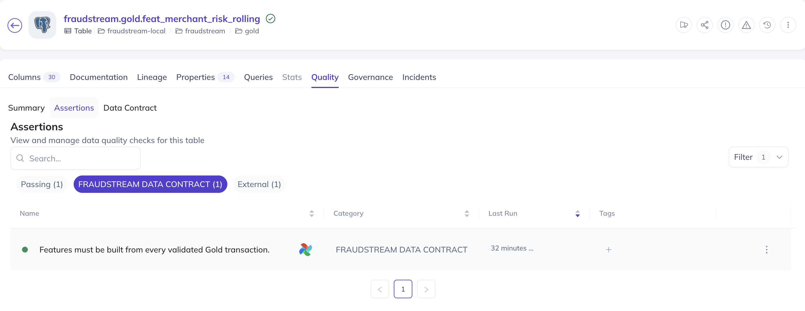

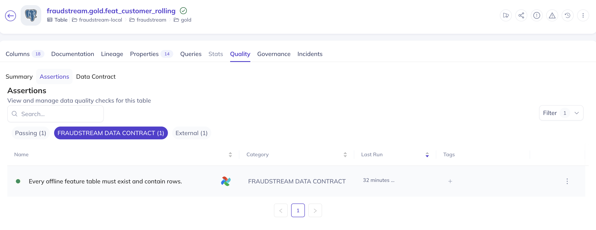

## When a table is dropped

DataHub keeps every table it has seen, so a table dropped from PostgreSQL
stays in the catalog until it's deleted there too. Delete it by its URN:

```bash
export DATAHUB_GMS_URL=http://localhost:18087
uv run --project datahub --python 3.11 datahub delete --hard \
  --urn 'urn:li:dataset:(urn:li:dataPlatform:postgres,fraudstream-local.fraudstream.gold.<table>,PROD)'
```

Run it once with `--dry-run` first to see what it would delete.

## Where things are

| What | Where |
|---|---|
| Start and stop DataHub | [`datahub/scripts/start.sh`](../../datahub/scripts/start.sh), [`datahub/scripts/stop.sh`](../../datahub/scripts/stop.sh) |
| Schema ingestion and publish | [`datahub/scripts/publish.sh`](../../datahub/scripts/publish.sh) |
| PostgreSQL recipe | [`datahub/recipes/postgres.dhub.yaml`](../../datahub/recipes/postgres.dhub.yaml) |
| Data contracts | [`datahub/contracts/`](../../datahub/contracts/) |
| Tables, pipelines, lineage and checks | [`datahub/src/fraudstream_datahub/model.py`](../../datahub/src/fraudstream_datahub/model.py) |
| Publisher | [`datahub/src/fraudstream_datahub/publish.py`](../../datahub/src/fraudstream_datahub/publish.py) |
| Publisher tests | [`datahub/tests/`](../../datahub/tests/) |
| DataHub client in Airflow | [`airflow/Dockerfile`](../../airflow/Dockerfile) |
| Schema the contracts are checked against | [`infra/postgres/init/001_create_fraudstream_schema.sql`](../../infra/postgres/init/001_create_fraudstream_schema.sql) |
| Screenshots | [`images/datahub/`](../../images/datahub/) |
