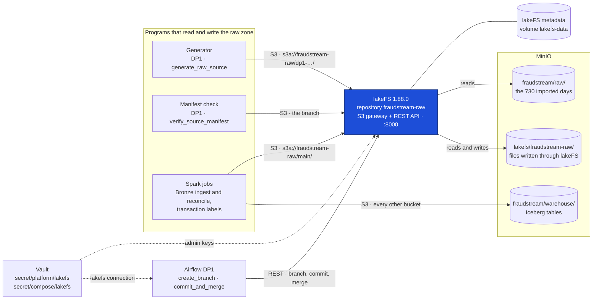
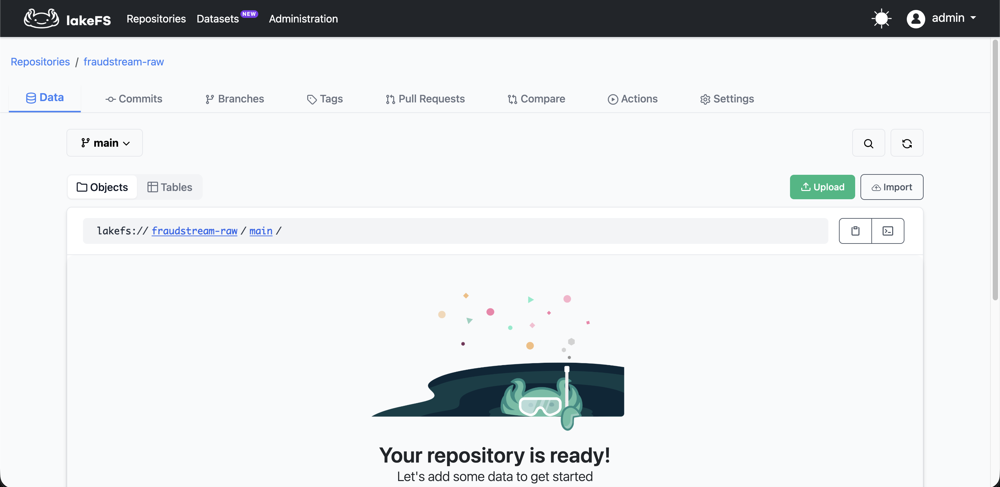
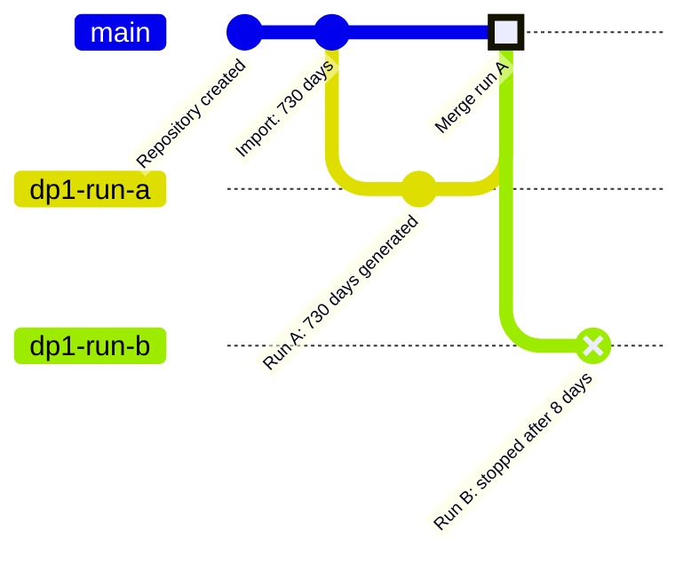
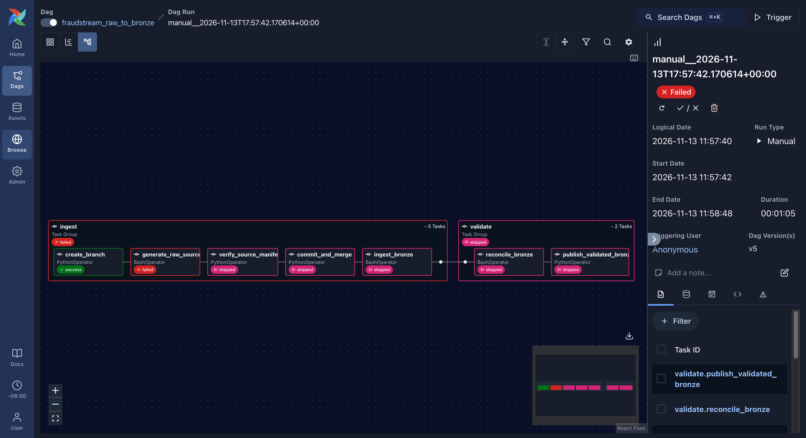
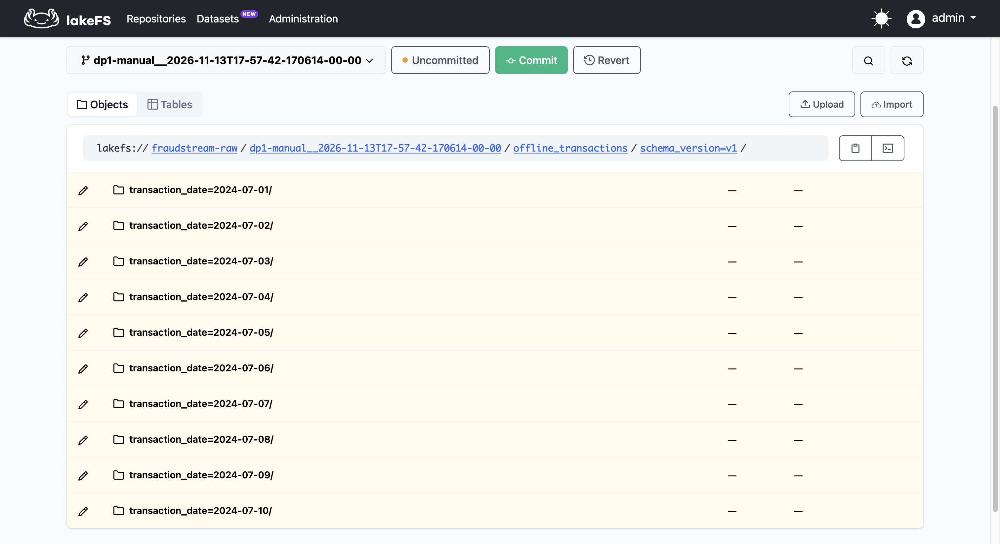
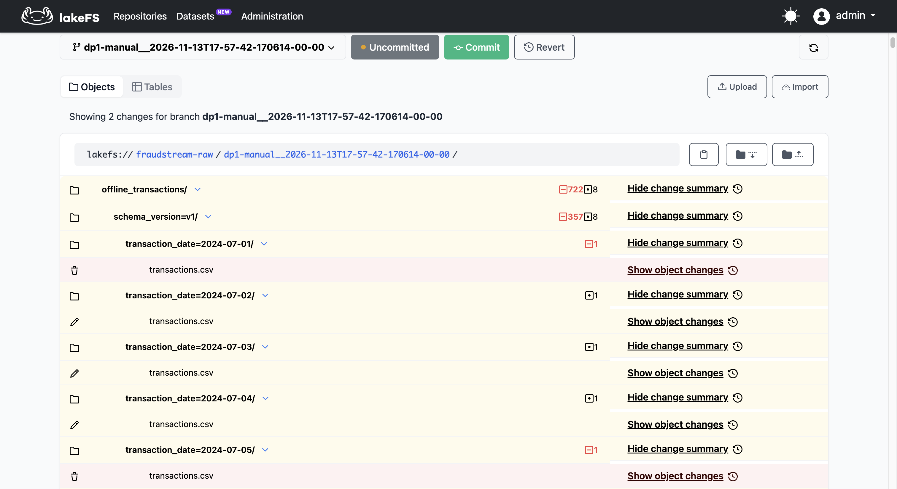
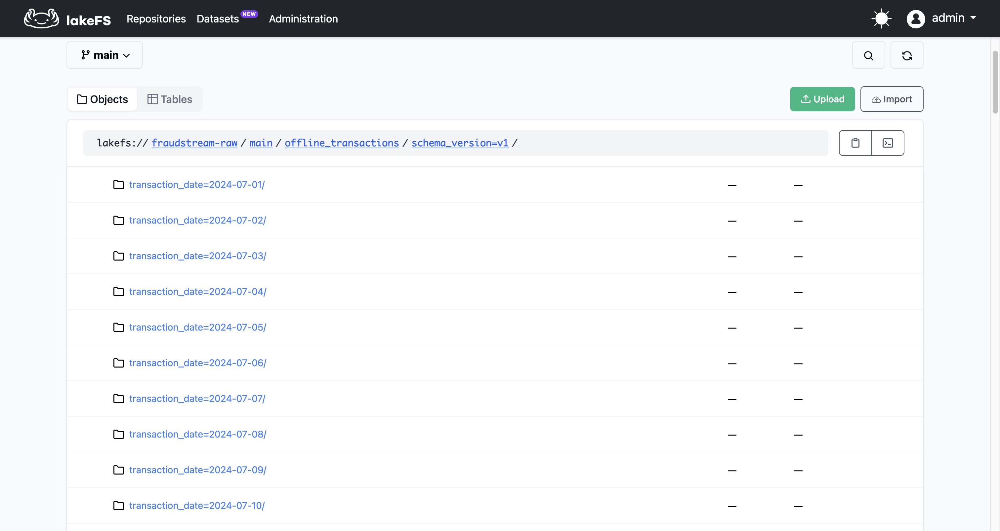

# lakeFS: Version Control for the Raw Zone

The raw zone holds what every table downstream is built from: 730 days of
transaction CSVs and their labels, 115 GB in MinIO. Until now they were plain
files. A program that deleted them deleted them for good, and nothing recorded
what the zone looked like before.

That happened on 10 November. A DP1 run was stopped after 35 seconds. The
generator's first step clears the raw folder before it writes, so the stop
left 4 files out of 730, and nobody noticed for two days. Iceberg's snapshots
didn't help: they cover the Iceberg tables, and the raw CSVs aren't one.

lakeFS gives the raw zone what Git gives code:

- **Commits:** every change is recorded, and any past state can be read or restored.
- **Branches:** a DP1 run writes to its own branch, never straight to `main`.
- **Merges:** `main` changes in one step, and only after the run's checks pass.

The programs don't need to know any of this. lakeFS speaks the same S3 protocol
as MinIO, so the generator, the checks and Spark keep their S3 code. Only the
address of one bucket changed.

## Architecture



lakeFS sits between the programs and MinIO, and only for the raw zone. Every
other bucket is still reached directly. Inside lakeFS, a branch is a list that
says, for each file name, where its bytes are in MinIO. It keeps those lists on
its own volume and the bytes in MinIO:

- **The 730 days imported once** are read from where they always were, `fraudstream/raw/`.
- **Every file written through lakeFS** goes to its own area, `lakefs/fraudstream-raw/`.

A write never replaces a file in place: a new version is a new file. Every
commit's list still points at bytes that exist, so going back is always possible.

## How a path reaches lakeFS

lakeFS reads the first two parts of an S3 path as the repository and the
branch:

```
s3a://fraudstream-raw/main/offline_transactions/schema_version=v1/transaction_date=2024-07-01/transactions.csv
      └─ repository ─┘└branch┘└──────────────────────── file path ──────────────────────────────┘
```

| Part | Who chose it |
|---|---|
| `bucket/branch/path` layout | lakeFS's S3 gateway requires it |
| `fraudstream-raw` | ours: the repository's name |
| `main` | lakeFS's default name for the first branch |
| `dp1-<run id>` | ours: one branch per DP1 run |

One method sends each bucket to the right place.
[`WarehouseConfig.s3_settings`](../../src/fraudstream/jobs/warehouse.py#L42)
returns lakeFS's address and keys for `fraudstream-raw`, and MinIO's for every
other bucket. If the lakeFS keys are missing, it stops with an error instead of
falling back to MinIO. Both kinds of client use it:

- **Python with boto3** (the generator and the manifest check):
  [`storage._client`](../../src/fraudstream/storage.py#L240) builds one client per bucket from it.
- **Spark** (Bronze and the labels job):
  [`configure_object_storage`](../../src/fraudstream/jobs/warehouse.py#L195)
  adds Hadoop's per-bucket settings, `fs.s3a.bucket.fraudstream-raw.*`, so that
  one bucket gets lakeFS's endpoint and keys and every other bucket keeps MinIO's.

## Setting up lakeFS

**1. The service.** [`docker-compose.yml:236`](../../docker-compose.yml#L236)
runs `treeverse/lakefs:1.88.0` on port 18000:

- [`docker-compose.yml:246`](../../docker-compose.yml#L246): its metadata goes in lakeFS's built-in
  key-value store. That's the only store with which lakeFS creates the first
  admin from its settings at start-up, so nobody has to click through a setup page.
- [`docker-compose.yml:250`](../../docker-compose.yml#L250): its files go to MinIO, with path-style
  addresses, as MinIO needs.
- [`docker-compose.yml:234`](../../docker-compose.yml#L234): `minio-bucket-init` creates the `lakefs` bucket.
- [`docker-compose.yml:260`](../../docker-compose.yml#L260): the volume is mounted on the `lakefs`
  user's home folder. The image runs as that user, not as root, and the home
  folder is the one place it can write.

**2. The keys, from Vault.** Nothing is written in the repository:

- [`infra/vault/seed.sh:68`](../../infra/vault/seed.sh#L68) makes the admin's
  access key and secret (`secret/platform/lakefs`) and lakeFS's encryption key
  (`secret/compose/lakefs`).
- [`infra/vault/env.sh:30`](../../infra/vault/env.sh#L30) exports them for Compose.
- [`infra/vault/policies/airflow.hcl:17`](../../infra/vault/policies/airflow.hcl#L17)
  lets Airflow read `platform/lakefs` as its `lakefs` connection.
- [`airflow/include/fraudstream_airflow/dag_helpers.py:23`](../../airflow/include/fraudstream_airflow/dag_helpers.py#L23)
  hands the keys to every task through Airflow's connection templates.
- [`docker-compose.yml:37`](../../docker-compose.yml#L37) gives Airflow lakeFS's address.

```bash
./infra/vault/seed.sh && ./infra/vault/configure.sh
. infra/vault/env.sh
docker compose up -d lakefs
```

**3. The repository.** In the UI at `http://localhost:18000`, create
`fraudstream-raw` with storage namespace `s3://lakefs/fraudstream-raw` and
default branch `main`:



**4. Import the existing days without copying them.** `lakectl import` records
the 730 days already in MinIO as one commit on `main`. It finishes in seconds:

```bash
lakectl import --no-progress --from s3://fraudstream/raw/ --to lakefs://fraudstream-raw/main/ \
  --message "Import the raw zone: 730 days of transactions and their labels"
lakectl fs ls -r lakefs://fraudstream-raw/main/offline_transactions/ | wc -l   # 730
lakectl fs ls -r lakefs://fraudstream-raw/main/transaction_labels/ | wc -l     # 730
```

**5. Point the raw paths at the repository.** The Airflow Variables
[`fraudstream_raw_uri` and `fraudstream_labels_uri`](../../airflow/config/variables.json#L6)
now name `s3a://fraudstream-raw/main/…`, and so do the generator's and Bronze's
own defaults. A run with the default settings can no longer reach the imported
files in MinIO.

## How DP1 uses a branch



Run A passed its checks and merged, so `main` moved forward in one step. Run B
was stopped. Its branch keeps the half-written files for inspection and never
merges, so `main` doesn't change.

DP1 ([`airflow/dags/raw_to_bronze.py:99`](../../airflow/dags/raw_to_bronze.py#L99))
runs these five steps in order:

| Step | What it does | Code |
|---|---|---|
| `create_branch` | Branches `dp1-<run id>` off `main`. A retried run reuses its branch. | [`lakefs.py:29`](../../airflow/include/fraudstream_airflow/lakefs.py#L29) |
| `generate_raw_source` | Writes the 730 days into the branch. Its clear-first step now clears only the branch. | [`raw_to_bronze.py:56`](../../airflow/dags/raw_to_bronze.py#L56), [`lakefs.py:22`](../../airflow/include/fraudstream_airflow/lakefs.py#L22) |
| `verify_source_manifest` | Checks every file in the manifest exists on the branch and isn't empty. | [`dag_helpers.py:54`](../../airflow/include/fraudstream_airflow/dag_helpers.py#L54) |
| `commit_and_merge` | Commits the branch, with the Airflow run ID in the commit's metadata, and merges it into `main`. Returns the merged commit. | [`lakefs.py:43`](../../airflow/include/fraudstream_airflow/lakefs.py#L43) |
| `ingest_bronze` | Reads `main` and writes the merged commit into its summary as `source_commit`. | [`raw_to_bronze.py:93`](../../airflow/dags/raw_to_bronze.py#L93), [`ingest_transactions.py:893`](../../src/fraudstream/jobs/bronze/ingest_transactions.py#L893) |

How the pieces work:

- **The generator's paths:** the DAG makes [`on_branch`](../../airflow/include/fraudstream_airflow/lakefs.py#L22)
  available to its templates ([`raw_to_bronze.py:39`](../../airflow/dags/raw_to_bronze.py#L39)).
  It turns `s3a://fraudstream-raw/main/…` into `s3a://fraudstream-raw/dp1-<run id>/…`.
- **Branch names:** lakeFS allows only letters, digits, `_` and `-`, so
  [`branch_name`](../../airflow/include/fraudstream_airflow/lakefs.py#L16) replaces
  everything else in the run ID with `-`.
- **The lakeFS calls:** there are three, and [`_post`](../../airflow/include/fraudstream_airflow/lakefs.py#L71)
  makes them with Python's built-in `urllib`, so the Airflow image needs no new package.
- **Reruns:** commit and merge both allow an empty change, so a rerun that
  regenerates identical files still finishes.
- **Errors:** they stop the task with lakeFS's own message.

## Proof

The test repeated the accident: trigger DP1, let the generator run about 30
seconds, then mark it failed in Airflow.



`commit_and_merge` never ran, so the half-written branch never reached `main`:

| | 10 November, before lakeFS | This run, with lakeFS |
|---|---|---|
| Transaction files left on `main` | 4 of 730 | **730 of 730** |
| Label files left on `main` | lost | **730 of 730** |
| Transaction files on the run's branch | — | 8 (the days written before the stop) |
| Changes on the branch, uncommitted | — | 1,444 removed (722 transactions + 722 labels), 16 rewritten (8 + 8) |
| `main`'s last commit | — | still the import, `683c18da…` |
| Recovery | regenerate 115 GB | nothing to do: delete the branch, or keep it to inspect |

The run's branch holds only the first days:



Its uncommitted changes show what the run did before it stopped: the
clear-first step marked 722 files removed in each folder, and 8 days were
already rewritten.



`main` at the same moment still has every day:



The numbers come from:

```bash
lakectl fs ls -r lakefs://fraudstream-raw/$B/offline_transactions/ | wc -l     # 8
lakectl fs ls -r lakefs://fraudstream-raw/main/offline_transactions/ | wc -l   # 730
lakectl diff lakefs://fraudstream-raw/$B | grep -c '^ *-'                       # 1444
```

## What lakeFS doesn't protect

- **Deleting the files in MinIO directly.** lakeFS keeps lists, not copies.
  `mc rm` on `fraudstream/raw/` or `lakefs/` would leave `main` listing files
  that can't be read. Production systems let only lakeFS's own account access
  those buckets, and keep backups with bucket versioning.
- **The generator's local evidence files.** `_manifest.json` and
  `_quality_summary.*` live on the Airflow container's disk, and the generator
  deletes them at start-up
  ([`offline_transactions.py:476`](../../src/fraudstream/generators/offline_transactions.py#L476)).
  A stopped run loses them, so back them up before a test like the one above.
- **Old branches pile up,** one per run. They cost only metadata, and are kept
  on purpose because Bronze's `_source_file` column points at the branch's
  paths. Delete one with `lakectl branch delete`.

## Where things are

| What | Where |
|---|---|
| lakeFS service and its bucket | [`docker-compose.yml`](../../docker-compose.yml) |
| lakeFS keys | [`infra/vault/seed.sh`](../../infra/vault/seed.sh), [`infra/vault/env.sh`](../../infra/vault/env.sh), [`infra/vault/policies/airflow.hcl`](../../infra/vault/policies/airflow.hcl) |
| Which bucket goes to lakeFS | [`src/fraudstream/jobs/warehouse.py`](../../src/fraudstream/jobs/warehouse.py), [`src/fraudstream/storage.py`](../../src/fraudstream/storage.py) |
| Branch, commit and merge | [`airflow/include/fraudstream_airflow/lakefs.py`](../../airflow/include/fraudstream_airflow/lakefs.py) |
| DP1 with its branch | [`airflow/dags/raw_to_bronze.py`](../../airflow/dags/raw_to_bronze.py) |
| Raw paths | [`airflow/config/variables.json`](../../airflow/config/variables.json), [`configs/generator/offline_transactions.json`](../../configs/generator/offline_transactions.json) |
| The commit Bronze read | [`src/fraudstream/jobs/bronze/ingest_transactions.py`](../../src/fraudstream/jobs/bronze/ingest_transactions.py) |
| Tests | [`tests/unit/test_lakefs_service.py`](../../tests/unit/test_lakefs_service.py), [`tests/unit/test_lakefs_branches.py`](../../tests/unit/test_lakefs_branches.py), [`tests/unit/test_storage.py`](../../tests/unit/test_storage.py), [`tests/unit/test_warehouse.py`](../../tests/unit/test_warehouse.py) |
| Screenshots | [`images/lakefs/`](../../images/lakefs/) |
