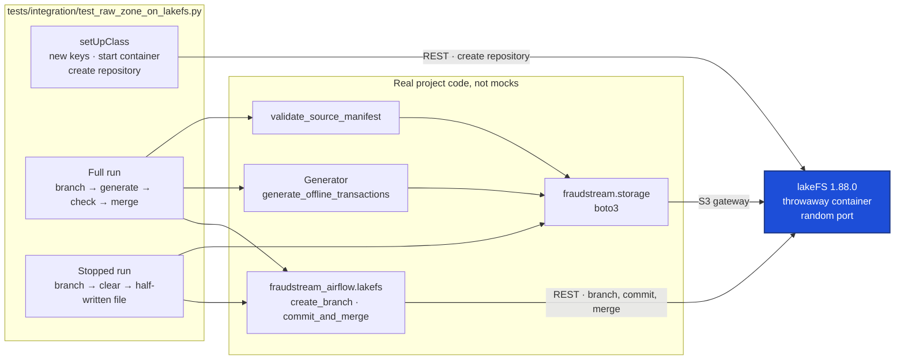

# Integration Tests with Testcontainers

The unit tests in `tests/unit/` are fast because they never leave the laptop:
every job reads and writes local `file://` paths instead of MinIO and lakeFS.
That's also their blind spot. The code that talks to real storage (boto3 through
lakeFS's S3 gateway, picking an endpoint per bucket, branching, committing,
merging) only runs for real inside Airflow, where a DP1 run takes an hour.

While lakeFS was being added, every storage problem was found that way: a
lakeFS volume the container couldn't write to, upload checksums through the
gateway, an Iceberg catalog OpenLineage couldn't read. Each one cost a full
run to find.

Testcontainers fills the gap. A test starts a real service in a throwaway
Docker container, runs the real code against it, and removes the container
when it finishes. The raw zone's whole lakeFS path is checked in about a
minute, on any machine with Docker, with nothing to set up beforehand.

## What the test runs



The test owns the container from start to finish:

- **It starts lakeFS** ([`test_raw_zone_on_lakefs.py:48`](../../tests/integration/test_raw_zone_on_lakefs.py#L48)):
  the same `treeverse/lakefs:1.88.0` image Compose runs. It keeps its metadata
  and files inside the container, so MinIO isn't needed.
- **It makes the keys** at run time ([`:45`](../../tests/integration/test_raw_zone_on_lakefs.py#L45)),
  so no key is written in the repository or read from Vault.
- **It waits for lakeFS's health check** ([`:60`](../../tests/integration/test_raw_zone_on_lakefs.py#L60))
  and creates the `fraudstream-raw` repository through lakeFS's API ([`:61`](../../tests/integration/test_raw_zone_on_lakefs.py#L61)).
- **It removes the container** when the tests finish, pass or fail
  ([`:58`](../../tests/integration/test_raw_zone_on_lakefs.py#L58)).
  Testcontainers also runs a small clean-up container of its own, so a test
  killed halfway still leaves nothing behind.
- **It skips itself** when Docker isn't running ([`:42`](../../tests/integration/test_raw_zone_on_lakefs.py#L42)),
  so it never breaks the unit suite.

## The two tests

**A run reaches `main` only after it merges**
([`:69`](../../tests/integration/test_raw_zone_on_lakefs.py#L69)). It follows
DP1's raw-zone steps in order, with the code DP1 itself uses:

| Step | Code it runs | What the test checks |
|---|---|---|
| 1. Branch | [`lakefs.create_branch`](../../airflow/include/fraudstream_airflow/lakefs.py#L29) | — |
| 2. Generate 2 days (one v1, one v2) through the S3 gateway | [`generate_offline_transactions`](../../src/fraudstream/generators/offline_transactions.py#L440), [`storage._client`](../../src/fraudstream/storage.py#L240) | `main` hasn't changed |
| 3. Check the branch | [`validate_source_manifest`](../../src/fraudstream/orchestration/validation.py#L24) | 2 files |
| 4. Commit and merge | [`lakefs.commit_and_merge`](../../airflow/include/fraudstream_airflow/lakefs.py#L43) | a 64-character commit ID |
| 5. Read back from `main` | [`storage.open_text`](../../src/fraudstream/storage.py#L92) | both files there, every generated row read back |

**A stopped run leaves `main` as it was**
([`:94`](../../tests/integration/test_raw_zone_on_lakefs.py#L94)). It repeats
what the 10 November run did before it was stopped: clear the raw zone
([`:101`](../../tests/integration/test_raw_zone_on_lakefs.py#L101)) and write one
half-written file ([`:102`](../../tests/integration/test_raw_zone_on_lakefs.py#L102)),
all on the run's branch. Nothing merges, and `main` is unchanged.

Both tests go through the same per-bucket routing as production:
[`WarehouseConfig.s3_settings`](../../src/fraudstream/jobs/warehouse.py#L42)
sends `fraudstream-raw` to lakeFS. Only lakeFS's address changes, to the
container's random port.

## Run it

```bash
./cicd/test.sh integration
```

That suite ([`cicd/test.sh:11`](../../cicd/test.sh#L11)) installs the
`integration` extra, `testcontainers==4.15.0`
([`pyproject.toml:11`](../../pyproject.toml#L11)), and runs everything in
`tests/integration/`. It isn't in the default list because it needs Docker;
`./cicd/test.sh` alone still runs only the unit suites.

## Unit tests and integration tests

| | Unit tests (`tests/unit/`) | Integration tests (`tests/integration/`) |
|---|---|---|
| Storage | local `file://` paths | a real lakeFS in a container |
| Needs | Python only | Python and Docker |
| Time | seconds | about a minute, plus the first image download |
| Catches | logic: counts, rules, schemas | wiring: the S3 gateway, keys, branches, merges |

They don't replace each other. The unit tests stay the fast check on every
change, and the integration tests check what only a real service can show.

## Where things are

| What | Where |
|---|---|
| The integration tests | [`tests/integration/test_raw_zone_on_lakefs.py`](../../tests/integration/test_raw_zone_on_lakefs.py) |
| How they're run | [`cicd/test.sh`](../../cicd/test.sh) |
| The Testcontainers version | [`pyproject.toml`](../../pyproject.toml) |
| The code under test | [`airflow/include/fraudstream_airflow/lakefs.py`](../../airflow/include/fraudstream_airflow/lakefs.py), [`src/fraudstream/storage.py`](../../src/fraudstream/storage.py), [`src/fraudstream/generators/offline_transactions.py`](../../src/fraudstream/generators/offline_transactions.py), [`src/fraudstream/orchestration/validation.py`](../../src/fraudstream/orchestration/validation.py) |
| lakeFS on the raw zone | [`07_lakefs.md`](07_lakefs.md) |
| Screenshots | [`images/testcontainers/`](../../images/testcontainers/) |
