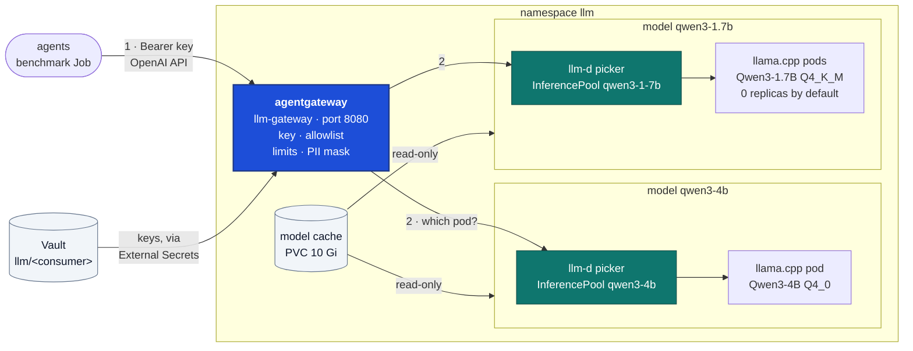
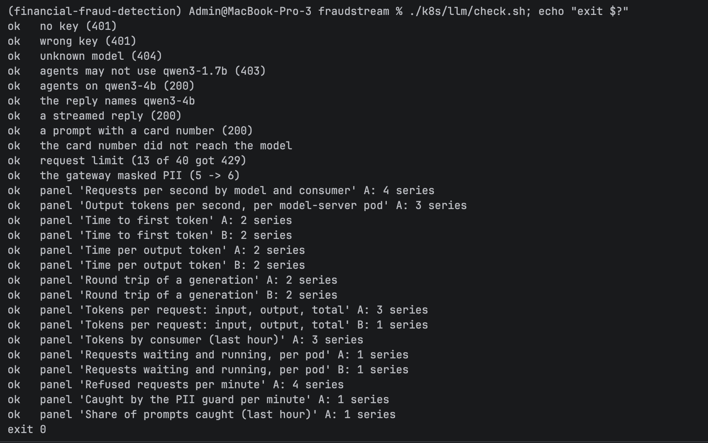
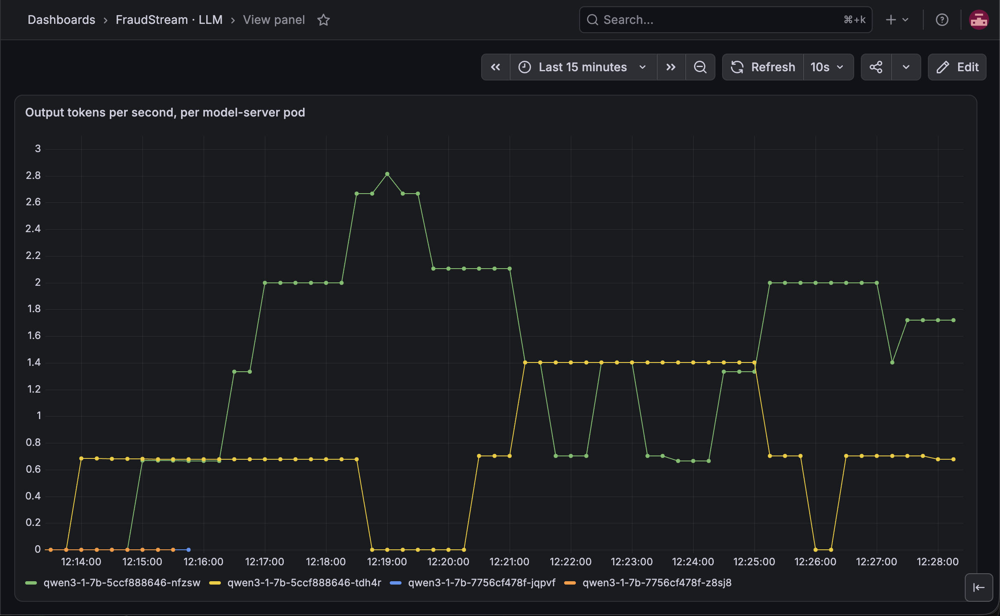
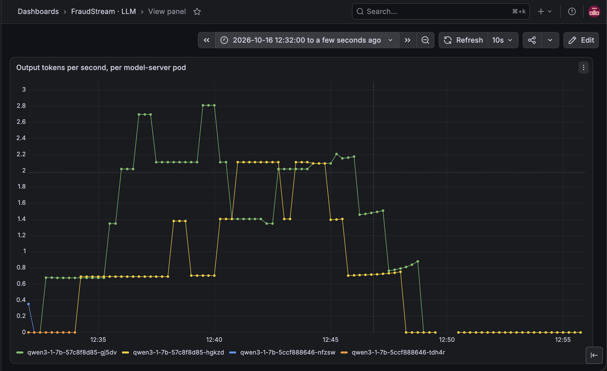

# LLM Inference Platform

The agents need a language model to read facts and explain them. This is that model's
endpoint inside the cluster: one OpenAI-compatible address,
`http://llm-gateway.llm.svc.cluster.local:8080/v1`. Every request needs a key, may use
only the models its key allows, is rate limited, and has card numbers and emails masked
before the model sees them. The fraud detection model still makes every fraud decision;
the LLM only explains.

## Architecture



One request, `POST /v1/chat/completions` with `"model": "qwen3-4b"`:

1. **Key.** agentgateway hashes the `Bearer` key and looks it up. No key, or a wrong one: 401.
2. **Model.** The `model` field must match a declared model. Anything else: 404.
3. **Allowlist.** The key lists the models its consumer may use. `agents` asking for
   `qwen3-1.7b`: 403.
4. **Limits.** Requests and tokens per minute, per consumer. Over the limit: 429.
5. **Masking.** Card numbers (Luhn-checked) and emails in the prompt are replaced before
   the model sees them, and again in the reply.
6. **Picker.** agentgateway asks the model's llm-d picker which pod should answer. The
   picker prefers a pod that already holds the prompt's prefix in cache, then the least
   busy one.
7. **Pod.** llama.cpp answers, and the gateway records tokens and timing under the
   caller's consumer name.

All policy lives in one proxy, and there is one hop to the model pod. The pickers only
choose pods; they are not in the data path.

## Deploying the platform

[`k8s/llm/install.sh`](../../k8s/llm/install.sh) installs everything, in order, and is
safe to run again. Every version is pinned in
[`k8s/versions.sh:16`](../../k8s/versions.sh#L16) (Gateway API v1.6.3, Inference
Extension v1.6.2, agentgateway v1.6.0, llm-d router v0.11.0).

| Step | What it does | Where |
|---|---|---|
| CRDs | the Gateway API and the Inference Extension CRDs, applied apart from their charts, since Helm never updates a CRD | [`llm/install.sh:15`](../../k8s/llm/install.sh#L15) |
| agentgateway | its CRDs and controller, with the Inference Extension switched on; without it every model answers `route not found` | [`llm/install.sh:21`](../../k8s/llm/install.sh#L21), [`llm/agentgateway-values.yaml:7`](../../k8s/llm/agentgateway-values.yaml#L7) |
| Model cache | a 10 Gi volume and a Job that downloads the model files into it | [`llm/install.sh:31`](../../k8s/llm/install.sh#L31), [`models/fetch.yaml:1`](../../k8s/llm/models/fetch.yaml#L1) |
| Model servers | one llama.cpp Deployment per model | [`llm/install.sh:35`](../../k8s/llm/install.sh#L35) |
| Endpoint pickers | one llm-d picker and InferencePool per model, named after it | [`llm/install.sh:40`](../../k8s/llm/install.sh#L40) |
| Keys | one key per consumer, made once in Vault and copied in by External Secrets | [`llm/install.sh:51`](../../k8s/llm/install.sh#L51) |
| Gateway, models, policy | the Gateway `llm-gateway`, one `AgentgatewayModel` per model, then the policy | [`llm/install.sh:56`](../../k8s/llm/install.sh#L56), [`llm/install.sh:60`](../../k8s/llm/install.sh#L60) |
| Scraping and dashboard | ServiceMonitors and the LLM dashboard | [`llm/install.sh:63`](../../k8s/llm/install.sh#L63) |

The Gateway has one listener on port 8080 that takes only `AgentgatewayModel` routes
([`llm/gateway.yaml:34`](../../k8s/llm/gateway.yaml#L34)). Each model is a route to its
InferencePool, so agentgateway asks the pool's picker for a pod
([`llm/gateway.yaml:61`](../../k8s/llm/gateway.yaml#L61)). The picker scores pods on
queue length, KV-cache use and prefix-cache hits, prefix weighted highest
([`llm/router-values.yaml:30`](../../k8s/llm/router-values.yaml#L30)).

| Component | Memory, during a benchmark run |
|---|---|
| `qwen3-4b` model pod | 3.8 GiB (asks for 4 GiB, limit 5 GiB, [`models/qwen3-4b.yaml:54`](../../k8s/llm/models/qwen3-4b.yaml#L54)) |
| agentgateway proxy | 27 MiB |
| agentgateway controller | 52 MiB |
| llm-d picker, each | 34–38 MiB |

## A custom LLM model

The model is not a hosted API. It is **Qwen3-4B**, a GGUF file pinned to one Hugging
Face revision, served by llama.cpp in the cluster, and declared to the gateway as a
custom provider.

**Why Qwen3-4B.** Twenty fraud analyst questions with the agents' four tools were sent
to three Qwen3 sizes. The 4B picked the right tool with the right arguments 20 times
out of 20, the 1.7B 16 times, the 0.6B 10 times. The Q4_0 file the benchmark kept
scores 19/20 on the same test.

**The files.** The Job downloads each file from a pinned revision and keeps it only if
its SHA-256 matches; a file already correct is skipped next time
([`models/fetch.yaml:31`](../../k8s/llm/models/fetch.yaml#L31),
[`models/fetch.yaml:42`](../../k8s/llm/models/fetch.yaml#L42)). The model pods mount
the volume read-only ([`models/qwen3-4b.yaml:60`](../../k8s/llm/models/qwen3-4b.yaml#L60)).

| File | Size | Serves |
|---|---|---|
| `Qwen3-4B-Q4_0.gguf` | 2.4 GB | `qwen3-4b` |
| `Qwen3-4B-Q4_K_M.gguf` | 2.5 GB | the benchmark baseline only |
| `Qwen3-1.7B-Q4_K_M.gguf` | 1.1 GB | `qwen3-1.7b`: the routing benchmark and the A/B tests |

**The server.** llama.cpp `server-b11610` serves the file under the name `qwen3-4b`
([`models/qwen3-4b.yaml:21`](../../k8s/llm/models/qwen3-4b.yaml#L21)):

| Flag | Why | Where |
|---|---|---|
| `--alias qwen3-4b` | the name callers ask for, whatever the file is called | [`models/qwen3-4b.yaml:25`](../../k8s/llm/models/qwen3-4b.yaml#L25) |
| `--jinja` | Qwen's chat template, which handles tool calls | [`models/qwen3-4b.yaml:27`](../../k8s/llm/models/qwen3-4b.yaml#L27) |
| `--reasoning off` | Qwen3's hidden thinking adds a minute per call on this CPU and can use up the 512 tokens before the tool call is written | [`models/qwen3-4b.yaml:28`](../../k8s/llm/models/qwen3-4b.yaml#L28) |
| `--threads 8 --parallel 1 --ctx-size 8192` | the benchmark's winner, below | [`models/qwen3-4b.yaml:30`](../../k8s/llm/models/qwen3-4b.yaml#L30) |
| `--cache-ram 512` | the prompt cache defaults to 8 GiB, past the memory limit | [`models/qwen3-4b.yaml:37`](../../k8s/llm/models/qwen3-4b.yaml#L37) |
| `--metrics` | queue, tokens and KV cache for Prometheus and the picker | [`models/qwen3-4b.yaml:39`](../../k8s/llm/models/qwen3-4b.yaml#L39) |
| `Recreate` | the node can't hold two copies of the model during a rolling update | [`models/qwen3-4b.yaml:8`](../../k8s/llm/models/qwen3-4b.yaml#L8) |

**Declared to the gateway as a custom provider.** agentgateway has no built-in llama.cpp
provider, so the model is `provider: Custom` with `providerOverride: llama-cpp`, in the
OpenAI completions format ([`llm/gateway.yaml:58`](../../k8s/llm/gateway.yaml#L58)).

**Taught to the picker.** llm-d knows vLLM's and SGLang's metric names, not llama.cpp's.
The picker reads llama.cpp's queue, running requests and KV-cache use through an engine
defined in the values ([`llm/router-values.yaml:22`](../../k8s/llm/router-values.yaml#L22)).

## agentgateway: security and policy

| Check | Setting | Why | Answer | Where |
|---|---|---|---|---|
| Inside the cluster only | Service `ClusterIP`, no Ingress | only agents in the cluster call the model | | [`llm/gateway.yaml:18`](../../k8s/llm/gateway.yaml#L18) |
| Routes from its own namespace only | `allowedRoutes: Same`, model routes only | a route made elsewhere can't attach itself to the model | | [`llm/gateway.yaml:38`](../../k8s/llm/gateway.yaml#L38) |
| A key on every request | `apiKeyAuthentication`, `mode: Strict`, keys from Secret `llm-api-keys` | nothing is anonymous, so every token is billed to someone | 401 | [`llm/policy.yaml:12`](../../k8s/llm/policy.yaml#L12) |
| Only hashes at the gateway | the gateway's Secret holds each key's SHA-256, its consumer and its models | reading the gateway's Secret gives away no key | | [`llm/secrets.yaml:105`](../../k8s/llm/secrets.yaml#L105) |
| Keys from Vault | each key made once in Vault, never printed, copied in every minute by External Secrets | no key is in a file; rotating one is a Vault write | | [`llm/install.sh:51`](../../k8s/llm/install.sh#L51), [`vault/new-key.sh:21`](../../infra/vault/new-key.sh#L21), [`llm/secrets.yaml:89`](../../k8s/llm/secrets.yaml#L89) |
| The model must exist | only declared `AgentgatewayModel`s match | a typo can't reach some default backend | 404 | [`llm/gateway.yaml:56`](../../k8s/llm/gateway.yaml#L56) |
| The model must be allowed | `"qwen3-4b" in apiKey.models`, on each model | the agents' key can't use the benchmark's models | 403 | [`llm/gateway.yaml:71`](../../k8s/llm/gateway.yaml#L71), [`llm/gateway.yaml:108`](../../k8s/llm/gateway.yaml#L108) |
| Request and token limits | per consumer, keyed on `apiKey.consumer` | one runaway agent can't starve the others on a one-slot CPU model | 429 | [`llm/policy.yaml:16`](../../k8s/llm/policy.yaml#L16) |
| PII guard | `promptGuard` with the built-ins `CreditCard` and `Email`, action `Mask`, on request and reply | a card number pasted into a question never reaches the model or the logs | masked, not refused | [`llm/gateway.yaml:72`](../../k8s/llm/gateway.yaml#L72) |
| Calls per consumer | the `consumer` attribute on every metric, and traces to Jaeger | the dashboard separates agents from the benchmark | | [`llm/policy.yaml:38`](../../k8s/llm/policy.yaml#L38) |

| Consumer | Models | Requests | Tokens |
|---|---|---|---|
| `benchmark` | `qwen3-4b`, `qwen3-1.7b` | 600 a minute | 2,000,000 a minute |
| `agents` | `qwen3-4b` | 30 a minute | 20,000 a minute |
| `risk-agent-b` | `qwen3-1.7b` | 30 a minute | 20,000 a minute |

Phone numbers were masked too, until the agents showed that the guard reads every date,
such as `2026-06-23`, as one. Streamed replies are not masked by agentgateway; agents call
without streaming, so their replies are.

[`k8s/llm/check.sh`](../../k8s/llm/check.sh) sends each case through the gateway from a
pod inside the cluster ([`llm/check-requests.sh:18`](../../k8s/llm/check-requests.sh#L18)):
no key and a wrong key get 401, an unknown model 404, a model off the key's list 403,
the allowed model 200. A prompt with a card number comes back without it
([`llm/check-requests.sh:35`](../../k8s/llm/check-requests.sh#L35)), and the gateway's
own mask counter must have grown, so a model that simply refused to repeat it can't pass
([`llm/check.sh:16`](../../k8s/llm/check.sh#L16)). Forty requests sent together must
meet a 429 ([`llm/check-requests.sh:42`](../../k8s/llm/check-requests.sh#L42)).



The gateway's metrics, the LLM dashboard and the traces are in
[18_observability.md](18_observability.md#llm-telemetry).

## Benchmark and optimization

**Workload.** guidellm runs as a Job in the cluster and sends chat requests through the
gateway with the benchmark key. Each has a 1,000-token prefix shared by all requests,
200 tokens of its own, and asks for 200 tokens back, streamed, for 15 minutes per level
([`bench/job.yaml:28`](../../k8s/llm/bench/job.yaml#L28),
[`bench/job.yaml:31`](../../k8s/llm/bench/job.yaml#L31)).

**SLA, fixed before any run.** Time to first token ≤ 8 s and time per output token
≤ 400 ms for 95% of requests ([`bench/job.yaml:30`](../../k8s/llm/bench/job.yaml#L30)).
guidellm searches for the highest number of concurrent requests that still meets it,
the **goodput** ([`llm/bench.sh:16`](../../k8s/llm/bench.sh#L16)).

**Limitation.** The model runs on a MacBook's CPU inside Docker: no GPU, about 4–5
usable cores. 8 s is already lenient, since chat usually aims for 1–2 s; the limit was
kept, not raised until something passed. Runs vary by up to 25%, so smaller changes
count as noise.

| # | Change from the best so far | Goodput | Output tokens/s | TTFT p50 / p95 | Time per token p50 / p95 | Kept? |
|---|---|---|---|---|---|---|
| 0 | Baseline: Q4_K_M, 8 threads, 1 slot | none | 4.0 | 13.0 / 13.5 s | 239 / 263 ms | baseline |
| 1 | Q4_K_M → **Q4_0** weights | **1** | **7.6** | **5.1 / 5.4 s** | **125 / 140 ms** | **yes** |
| 2 | 1 → 2 slots | 1 | 6.9 | 5.4 / 6.5 s | 139 / 188 ms | no |
| 3 | 8-bit KV cache | none | 6.0 | 6.4 / 9.4 s | 136 / 289 ms | no |
| 4 | 8 → 6 threads | 1 | 6.4 | 7.2 / 7.8 s | 151 / 165 ms | no |

- **Q4_0 is the only win.** llama.cpp has a faster arm64 path for Q4_0 weights, which
  halves both prompt reading and token time, so one request at a time now meets the
  SLA. It is the file the server loads ([`models/qwen3-4b.yaml:24`](../../k8s/llm/models/qwen3-4b.yaml#L24)).
- **Two slots** run two requests side by side on the same cores: 95% met the SLA at
  two, right at the bar, so goodput stays 1.
- **The 8-bit KV cache** saves memory, which is not short here, and costs speed to convert.
- **Six threads** use fewer of the cores the laptop frees up, and are slower.
- **Prompt cache reuse** was not tried: llama.cpp already serves the shared prefix from
  its cache, 1,010 of 1,213 prompt tokens on every request.

Every row, with its exact flag change and each run's report, is in
[`k8s/llm/bench/results/summary.md`](../../k8s/llm/bench/results/summary.md).

### Routing: a plain Service against the llm-d picker

Two Qwen3-1.7B pods and four different shared prefixes, as if four agents with
different system prompts used the model. Only the model's `backendRef` changes between
the two runs: the plain Service
([`models/qwen3-1-7b.yaml:70`](../../k8s/llm/models/qwen3-1-7b.yaml#L70)) or the
InferencePool ([`llm/gateway.yaml:98`](../../k8s/llm/gateway.yaml#L98)).

| Route | Prefix found in cache | TTFT p50 / p95 | Time per token p50 |
|---|---|---|---|
| plain Service, round-robin | 5 of 13 requests | 47.0 / 48.7 s | 389 ms |
| **llm-d picker** | **9 of 14 requests** | **10.7** / 48.9 s | **213 ms** |

The picker sends a request to the pod that already holds its prefix, so most requests
skip reading 1,000 tokens and the median first token comes 4× sooner. A request that
misses the cache costs the same either way, so p95 does not move.

**Before, the plain Service.** A request often lands on the pod without its prefix and
the pod spends its time re-reading the prompt. One pod sits at 0 tokens a second twice:



**After, the llm-d picker.** Both pods keep writing tokens for the whole run:



## How to run it

```bash
./k8s/llm/install.sh                       # CRDs, agentgateway, models, pickers, keys, Gateway, policy, dashboard
./k8s/llm/check.sh; echo "exit $?"         # every policy case and every dashboard panel
./k8s/llm/bench.sh <label>                 # one goodput search, saved to k8s/llm/bench/results/<label>.json
```

## Where things are

| What | Where |
|---|---|
| Install | [`k8s/llm/install.sh`](../../k8s/llm/install.sh) |
| Pinned versions | [`k8s/versions.sh`](../../k8s/versions.sh) |
| agentgateway values | [`k8s/llm/agentgateway-values.yaml`](../../k8s/llm/agentgateway-values.yaml) |
| Gateway and models | [`k8s/llm/gateway.yaml`](../../k8s/llm/gateway.yaml) |
| Keys, limits, telemetry | [`k8s/llm/policy.yaml`](../../k8s/llm/policy.yaml), [`k8s/llm/secrets.yaml`](../../k8s/llm/secrets.yaml) |
| llm-d pickers | [`k8s/llm/router-values.yaml`](../../k8s/llm/router-values.yaml) |
| Model cache and servers | [`k8s/llm/models/`](../../k8s/llm/models/) |
| Checks | [`k8s/llm/check.sh`](../../k8s/llm/check.sh), [`k8s/llm/check-requests.sh`](../../k8s/llm/check-requests.sh) |
| Benchmark and results | [`k8s/llm/bench.sh`](../../k8s/llm/bench.sh), [`k8s/llm/bench/`](../../k8s/llm/bench/) |
| Screenshots | [`images/llm/`](../../images/llm/) |
