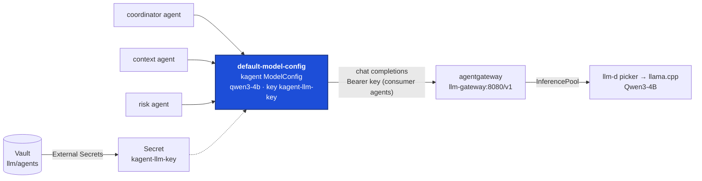
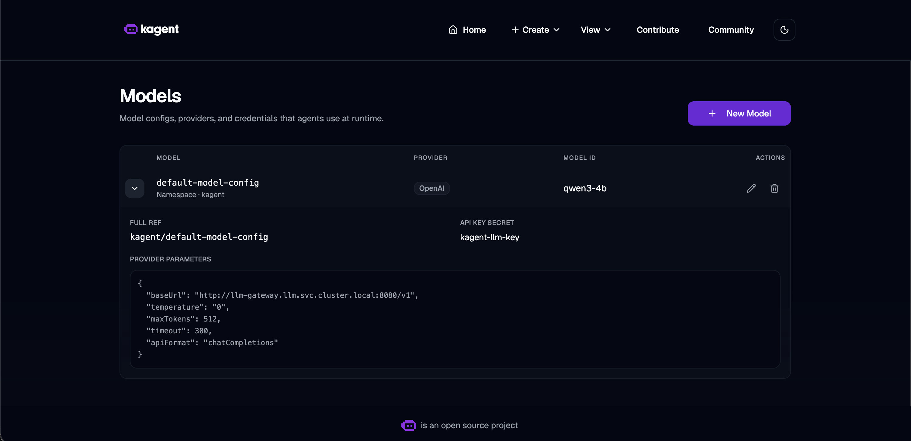

# Global Model Config

Every agent reaches the model through one kagent `ModelConfig`, `default-model-config`.
It points at the LLM gateway from [01_llm_inference_platform.md](01_llm_inference_platform.md),
not at a model pod, so every agent call passes the gateway's key, model allowlist, rate
limits and PII guard. Changing the model for every agent is one change, in one file.



## The config

kagent's chart makes `default-model-config` from its `providers` values, set in
[`agents/kagent-values.yaml:1`](../../k8s/agents/kagent-values.yaml#L1) and installed by
[`agents/install.sh:48`](../../k8s/agents/install.sh#L48):

```yaml
providers:
  default: openAI
  openAI:
    provider: OpenAI
    model: qwen3-4b
    apiKeySecretRef: kagent-llm-key
    apiKeySecretKey: key
    config:
      baseUrl: http://llm-gateway.llm.svc.cluster.local:8080/v1
      temperature: "0"
      maxTokens: 512
      timeout: 300
```

| Setting | Value | Why | Where |
|---|---|---|---|
| Provider | OpenAI-compatible | agentgateway speaks the OpenAI API in front of llama.cpp | [`agents/kagent-values.yaml:4`](../../k8s/agents/kagent-values.yaml#L4) |
| Model | `qwen3-4b` | the only size that picked every tool right when the models were compared | [`agents/kagent-values.yaml:5`](../../k8s/agents/kagent-values.yaml#L5) |
| Key | the Secret `kagent-llm-key`, field `key` | the gateway knows it as the consumer `agents`; the key itself is never in a file | [`agents/kagent-values.yaml:6`](../../k8s/agents/kagent-values.yaml#L6) |
| Address | `llm-gateway.llm.svc.cluster.local:8080/v1` | the gateway, never a model pod: every call gets the key check, limits and PII guard | [`agents/kagent-values.yaml:9`](../../k8s/agents/kagent-values.yaml#L9) |
| Temperature | 0 | the same question picks the same tool | [`agents/kagent-values.yaml:10`](../../k8s/agents/kagent-values.yaml#L10) |
| Max tokens | 512 | a few bullet points or one tool call | [`agents/kagent-values.yaml:11`](../../k8s/agents/kagent-values.yaml#L11) |
| Timeout | 300 s | the model answers one request at a time on the CPU, so a call may wait behind others; at 120 s, five of six questions sent together failed | [`agents/kagent-values.yaml:12`](../../k8s/agents/kagent-values.yaml#L12) |

## Where the key comes from

The key is made once in Vault by the LLM install, at `secret/llm/agents`
([`llm/install.sh:51`](../../k8s/llm/install.sh#L51)). External Secrets copies it into the `kagent` namespace as
`kagent-llm-key` ([`agents/secrets.yaml:109`](../../k8s/agents/secrets.yaml#L109)), and
the gateway's list holds only its hash, with the consumer name `agents` and the one
model it may use ([`llm/secrets.yaml:106`](../../k8s/llm/secrets.yaml#L106)). So the
agents can call `qwen3-4b` and nothing else: asking for `qwen3-1.7b` with this key gets
403 ([`llm/check-requests.sh:22`](../../k8s/llm/check-requests.sh#L22)).

## Every agent names it

| Agent | Where |
|---|---|
| context agent | [`agents/context-agent.yaml:27`](../../k8s/agents/context-agent.yaml#L27) |
| risk agent | [`agents/risk-agent.yaml:27`](../../k8s/agents/risk-agent.yaml#L27) |
| coordinator agent | [`agents/coordinator-agent.yaml:10`](../../k8s/agents/coordinator-agent.yaml#L10) |

The one exception is deliberate: `risk-agent-b`, the B side of an A/B test, runs on a
second config, `small-model-config`, with `qwen3-1.7b` and a key of its own
([`agents/small-model-config.yaml:1`](../../k8s/agents/small-model-config.yaml#L1)); see
[19_ab_testing.md](19_ab_testing.md).

kagent's UI shows the config: `qwen3-4b` through the LLM gateway, with the key's Secret.



## Thinking is off at the model server

Qwen3 writes a hidden reasoning block before it answers. On this CPU that adds a minute
or more per call and can use up the 512 tokens before the tool call is written. kagent
can't turn it off per request, so llama.cpp runs with `--reasoning off`
([`models/qwen3-4b.yaml:28`](../../k8s/llm/models/qwen3-4b.yaml#L28)).

## Where things are

| What | Where |
|---|---|
| The global model config | [`k8s/agents/kagent-values.yaml`](../../k8s/agents/kagent-values.yaml) |
| kagent's install | [`k8s/agents/install.sh`](../../k8s/agents/install.sh) |
| The key from Vault | [`k8s/agents/secrets.yaml`](../../k8s/agents/secrets.yaml), [`k8s/llm/secrets.yaml`](../../k8s/llm/secrets.yaml) |
| The agents that use it | [`k8s/agents/`](../../k8s/agents/) |
| The A/B config | [`k8s/agents/small-model-config.yaml`](../../k8s/agents/small-model-config.yaml) |
| Screenshot | [`images/agents/12-kagent-model-config.png`](../../images/agents/12-kagent-model-config.png) |
