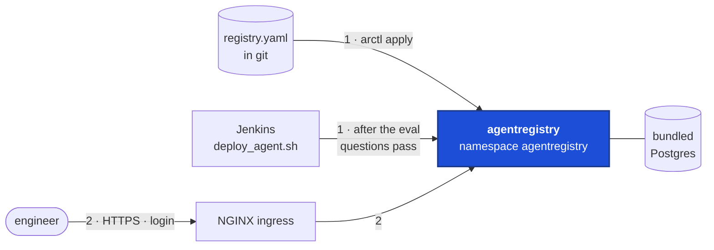
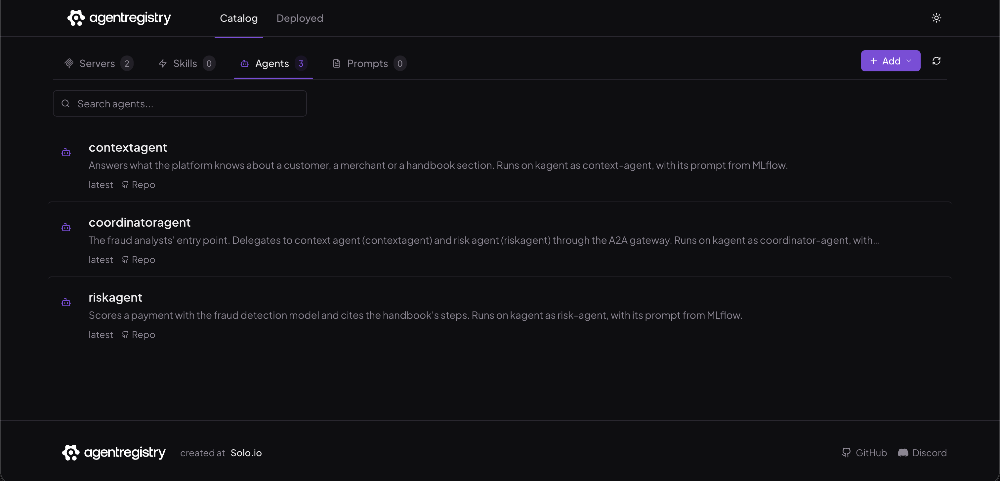
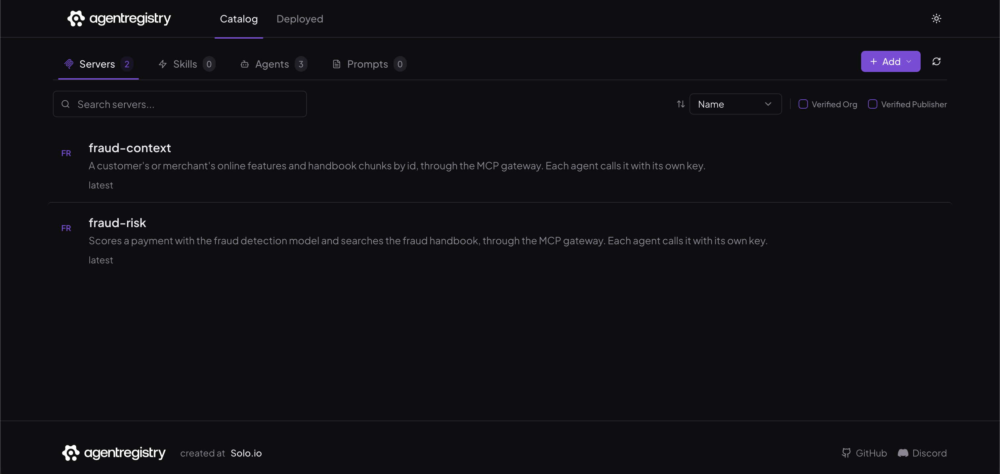
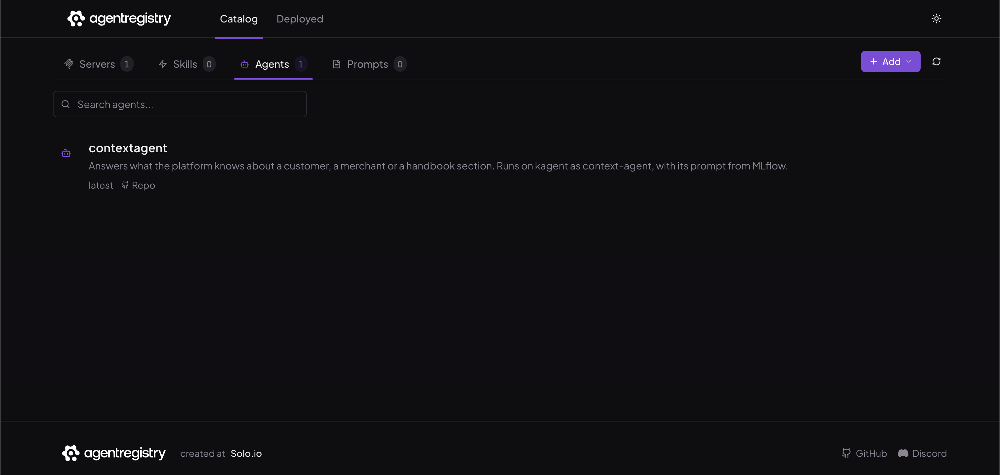
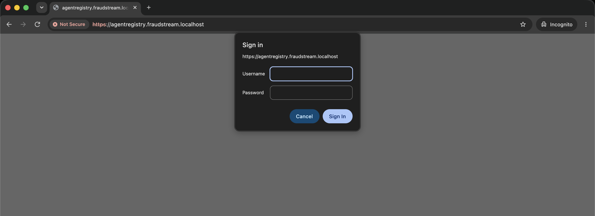

# Agent Registry

agentregistry is the catalog of the platform's agents and the MCP servers they use: what
each agent does, which image runs it, where its code lives, and which tools it may
call. It is a catalog only. It has no cluster permissions and no runtimes, so it can
list agents but never deploy or change them. kagent runs the agents; the registry
records them.



1. The records are published from git with `arctl`, the registry's command line: by
   hand at install, and by Jenkins each time an agent passes its eval questions.
2. An engineer browses the catalog through NGINX, with HTTPS and the gateway login.

## Deploying the registry

agentregistry 0.4.0 ([`k8s/versions.sh:22`](../../k8s/versions.sh#L22)) is a Helm
release in namespace `agentregistry`, installed by
[`agents/install.sh:79`](../../k8s/agents/install.sh#L79).

| Setting | Value | Why | Where |
|---|---|---|---|
| Database | the chart's bundled Postgres, 1 Gi | the catalog is small and only the registry uses it | [`agents/agentregistry-values.yaml:1`](../../k8s/agents/agentregistry-values.yaml#L1) |
| Cluster permissions | none, `rbac.enabled: false` | a catalog has no reason to touch the cluster, so a bug or a bad record can't deploy anything | [`agents/agentregistry-values.yaml:12`](../../k8s/agents/agentregistry-values.yaml#L12) |
| Resources | 100m CPU, 128 Mi, at most 512 Mi | | [`agents/agentregistry-values.yaml:14`](../../k8s/agents/agentregistry-values.yaml#L14) |
| Reachable only from NGINX | a NetworkPolicy on the registry's server pod | the open-source registry lets any caller write, so a pod in the cluster could otherwise change the catalog without the login | [`agents/ingress.yaml:67`](../../k8s/agents/ingress.yaml#L67) |

## What it holds

[`k8s/agents/registry.yaml`](../../k8s/agents/registry.yaml) holds every record. Registry
agent names can't contain hyphens, so `context-agent` in kagent is `contextagent` here.

| Record | Kind | Links to | Where |
|---|---|---|---|
| `fraud-context` | MCP server | the MCP gateway's address, streamable HTTP, no key | [`agents/registry.yaml:1`](../../k8s/agents/registry.yaml#L1) |
| `contextagent` | Agent | its image, this repository, and `fraud-context` | [`agents/registry.yaml:12`](../../k8s/agents/registry.yaml#L12) |
| `fraud-risk` | MCP server | the MCP gateway's address | [`agents/registry.yaml:27`](../../k8s/agents/registry.yaml#L27) |
| `riskagent` | Agent | its image, this repository, and `fraud-risk` | [`agents/registry.yaml:38`](../../k8s/agents/registry.yaml#L38) |
| `coordinatoragent` | Agent | its image and this repository; the registry has no field for the agents it calls, so its description names them | [`agents/registry.yaml:53`](../../k8s/agents/registry.yaml#L53) |

## Publishing

[`k8s/agents/publish.sh`](../../k8s/agents/publish.sh) downloads `arctl` once and keeps it
only if its SHA-256 matches the one its release publishes
([`agents/publish.sh:15`](../../k8s/agents/publish.sh#L15)). Then it applies
`registry.yaml` through a port-forward ([`agents/publish.sh:31`](../../k8s/agents/publish.sh#L31)).
`arctl apply` writes each record as it is in the file, so it is safe to run again.

It runs at two moments:

- at the end of the install ([`agents/install.sh:82`](../../k8s/agents/install.sh#L82));
- in Jenkins, after an agent's eval questions pass and its prompt is promoted to
  production ([`cicd/deploy_agent.sh:94`](../../cicd/deploy_agent.sh#L94)). An agent
  that fails its questions is rolled back and never reaches the catalog.

## The UI

The catalog shows the three agents and the two MCP servers:





An agent's page links its repository and its MCP server:



The UI is at `https://agentregistry.fraudstream.localhost`, behind NGINX with HTTPS, the
gateway login and a rate limit ([`agents/ingress.yaml:35`](../../k8s/agents/ingress.yaml#L35));
see [16_external_routing.md](16_external_routing.md). It asks for the login before
anything loads:



## How to run it

```bash
./k8s/agents/install.sh     # kagent, the agents, then agentregistry and the records
./k8s/agents/publish.sh     # the records again, after a change to registry.yaml
```

## Where things are

| What | Where |
|---|---|
| Registry values | [`k8s/agents/agentregistry-values.yaml`](../../k8s/agents/agentregistry-values.yaml) |
| The records | [`k8s/agents/registry.yaml`](../../k8s/agents/registry.yaml) |
| Publishing | [`k8s/agents/publish.sh`](../../k8s/agents/publish.sh) |
| Install | [`k8s/agents/install.sh`](../../k8s/agents/install.sh) |
| Published from CI | [`cicd/deploy_agent.sh`](../../cicd/deploy_agent.sh) |
| The UI behind NGINX, and its NetworkPolicy | [`k8s/agents/ingress.yaml`](../../k8s/agents/ingress.yaml) |
| Screenshots | [`images/multi_agents/`](../../images/multi_agents/), [`images/agents/`](../../images/agents/) |
