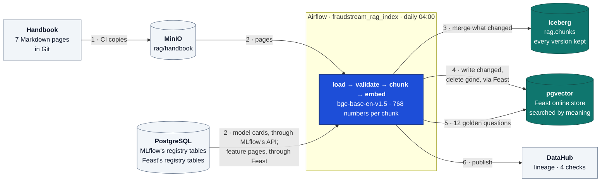
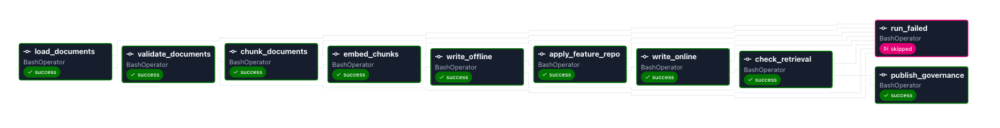
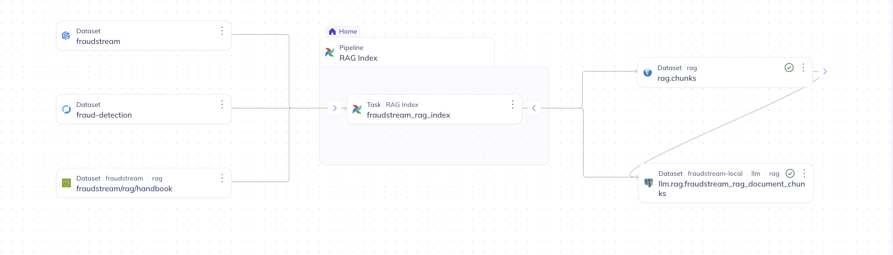

# RAG Data Pipeline

The agents answer from documents, not from memory. This pipeline prepares them: the
fraud handbook, a card for every version of the fraud detection model, and a page for
every feature view. Each is pulled as text, cut into chunks, turned into a vector by one
pinned embedding model, and stored in the feature store through Feast, so a question
can find the chunks closest to it. Airflow runs it daily, and only chunks that changed
are written.

## Architecture



1. **Copy.** CI copies the handbook from Git to MinIO, so Airflow reads one place.
2. **Load.** Three sources are read as text: the handbook pages, one card per registered
   model version, one page per feature view.
3. **Validate, chunk, embed**, then **merge into Iceberg** only the chunks whose hash
   changed.
4. **Write to pgvector** through Feast, with the same rule.
5. **Check** that twelve golden questions find their page.
6. **Publish** the lineage and the check results to DataHub.

## The pipeline in Airflow

The DAG is [`airflow/dags/rag_index.py`](../../airflow/dags/rag_index.py), scheduled at
04:00 every day, one run at a time ([`dags/rag_index.py:24`](../../airflow/dags/rag_index.py#L24)).
Each task runs one step of [`rag/src/fraudstream_rag/steps.py`](../../rag/src/fraudstream_rag/steps.py)
and leaves its output in the run's folder, so a step can be rerun alone.

| Task | What it does | DAG | Code |
|---|---|---|---|
| `load_documents` | pulls the text from the three sources | [`dags/rag_index.py:34`](../../airflow/dags/rag_index.py#L34) | [`fraudstream_rag/steps.py:39`](../../rag/src/fraudstream_rag/steps.py#L39) |
| `validate_documents` | stops the run before anything is written, with no retry | [`dags/rag_index.py:47`](../../airflow/dags/rag_index.py#L47) | [`fraudstream_rag/documents.py:120`](../../rag/src/fraudstream_rag/documents.py#L120) |
| `chunk_documents` | one chunk per heading | [`dags/rag_index.py:54`](../../airflow/dags/rag_index.py#L54) | [`fraudstream_rag/chunking.py:58`](../../rag/src/fraudstream_rag/chunking.py#L58) |
| `embed_chunks` | 768 numbers per chunk, each vector of length 1 | [`dags/rag_index.py:56`](../../airflow/dags/rag_index.py#L56) | [`fraudstream_rag/embedding.py:105`](../../rag/src/fraudstream_rag/embedding.py#L105) |
| `write_offline` | Iceberg `rag.chunks`, merged | [`dags/rag_index.py:58`](../../airflow/dags/rag_index.py#L58) | [`fraudstream_rag/offline.py:32`](../../rag/src/fraudstream_rag/offline.py#L32) |
| `apply_feature_repo` | `feast apply` for the `fraudstream_rag` project | [`dags/rag_index.py:65`](../../airflow/dags/rag_index.py#L65) | [`feature_repo/definitions.py:27`](../../rag/feature_repo/definitions.py#L27) |
| `write_online` | the embeddings into pgvector, through Feast | [`dags/rag_index.py:76`](../../airflow/dags/rag_index.py#L76) | [`fraudstream_rag/online.py:21`](../../rag/src/fraudstream_rag/online.py#L21) |
| `check_retrieval` | the golden questions | [`dags/rag_index.py:81`](../../airflow/dags/rag_index.py#L81) | [`fraudstream_rag/retrieval.py:71`](../../rag/src/fraudstream_rag/retrieval.py#L71) |
| `publish_governance` | the summary and DataHub, even after a failure | [`dags/rag_index.py:90`](../../airflow/dags/rag_index.py#L90) | [`fraudstream_datahub/model.py:277`](../../datahub/src/fraudstream_datahub/model.py#L277) |
| `run_failed` | fails the run when any step failed | [`dags/rag_index.py:109`](../../airflow/dags/rag_index.py#L109) | |

`run_failed` is skipped on a good run. It exists because Airflow judges a run by its last
task, and `publish_governance` runs even after a failure so DataHub shows which check
failed.



### 1. Pulling the text

| Source | Documents | Chunks | Read from | Code |
|---|---|---|---|---|
| Handbook | 7 | 31 | Markdown in `rag/handbook/`, copied by CI to `s3a://fraudstream/rag/handbook` | [`fraudstream_rag/sources.py:18`](../../rag/src/fraudstream_rag/sources.py#L18) |
| Model cards | 5 | 25 | MLflow's REST API: each version, its aliases and its run's metrics and settings, which MLflow keeps in its PostgreSQL database | [`fraudstream_rag/sources.py:25`](../../rag/src/fraudstream_rag/sources.py#L25) |
| Feature pages | 5 | 15 | the Feast registry: features, types, freshness, source, per feature view, which Feast keeps in the same PostgreSQL server (`feature_store/feature_repo/feature_store.yaml`) | [`fraudstream_rag/sources.py:58`](../../rag/src/fraudstream_rag/sources.py#L58) |

Model cards and feature pages are written from the registries on every run, so they
never drift from what is deployed. The production version's card says, for example,
"held for review when the score of version 4 is at or above 0.6264".

### 2. Cutting into chunks

- **One chunk per heading**, and the intro under the title is a chunk too. A section over
  300 words is split between paragraphs ([`fraudstream_rag/chunking.py:18`](../../rag/src/fraudstream_rag/chunking.py#L18)).
- **The title and heading go in front** of the embedded text, so a section called "What
  to do" still knows its topic ([`fraudstream_rag/chunking.py:52`](../../rag/src/fraudstream_rag/chunking.py#L52)).
- **Ids come from headings**, not positions, so adding a section moves no other id:
  `handbook/review-policy#releasing-a-payment`.
- **The hash covers the embedding model and the exact text**
  ([`fraudstream_rag/chunking.py:74`](../../rag/src/fraudstream_rag/chunking.py#L74)).
  Change either and the chunk is written again; change nothing and it is skipped.

### 3. The embedding

**bge-base-en-v1.5** on onnxruntime, pinned to one Hugging Face revision, and refused if
a file's SHA-256 doesn't match ([`fraudstream_rag/embedding.py:29`](../../rag/src/fraudstream_rag/embedding.py#L29),
[`fraudstream_rag/embedding.py:46`](../../rag/src/fraudstream_rag/embedding.py#L46)). It is
shipped inside the Airflow image and shared with the context API, so a question is
embedded exactly as the chunks were. Each vector is scaled to length 1
([`fraudstream_rag/embedding.py:102`](../../rag/src/fraudstream_rag/embedding.py#L102)).

### 4. Storing the embeddings through Feast

The chunks are a Feast feature view, `document_chunks`, in their own project
`fraudstream_rag`, with the embedding as a 768-float vector field searched by cosine
distance ([`feature_repo/definitions.py:39`](../../rag/feature_repo/definitions.py#L39)).
Its offline source is the Iceberg table ([`feature_repo/definitions.py:20`](../../rag/feature_repo/definitions.py#L20));
its online store is pgvector ([`feature_repo/feature_store.yaml`](../../rag/feature_repo/feature_store.yaml)).

| | Iceberg `rag.chunks` | pgvector, Feast `fraudstream_rag` |
|---|---|---|
| For | history and rebuilding | searching by meaning |
| Keeps | one snapshot per real change | the current chunks |
| Written by | a `MERGE` that updates changed rows, inserts new ones, deletes gone ones ([`fraudstream_rag/offline.py:46`](../../rag/src/fraudstream_rag/offline.py#L46)) | Feast's `write_to_online_store` for changed chunks ([`fraudstream_rag/online.py:31`](../../rag/src/fraudstream_rag/online.py#L31)) |

Both compare the new chunks with what they hold through one change plan
([`fraudstream_rag/changes.py:26`](../../rag/src/fraudstream_rag/changes.py#L26)), which
refuses to delete every stored chunk when no current chunk came in. Iceberg skips the
merge when nothing changed, because even an empty merge rewrites the table. Feast 0.66
can write and search pgvector but not list or delete rows, so those two use SQL on the
table Feast made ([`fraudstream_rag/online.py:42`](../../rag/src/fraudstream_rag/online.py#L42),
[`fraudstream_rag/online.py:61`](../../rag/src/fraudstream_rag/online.py#L61)).

**pgvector holds** 71 chunks: 31 from the handbook, 25 from model cards, 15 from feature
pages. Each has `doc_id`, `source`, `title`, `heading`, `text`, `content_hash` and the
768-number `embedding`, keyed by `chunk_id`. It holds no questions, answers or
conversations. The customer and merchant features in Redis belong to the fraud detection
model and are written by the feature pipelines in [05_feature_store_pipelines.md](05_feature_store_pipelines.md),
not by this one.

### 5. The golden questions

Twelve questions, each with the page that must come back in the top five, and a bar of
90% set before the first run ([`rag/checks/golden_questions.yaml:1`](../../rag/checks/golden_questions.yaml#L1)).
The check searches through Feast, the same `search()` the context API uses
([`fraudstream_rag/retrieval.py:39`](../../rag/src/fraudstream_rag/retrieval.py#L39)). The
first run found all twelve; eleven rank first.

## Data governance

The pipeline is governed the same way as the batch pipelines in
[edai-1/06_data_governance.md](../edai-1/06_data_governance.md): every dataset in the
DataHub catalog, the lineage between them, a contract, and checks published as
assertions.

**Nothing unsafe is indexed.** Validation refuses the whole run, before any store is
touched, when a source gave no documents (which would delete all its chunks), an id is
malformed or repeated, a page has no title or no text, a page is over 100,000
characters, or the handbook holds what looks like a card number, Luhn-checked
([`fraudstream_rag/documents.py:120`](../../rag/src/fraudstream_rag/documents.py#L120),
[`fraudstream_rag/documents.py:150`](../../rag/src/fraudstream_rag/documents.py#L150)).

**Catalog and lineage.** The three sources and the two stores are DataHub datasets
([`fraudstream_datahub/model.py:178`](../../datahub/src/fraudstream_datahub/model.py#L178)),
and the pipeline links them: handbook, model cards and feature dictionary into
`rag.chunks`, then `rag.chunks` into pgvector
([`fraudstream_datahub/model.py:277`](../../datahub/src/fraudstream_datahub/model.py#L277)).



**The contract** names both datasets with their grain and required fields, the owner,
and four quality rules ([`datahub/contracts/rag_index.contract.yaml:1`](../../datahub/contracts/rag_index.contract.yaml#L1)).
Each rule is checked from the run's summary and published as an assertion:

| Check | Passes when | Code |
|---|---|---|
| Sources present | every source gave documents and none failed validation | [`fraudstream_datahub/model.py:639`](../../datahub/src/fraudstream_datahub/model.py#L639) |
| Chunks embedded | every vector has 768 numbers and length 1 | [`fraudstream_datahub/model.py:651`](../../datahub/src/fraudstream_datahub/model.py#L651) |
| Stores agree | Iceberg and pgvector hold exactly the current chunks | [`fraudstream_datahub/model.py:665`](../../datahub/src/fraudstream_datahub/model.py#L665) |
| Golden retrieval | the twelve questions found their page | [`fraudstream_datahub/model.py:677`](../../datahub/src/fraudstream_datahub/model.py#L677) |

A missing summary is an error in DataHub, never a pass. **History is kept**: Iceberg has
a snapshot for every real change, so "what could the agents cite on that day" has an
answer. **No password is in the DAG**: the stores' logins reach Airflow from Vault
([20_security.md](20_security.md)).

The pipeline's CI/CD is in [15_ci_cd.md](15_ci_cd.md#the-rag-data-pipeline).

## How to run it

```bash
./cicd/run_dag.sh fraudstream_rag_index          # run it and wait; exit 0 only on success
```

Each step also runs alone, for example
`python -m fraudstream_rag.steps embed --run-dir <folder>`.

## Where things are

| What | Where |
|---|---|
| DAG | [`airflow/dags/rag_index.py`](../../airflow/dags/rag_index.py) |
| The steps | [`rag/src/fraudstream_rag/steps.py`](../../rag/src/fraudstream_rag/steps.py) |
| Sources, documents, validation | [`rag/src/fraudstream_rag/sources.py`](../../rag/src/fraudstream_rag/sources.py), [`rag/src/fraudstream_rag/documents.py`](../../rag/src/fraudstream_rag/documents.py) |
| Chunking and embedding | [`rag/src/fraudstream_rag/chunking.py`](../../rag/src/fraudstream_rag/chunking.py), [`rag/src/fraudstream_rag/embedding.py`](../../rag/src/fraudstream_rag/embedding.py) |
| Iceberg and pgvector writes | [`rag/src/fraudstream_rag/offline.py`](../../rag/src/fraudstream_rag/offline.py), [`rag/src/fraudstream_rag/online.py`](../../rag/src/fraudstream_rag/online.py) |
| Feast project | [`rag/feature_repo/`](../../rag/feature_repo/) |
| Search and golden questions | [`rag/src/fraudstream_rag/retrieval.py`](../../rag/src/fraudstream_rag/retrieval.py), [`rag/checks/golden_questions.yaml`](../../rag/checks/golden_questions.yaml) |
| Handbook | [`rag/handbook/`](../../rag/handbook/) |
| DataHub contract and checks | [`datahub/contracts/rag_index.contract.yaml`](../../datahub/contracts/rag_index.contract.yaml), [`datahub/src/fraudstream_datahub/model.py`](../../datahub/src/fraudstream_datahub/model.py) |
| Tests | [`rag/tests/`](../../rag/tests/) |
| Screenshots | [`images/rag/`](../../images/rag/) |
