# Feature Store Pipelines

The fraud detection model scores a payment from the customer's and the merchant's
features, read from Feast's online store, Redis. Two pipelines keep it filled:

- **Materialize**, an Airflow DAG: Gold's daily feature snapshots, from the offline
  store (Iceberg), copied into Redis. Each run copies only what is newer than the last.
- **Stream push**, a long-running job: Flink's 5-minute windows, from Kafka, written to
  both stores at once, Redis and an Iceberg landing table.

The customer and merchant features the agents read through the context API come from
here too ([08_context_api_and_agent.md](08_context_api_and_agent.md)).

## Architecture

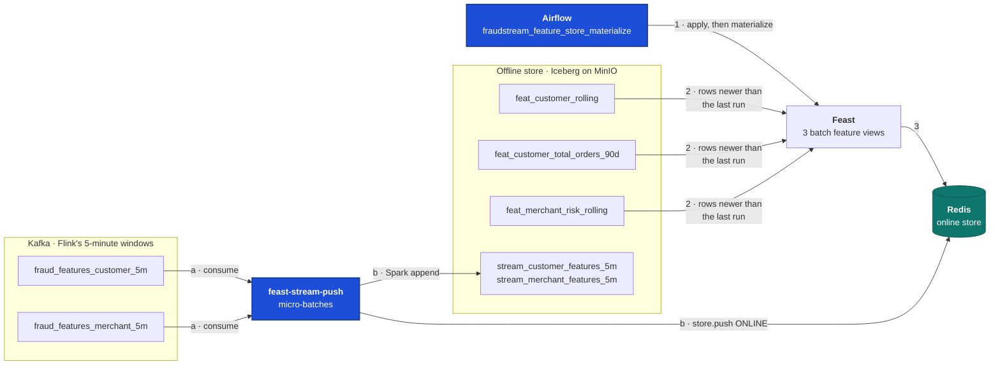

## The feature views

Defined once in [`feature_store/feature_repo/definitions.py`](../../feature_store/feature_repo/definitions.py)
and registered by `feast apply` in a SQL registry in PostgreSQL
([`feature_repo/feature_store.yaml:5`](../../feature_store/feature_repo/feature_store.yaml#L5)).
The offline store is Spark over the Iceberg catalog
([`feature_repo/feature_store.yaml:15`](../../feature_store/feature_repo/feature_store.yaml#L15)),
the online store Redis, whose keys expire after 91 days
([`feature_repo/feature_store.yaml:10`](../../feature_store/feature_repo/feature_store.yaml#L10)).

| Feature view | Features | TTL | Source | Where |
|---|---|---|---|---|
| `customer_rolling_features` | 10: counts, sums, averages, distinct merchants and declines over 7 and 30 days | 31 days | Gold `feat_customer_rolling` | [`feature_repo/definitions.py:98`](../../feature_store/feature_repo/definitions.py#L98) |
| `customer_orders_90d_features` | 1: `total_orders_90d` | 91 days | Gold `feat_customer_total_orders_90d` | [`feature_repo/definitions.py:119`](../../feature_store/feature_repo/definitions.py#L119) |
| `merchant_risk_features` | 12: counts, amounts, fraud rate, declines, burst ratio | 31 days | Gold `feat_merchant_risk_rolling` | [`feature_repo/definitions.py:129`](../../feature_store/feature_repo/definitions.py#L129) |
| `customer_features_5m_stream` | 8, one 5-minute window | 1 hour | push source, landing table | [`feature_repo/definitions.py:183`](../../feature_store/feature_repo/definitions.py#L183) |
| `merchant_features_5m_stream` | 8, one 5-minute window | 1 hour | push source, landing table | [`feature_repo/definitions.py:202`](../../feature_store/feature_repo/definitions.py#L202) |

A TTL matches what a feature's name promises: a 30-day count older than 31 days no longer
describes "the last 30 days". The stream views' 1 hour is above Flink's 40-minute
allowed lateness, so a late correction is still joinable. Gold's daily snapshots are
timestamped at the start of the day they cover but only known once it closes, so each
batch source adds one day to its timestamp
([`feature_repo/definitions.py:37`](../../feature_store/feature_repo/definitions.py#L37)),
and the point-in-time join never hands a snapshot to a payment that couldn't have seen it.

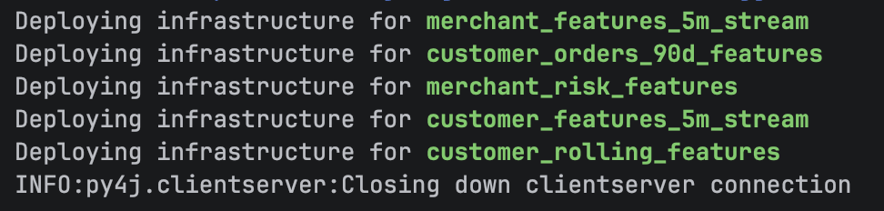

## Incremental materialization, offline to online

The DAG [`airflow/dags/feature_store_materialize.py`](../../airflow/dags/feature_store_materialize.py)
has no clock. It starts when the offline features DAG publishes its validated asset
([`dags/feature_store_materialize.py:19`](../../airflow/dags/feature_store_materialize.py#L19)),
so Redis is refreshed exactly when Gold has new, checked features.

| Task | What it does | Where |
|---|---|---|
| `materialize.apply_feature_repo` | `feast apply`, in the Spark pool, since it starts a Spark session | [`dags/feature_store_materialize.py:26`](../../airflow/dags/feature_store_materialize.py#L26) |
| `materialize.materialize_features` | the job below, up to the run's logical date | [`dags/feature_store_materialize.py:40`](../../airflow/dags/feature_store_materialize.py#L40) |
| `validate.publish_materialized_features` | reads the summary, checks the online store answered real reads, then publishes the asset `feature_store/materialized` | [`dags/feature_store_materialize.py:61`](../../airflow/dags/feature_store_materialize.py#L61), [`orchestration/validation.py:249`](../../src/fraudstream/orchestration/validation.py#L249) |

**How it stays incremental.** [`fraudstream_feast/materialize.py`](../../feature_store/src/fraudstream_feast/materialize.py)
splits the views by their stored watermark ([`fraudstream_feast/materialize.py:39`](../../feature_store/src/fraudstream_feast/materialize.py#L39)).
A view that has one resumes with `materialize_incremental`, from its watermark to the
run's date ([`fraudstream_feast/materialize.py:77`](../../feature_store/src/fraudstream_feast/materialize.py#L77)).
A view that has never been materialized gets one full window first
([`fraudstream_feast/materialize.py:73`](../../feature_store/src/fraudstream_feast/materialize.py#L73)):
Feast's own fallback for a new view is `now - ttl`, which for this historical dataset
sits after the data and would load nothing. The summary records each view's mode and its
watermark before and after ([`fraudstream_feast/materialize.py:84`](../../feature_store/src/fraudstream_feast/materialize.py#L84)),
and a spot check reads five real customers and merchants back from Redis for every batch
view ([`fraudstream_feast/materialize.py:106`](../../feature_store/src/fraudstream_feast/materialize.py#L106)):
a watermark can move while Redis stays empty.

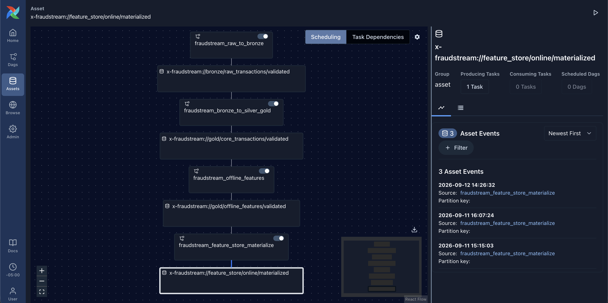

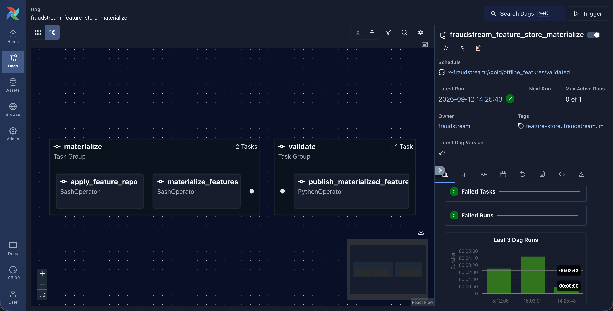

### Proof that only new rows move

One new row inserted straight into Gold, then walked through the DAG:

1. Before: the online store has never heard of the demo customer.

   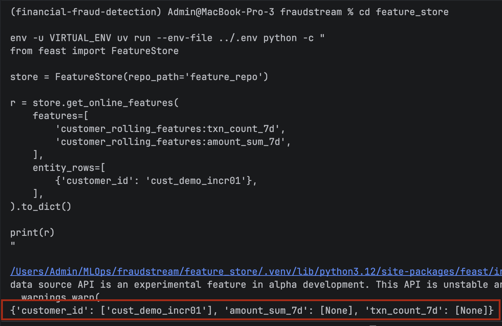
   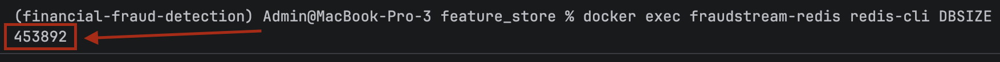

2. A new snapshot goes into `iceberg.gold.feat_customer_rolling`.

   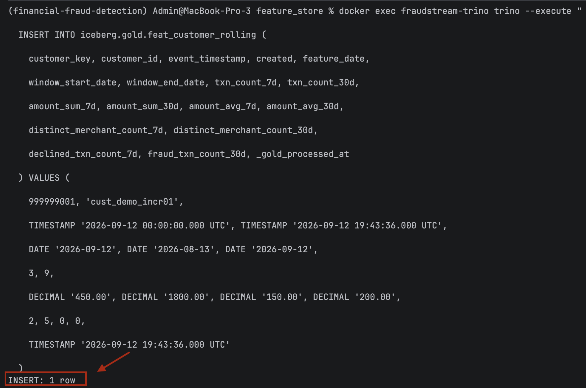
   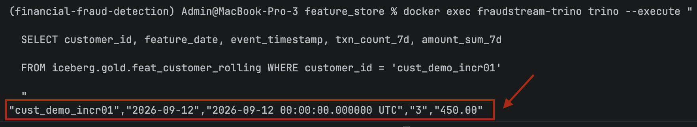

3. A first run, whose window ends before the new row, loads nothing new.

   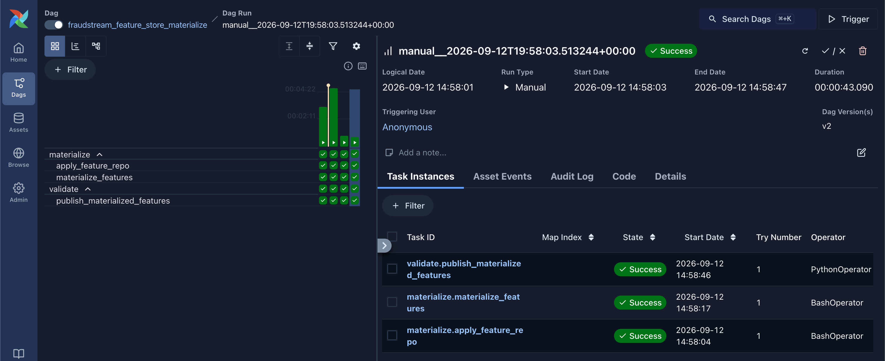

4. After the next run the online store returns the new values, and Redis holds exactly one key more.

   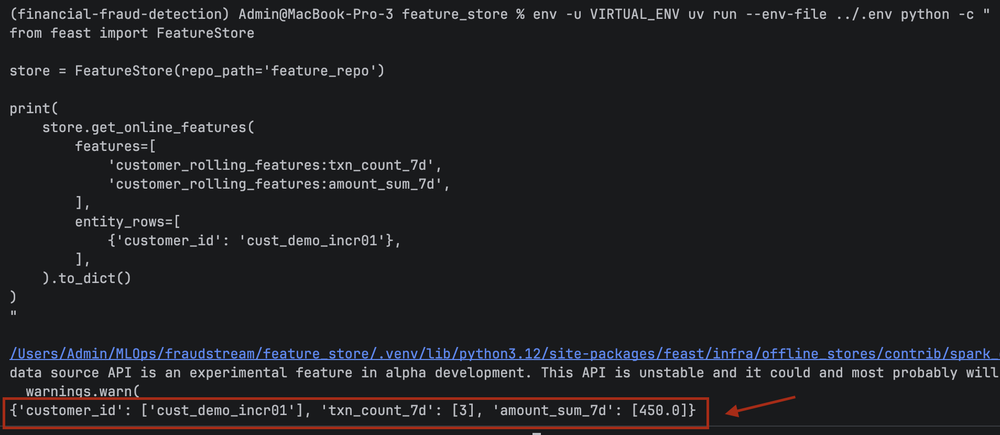
   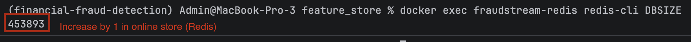

5. The summary shows every view resumed in `incremental` mode from a watermark.

   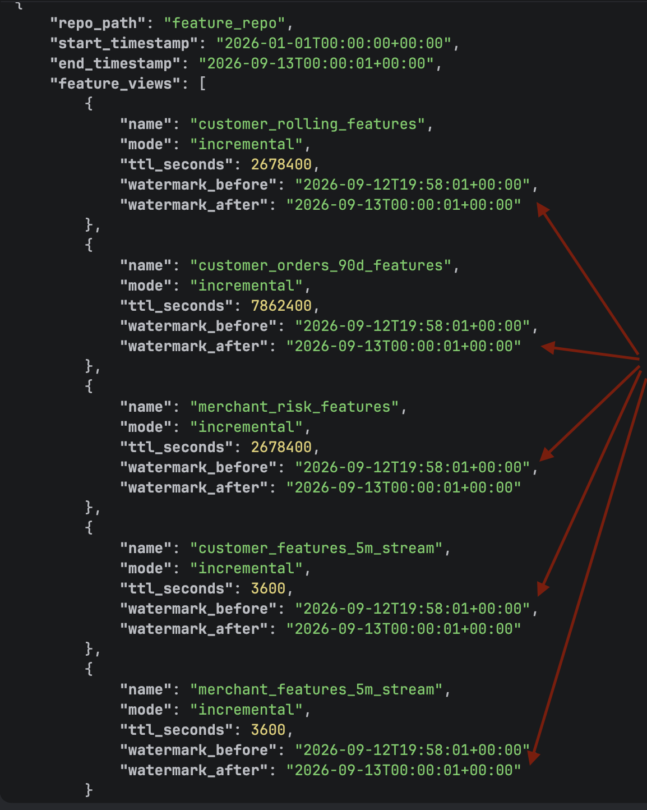

## The stream push job, into the offline and online stores

[`fraudstream_feast/stream_push.py`](../../feature_store/src/fraudstream_feast/stream_push.py)
consumes Flink's two window topics, `fraud_features_customer_5m` and
`fraud_features_merchant_5m` ([`fraudstream_feast/stream_push.py:45`](../../feature_store/src/fraudstream_feast/stream_push.py#L45)),
and collects rows into micro-batches. Each flush writes both stores
([`fraudstream_feast/stream_push.py:132`](../../feature_store/src/fraudstream_feast/stream_push.py#L132)):

- **Online:** `store.push(..., to=PushMode.ONLINE)` through the view's push source
  ([`fraudstream_feast/stream_push.py:158`](../../feature_store/src/fraudstream_feast/stream_push.py#L158)).
- **Offline:** a Spark `writeTo(table).append()` to the Iceberg landing table
  ([`fraudstream_feast/stream_push.py:168`](../../feature_store/src/fraudstream_feast/stream_push.py#L168)).
  Feast's Spark offline store can write only parquet, csv, json or avro, never Iceberg,
  so this half is a plain Spark write into the same table the push source reads for
  training ([`feature_repo/definitions.py:159`](../../feature_store/feature_repo/definitions.py#L159)).
  The tables are created before the first append
  ([`fraudstream_feast/spark.py:167`](../../feature_store/src/fraudstream_feast/spark.py#L167)).

**No window is lost.** Kafka's auto-commit is off
([`fraudstream_feast/stream_push.py:224`](../../feature_store/src/fraudstream_feast/stream_push.py#L224)),
and offsets are committed only after a flush succeeded
([`fraudstream_feast/stream_push.py:293`](../../feature_store/src/fraudstream_feast/stream_push.py#L293)).
A job stopped halfway through a flush replays the batch. A flush happens every 30 seconds
or at 10,000 rows, and every flush is one Iceberg commit, not one per record.

**Deployed** as the Compose service `feast-stream-push`, from its own image
([`docker-compose.yml:369`](../../docker-compose.yml#L369), [`feature_store/Dockerfile`](../../feature_store/Dockerfile)),
with its logins from Vault. Jenkins restarts it on a new commit and checks it stays up
([`Jenkinsfile:244`](../../Jenkinsfile#L244)); see [15_ci_cd.md](15_ci_cd.md#the-stream-feature-jobs).

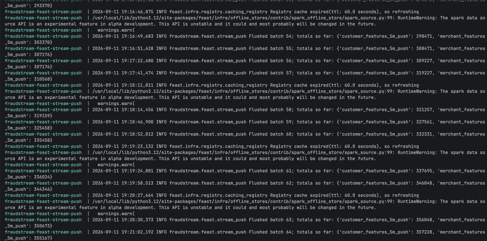

### The data, in both stores

| Online store (Redis) | Offline store (Iceberg on MinIO, read with Trino) |
|---|---|
| 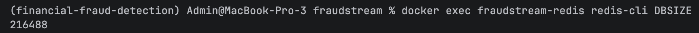 | 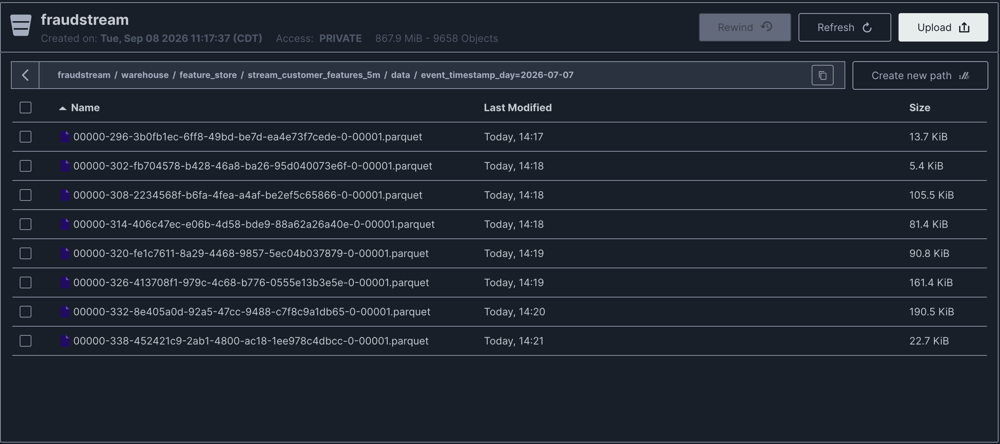 |
| 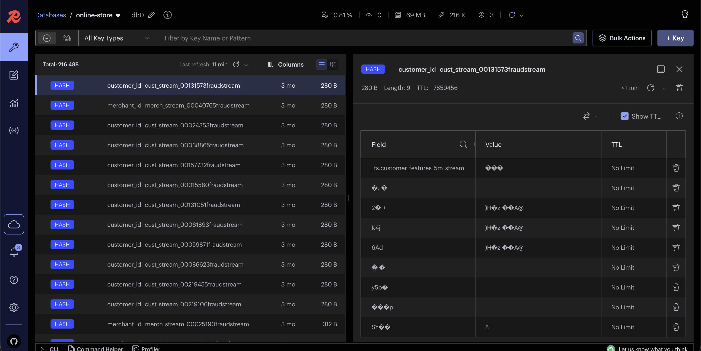 | 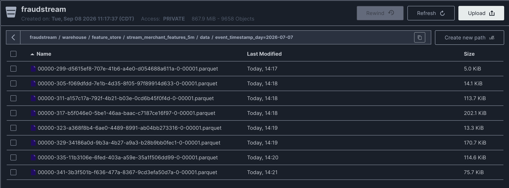 |
| | 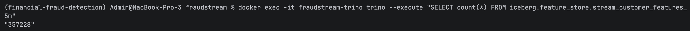 |

## How to run it

```bash
docker compose up -d kafka postgres minio redis
(cd feature_store/feature_repo && uv run feast apply)
docker compose --profile feature-store up -d feast-stream-push     # the push job
docker compose --profile orchestration up -d                       # Airflow; the DAG follows the offline features DAG
```

Check both stores:

```bash
docker exec fraudstream-redis redis-cli DBSIZE
docker exec -it fraudstream-trino trino --execute \
  "SELECT count(*) FROM iceberg.feature_store.stream_customer_features_5m"
```

## Where things are

| What | Where |
|---|---|
| Entities and feature views | [`feature_store/feature_repo/definitions.py`](../../feature_store/feature_repo/definitions.py) |
| Registry, offline and online store | [`feature_store/feature_repo/feature_store.yaml`](../../feature_store/feature_repo/feature_store.yaml) |
| Materialize DAG and job | [`airflow/dags/feature_store_materialize.py`](../../airflow/dags/feature_store_materialize.py), [`feature_store/src/fraudstream_feast/materialize.py`](../../feature_store/src/fraudstream_feast/materialize.py) |
| The check that publishes the asset | [`src/fraudstream/orchestration/validation.py`](../../src/fraudstream/orchestration/validation.py) |
| Stream push job | [`feature_store/src/fraudstream_feast/stream_push.py`](../../feature_store/src/fraudstream_feast/stream_push.py), [`feature_store/src/fraudstream_feast/spark.py`](../../feature_store/src/fraudstream_feast/spark.py) |
| Its image and service | [`feature_store/Dockerfile`](../../feature_store/Dockerfile), [`docker-compose.yml`](../../docker-compose.yml) |
| Tests | [`feature_store/tests/`](../../feature_store/tests/) |
| Screenshots | [`images/feature_store/`](../../images/feature_store/) |
