# Training Pipeline

The fraud detection model is trained by a Kubeflow pipeline: features from the offline
feature store, a split by date, distributed XGBoost on Kubeflow Trainer, one evaluation
on the test split, and a new model version in MLflow tied to the exact rows it trained
on. Training never decides what serves: a new version becomes `latest` the moment it
registers, and `production` only when it serves every payment.

## Architecture

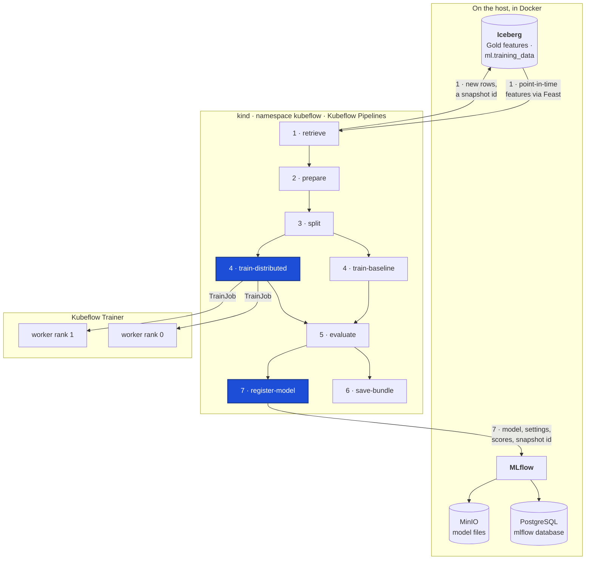

## The pipeline

The graph is [`pipelines/src/fraudstream_pipelines/pipeline.py`](../../pipelines/src/fraudstream_pipelines/pipeline.py),
each step a container in [`components.py`](../../pipelines/src/fraudstream_pipelines/components.py).

| Step | What it does | Graph | Step |
|---|---|---|---|
| `retrieve` | **loads data from the offline feature store**: Feast's point-in-time join over the Gold features for 500,000 labelled payments, then saves them as a data version | [`fraudstream_pipelines/pipeline.py:66`](../../pipelines/src/fraudstream_pipelines/pipeline.py#L66) | [`fraudstream_pipelines/components.py:25`](../../pipelines/src/fraudstream_pipelines/components.py#L25) |
| `prepare` | adds the availability flags and encodes the categories | [`fraudstream_pipelines/pipeline.py:77`](../../pipelines/src/fraudstream_pipelines/pipeline.py#L77) | [`fraudstream_pipelines/components.py:70`](../../pipelines/src/fraudstream_pipelines/components.py#L70) |
| `split` | **data split**: train, validation and test by event time, never at random | [`fraudstream_pipelines/pipeline.py:79`](../../pipelines/src/fraudstream_pipelines/pipeline.py#L79) | [`fraudstream_pipelines/components.py:90`](../../pipelines/src/fraudstream_pipelines/components.py#L90) |
| `train-baseline` | a logistic regression, as a yardstick | [`fraudstream_pipelines/pipeline.py:87`](../../pipelines/src/fraudstream_pipelines/pipeline.py#L87) | [`fraudstream_pipelines/components.py:115`](../../pipelines/src/fraudstream_pipelines/components.py#L115) |
| `train-distributed` | **model training**: XGBoost as a Kubeflow `TrainJob` over two workers | [`fraudstream_pipelines/pipeline.py:92`](../../pipelines/src/fraudstream_pipelines/pipeline.py#L92) | [`fraudstream_pipelines/components.py:137`](../../pipelines/src/fraudstream_pipelines/components.py#L137) |
| `evaluate` | **model evaluation**: the threshold picked on validation, the test split scored once | [`fraudstream_pipelines/pipeline.py:108`](../../pipelines/src/fraudstream_pipelines/pipeline.py#L108) | [`fraudstream_pipelines/components.py:267`](../../pipelines/src/fraudstream_pipelines/components.py#L267) |
| `save-bundle` | the model with its column order and threshold | [`fraudstream_pipelines/pipeline.py:116`](../../pipelines/src/fraudstream_pipelines/pipeline.py#L116) | [`fraudstream_pipelines/components.py:323`](../../pipelines/src/fraudstream_pipelines/components.py#L323) |
| `register-model` | the run in MLflow, and a new model version | [`fraudstream_pipelines/pipeline.py:124`](../../pipelines/src/fraudstream_pipelines/pipeline.py#L124) | [`fraudstream_pipelines/components.py:351`](../../pipelines/src/fraudstream_pipelines/components.py#L351) |

- **The offline store read** is `get_historical_features` on the Feast repo of
  [05_feature_store_pipelines.md](05_feature_store_pipelines.md)
  ([`fraudstream_ml/dataset.py:99`](../../ml/src/fraudstream_ml/dataset.py#L99)), so
  training reads the same features serving does, as they were before each payment.
- **The test split enters the graph once**, at `evaluate`
  ([`fraudstream_pipelines/pipeline.py:107`](../../pipelines/src/fraudstream_pipelines/pipeline.py#L107)),
  and a test fails if that changes.
- **Only the steps that read storage get its logins**, from a Kubernetes Secret synced
  from Vault ([`fraudstream_pipelines/pipeline.py:33`](../../pipelines/src/fraudstream_pipelines/pipeline.py#L33)).
- **The training is really distributed.** `train-distributed` does no training itself:
  it asks Kubeflow Trainer for two workers ([`fraudstream_pipelines/components.py:236`](../../pipelines/src/fraudstream_pipelines/components.py#L236)),
  each holding every other row, so neither draws a quiet stretch of weeks.

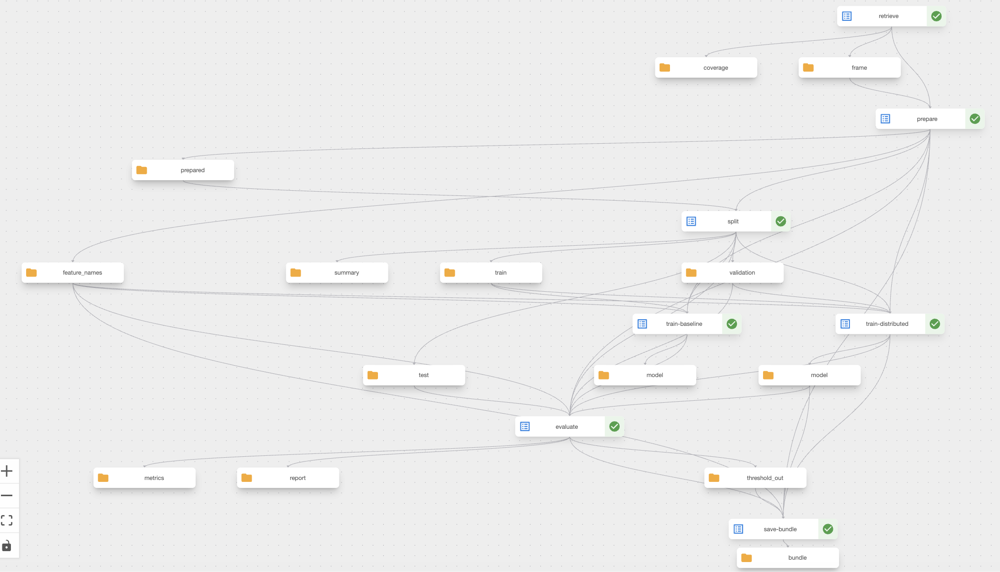

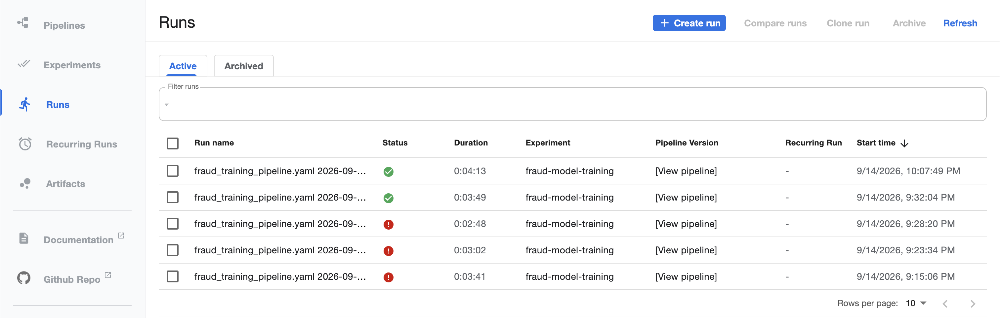

Two worker pods, one per rank, created for the run; rank 0 writes the model:

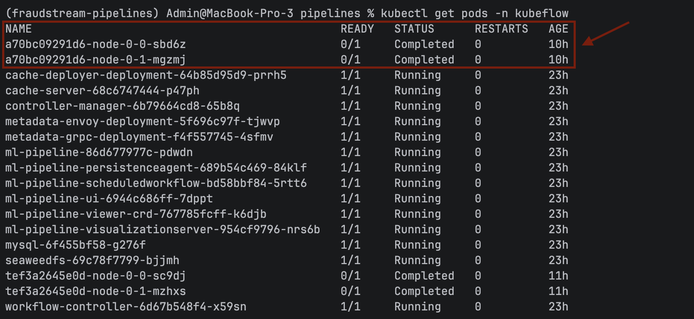

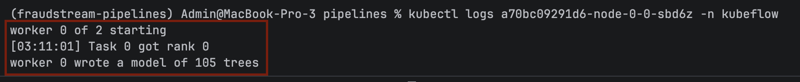

| | Notebook | Pipeline, 2 workers |
|---|---|---|
| PR-AUC | 0.0279 | **0.0283** |
| ROC-AUC | 0.6579 | **0.6584** |
| Threshold | 0.628 | **0.626** |

Matching the notebook is the result: a jump would have meant something leaked.

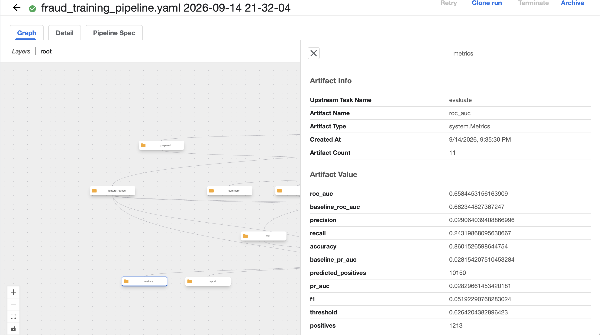

## Versioning in MLflow: the model, the data and the run

`register-model` calls [`fraudstream_ml/registry.py:33`](../../ml/src/fraudstream_ml/registry.py#L33)
on every run:

| Saved | How | Where |
|---|---|---|
| The settings | `max_depth`, `learning_rate`, `num_boost_round`, `num_nodes`, `threshold` | [`fraudstream_ml/registry.py:58`](../../ml/src/fraudstream_ml/registry.py#L58) |
| The data version | the Iceberg snapshot id of the rows it trained on, and the table | [`fraudstream_ml/registry.py:61`](../../ml/src/fraudstream_ml/registry.py#L61) |
| The scores | PR-AUC, ROC-AUC and the rest, from `evaluate` | [`fraudstream_ml/registry.py:65`](../../ml/src/fraudstream_ml/registry.py#L65) |
| The model | logged and registered as a new version of `fraud-detection` | [`fraudstream_ml/registry.py:67`](../../ml/src/fraudstream_ml/registry.py#L67) |

MLflow keeps the runs and versions in its `mlflow` database in PostgreSQL and the model
files in MinIO ([`docker-compose.yml:285`](../../docker-compose.yml#L285)). The pipeline
pods upload through the MLflow server, so no step needs MinIO's logins for this.

**The data is versioned too.** `retrieve` merges the rows into `iceberg.ml.training_data`,
matched on transaction id, and rewrites a row only when a value changed
([`fraudstream_ml/versioning.py:53`](../../ml/src/fraudstream_ml/versioning.py#L53)). The
snapshot id it returns goes to MLflow. A second run over a longer window stored only its
72,426 new rows (2.9 MB, not 19.7 MB for a full copy):

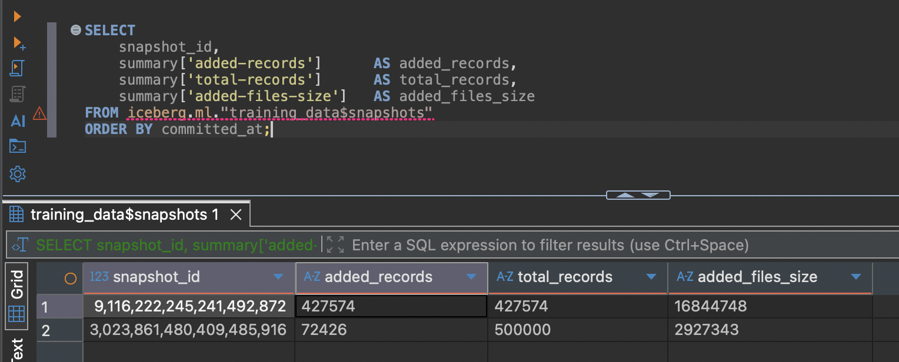

Two runs, two versions, each pointing at its own data snapshot:

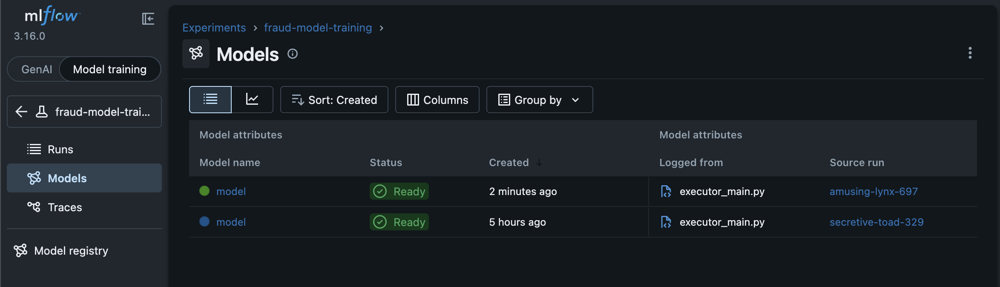

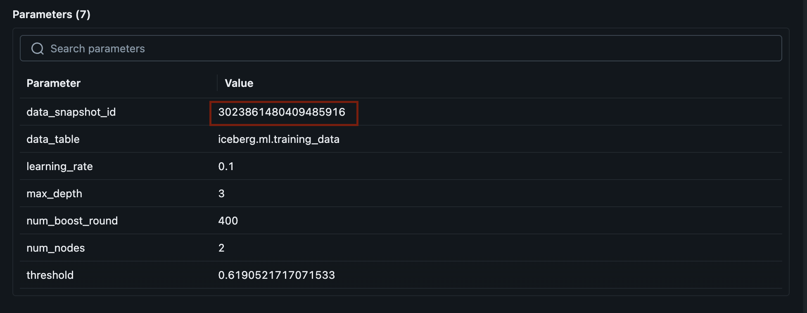

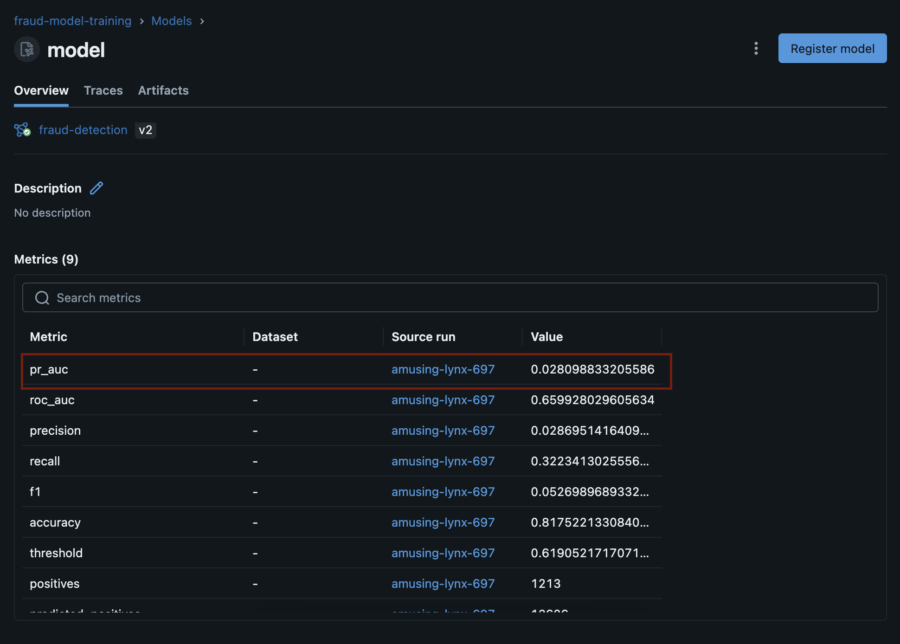

| | Version 1 | Version 2 |
|---|---|---|
| Rows | 427,574 | 500,000 |
| Data snapshot | `9116222245241492872` | `3023861480409485916` |
| PR-AUC | 0.0342 | 0.0281 |
| Threshold | 0.640 | 0.619 |

The exact rows of version 1 can be read back at any time:

```sql
SELECT count(*) FROM iceberg.ml.training_data FOR VERSION AS OF 9116222245241492872;   -- 427,574
```

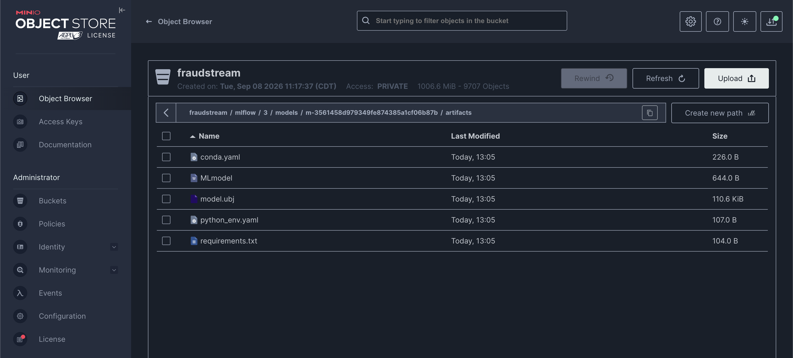

## `latest` and `production`, set without a person

| Name | Moves when | How | Where |
|---|---|---|---|
| `latest` | a run registers a new version | MLflow's own pointer, `models:/fraud-detection/latest`; the name is reserved, so it can't be set wrong or forgotten | [`fraudstream_ml/registry.py:6`](../../ml/src/fraudstream_ml/registry.py#L6) |
| `production` | a version serves every payment | the deploy script sets the alias after KServe routes 100% to it | [`cicd/apply_model.sh:56`](../../cicd/apply_model.sh#L56) |

Deploys read these names, never a hard-coded file: the model server's image is built
from `models:/fraud-detection/<version>` ([`cicd/apply_model.sh:30`](../../cicd/apply_model.sh#L30)),
see [07_ml_inference_service.md](07_ml_inference_service.md). A new version reaches
traffic as a canary first ([19_ab_testing.md](19_ab_testing.md)), so `production` always
names the model actually answering. `promote()` still moves an alias by hand
([`fraudstream_ml/registry.py:76`](../../ml/src/fraudstream_ml/registry.py#L76)).

Jenkins uploads the pipeline as a new version on every change to the training code
([`Jenkinsfile:163`](../../Jenkinsfile#L163)), and the drift pipeline starts a run when
the model's inputs move ([18_observability.md](18_observability.md#drift-and-retraining)).

## How to run it

```bash
docker compose up -d postgres minio redis mlflow   # the lakehouse and MLflow
./k8s/bootstrap.sh                                 # cluster, Pipelines, Trainer
docker build -f k8s/Dockerfile.ml -t fraudstream-ml:dev . && kind load docker-image fraudstream-ml:dev --name fraudstream
cd pipelines && PYTHONPATH=src uv run python -m fraudstream_pipelines.submit --num-nodes 2
```

## Where things are

| What | Where |
|---|---|
| The pipeline and its steps | [`pipelines/src/fraudstream_pipelines/`](../../pipelines/src/fraudstream_pipelines/) |
| Feature retrieval | [`ml/src/fraudstream_ml/dataset.py`](../../ml/src/fraudstream_ml/dataset.py) |
| Split, training, distributed training | [`ml/src/fraudstream_ml/split.py`](../../ml/src/fraudstream_ml/split.py), [`ml/src/fraudstream_ml/train.py`](../../ml/src/fraudstream_ml/train.py), [`ml/src/fraudstream_ml/distributed.py`](../../ml/src/fraudstream_ml/distributed.py) |
| MLflow registration and aliases | [`ml/src/fraudstream_ml/registry.py`](../../ml/src/fraudstream_ml/registry.py) |
| Data snapshots | [`ml/src/fraudstream_ml/versioning.py`](../../ml/src/fraudstream_ml/versioning.py) |
| `production` set on deploy | [`cicd/apply_model.sh`](../../cicd/apply_model.sh) |
| Step image, TrainJob permissions | [`k8s/Dockerfile.ml`](../../k8s/Dockerfile.ml), [`k8s/rbac/trainjob-access.yaml`](../../k8s/rbac/trainjob-access.yaml) |
| Model training in detail | [`docs/ml/17_ml_training.md`](../ml/17_ml_training.md) |
| Tests | [`pipelines/tests/`](../../pipelines/tests/), [`ml/tests/`](../../ml/tests/) |
| Screenshots | [`images/kubeflow/`](../../images/kubeflow/), [`images/mlflow/`](../../images/mlflow/) |
