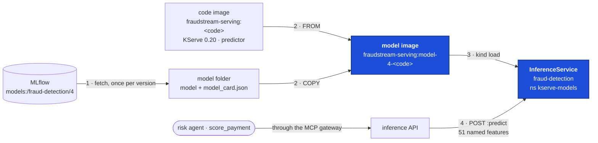
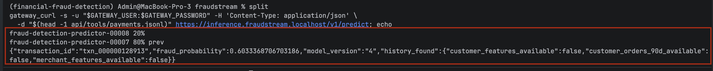

# ML Inference Service

The fraud detection model trained in [06_training_pipeline.md](06_training_pipeline.md) is
served by KServe, with the model **inside its image**: the image `fraudstream-serving:model-4-<code>`
holds the serving code and version 4 of the model, so a pod starts without asking MLflow
or MinIO for anything. The inference API calls it to score a payment, and the risk
agent reaches it through the inference API with its `score_payment` tool
([09_risk_agent.md](09_risk_agent.md)).



## The KServe YAML

[`k8s/models/fraud-detection.yaml`](../../k8s/models/fraud-detection.yaml) is the whole
deployment:

| Setting | Value | Why | Where |
|---|---|---|---|
| Kind | `InferenceService` `fraud-detection`, namespace `kserve-models` | KServe makes the Knative service, its revisions and the traffic split from it | [`models/fraud-detection.yaml:6`](../../k8s/models/fraud-detection.yaml#L6) |
| One replica kept warm | `minReplicas: 1` | a cold start took 3.5–5.8 s, too slow for a payment | [`models/fraud-detection.yaml:13`](../../k8s/models/fraud-detection.yaml#L13) |
| Image | `fraudstream-serving:model-4` | names the model version it carries; the deploy adds the code version | [`models/fraud-detection.yaml:16`](../../k8s/models/fraud-detection.yaml#L16) |
| Resources | 100m CPU, 512 Mi, at most 2 Gi | it uses about 219 Mi while running | [`models/fraud-detection.yaml:21`](../../k8s/models/fraud-detection.yaml#L21) |

## The model inside the image

Two images, built in order by [`cicd/apply_model.sh`](../../cicd/apply_model.sh):

1. **The code image**, [`k8s/Dockerfile.serving`](../../k8s/Dockerfile.serving): Python
   3.12 slim with KServe 0.20, MLflow and XGBoost, and the predictor
   ([`k8s/Dockerfile.serving:13`](../../k8s/Dockerfile.serving#L13)). Its tag is the last
   commit that changed the serving code, so a manifest-only change reuses it
   ([`cicd/apply_model.sh:16`](../../cicd/apply_model.sh#L16)).
2. **The model image**, [`k8s/Dockerfile.model`](../../k8s/Dockerfile.model): the code
   image plus one model version, copied in, with `MODEL_URI` pointing at the copy
   ([`k8s/Dockerfile.model:9`](../../k8s/Dockerfile.model#L9)).

The script reads the version from the manifest's image tag
([`cicd/apply_model.sh:17`](../../cicd/apply_model.sh#L17)), downloads that version from
MLflow with its card, the version number and the threshold training chose
([`cicd/apply_model.sh:30`](../../cicd/apply_model.sh#L30),
[`fraudstream_serving/fetch.py:22`](../../serving/src/fraudstream_serving/fetch.py#L22)),
builds the model image and loads it into kind ([`cicd/apply_model.sh:32`](../../cicd/apply_model.sh#L32)).
Then it applies the manifest with the full tag `model-4-<code>`
([`cicd/apply_model.sh:35`](../../cicd/apply_model.sh#L35)), waits until KServe routes
the manifest's share to the new revision and it is Ready
([`cicd/apply_model.sh:42`](../../cicd/apply_model.sh#L42)), and, when it takes all
traffic, points MLflow's `production` alias at it
([`cicd/apply_model.sh:56`](../../cicd/apply_model.sh#L56)).

**Why the model goes inside.** A pod that downloads its model at start needs MLflow and
MinIO up, and their logins, every time it starts. With the model in the image, a new pod
needs nothing but the image, the image tag says exactly which model answers, and rolling
back is choosing the previous image.

## The predictor

KServe's own runtimes can't serve this model here: the MLflow runtime has no image for
Apple Silicon, and the XGBoost runtime sends columns without names, which the model
refuses. So the predictor is a small KServe `Model` in
[`serving/src/fraudstream_serving/predictor.py`](../../serving/src/fraudstream_serving/predictor.py):

- **Load.** It loads the model from `MODEL_URI` and reads the packaged card for the
  version and threshold, so nothing asks MLflow
  ([`fraudstream_serving/predictor.py:61`](../../serving/src/fraudstream_serving/predictor.py#L61),
  [`fraudstream_serving/predictor.py:76`](../../serving/src/fraudstream_serving/predictor.py#L76)).
- **Predict.** It matches the fields by name and puts them in the model's own order, so a
  request that lists them in another order still gets the right score. A missing field
  is refused with HTTP 400, naming it ([`fraudstream_serving/predictor.py:95`](../../serving/src/fraudstream_serving/predictor.py#L95)).
- **Answer.** The fraud probability, the model version and its threshold.

Served scores match the model run locally on real rows; one differs in the 8th decimal,
from XGBoost's macOS and Linux builds.

## Calling it

The inference API calls the predictor inside the cluster at
`http://fraud-detection-predictor.kserve-models.svc.cluster.local/v1/models/fraud-detection:predict`
([`inference/settings.py:17`](../../api/src/fraudstream_api/inference/settings.py#L17)),
after reading the payment's features from Redis. One payment, through the gateway, while
a new version takes 20% of traffic: the two KServe revisions and their shares, then the
answer from version 4.



From inside the cluster, or through Kourier from the host:

```bash
MLFLOW_TRACKING_URI=http://localhost:18085 ./cicd/apply_model.sh     # build, load, apply, wait
kubectl -n kserve-models get inferenceservice fraud-detection
kubectl -n kserve-models get pod                                    # the predictor pod
curl -H "Host: fraud-detection-predictor.kserve-models.knative.localhost" \
  -H "Content-Type: application/json" -d @request.json \
  http://localhost:8081/v1/models/fraud-detection:predict
```

`request.json` is `{"instances": [{...51 named features...}]}`.

| | Measured |
|---|---|
| A request to a running pod | 9–15 ms |
| Cold start, from zero | 3.5–5.8 s |
| Memory while running | 219 Mi |

Jenkins applies the manifest on every change to the serving code or the manifest
([`Jenkinsfile:120`](../../Jenkinsfile#L120)); a new model version starts as a canary
([19_ab_testing.md](19_ab_testing.md)).

## Where things are

| What | Where |
|---|---|
| The InferenceService | [`k8s/models/fraud-detection.yaml`](../../k8s/models/fraud-detection.yaml) |
| Code image and model image | [`k8s/Dockerfile.serving`](../../k8s/Dockerfile.serving), [`k8s/Dockerfile.model`](../../k8s/Dockerfile.model) |
| Build, load, apply and set `production` | [`cicd/apply_model.sh`](../../cicd/apply_model.sh) |
| The predictor and the fetch from MLflow | [`serving/src/fraudstream_serving/`](../../serving/src/fraudstream_serving/) |
| The caller | [`api/src/fraudstream_api/inference/`](../../api/src/fraudstream_api/inference/) |
| KServe, Knative and Kourier on kind | [`k8s/bootstrap.sh`](../../k8s/bootstrap.sh), [`k8s/platform/`](../../k8s/platform/) |
| Tests | [`serving/tests/`](../../serving/tests/) |
