# Context API, MCP Server and Context Agent

The context agent answers what the platform knows about a customer, a merchant or a
handbook section. Three layers make that work, each deployed and tested on its own:

- **The context API**, a FastAPI web API that pulls data by id from the online stores: a
  customer's or merchant's features from Redis (written by the feature pipelines,
  [05](05_feature_store_pipelines.md)) and a chunk from pgvector (written by the RAG
  pipeline, [04](04_rag_pipeline.md)).
- **The MCP server `fraud-context`**, three tools in front of that API, deployed with Helm.
- **The context agent**, a kagent agent that calls those tools, sandboxed, and published
  to the registry.

## Architecture

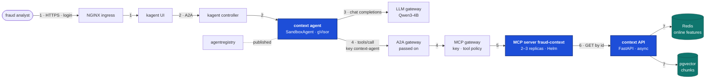

1. The analyst opens the kagent UI through NGINX, with the gateway login.
2. kagent's controller passes the question to the context agent over A2A.
3. The agent asks Qwen3-4B, through the LLM gateway, which tool to call.
4. It calls the tool with its own key. The call passes the A2A gateway, which hands it
   on unchanged, then the MCP gateway, which checks the key and the tool
   ([10_mcp_gateway.md](10_mcp_gateway.md)).
5. The MCP server turns the tool call into one request to the context API.
6. The context API reads the stores through Feast, and the agent writes its answer.

## The context API

| Endpoint | Answers | Where |
|---|---|---|
| `GET /v1/customers/{id}` | the customer's views from Redis, each with `as_of` | [`context/app.py:70`](../../api/src/fraudstream_api/context/app.py#L70) |
| `GET /v1/merchants/{id}` | the merchant's risk view, with `as_of` | [`context/app.py:74`](../../api/src/fraudstream_api/context/app.py#L74) |
| `GET /v1/chunks?chunk_id=…` | one chunk from pgvector, by id | [`context/app.py:78`](../../api/src/fraudstream_api/context/app.py#L78) |
| `POST /v1/search` | the `top_k` chunks closest to a question | [`context/app.py:88`](../../api/src/fraudstream_api/context/app.py#L88) |

404 means nothing is stored, with a sentence the model can repeat ("the online store has
no features for customer cust_9"); 503 means a store can't be reached
([`context/app.py:61`](../../api/src/fraudstream_api/context/app.py#L61)). Chunk ids are a
query parameter because every id has a `#`, which a URL path would cut off.

### FastAPI with validation by pydantic

| What is validated | Rule | Where |
|---|---|---|
| Customer and merchant ids | `^[A-Za-z0-9_-]{1,64}$`, so `../search` can't reach another endpoint | [`context/schemas.py:9`](../../api/src/fraudstream_api/context/schemas.py#L9), [`context/app.py:23`](../../api/src/fraudstream_api/context/app.py#L23) |
| Chunk id | 1 to 200 characters | [`context/app.py:25`](../../api/src/fraudstream_api/context/app.py#L25) |
| Search question | stripped, 1 to 500 characters | [`context/schemas.py:37`](../../api/src/fraudstream_api/context/schemas.py#L37) |
| `top_k` | 1 to 10, default 5 | [`context/schemas.py:40`](../../api/src/fraudstream_api/context/schemas.py#L40) |
| Unknown fields in a search | refused, `extra="forbid"` | [`context/schemas.py:35`](../../api/src/fraudstream_api/context/schemas.py#L35) |
| Every answer | a response model: `EntityFeatures`, `Chunk`, `SearchAnswer` | [`context/schemas.py:14`](../../api/src/fraudstream_api/context/schemas.py#L14) |
| Settings and logins | `pydantic-settings`, passwords as `SecretStr`, from a Secret synced from Vault | [`context/settings.py:7`](../../api/src/fraudstream_api/context/settings.py#L7) |

A bad id or question gets FastAPI's 422 with the field named, before any store is asked.

### Health checks for Kubernetes

| Probe | Endpoint | Checks | Where |
|---|---|---|---|
| Liveness and startup | `/livez` | nothing else: restarting the pod can't fix Redis or pgvector | [`context/app.py:96`](../../api/src/fraudstream_api/context/app.py#L96) |
| Readiness | `/readyz` | Redis answers a ping and pgvector takes a connection, each within 1 s | [`context/app.py:101`](../../api/src/fraudstream_api/context/app.py#L101), [`context/stores.py:136`](../../api/src/fraudstream_api/context/stores.py#L136) |

The chart wires them as the pod's probes ([`fraudstream-api/templates/deployment.yaml:60`](../../k8s/charts/fraudstream-api/templates/deployment.yaml#L60),
[`fraudstream-api/values.yaml:17`](../../k8s/charts/fraudstream-api/values.yaml#L17)). The
stores and the embedding model load before Uvicorn opens its port, so no request meets
a cold store ([`context/app.py:42`](../../api/src/fraudstream_api/context/app.py#L42)).

### Async, for concurrent requests

Every endpoint is `async def`, and every store call is awaited, so one pod serves many
requests while each waits on Redis, Postgres or the CPU:

| Call | How it avoids blocking | Where |
|---|---|---|
| Features from Redis | Feast's `get_online_features_async` | [`context/stores.py:116`](../../api/src/fraudstream_api/context/stores.py#L116) |
| A chunk from pgvector | Feast's `get_online_features_async` | [`context/stores.py:123`](../../api/src/fraudstream_api/context/stores.py#L123) |
| Search | embedding is CPU work and Feast's vector search has no async form, so it runs in a worker thread with `asyncio.to_thread` | [`context/stores.py:134`](../../api/src/fraudstream_api/context/stores.py#L134) |
| Readiness | the async Redis client and `psycopg.AsyncConnection`, each under `asyncio.wait_for` | [`context/stores.py:138`](../../api/src/fraudstream_api/context/stores.py#L138) |
| Start-up | the embedding model warmed in a thread | [`context/stores.py:107`](../../api/src/fraudstream_api/context/stores.py#L107) |

The MCP servers are async the same way: every tool is a coroutine and calls the API
through one shared `httpx.AsyncClient` ([`fraudstream_mcp/common.py:91`](../../mcp_servers/src/fraudstream_mcp/common.py#L91)).

It runs as a release of the shared chart, behind NGINX at `context.fraudstream.localhost`
with HTTPS, a login and a rate limit ([`apis/context-api.yaml:24`](../../k8s/apis/context-api.yaml#L24)):

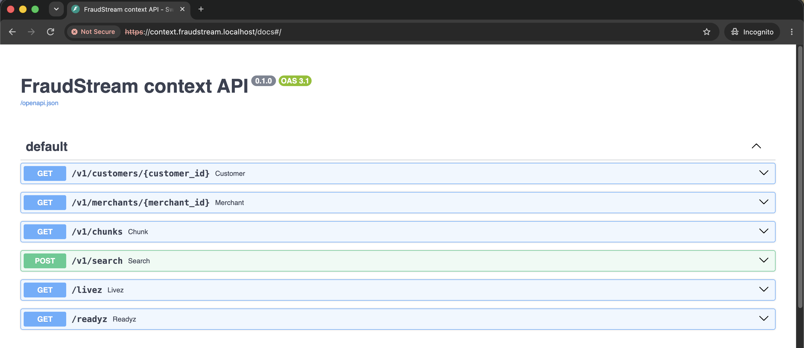

Its load test is in [14_validation_and_verification.md](14_validation_and_verification.md#load-testing-the-web-api).

## The MCP server, deployed with Helm

| Tool | Calls | Where |
|---|---|---|
| `get_customer_features(customer_id)` | `GET /v1/customers/{id}` | [`fraudstream_mcp/context_server.py:22`](../../mcp_servers/src/fraudstream_mcp/context_server.py#L22) |
| `get_merchant_features(merchant_id)` | `GET /v1/merchants/{id}` | [`fraudstream_mcp/context_server.py:31`](../../mcp_servers/src/fraudstream_mcp/context_server.py#L31) |
| `get_chunk(chunk_id)` | `GET /v1/chunks?chunk_id=…` | [`fraudstream_mcp/context_server.py:39`](../../mcp_servers/src/fraudstream_mcp/context_server.py#L39) |

An MCP server is not a plain API: a client opens a session and may stream. These choices
make it safe to run several replicas and roll them:

- **Stateless streamable HTTP with JSON answers.** No session lives in a pod, so any
  replica answers any call and a rolling update breaks no caller
  ([`fraudstream_mcp/__main__.py:32`](../../mcp_servers/src/fraudstream_mcp/__main__.py#L32)).
  The MCP gateway matches it with `sessionRouting: Stateless`.
- **`host="0.0.0.0"`** turns off the SDK's localhost-only Host check, which would refuse
  the gateway calling by the Service's name.
- **Readiness asks the API behind the tools** ([`fraudstream_mcp/common.py:149`](../../mcp_servers/src/fraudstream_mcp/common.py#L149)):
  a pod that can't reach its API can't answer any tool, so it never becomes ready.
- **Graceful shutdown:** Uvicorn gets 20 s to finish calls in flight
  ([`fraudstream_mcp/__main__.py:40`](../../mcp_servers/src/fraudstream_mcp/__main__.py#L40)),
  after the chart's 5 s pre-stop pause.

**Helm, rolling update and automatic fallback.** [`k8s/mcp/install.sh`](../../k8s/mcp/install.sh)
deploys each server as a release of the shared chart
([`mcp/install.sh:21`](../../k8s/mcp/install.sh#L21)):

```bash
helm upgrade --install fraud-context k8s/charts/fraudstream-api -n mcp -f k8s/mcp/fraud-context.yaml \
  --set-string image.tag="$TAG" --rollback-on-failure --timeout 3m
```

| Setting | Value | Where |
|---|---|---|
| Rolling update | `maxSurge: 1`, `maxUnavailable: 0`: a new pod is ready before an old one goes | [`fraudstream-api/templates/deployment.yaml:12`](../../k8s/charts/fraudstream-api/templates/deployment.yaml#L12), [`fraudstream-api/values.yaml:38`](../../k8s/charts/fraudstream-api/values.yaml#L38) |
| Automatic fallback | `--rollback-on-failure`: a release whose pods never become ready within 3 minutes is rolled back to the last good one | [`mcp/install.sh:22`](../../k8s/mcp/install.sh#L22) |
| Replicas | 2, up to 3, scaled by KEDA on CPU | [`mcp/fraud-context.yaml:13`](../../k8s/mcp/fraud-context.yaml#L13), [`fraudstream-api/templates/scaledobject.yaml:1`](../../k8s/charts/fraudstream-api/templates/scaledobject.yaml#L1) |
| Hardened pod | non-root, read-only root filesystem, every capability dropped | [`fraudstream-api/templates/deployment.yaml:26`](../../k8s/charts/fraudstream-api/templates/deployment.yaml#L26) |

`./k8s/mcp/check.sh --loop 150` calls a tool every 0.6 s while both servers roll to a new
image. 196 calls, none failed:

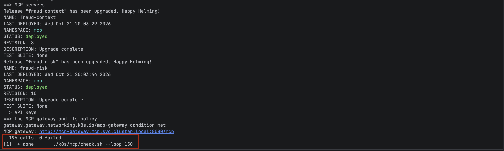

## The context agent

[`k8s/agents/context-agent.yaml`](../../k8s/agents/context-agent.yaml) holds the agent and
its tool server:

| Setting | Where |
|---|---|
| Its tools: a `RemoteMCPServer` at the MCP gateway, with the agent's own key from a Secret synced from Vault | [`agents/context-agent.yaml:2`](../../k8s/agents/context-agent.yaml#L2) |
| The global model config | [`agents/context-agent.yaml:27`](../../k8s/agents/context-agent.yaml#L27) |
| Its prompt, from MLflow's prompt registry through a ConfigMap | [`agents/context-agent.yaml:28`](../../k8s/agents/context-agent.yaml#L28) |
| Exactly three tools, by name | [`agents/context-agent.yaml:38`](../../k8s/agents/context-agent.yaml#L38) |
| Its A2A skill, for the coordinator | [`agents/context-agent.yaml:42`](../../k8s/agents/context-agent.yaml#L42) |

The prompt lives in git ([`agents/prompts/context-agent.md`](../../agents/prompts/context-agent.md))
and is registered in MLflow, which makes a new version only when the text changed
([`agents/install.sh:58`](../../k8s/agents/install.sh#L58)).

In the kagent UI the agent runs on `qwen3-4b` with exactly its three tools. Asked about a
customer, it calls `get_customer_features` once:

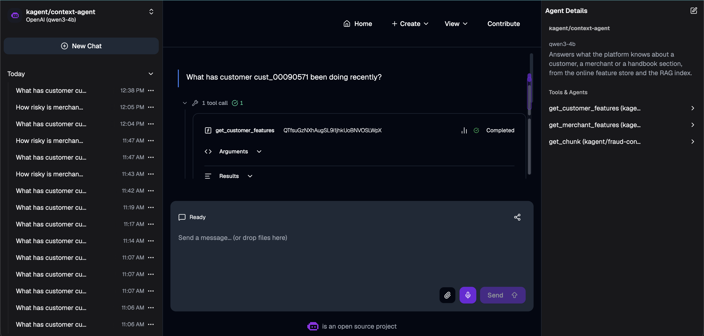

and answers with the stored values and when they were computed:

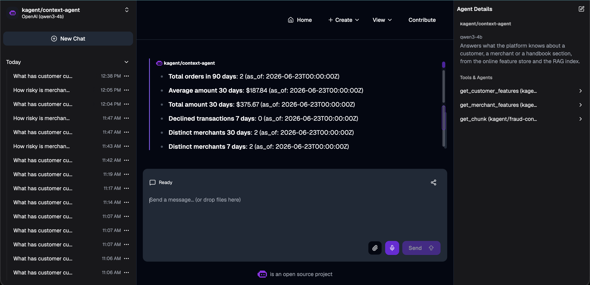

### Multiple replicas, scaled by KEDA

The agent was first deployed as a kagent `Agent` with a KEDA `ScaledObject`: two
replicas, up to three, scaled on calls in flight, read from Prometheus
([`k8s/agents/context-agent.yaml` at e74579e, line 60](https://github.com/hiendat04/fraudstream/blob/e74579e54d47914eccb0f91af9bfd9a453d34913/k8s/agents/context-agent.yaml#L60)):

| Setting | Value | Why |
|---|---|---|
| Trigger | `sum(rate(agent_duration_seconds_sum{gen_ai_agent_name="context_agent"}[2m]))` | seconds of calling per second is the average number of calls in progress; CPU says nothing, since the agent waits on the model |
| Target | 1 call in flight per replica | a third replica once more than two questions wait |
| Fallback | 2 replicas after 3 failed reads | a Prometheus outage leaves the agent as it is |
| Scale down | after 2 minutes | questions come in bursts |
| The agent's own replica count | not set | kagent never writes it, so KEDA is its only owner |

Three questions at once put 1.16 calls in flight per replica against a target of 1, and a
third pod started:

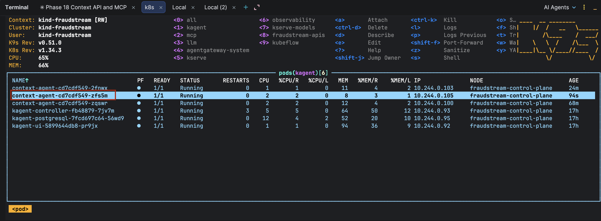

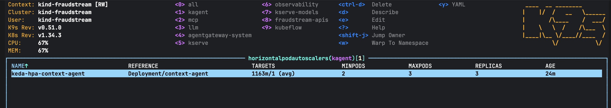

Restarting kagent's controller at 3 replicas leaves 3, so kagent never fights KEDA:

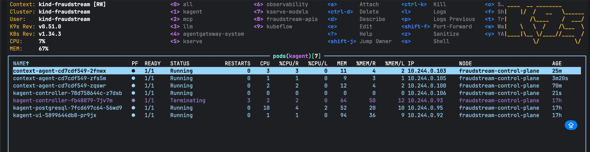

**Today the agent runs on the agent fleet** ([13_agent_fleet.md](13_agent_fleet.md)): every
conversation is its own sandboxed actor on a pool of three shared workers, so the agent
has no pods of its own to scale. KEDA can't scale that pool, since Substrate's WorkerPool
has no pod selector. Its MCP server keeps 2–3 replicas.

### Running in a sandbox

| Restriction | How | Where |
|---|---|---|
| Every conversation in its own gVisor sandbox | a `SandboxAgent`, not an `Agent`: each conversation is an actor restored from a snapshot into a gVisor user-space kernel, so one can't see another's memory or files | [`agents/context-agent.yaml:19`](../../k8s/agents/context-agent.yaml#L19), [`agents/context-agent.yaml:51`](../../k8s/agents/context-agent.yaml#L51), [`agents/kagent-values.yaml:61`](../../k8s/agents/kagent-values.yaml#L61) |
| It can reach only the gateways | the NetworkPolicy `fleet-workers`: DNS, the kagent controller, the LLM gateway, the A2A gateway, Jaeger and Substrate; only Substrate may call in | [`agents/network.yaml:60`](../../k8s/agents/network.yaml#L60) |
| It sees only its own tools | its MCP key allows `fraud-context` only, never `score_payment` | [`mcp/secrets.yaml:105`](../../k8s/mcp/secrets.yaml#L105) |
| Its model calls are limited | the `agents` key: one model, 30 requests a minute | [`llm/secrets.yaml:106`](../../k8s/llm/secrets.yaml#L106) |

An agent is driven by text it reads, so a prompt injection could make it try any address.
A probe pod with the workers' label timed out calling `fraud-context`, the inference API
and the MCP gateway directly, and reached the LLM and A2A gateways. kagent marks the
sandboxed agents with Substrate's lock:

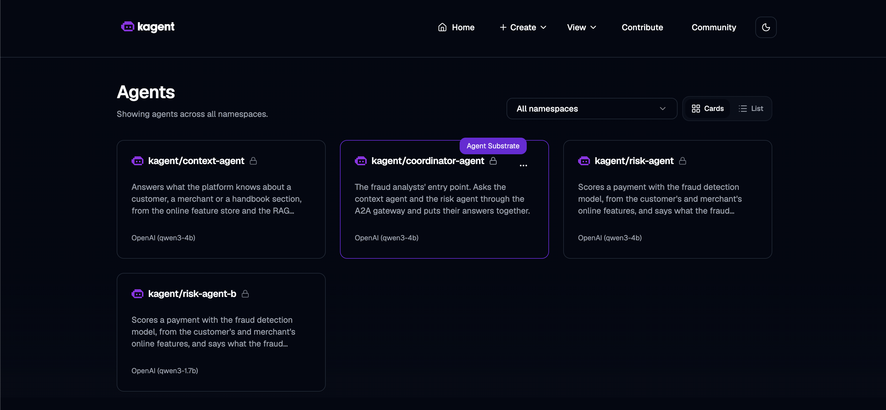

### Published to the registry

`contextagent` and its MCP server `fraud-context` are records in
[`agents/registry.yaml:12`](../../k8s/agents/registry.yaml#L12), published at install and
by Jenkins after the agent passes its eval questions
([`cicd/deploy_agent.sh:94`](../../cicd/deploy_agent.sh#L94)); see
[03_agent_registry.md](03_agent_registry.md).

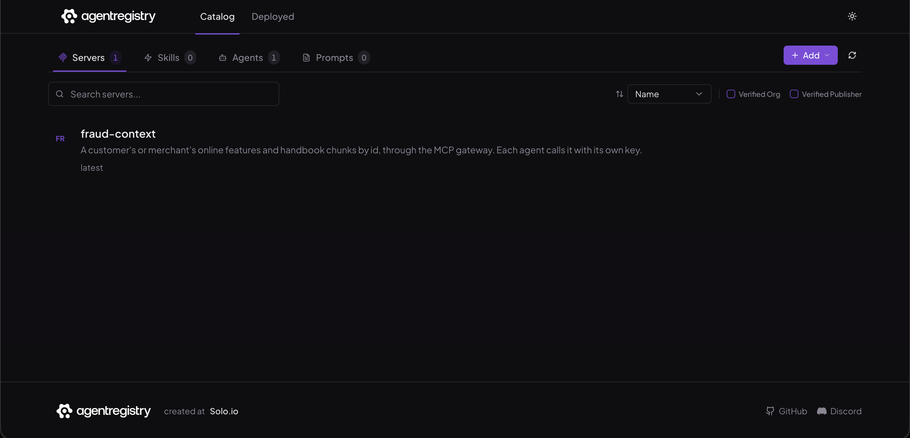

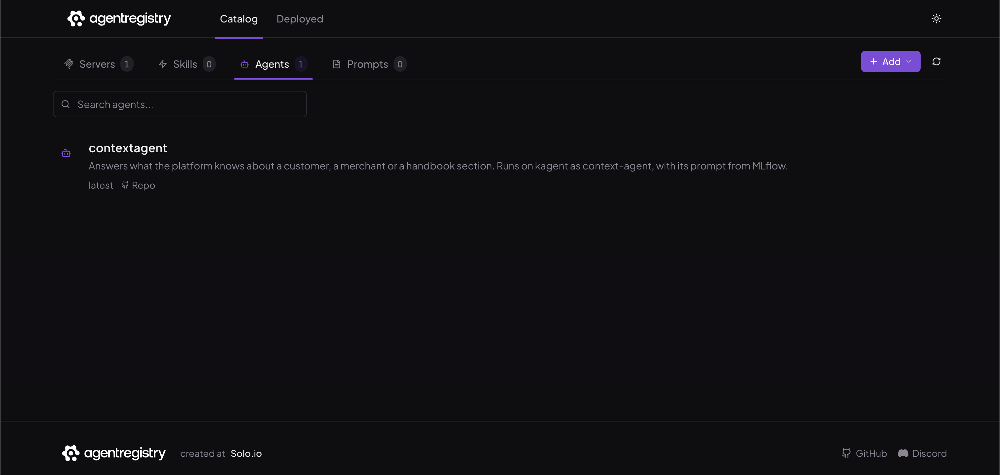

## How to run it

```bash
./k8s/mcp/install.sh            # MCP servers with Helm, keys, the MCP gateway
./k8s/mcp/check.sh --loop 150   # tool calls during a rolling update
./k8s/agents/install.sh         # kagent, the agents, the registry, the UIs
./k8s/agents/check.sh --agent context-agent
```

## Where things are

| What | Where |
|---|---|
| Context API | [`api/src/fraudstream_api/context/`](../../api/src/fraudstream_api/context/) |
| Its image and Helm values | [`k8s/Dockerfile.context`](../../k8s/Dockerfile.context), [`k8s/apis/context-api.yaml`](../../k8s/apis/context-api.yaml) |
| The shared chart | [`k8s/charts/fraudstream-api/`](../../k8s/charts/fraudstream-api/) |
| MCP servers | [`mcp_servers/src/fraudstream_mcp/`](../../mcp_servers/src/fraudstream_mcp/) |
| Their image, values and install | [`k8s/Dockerfile.mcp`](../../k8s/Dockerfile.mcp), [`k8s/mcp/fraud-context.yaml`](../../k8s/mcp/fraud-context.yaml), [`k8s/mcp/install.sh`](../../k8s/mcp/install.sh) |
| The context agent | [`k8s/agents/context-agent.yaml`](../../k8s/agents/context-agent.yaml), [`agents/prompts/context-agent.md`](../../agents/prompts/context-agent.md) |
| Network rules | [`k8s/agents/network.yaml`](../../k8s/agents/network.yaml) |
| Tests | [`api/tests/`](../../api/tests/), [`mcp_servers/tests/`](../../mcp_servers/tests/), [`agents/tests/`](../../agents/tests/) |
| Screenshots | [`images/mcp/`](../../images/mcp/), [`images/agents/`](../../images/agents/) |
