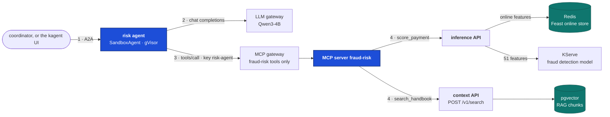
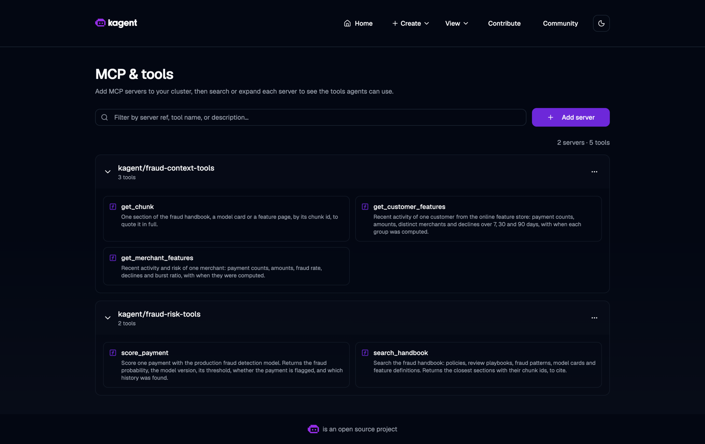
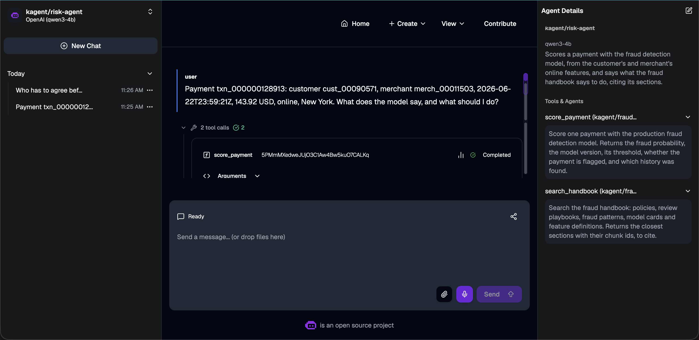
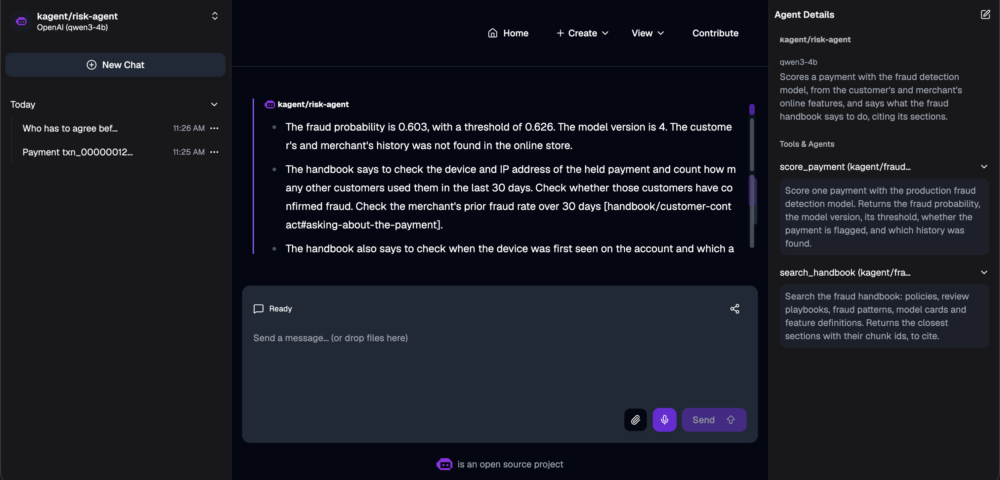
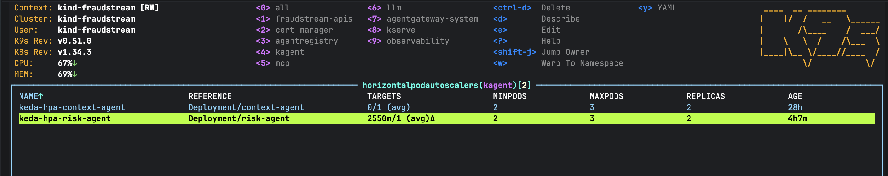
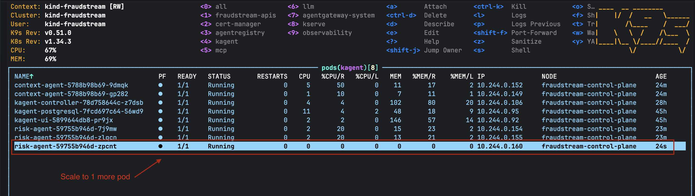
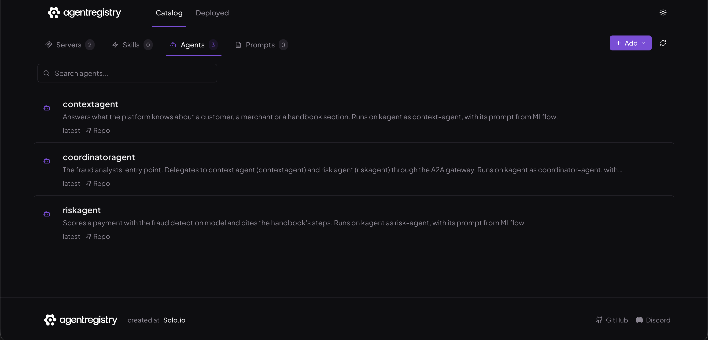
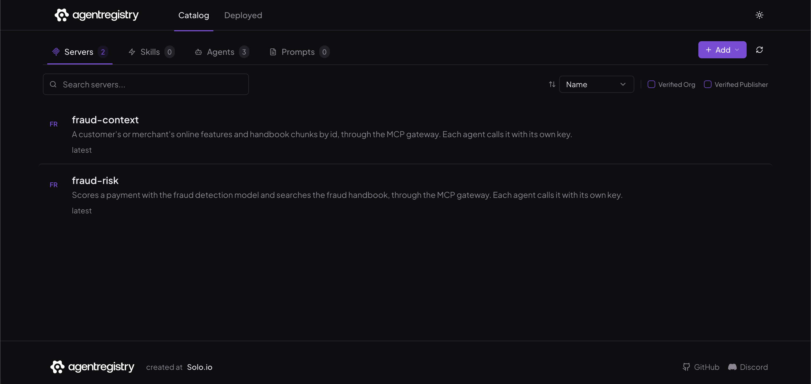

# Risk Agent

The risk agent is built like the context agent ([08_context_api_and_agent.md](08_context_api_and_agent.md))
and adds the two things an analyst needs about a payment: what the fraud detection model
says, and what the fraud handbook says to do. It has two tools, both on the MCP server
`fraud-risk`:

- **`score_payment`** calls the ML inference service. The inference API reads the
  customer's and merchant's features from the online feature store and scores the payment
  with the model on KServe ([07_ml_inference_service.md](07_ml_inference_service.md)).
- **`search_handbook`** is the RAG tool: it searches the chunks the RAG pipeline stored
  in pgvector ([04_rag_pipeline.md](04_rag_pipeline.md)) and returns them with their ids,
  to cite.

The model decides; the agent reports the decision and cites the handbook.

## The two tools

| Tool | Calls | Where |
|---|---|---|
| `score_payment(transaction_id, customer_id, merchant_id, event_timestamp, amount, channel, city)` | `POST /v1/predict` on the inference API | [`fraudstream_mcp/risk_server.py:23`](../../mcp_servers/src/fraudstream_mcp/risk_server.py#L23) |
| `search_handbook(query, top_k=5)` | `POST /v1/search` on the context API | [`fraudstream_mcp/risk_server.py:48`](../../mcp_servers/src/fraudstream_mcp/risk_server.py#L48) |

**`score_payment`, through the online feature store.** The inference API reads the
customer's and the merchant's features from Redis through Feast, asynchronously
([`inference/online_store.py:62`](../../api/src/fraudstream_api/inference/online_store.py#L62)),
drops any value older than its TTL at the payment's time, and asks the model
([`inference/app.py:77`](../../api/src/fraudstream_api/inference/app.py#L77)). It answers
with the probability, the model version, the threshold, whether the payment is flagged,
and which history was found ([`inference/app.py:112`](../../api/src/fraudstream_api/inference/app.py#L112)),
so the agent reports the model's decision and never works one out. The tool takes the
payment's fields, not just its id: payments live in Iceberg, not in an online store, and
the API's 422 names any field the model got wrong.

**`search_handbook`, the RAG tool.** The question is embedded with the RAG pipeline's own
pinned model and searched with its own `search()`, so it is matched exactly as the golden
questions are ([`context/stores.py:132`](../../api/src/fraudstream_api/context/stores.py#L132)).
Each hit comes back with its chunk id, which the agent must cite. The tool's description
tells the model what it covers: policies, playbooks, fraud patterns, model cards and
feature definitions.

The server's readiness checks both APIs ([`fraudstream_mcp/risk_server.py:56`](../../mcp_servers/src/fraudstream_mcp/risk_server.py#L56)).
It is deployed exactly like `fraud-context`: Helm, rolling update, rollback on failure,
2–3 replicas ([`mcp/fraud-risk.yaml:14`](../../k8s/mcp/fraud-risk.yaml#L14)).

## The agent

[`k8s/agents/risk-agent.yaml`](../../k8s/agents/risk-agent.yaml):

| Setting | Where |
|---|---|
| Its tools: the `fraud-risk` server through the MCP gateway, with the key `risk-agent` | [`agents/risk-agent.yaml:2`](../../k8s/agents/risk-agent.yaml#L2) |
| The global model config | [`agents/risk-agent.yaml:27`](../../k8s/agents/risk-agent.yaml#L27) |
| Its prompt, from MLflow through a ConfigMap | [`agents/risk-agent.yaml:28`](../../k8s/agents/risk-agent.yaml#L28) |
| Exactly two tools, by name | [`agents/risk-agent.yaml:38`](../../k8s/agents/risk-agent.yaml#L38) |
| Sandboxed on the agent fleet | [`agents/risk-agent.yaml:19`](../../k8s/agents/risk-agent.yaml#L19), [`agents/risk-agent.yaml:50`](../../k8s/agents/risk-agent.yaml#L50) |

The gateway's tool policy gives the `risk-agent` key `fraud-risk` only
([`mcp/secrets.yaml:106`](../../k8s/mcp/secrets.yaml#L106)), so it can't see the context
tools, and the context agent can't score a payment:

**Its prompt** ([`agents/prompts/risk-agent.md`](../../agents/prompts/risk-agent.md)) sorts
every question into one of two kinds, each with its own answer:

| Question | Tools | Answer |
|---|---|---|
| Gives a payment | `search_handbook`, then `score_payment` with the values as written | the probability, threshold and version; whether the history was found; the handbook's steps with chunk ids; last line `Model decision: flagged` or `not flagged`, copied from the model |
| Anything else | `search_handbook` only | the handbook's points with chunk ids, and nothing about the model |

The handbook search always comes first: when the models were compared, every wrong answer
was a policy question answered from memory. A first prompt with one template made the 4B
model write a decision under every policy question; two templates stopped it.

## In the kagent UI

Asked about a payment, it calls both tools:

and answers with the model's numbers, whether the history was found, and the handbook's
steps:

For this June 2026 payment the online store no longer held the customer's or merchant's
history, so the model scored it without, and the answer says so.

## Replicas, sandbox and registry

**Multiple replicas with KEDA.** Like the context agent, it was first deployed with a KEDA
scaler on calls in flight, 2–3 replicas
([`k8s/agents/risk-agent.yaml` at e74579e, line 60](https://github.com/hiendat04/fraudstream/blob/e74579e54d47914eccb0f91af9bfd9a453d34913/k8s/agents/risk-agent.yaml#L60)).
Three questions at once read 2.55 calls per replica against a target of 1, and a third
pod started:

It now runs on the agent fleet with the context agent, each conversation a sandboxed actor
on three shared workers ([13_agent_fleet.md](13_agent_fleet.md)).

**Sandbox.** The same as the context agent: a gVisor sandbox per conversation, the
`fleet-workers` NetworkPolicy ([`agents/network.yaml:60`](../../k8s/agents/network.yaml#L60)),
and a key that reaches only its own two tools. A prompt injection that reaches the risk
agent can't read customer data through the context tools.

**Registry.** `riskagent`, linked to `fraud-risk`, is published from
[`agents/registry.yaml:38`](../../k8s/agents/registry.yaml#L38) after its eval questions
pass ([`cicd/deploy_agent.sh:94`](../../cicd/deploy_agent.sh#L94)):

## Its eval questions

Two of the six eval questions are the risk agent's
([`fraudstream_agents/evals.py:48`](../../agents/src/fraudstream_agents/evals.py#L48)). The
truth is read at check time: the model's answer for the same payment from the inference
API, and the chunks from the context API.

| Question | Must call | The answer must |
|---|---|---|
| a payment: what the model says, what to do | `score_payment`, `search_handbook` | carry the model's decision and threshold, and cite a chunk that exists |
| who agrees before a block above 5,000 USD | `search_handbook` | cite a chunk under `handbook/review-policy`, and hold no decision line |

An answer with a decision line when no payment was scored fails: that would be a decision
the model never made.

## Where things are

| What | Where |
|---|---|
| The risk agent and its tools | [`k8s/agents/risk-agent.yaml`](../../k8s/agents/risk-agent.yaml) |
| Its prompt | [`agents/prompts/risk-agent.md`](../../agents/prompts/risk-agent.md) |
| The `fraud-risk` MCP server | [`mcp_servers/src/fraudstream_mcp/risk_server.py`](../../mcp_servers/src/fraudstream_mcp/risk_server.py), [`k8s/mcp/fraud-risk.yaml`](../../k8s/mcp/fraud-risk.yaml) |
| The inference API | [`api/src/fraudstream_api/inference/`](../../api/src/fraudstream_api/inference/) |
| Search | [`api/src/fraudstream_api/context/stores.py`](../../api/src/fraudstream_api/context/stores.py), [`rag/src/fraudstream_rag/retrieval.py`](../../rag/src/fraudstream_rag/retrieval.py) |
| Eval questions and checks | [`agents/src/fraudstream_agents/evals.py`](../../agents/src/fraudstream_agents/evals.py), [`k8s/agents/check.sh`](../../k8s/agents/check.sh) |
| Screenshots | [`images/multi_agents/`](../../images/multi_agents/) |
