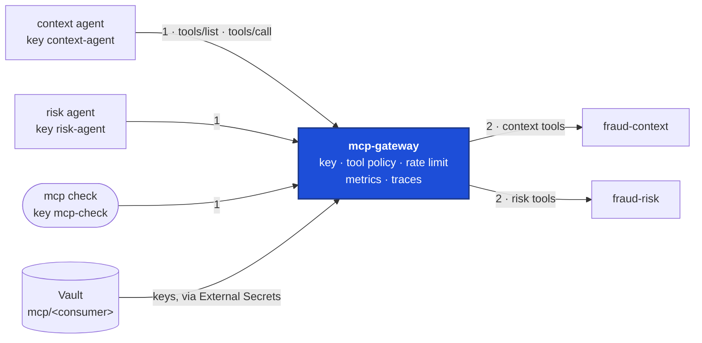
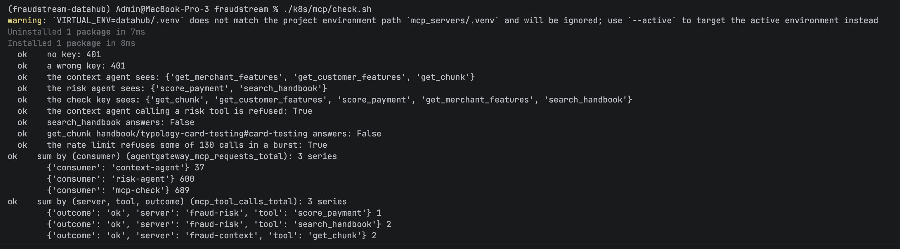
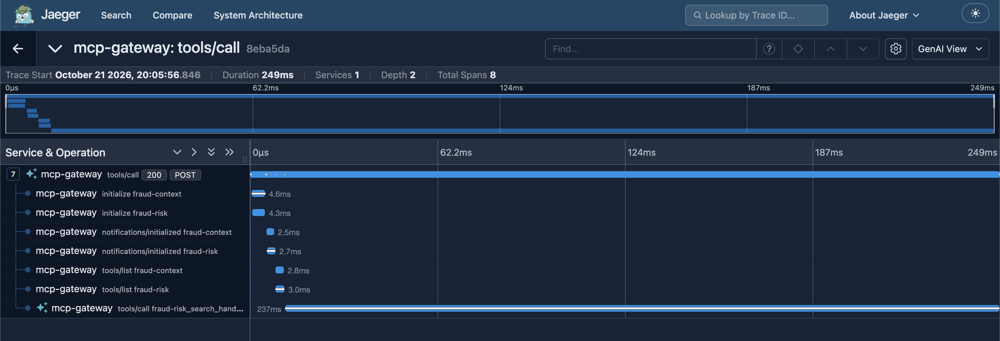

# MCP Gateway

Agents never call an MCP server directly. They call `mcp-gateway`, an agentgateway
Gateway in the namespace `mcp`, which is the one entry point to both MCP servers. It
checks each agent's key, shows the agent only the tools that key allows, limits its
rate, and counts and traces every call.

It is a second Gateway of the same agentgateway controller as the LLM gateway
([01_llm_inference_platform.md](01_llm_inference_platform.md)), not the same one: LLM
keys and MCP keys never mix, and either can change without touching the other.



1. An agent calls the gateway with its own key. Its calls pass the A2A gateway first,
   which hands them on unchanged ([11_a2a_gateway.md](11_a2a_gateway.md)).
2. The gateway answers `tools/list` with only the allowed tools and forwards each
   `tools/call` to the server that owns the tool.

## Setup

[`k8s/mcp/install.sh`](../../k8s/mcp/install.sh) makes the keys, then applies two files
([`mcp/install.sh:28`](../../k8s/mcp/install.sh#L28), [`mcp/install.sh:33`](../../k8s/mcp/install.sh#L33)):

| Object | What it does | Where |
|---|---|---|
| `AgentgatewayParameters` | the gateway pod's size and its Service type | [`mcp/gateway.yaml:6`](../../k8s/mcp/gateway.yaml#L6) |
| `Gateway` `mcp-gateway` | one HTTP listener on port 8080 | [`mcp/gateway.yaml:22`](../../k8s/mcp/gateway.yaml#L22) |
| `AgentgatewayBackend` | both MCP servers as targets of one backend, so an agent sees one tool list | [`mcp/gateway.yaml:42`](../../k8s/mcp/gateway.yaml#L42) |
| `HTTPRoute` | sends `/mcp` to that backend | [`mcp/gateway.yaml:68`](../../k8s/mcp/gateway.yaml#L68) |
| `AgentgatewayPolicy` `mcp-gateway` | on the Gateway: keys, rate limit, metrics, tracing | [`mcp/policy.yaml:1`](../../k8s/mcp/policy.yaml#L1) |
| `AgentgatewayPolicy` `fraud-detection-tools` | on the backend: which tools each key may see and call | [`mcp/policy.yaml:33`](../../k8s/mcp/policy.yaml#L33) |
| `ReferenceGrant` | lets the policy in `mcp` send traces to Jaeger in `observability` | [`mcp/policy.yaml:51`](../../k8s/mcp/policy.yaml#L51) |
| Keys | one per consumer from Vault, and the gateway's list of their hashes | [`mcp/secrets.yaml:89`](../../k8s/mcp/secrets.yaml#L89) |

The two rules that matter:

```yaml
traffic:
  apiKeyAuthentication:
    mode: Strict
    secretRef: {name: mcp-api-keys}
  rateLimit:
    local:
      - {requests: 120, unit: Minutes, key: apiKey.consumer}
---
backend:
  mcp:
    authorization:
      action: Allow
      policy:
        matchExpressions:
          - mcp.tool.target in apiKey.servers
```

Each key's entry holds only its hash, the consumer's name and the servers it may use:

```json
{"keyHash": "sha256:…", "metadata": {"consumer": "context-agent", "servers": ["fraud-context"]}}
```

## Security and policy, and why

| Setting | Value | Why | Where |
|---|---|---|---|
| Inside the cluster only | Service `ClusterIP`, no Ingress | agents run in the cluster; nothing outside needs the tools, so nothing is exposed | [`mcp/gateway.yaml:18`](../../k8s/mcp/gateway.yaml#L18) |
| Routes from its own namespace only | `allowedRoutes: Same` | a route created elsewhere can't attach itself to the MCP gateway | [`mcp/gateway.yaml:38`](../../k8s/mcp/gateway.yaml#L38) |
| A key on every call | `apiKeyAuthentication`, `mode: Strict` | no key or a wrong one gets 401; nothing is anonymous | [`mcp/policy.yaml:12`](../../k8s/mcp/policy.yaml#L12) |
| A key per consumer | `context-agent`, `risk-agent`, `mcp-check`, made once in Vault | the gateway knows who calls, so limits, metrics and traces are per agent, and one key can be replaced alone | [`mcp/install.sh:28`](../../k8s/mcp/install.sh#L28) |
| Only hashes at the gateway | `keyHash: sha256:…` | reading the gateway's Secret gives away no key | [`mcp/secrets.yaml:105`](../../k8s/mcp/secrets.yaml#L105) |
| A tool policy per key | `mcp.tool.target in apiKey.servers` | each agent sees and calls only its own tools. A small model given fewer tools picks the right one more often, and a prompt injection reaching the risk agent can't read customer data | [`mcp/policy.yaml:49`](../../k8s/mcp/policy.yaml#L49) |
| A rate limit per consumer | 120 requests a minute, keyed on `apiKey.consumer` | one runaway agent can't starve the others. A throttled call gets HTTP 200 with a JSON-RPC error, as MCP requires | [`mcp/policy.yaml:16`](../../k8s/mcp/policy.yaml#L16) |
| No server prefix on tool names | `prefixMode: Never` | agents see `get_customer_features`, not `fraud-context_get_customer_features`, which a small model calls more reliably | [`mcp/gateway.yaml:51`](../../k8s/mcp/gateway.yaml#L51) |
| No session in the gateway | `sessionRouting: Stateless` | matches the servers: any replica answers, so a rolling update breaks no caller | [`mcp/gateway.yaml:49`](../../k8s/mcp/gateway.yaml#L49) |
| One server down, the other still works | `failureMode: FailOpen` | if the risk server is down, the context tools keep answering | [`mcp/gateway.yaml:50`](../../k8s/mcp/gateway.yaml#L50) |
| Calls counted per consumer | metrics attribute `consumer` | the dashboard shows which agent called which tool | [`mcp/policy.yaml:20`](../../k8s/mcp/policy.yaml#L20) |
| Every call traced | OTLP to Jaeger | a tool call can be followed from the gateway to the server that answered | [`mcp/policy.yaml:25`](../../k8s/mcp/policy.yaml#L25) |
| A small pod | 50m CPU, 64 Mi, at most 256 Mi | it only routes; it idles at 25 MiB | [`mcp/gateway.yaml:12`](../../k8s/mcp/gateway.yaml#L12) |

The agents' NetworkPolicies don't let them reach the MCP gateway or the servers directly
([`agents/network.yaml:60`](../../k8s/agents/network.yaml#L60)): every tool call goes
through the A2A gateway to this one, so the key and the tool policy can't be gone around.

## Proof

[`k8s/mcp/check.sh`](../../k8s/mcp/check.sh) runs every rule from outside
([`mcp_servers/tools/check_gateway.py`](../../mcp_servers/tools/check_gateway.py)): no key
and a wrong key get 401, each agent's key lists only its own tools, the context agent's key
is refused a risk tool, real calls reach both servers, a burst is throttled, and Prometheus
has calls per consumer and per tool.



One `tools/call` in Jaeger: the gateway opens both servers, lists their tools, and sends
the call to `fraud-risk`.



## How to run it

```bash
./k8s/mcp/install.sh     # servers, keys, gateway, policy
./k8s/mcp/check.sh       # every rule, checked from outside
```

## Where things are

| What | Where |
|---|---|
| Gateway, backend and route | [`k8s/mcp/gateway.yaml`](../../k8s/mcp/gateway.yaml) |
| Policy | [`k8s/mcp/policy.yaml`](../../k8s/mcp/policy.yaml) |
| Keys from Vault | [`k8s/mcp/secrets.yaml`](../../k8s/mcp/secrets.yaml), [`infra/vault/new-key.sh`](../../infra/vault/new-key.sh) |
| Install | [`k8s/mcp/install.sh`](../../k8s/mcp/install.sh) |
| Checks | [`k8s/mcp/check.sh`](../../k8s/mcp/check.sh), [`mcp_servers/tools/check_gateway.py`](../../mcp_servers/tools/check_gateway.py) |
| Screenshots | [`images/mcp/`](../../images/mcp/) |
