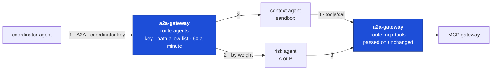
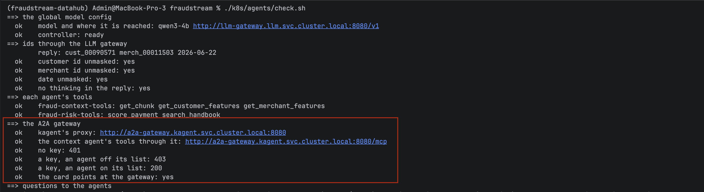
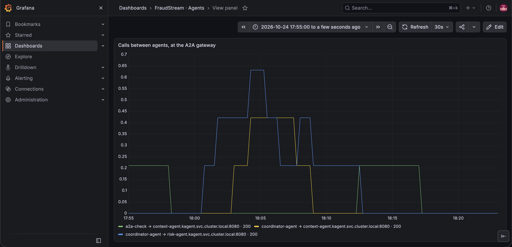
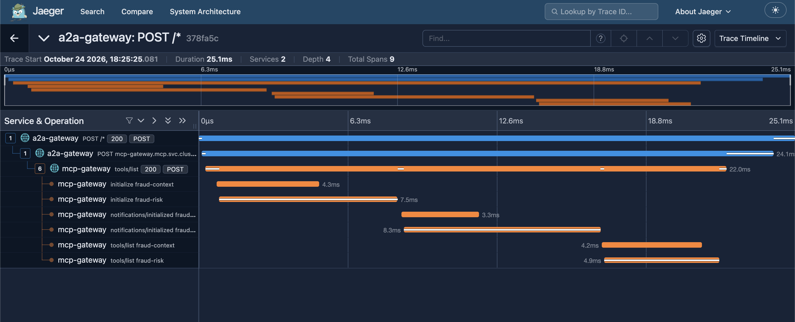

# A2A Gateway

Agents never call each other directly. When the coordinator asks a specialist, the call
goes to `a2a-gateway`, an agentgateway Gateway in the namespace `kagent`, which checks
who is calling, whether that caller may call that agent, and how often.



## How calls reach it

kagent calls a sandboxed specialist at its address on the controller,
`http://kagent-controller.kagent:8083/api/a2a-sandboxes/kagent/risk-agent/`, and an Agent
tool has no field to change that. What kagent does have is one proxy setting for the
whole platform ([`agents/kagent-values.yaml:47`](../../k8s/agents/kagent-values.yaml#L47)).
With it set, every call an agent makes inside the cluster goes to the gateway, with a
header naming where it was meant to go:

```text
POST http://a2a-gateway.kagent.svc.cluster.local:8080/api/a2a-sandboxes/kagent/risk-agent/
x-kagent-host: kagent-controller.kagent
Authorization: Bearer <the coordinator's A2A key>
```

The coordinator sends its key on both agent tools, from a Secret synced from Vault
([`agents/coordinator-agent.yaml:21`](../../k8s/agents/coordinator-agent.yaml#L21)).

## Setup

Applied by [`agents/install.sh:38`](../../k8s/agents/install.sh#L38), before kagent, whose
proxy setting points at it:

| Object | What it does | Where |
|---|---|---|
| `AgentgatewayParameters`, `Gateway` | one HTTP listener on 8080, `ClusterIP`, routes from `kagent` only | [`agents/a2a-gateway.yaml:1`](../../k8s/agents/a2a-gateway.yaml#L1), [`agents/a2a-gateway.yaml:17`](../../k8s/agents/a2a-gateway.yaml#L17) |
| Service `sandbox-agents` | the controller's sandbox port, marked `appProtocol: kgateway.dev/a2a` | [`agents/a2a-gateway.yaml:37`](../../k8s/agents/a2a-gateway.yaml#L37) |
| `HTTPRoute` `agents` | the controller's host and each specialist's sandbox path; the risk agent's calls split by weight between `risk-agent-a` and `risk-agent-b` | [`agents/a2a-gateway.yaml:85`](../../k8s/agents/a2a-gateway.yaml#L85) |
| `HTTPRoute` `mcp-tools` | the MCP gateway's host, passed on unchanged | [`agents/a2a-gateway.yaml:136`](../../k8s/agents/a2a-gateway.yaml#L136) |
| `AgentgatewayPolicy` `a2a-gateway` | on the Gateway: the caller as `consumer` on metrics, traces to Jaeger | [`agents/a2a-policy.yaml:1`](../../k8s/agents/a2a-policy.yaml#L1) |
| `AgentgatewayPolicy` `agents` | on the route `agents`: key, allow-list, rate limit | [`agents/a2a-policy.yaml:40`](../../k8s/agents/a2a-policy.yaml#L40) |
| Keys | one per caller from Vault, and the gateway's list of hashes with each caller's allowed paths | [`agents/install.sh:31`](../../k8s/agents/install.sh#L31), [`agents/secrets.yaml:94`](../../k8s/agents/secrets.yaml#L94) |

The second route exists because the proxy setting also catches the specialists' tool
calls: the MCP gateway's address is inside the cluster too. Passing them on unchanged
keeps the MCP gateway's own keys and tool policy exactly as they are
([10_mcp_gateway.md](10_mcp_gateway.md)).

## Security and policy, and why

| Setting | Value | Why | Where |
|---|---|---|---|
| A key on every agent call | `apiKeyAuthentication`, `mode: Strict`, hashes in `a2a-api-keys` | only a caller with a key reaches an agent. The specialists have none, so they can't call each other | [`agents/a2a-policy.yaml:51`](../../k8s/agents/a2a-policy.yaml#L51) |
| An allow-list per key | `apiKey.agents.exists(p, request.path == p \|\| request.path.startsWith(p + "/"))` | each key names the agent paths it may call: the coordinator's both specialists, the check's key only the context agent | [`agents/a2a-policy.yaml:59`](../../k8s/agents/a2a-policy.yaml#L59), [`agents/secrets.yaml:94`](../../k8s/agents/secrets.yaml#L94) |
| A rate limit per caller | 60 requests a minute | a delegated question is one request and the model answers far fewer, so only a runaway loop meets it | [`agents/a2a-policy.yaml:62`](../../k8s/agents/a2a-policy.yaml#L62) |
| Who called whom | `consumer` from the key on every metric, traces to Jaeger | calls between agents on the dashboard, and one trace across agents | [`agents/a2a-policy.yaml:11`](../../k8s/agents/a2a-policy.yaml#L11) |
| Agent cards point at the gateway | `appProtocol: kgateway.dev/a2a` on the Service | agentgateway rewrites a card's address to its own, so the next call can't go straight to the pod | [`agents/a2a-gateway.yaml:51`](../../k8s/agents/a2a-gateway.yaml#L51) |
| No route to the coordinator | none | nothing calls the coordinator through the gateway | |
| Inside the cluster only | `ClusterIP`, `allowedRoutes: Same` | nothing outside calls an agent but the kagent UI, behind NGINX | [`agents/a2a-gateway.yaml:15`](../../k8s/agents/a2a-gateway.yaml#L15), [`agents/a2a-gateway.yaml:33`](../../k8s/agents/a2a-gateway.yaml#L33) |
| No way around it | NetworkPolicies: the agents may reach DNS, the controller, the LLM and A2A gateways and Jaeger, nothing else | a prompt injection can't send an agent straight to another agent or tool | [`agents/network.yaml:1`](../../k8s/agents/network.yaml#L1), [`agents/network.yaml:60`](../../k8s/agents/network.yaml#L60) |

`k8s/agents/check.sh` proves the policy: 401 without a key, 403 for an agent off the
key's list, 200 for one on it, and the card pointing at the gateway.



Calls between agents on the dashboard, by caller, agent and status:



A tool listing passed on by the A2A gateway to the MCP gateway, in one trace:



## Known limit

**The controller is a side door.** Agents still reach the controller, where they keep their
sessions, and its A2A endpoint has no login on kind. The gateway's policy covers the calls
kagent routes through it.

## Where things are

| What | Where |
|---|---|
| Gateway, routes and Services | [`k8s/agents/a2a-gateway.yaml`](../../k8s/agents/a2a-gateway.yaml) |
| Policy | [`k8s/agents/a2a-policy.yaml`](../../k8s/agents/a2a-policy.yaml) |
| kagent's proxy setting | [`k8s/agents/kagent-values.yaml`](../../k8s/agents/kagent-values.yaml) |
| Keys from Vault | [`k8s/agents/secrets.yaml`](../../k8s/agents/secrets.yaml) |
| Network rules | [`k8s/agents/network.yaml`](../../k8s/agents/network.yaml) |
| Install and checks | [`k8s/agents/install.sh`](../../k8s/agents/install.sh), [`k8s/agents/check.sh`](../../k8s/agents/check.sh) |
| Screenshots | [`images/multi_agents/`](../../images/multi_agents/) |
