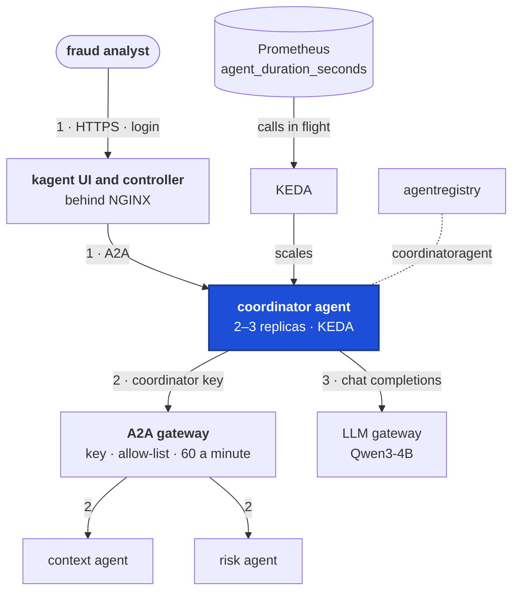
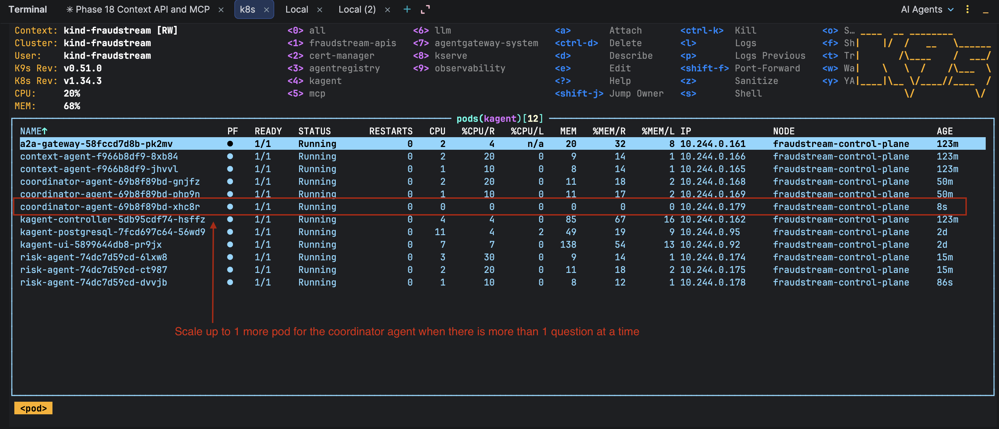
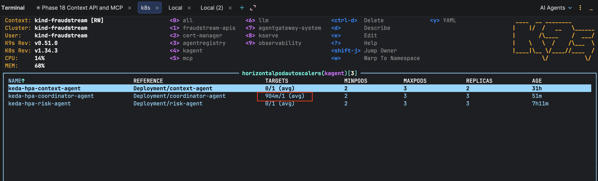
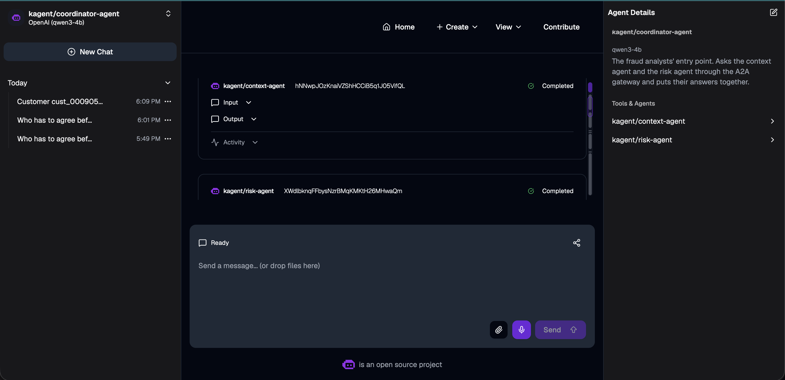
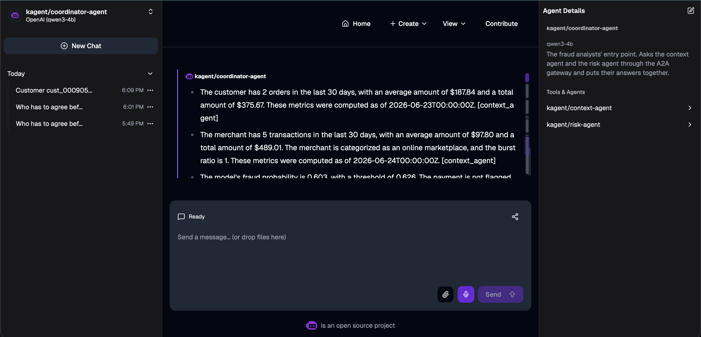
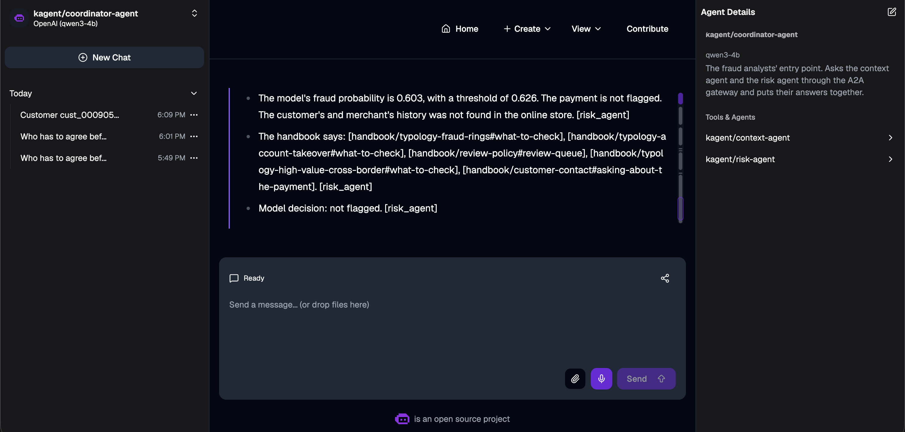
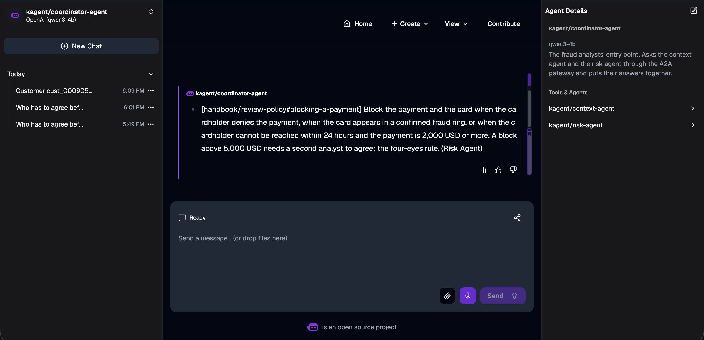
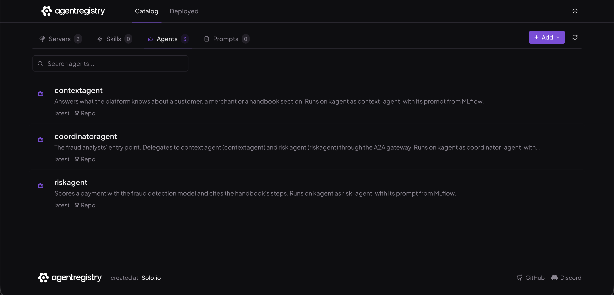

# Coordinator Agent

Fraud analysts talk to one agent, the coordinator. It answers by asking the two
specialists: the context agent, for what the platform stores about a customer or a
merchant ([08](08_context_api_and_agent.md)), and the risk agent, for what the fraud
detection model says about a payment and what the handbook says to do
([09](09_risk_agent.md)). It has no MCP tools of its own; its two tools are the agents.



1. The analyst asks the coordinator in the kagent UI.
2. The coordinator calls a specialist as a tool, through the A2A gateway with its key
   ([11_a2a_gateway.md](11_a2a_gateway.md)).
3. It asks Qwen3-4B, through the LLM gateway, whom to ask and how to put the answers
   together.

## The agent

[`k8s/agents/coordinator-agent.yaml`](../../k8s/agents/coordinator-agent.yaml):

| Setting | Value | Why | Where |
|---|---|---|---|
| Kind | `Agent`, with pods of its own | KEDA scales pods; the sandboxed specialists have none | [`agents/coordinator-agent.yaml:2`](../../k8s/agents/coordinator-agent.yaml#L2) |
| Model | the global model config | | [`agents/coordinator-agent.yaml:10`](../../k8s/agents/coordinator-agent.yaml#L10) |
| Prompt | from MLflow through a ConfigMap | | [`agents/coordinator-agent.yaml:11`](../../k8s/agents/coordinator-agent.yaml#L11) |
| Tools | the context agent and the risk agent | | [`agents/coordinator-agent.yaml:16`](../../k8s/agents/coordinator-agent.yaml#L16) |
| Key | `Authorization` from `a2a-key-coordinator-agent` on both tools | the gateway lets this key call both specialists | [`agents/coordinator-agent.yaml:21`](../../k8s/agents/coordinator-agent.yaml#L21) |
| `isolateSessions` | `true` on both tools | by default every call from a pod reuses one specialist session; every analyst's question would pile into it, outgrow the model's 8,192 tokens and mix one chat's payment into the next | [`agents/coordinator-agent.yaml:20`](../../k8s/agents/coordinator-agent.yaml#L20) |
| Resources | 10m CPU, 64 Mi, at most 512 Mi | it uses 7–15 MiB | [`agents/coordinator-agent.yaml:38`](../../k8s/agents/coordinator-agent.yaml#L38) |

kagent shows the two tools to the model as `kagent__NS__context_agent` and
`kagent__NS__risk_agent`, so the prompt ([`agents/prompts/coordinator-agent.md`](../../agents/prompts/coordinator-agent.md))
uses those names. It says when to ask which, to pass ids and payment values on as written,
to keep the specialists' numbers, chunk ids and decision line, and never to judge a
payment itself.

It is applied after both specialists are Ready, since kagent refuses an Agent tool whose
agent doesn't exist yet ([`agents/install.sh:71`](../../k8s/agents/install.sh#L71)).

## Multiple replicas, scaled by KEDA

A KEDA `ScaledObject` keeps 2 to 3 replicas ([`agents/coordinator-agent.yaml:47`](../../k8s/agents/coordinator-agent.yaml#L47)):

| Setting | Value | Why | Where |
|---|---|---|---|
| Replicas | 2, up to 3 | two keep it up while a pod restarts | [`agents/coordinator-agent.yaml:55`](../../k8s/agents/coordinator-agent.yaml#L55) |
| Trigger | `sum(rate(agent_duration_seconds_sum{gen_ai_agent_name="coordinator_agent"}[5m]))` from Prometheus | seconds of calling per second is the number of calls in flight. CPU says nothing: the agent waits on the model | [`agents/coordinator-agent.yaml:69`](../../k8s/agents/coordinator-agent.yaml#L69) |
| Target | 1 call in flight per replica | | [`agents/coordinator-agent.yaml:70`](../../k8s/agents/coordinator-agent.yaml#L70) |
| Window | 5 minutes, not 2 | its calls take minutes and are counted only when they end, so a 2-minute window reads 0 during a burst and then jumps | [`agents/coordinator-agent.yaml:69`](../../k8s/agents/coordinator-agent.yaml#L69) |
| Fallback | 2 replicas after 3 failed reads | a Prometheus outage leaves it as it is | [`agents/coordinator-agent.yaml:57`](../../k8s/agents/coordinator-agent.yaml#L57) |
| Scale down | after 2 minutes | questions come in bursts | [`agents/coordinator-agent.yaml:64`](../../k8s/agents/coordinator-agent.yaml#L64) |

The metric is counted from the agents' own spans in Jaeger, since kagent has no request
metrics ([18_observability.md](18_observability.md#agent-telemetry)).

**Tested.** `./k8s/agents/check.sh --load 3 --agent coordinator-agent` sends three
questions at once. More than one call is in flight per replica, and a third pod starts:





More replicas add availability, not speed: the model answers one request at a time, and a
coordinator question waits for two or three answers in turn.

## In the kagent UI

Asked about a customer and a payment, it calls both specialists:



and puts their answers together, saying which agent each point came from:





A policy question goes to the risk agent alone, and comes back with the right chunk and no
model decision:



The kagent UI is behind NGINX with HTTPS and the gateway login, with a 600 s read timeout
since a coordinator answer waits on a specialist ([`agents/ingress.yaml:15`](../../k8s/agents/ingress.yaml#L15)).

## Published to the registry

`coordinatoragent` is a record in [`agents/registry.yaml:53`](../../k8s/agents/registry.yaml#L53).
The registry has no field for the agents an agent calls, so its description names them,
`contextagent` and `riskagent`. Jenkins publishes it after its eval questions pass
([`cicd/deploy_agent.sh:94`](../../cicd/deploy_agent.sh#L94)); see
[03_agent_registry.md](03_agent_registry.md).



## Its eval questions

| Question | Must call | The answer must | Time |
|---|---|---|---|
| the policy question | `kagent__NS__risk_agent` | the same as the risk agent's | 100–270 s |
| the customer and the payment | both agent tools | a stored value of the customer, the decision and threshold, an existing chunk | 135–450 s |

The tool calls are read from the A2A task's history, where kagent records each one
([`fraudstream_agents/evals.py:48`](../../agents/src/fraudstream_agents/evals.py#L48)).

## How to run it

```bash
./k8s/agents/install.sh                                     # everything, safe to run again
./k8s/agents/check.sh --agent coordinator-agent             # its eval questions
./k8s/agents/check.sh --load 3 --agent coordinator-agent    # three at once, to watch KEDA
```

## Where things are

| What | Where |
|---|---|
| The coordinator and its scaler | [`k8s/agents/coordinator-agent.yaml`](../../k8s/agents/coordinator-agent.yaml) |
| Its prompt | [`agents/prompts/coordinator-agent.md`](../../agents/prompts/coordinator-agent.md) |
| Registry record | [`k8s/agents/registry.yaml`](../../k8s/agents/registry.yaml) |
| Install, checks and CI deploy | [`k8s/agents/install.sh`](../../k8s/agents/install.sh), [`k8s/agents/check.sh`](../../k8s/agents/check.sh), [`cicd/deploy_agent.sh`](../../cicd/deploy_agent.sh) |
| Eval questions | [`agents/src/fraudstream_agents/evals.py`](../../agents/src/fraudstream_agents/evals.py) |
| Screenshots | [`images/multi_agents/`](../../images/multi_agents/) |
