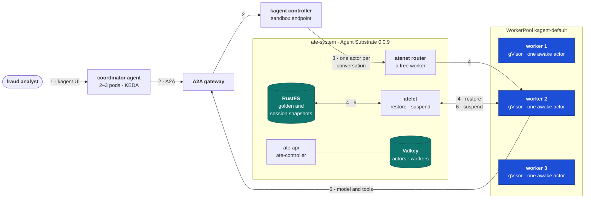
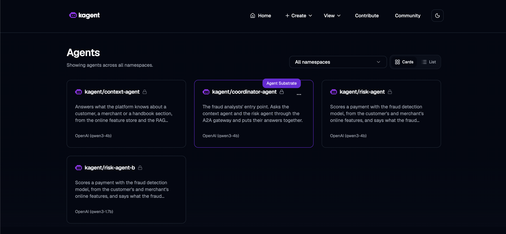
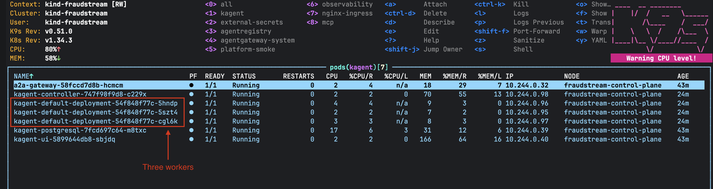
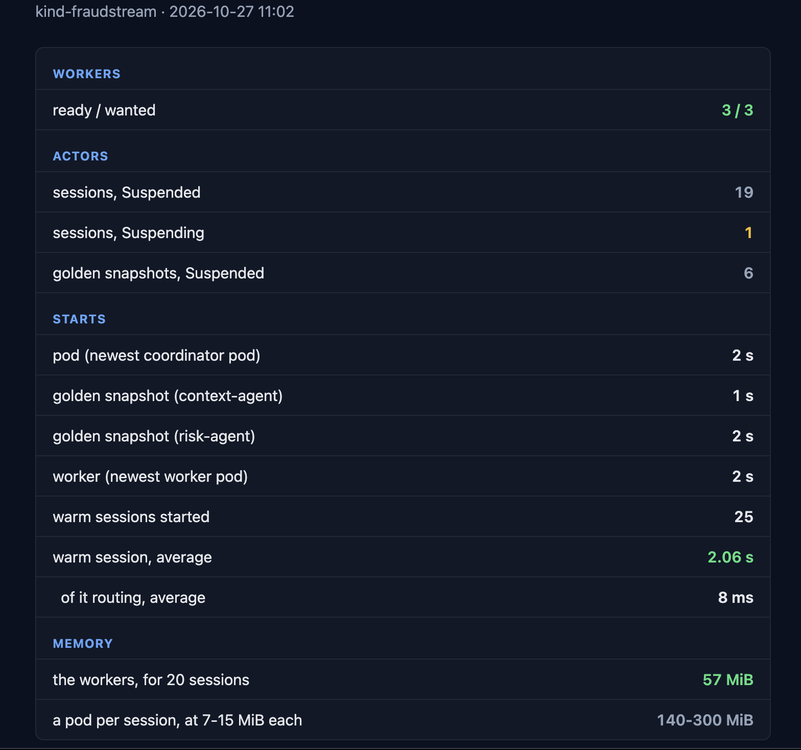

# Agent Fleet: Warm Workers for Sandboxed Agents

The context agent and the risk agent don't run as pods of their own. Every conversation
with them runs in its own gVisor sandbox, restored in about two seconds from a snapshot
of the agent, on a small pool of always-running workers it shares with every other
conversation. A sleeping conversation costs storage, not a worker. This is Agent
Substrate, which kagent 0.10 ships as its agent fleet.

## Architecture



1. **Ask.** The analyst asks the coordinator, an ordinary agent with pods.
2. **Delegate.** It calls a specialist through the A2A gateway, which sends the call to
   kagent's controller, the front door of every sandboxed agent.
3. **Route.** Each call carries a conversation id. A new id gets a new actor: a sandboxed
   copy of the agent for that conversation only.
4. **Warm start.** atelet restores the actor from the agent's golden snapshot onto a free
   worker.
5. **Answer.** The actor asks the model and calls its tools, through the same gateways.
6. **Suspend.** Once it has answered, the actor is snapshotted to RustFS and its worker is
   free for the next conversation.

## Setting up Substrate

| Part | What it does | Where |
|---|---|---|
| Substrate's install | its CRDs, control plane, router, atelet on every node, a six-node Valkey cluster for its state, and RustFS for the snapshots | [`agents/substrate.sh:28`](../../k8s/agents/substrate.sh#L28) |
| RustFS's keys | made once in Vault, in place of the chart's default login | [`agents/substrate.sh:21`](../../k8s/agents/substrate.sh#L21), [`k8s/agents/substrate-secrets.yaml`](../../k8s/agents/substrate-secrets.yaml) |
| Valkey after a restart | the 0.0.9 chart remembers pod IPs, so each node is made to announce its current one and the nodes meet again | [`agents/substrate.sh:36`](../../k8s/agents/substrate.sh#L36) |
| kagent pointed at it | `controller.substrate` | [`agents/kagent-values.yaml:51`](../../k8s/agents/kagent-values.yaml#L51) |
| The worker pool | `substrateWorkerPool`: three workers, each with gVisor in its image (`ateom-gvisor`), so no node needs a runtime installed | [`agents/kagent-values.yaml:58`](../../k8s/agents/kagent-values.yaml#L58) |
| The sandboxed agents | `SandboxAgent`, with `workerPoolRef: kagent-default` | [`agents/context-agent.yaml:51`](../../k8s/agents/context-agent.yaml#L51), [`agents/risk-agent.yaml:50`](../../k8s/agents/risk-agent.yaml#L50) |
| Installed before kagent | its controller connects to Substrate at start | [`agents/install.sh:43`](../../k8s/agents/install.sh#L43) |



## Warm start

Without a fleet, a new conversation on an idle system would wait for a pod to start, then
for the agent to boot. The fleet does both ahead of time:

- **Warm workers.** Three worker pods are always running.
- **Golden snapshots.** For each version of an agent, kagent makes an ActorTemplate and
  Substrate boots it once, then freezes it. Every new conversation is a restore of that
  frozen copy, not a boot.

kagent's Agent Substrate page shows both: each agent version's template with its golden
snapshot, then every actor, suspended in RustFS while the three workers sit idle.


**A new prompt is a new version.** A session restored from a golden snapshot keeps the
prompt the snapshot was taken with. So [`k8s/agents/apply.sh`](../../k8s/agents/apply.sh)
writes the prompt's MLflow version into the agent as `PROMPT_VERSION`
([`agents/apply.sh:11`](../../k8s/agents/apply.sh#L11)): a new prompt changes the agent,
kagent makes a new template, and Substrate takes a new golden snapshot. The CI deploy waits
for that snapshot before it asks the eval questions
([`cicd/deploy_agent.sh:33`](../../cicd/deploy_agent.sh#L33)).

## Many agents on few workers

**A worker runs one awake actor at a time.** Sleeping actors live in RustFS, not on the
worker, so the pool caps how many conversations can be *answering* at once, not how many
exist. When every worker is busy, Substrate refuses a new one with `no free workers`, and
the check asks again every 2 seconds in the same conversation
([`tools/check_agent.py:36`](../../agents/tools/check_agent.py#L36)). Six questions sent at
once on three workers all completed, the last three after waiting for a worker.



Twenty fresh conversations, ten to each specialist, asked two at a time, then read with
[`k8s/agents/fleet.sh`](../../k8s/agents/fleet.sh):



| Start | Time | What it is |
|---|---|---|
| **Warm conversation** | **2.06 s** average, 25 restores | atelet restoring an actor from its golden snapshot onto a running worker |
| of it, choosing the worker | 8 ms | the atenet router |
| Golden snapshot | 1–2 s, 47 s the first time | a new agent version booted and frozen |
| Worker pod | 2–6 s | a new worker, from creation to Ready |
| Agent pod | 2 s | the coordinator's newest pod, for comparison |

| Memory | Measured |
|---|---|
| Three workers, holding 20 conversations | **57 MiB** |
| A pod per conversation, at 7–15 MiB each | 140–300 MiB |
| Substrate itself (`ate-system`) | about 370 MiB, Valkey's six pods 66 MiB of it |

The workers' memory stays flat as conversations grow. Substrate's own 370 MiB is fixed, so
the fleet uses less memory than a pod per conversation only past 30 to 50 conversations.
The warm numbers come from atelet's `Restore` calls, which a PodMonitor scrapes
([`observability/servicemonitors.yaml:122`](../../k8s/observability/servicemonitors.yaml#L122)).

## Known limits

- **KEDA can't scale the pool.** An HPA needs its target's pod selector, and Substrate
  0.0.9's WorkerPool has none, so the pool is a fixed three workers.
- **Nothing is ever deleted.** Every conversation's actor and every old golden snapshot
  stays in Valkey and RustFS; kagent 0.10.3 has no setting to clean them up.
- **The coordinator doesn't ask again.** With more than three specialist calls in flight,
  one can fail on "no free workers".
- **RustFS is not durable**: one pod on the kind node. **Valkey runs without TLS.** Both are
  the 0.0.9 chart's defaults.
- **kagent 0.10 pins Substrate 0.0.9**; neither upgrades alone.

## How to run it

```bash
./k8s/agents/install.sh                                                  # Substrate, kagent, the agents, the pool
./k8s/agents/check.sh --load 10 --agent context-agent --concurrency 2    # ten conversations, two at a time
./k8s/agents/fleet.sh --html /tmp/fleet.html && open /tmp/fleet.html     # the report
```

Run `substrate.sh` again after a Docker restart: Valkey's pods come back on new IPs.

## Where things are

| What | Where |
|---|---|
| Substrate's install | [`k8s/agents/substrate.sh`](../../k8s/agents/substrate.sh) |
| kagent's Substrate settings and the worker pool | [`k8s/agents/kagent-values.yaml`](../../k8s/agents/kagent-values.yaml) |
| The sandboxed agents | [`k8s/agents/context-agent.yaml`](../../k8s/agents/context-agent.yaml), [`k8s/agents/risk-agent.yaml`](../../k8s/agents/risk-agent.yaml) |
| The prompt version on each agent | [`k8s/agents/apply.sh`](../../k8s/agents/apply.sh) |
| The workers' network rules | [`k8s/agents/network.yaml`](../../k8s/agents/network.yaml) |
| The fleet report | [`k8s/agents/fleet.sh`](../../k8s/agents/fleet.sh) |
| Screenshots | [`images/agent_fleet/`](../../images/agent_fleet/) |
