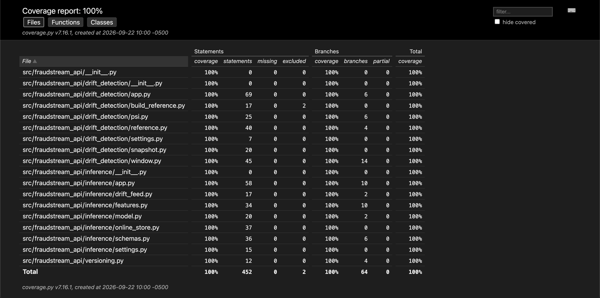
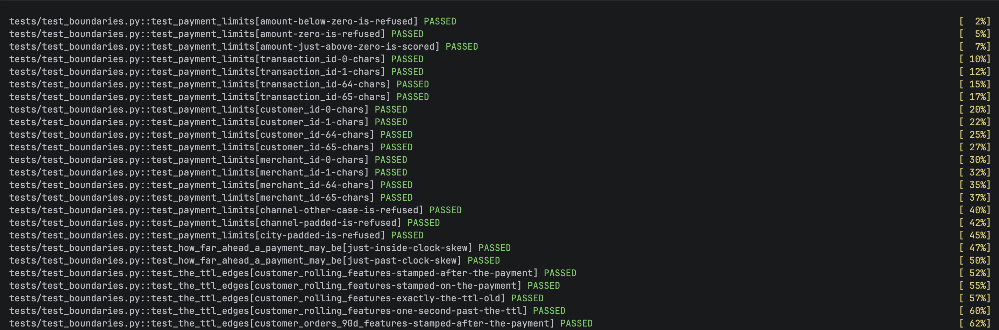
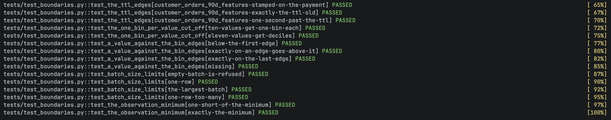
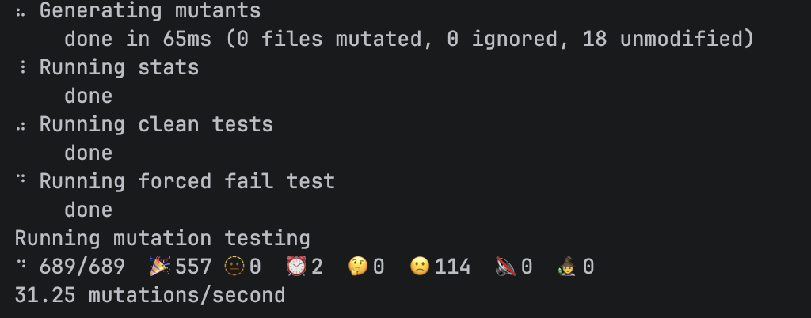
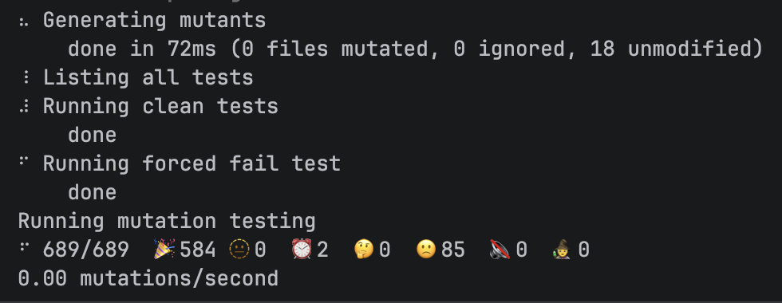
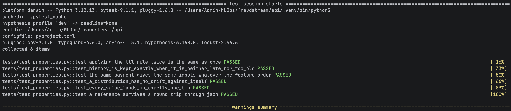
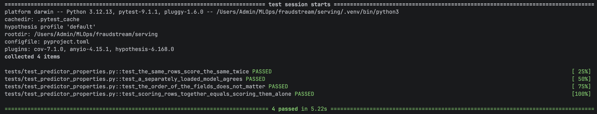
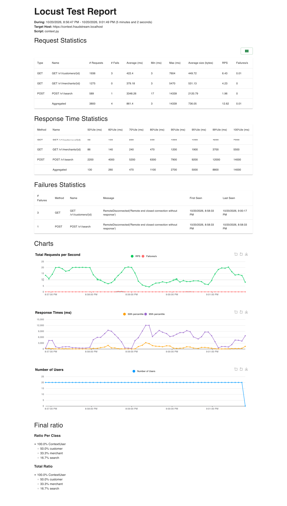
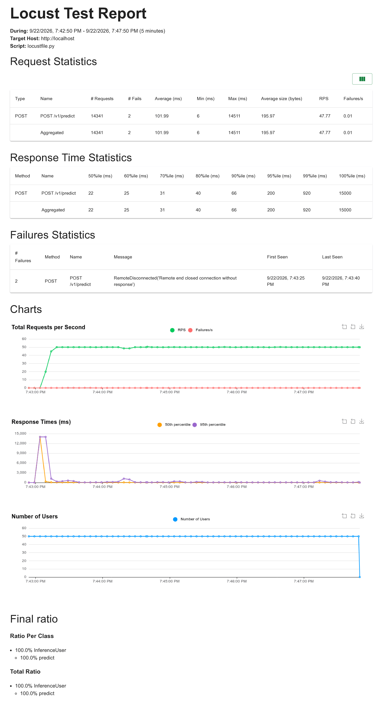
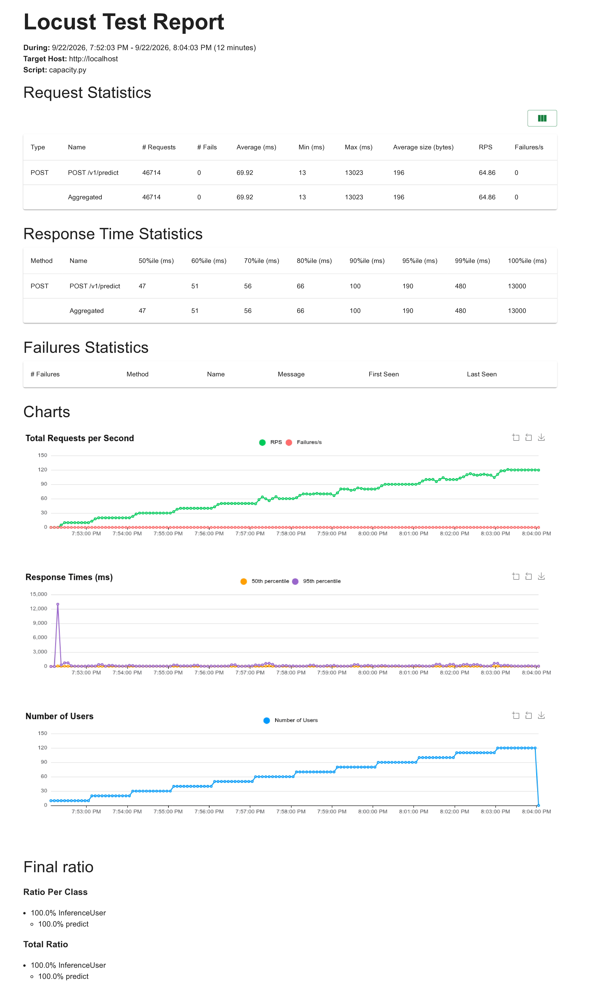

# Validation and Verification

Five checks on the web APIs, the model behind them, the MCP servers and the agents'
tooling: unit tests with coverage, test cases designed by equivalence partitioning and
boundary value analysis, mutation testing, property-based tests, and a load test against
an SLA fixed before it ran. The unit tests, boundary cases and properties run on every
push in CI ([15_ci_cd.md](15_ci_cd.md)); mutation testing and the load test are run by
hand. No test needs a database or a cluster.

| Check | Result |
|---|---|
| Line and branch coverage | **100%** `api/`, **100%** `serving/`, **99%** `mcp_servers/`, **99%** `agents/`, **99.7%** `rag/`; the gate is 90% |
| Mutation score | **89.6%** `api/` (94.2% in the context API), **91.5%** `mcp_servers/`, **94.6%** `agents/`, **87%** `rag/` |
| Properties | 24 in the APIs and the model, run by Hypothesis, 7 of them by CrossHair; more in `mcp_servers/`, `agents/` and `rag/` |
| Load test, context API | p95 5.0 s, p99 8.8 s at 12.6 req/s: **SLA missed**, cause found |
| Load test, inference API | p95 200 ms, p99 920 ms at 48 req/s: **SLA met** |

## Unit tests and coverage over 90%

```bash
cd api && uv run pytest --cov --cov-report=html
```



The gate counts branches and fails the run under 90%
([`api/pyproject.toml:89`](../../api/pyproject.toml#L89),
[`mcp_servers/pyproject.toml:37`](../../mcp_servers/pyproject.toml#L37)).

**Testing the web API.** The tests call the real FastAPI app through `TestClient`, with
only the stores replaced, so routing, validation, status codes and probes all run.

| Technique | Example | Where |
|---|---|---|
| Fixtures | `context_settings`, `fake_stores`, `context_client`: an app built with test settings and fake stores, opened and closed for each test | [`api/tests/conftest.py:88`](../../api/tests/conftest.py#L88), [`api/tests/conftest.py:101`](../../api/tests/conftest.py#L101) |
| A fake in place of the stores | `FakeStores` records what it was asked and can fail on demand, so a 503 is tested without stopping Postgres | [`api/tests/test_context_app.py:25`](../../api/tests/test_context_app.py#L25), [`api/tests/test_context_app.py:110`](../../api/tests/test_context_app.py#L110) |
| Mocks | Feast's `FeatureStore` replaced with `MagicMock` where the code looks it up; pgvector's async connection with `AsyncMock` | [`api/tests/test_context_stores.py:67`](../../api/tests/test_context_stores.py#L67), [`api/tests/test_context_stores.py:85`](../../api/tests/test_context_stores.py#L85) |
| A fake Redis | fakeredis, so the async client and the readiness ping really run | [`api/tests/test_context_stores.py:72`](../../api/tests/test_context_stores.py#L72) |

One test is there purely as a guard: `close()` must never call Feast's `teardown()`, which
deletes the feature store's infrastructure.

## Equivalence partitioning and boundary value analysis

Each input rule is split into its classes (equivalence partitioning), and the values
sitting exactly on and next to each limit are tested (boundary value analysis). Every case
is one `pytest.param` with a name that says what it proves
([`api/tests/test_boundaries.py`](../../api/tests/test_boundaries.py)):

| Rule | Classes and boundary values | Where |
|---|---|---|
| `amount > 0` | −0.01, 0, 0.01 | [`api/tests/test_boundaries.py:24`](../../api/tests/test_boundaries.py#L24) |
| ids are 1–64 characters | 0, 1, 64, 65 | [`api/tests/test_boundaries.py:33`](../../api/tests/test_boundaries.py#L33) |
| channel and city match exactly | `ATM`, ` atm`, `New York ` | [`api/tests/test_boundaries.py:35`](../../api/tests/test_boundaries.py#L35) |
| at most 5 minutes ahead | +4 min 50 s, +5 min 10 s | [`api/tests/test_boundaries.py:46`](../../api/tests/test_boundaries.py#L46) |
| history kept when `0 ≤ age ≤ ttl` | −1 s, 0, ttl, ttl + 1 s | [`api/tests/test_boundaries.py:60`](../../api/tests/test_boundaries.py#L60) |
| one bin per value up to ten distinct values | 10, 11 | [`api/tests/test_boundaries.py:85`](../../api/tests/test_boundaries.py#L85) |
| a value on a bin edge | below, on, above, missing | [`api/tests/test_boundaries.py:98`](../../api/tests/test_boundaries.py#L98) |
| a batch holds 1–5,000 rows | 0, 1, 5,000, 5,001 | [`api/tests/test_boundaries.py:113`](../../api/tests/test_boundaries.py#L113) |
| a drift verdict needs 50 observations | 49, 50 | [`api/tests/test_boundaries.py:128`](../../api/tests/test_boundaries.py#L128) |
| context search: question 1–500 characters, `top_k` 1–10 | empty, blank, 1, 500, 501; 0, 1, 10, 11 | [`api/tests/test_boundaries.py:143`](../../api/tests/test_boundaries.py#L143) |
| context ids: 1–64 of `A-Za-z0-9_-` | 64, 65, a dot, a space, underscore and dash | [`api/tests/test_boundaries.py:161`](../../api/tests/test_boundaries.py#L161) |
| chunk ids: 1–200 characters | 0, 200, 201 | [`api/tests/test_boundaries.py:175`](../../api/tests/test_boundaries.py#L175) |

```bash
cd api && uv run pytest -v tests/test_boundaries.py
```





Each case was checked by breaking its rule in the source and watching that one case fail,
for example `gt=0` to `ge=0`, or `<= ttl` to `< ttl`. The MCP servers and the agents'
tools do the same for their own limits: the status-code edges of a tool's outcome, prompts
of 4,000 and 4,001 characters, numbers exactly 1% and just over 1% from the tool's value.

## Mutation testing

Coverage says a line ran. Mutation testing changes the line and asks whether a test notices.
mutmut is configured per project ([`api/pyproject.toml:91`](../../api/pyproject.toml#L91)):

```bash
cd api
export PYTHONPATH=$(cd ../ml/src && pwd):$(cd ../rag/src && pwd) OBJC_DISABLE_INITIALIZE_FORK_SAFETY=YES
uv run --all-extras --group reference mutmut run && uv run --all-extras --group reference mutmut results
cd ../mcp_servers && uv run mutmut run && uv run mutmut results
cd ../agents && uv run mutmut run && uv run mutmut results
```

**Only changed code is mutated again.** mutmut keeps each function's result and re-tests
only the functions whose code changed since the last run: a first run of `api/` took 37 s, a
run after one small change 8 s. Its cache keys on the source, not on the tests, so
`rm -rf mutants` is needed after adding tests.

Before, 114 mutants survived in `api/`:



Six small tests, each from a survivor, closed real holes, such as `rows +=` becoming
`rows =` so only the last minute counted, or `timeout=None` making the model client wait
forever. That run ended at 85 survivors, 86.2%:



With the context API added since, `api/` scores 89.6% (1,054 of 1,176), the context API
alone 94.2%.

The survivors left can't change behaviour: help text, app titles, log wording, JSON indent.
mutmut's `segfault` is not counted as caught: run by hand, eight of eighteen failed a test
and ten passed every test.

## Property-based tests, with the CrossHair backend

A property says what must hold for every input; Hypothesis searches for the input that
breaks it, and the CrossHair backend solves the branch conditions instead of guessing.

| Property | Backend | Where |
|---|---|---|
| applying the TTL rule twice is the same as once (idempotent) | CrossHair | [`api/tests/test_properties.py:38`](../../api/tests/test_properties.py#L38) |
| history is kept exactly when it is neither late nor too old | CrossHair | [`api/tests/test_properties.py:51`](../../api/tests/test_properties.py#L51) |
| **the model gives the same score twice** for the same rows | Hypothesis | [`serving/tests/test_predictor_properties.py:49`](../../serving/tests/test_predictor_properties.py#L49) |
| a separately loaded model agrees | Hypothesis | [`serving/tests/test_predictor_properties.py:55`](../../serving/tests/test_predictor_properties.py#L55) |
| the order of the fields doesn't matter | Hypothesis | [`serving/tests/test_predictor_properties.py:61`](../../serving/tests/test_predictor_properties.py#L61) |
| rows scored together equal rows scored alone | Hypothesis | [`serving/tests/test_predictor_properties.py:70`](../../serving/tests/test_predictor_properties.py#L70) |
| only a 2xx status is a tool's `ok` | CrossHair | [`mcp_servers/tests/test_properties.py:20`](../../mcp_servers/tests/test_properties.py#L20) |
| a number counts exactly when it is within 1% of the tool's | CrossHair | [`agents/tests/test_properties.py:40`](../../agents/tests/test_properties.py#L40) |





CrossHair earned its place on plain numbers: a planted `200 < status` in the tool outcome,
and a planted `<` for `<=` in the 1% match, were each found at once. It can't see through
`datetime`: with `<= ttl` broken to `< ttl`, it missed it, and so did random search; the
boundary case above is what guards that edge. Live, the same payment sent 100 times through
the deployed API came back with one distinct probability.

## Load testing the web API

The context API, the one the agents pull data from, was load-tested with Locust through
the gateway, over HTTPS with the login. The SLA was fixed before the run, in the locustfile
itself: p95 ≤ 500 ms, p99 ≤ 1,000 ms, failures ≤ 1%
([`api/loadtest/context.py:32`](../../api/loadtest/context.py#L32)). Twenty users each make
one request a second in the mix a copilot makes, 3 customer : 2 merchant : 1 search
([`api/loadtest/context.py:50`](../../api/loadtest/context.py#L50)). When Locust stops, the
SLA is checked and a missed limit exits 1, so the HTML report is the SLA record
([`api/loadtest/sla.py:4`](../../api/loadtest/sla.py#L4)).

```bash
cd api && set -a && . ../.env && set +a
uv run --group loadtest locust -f loadtest/context.py \
  --headless -u 20 -r 20 -t 5m --html ../reports/load_test_context_api.html
```

| Measure | Target | Measured |
|---|---|---|
| p95 | ≤ 500 ms | **5,000 ms** |
| p99 | ≤ 1,000 ms | **8,800 ms** |
| failures | ≤ 1% | 4 of 3,800 (0.1%) |
| throughput | 20 req/s | 12.6 req/s |



**The SLA was missed, and search is why.** Its p95 was 9.2 s against 1.9 s for the feature
lookups. Each search embeds the question on the CPU, the pod is limited to 2 CPUs with at
most two replicas ([`apis/context-api.yaml:14`](../../k8s/apis/context-api.yaml#L14)), so
searches queue behind each other and slow the lookups that share the pod. The report:
[`reports/load_test_context_api.html`](../../reports/load_test_context_api.html).

The inference API meets the same SLA at 50 users: p95 200 ms, p99 920 ms, 2 failures in
14,341 ([`reports/load_test_inference_api.html`](../../reports/load_test_inference_api.html)).
A step-up run to 120 users kept p95 under 200 ms with no failure:





## Where things are

| What | Where |
|---|---|
| Unit tests and fixtures | [`api/tests/`](../../api/tests/), [`api/tests/conftest.py`](../../api/tests/conftest.py), [`serving/tests/`](../../serving/tests/), [`mcp_servers/tests/`](../../mcp_servers/tests/), [`agents/tests/`](../../agents/tests/), [`rag/tests/`](../../rag/tests/) |
| Boundary cases | [`api/tests/test_boundaries.py`](../../api/tests/test_boundaries.py) |
| Properties | [`api/tests/test_properties.py`](../../api/tests/test_properties.py), [`serving/tests/test_predictor_properties.py`](../../serving/tests/test_predictor_properties.py), [`mcp_servers/tests/test_properties.py`](../../mcp_servers/tests/test_properties.py), [`agents/tests/test_properties.py`](../../agents/tests/test_properties.py) |
| Coverage and mutation settings | [`api/pyproject.toml`](../../api/pyproject.toml), [`mcp_servers/pyproject.toml`](../../mcp_servers/pyproject.toml) |
| Load tests and the SLA check | [`api/loadtest/`](../../api/loadtest/) |
| Reports | [`reports/`](../../reports/) |
| Screenshots | [`images/validation/`](../../images/validation/), [`images/mcp/`](../../images/mcp/) |
