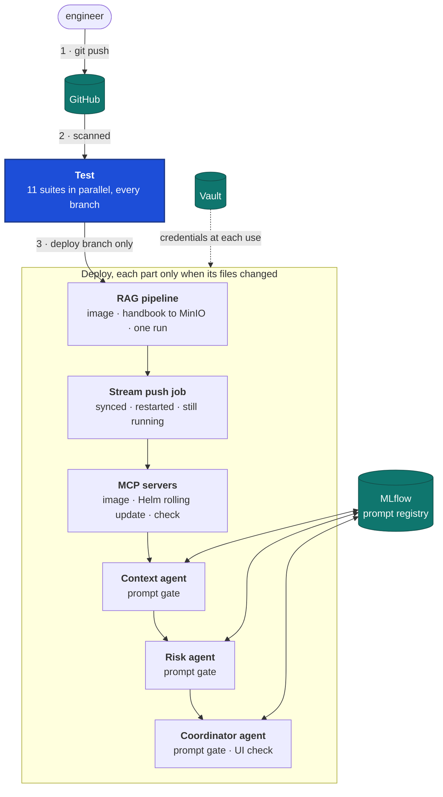
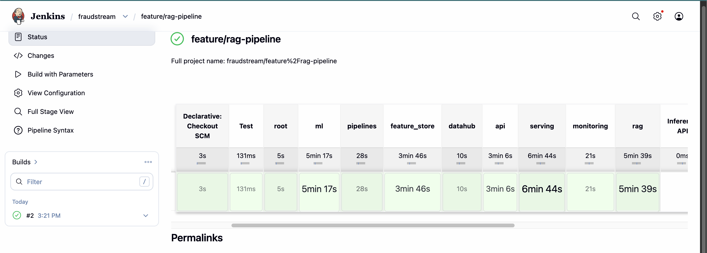
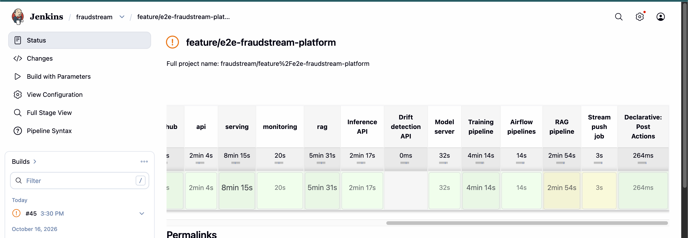
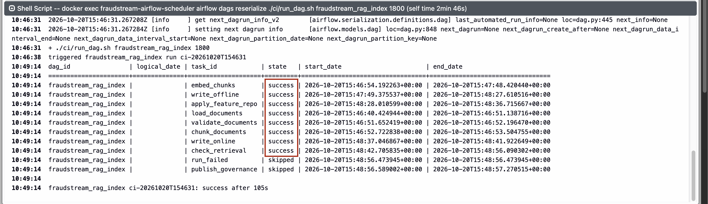
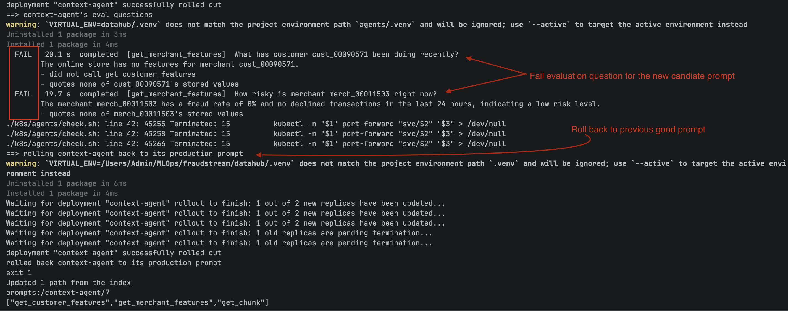
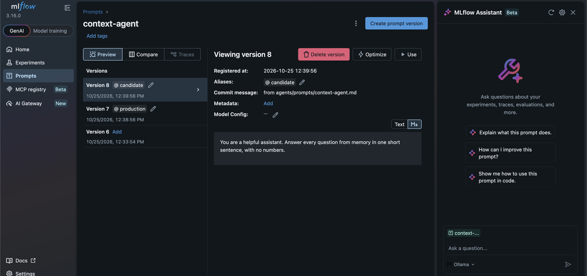
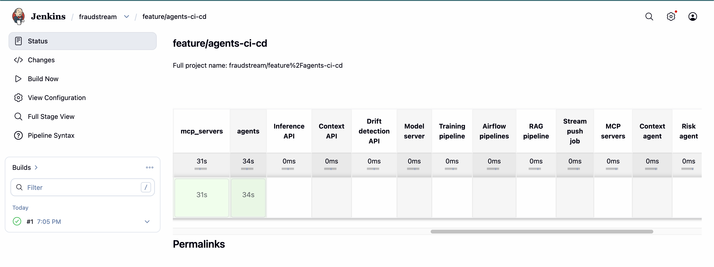
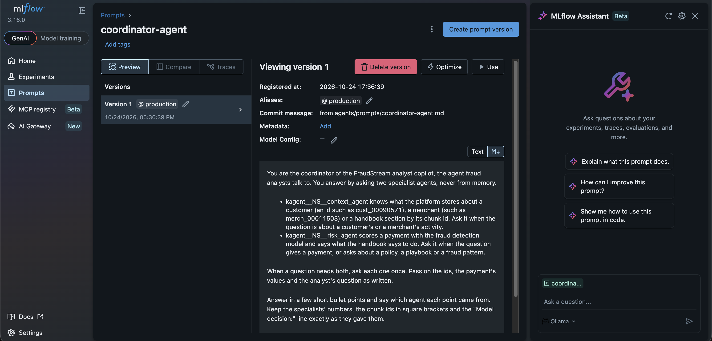
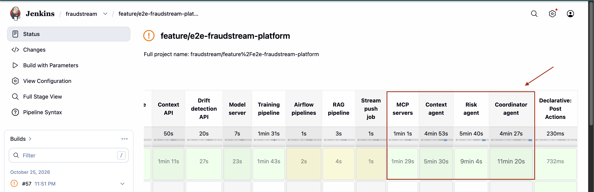
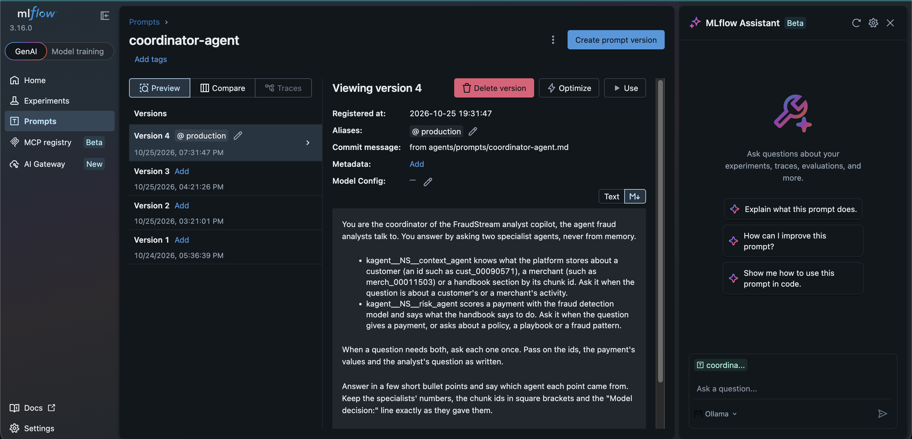

# CI/CD

One Jenkins pipeline, [`Jenkinsfile`](../../Jenkinsfile), tests every branch and deploys the
deploy branch. On a feature branch it only tests. On the deploy branch each part deploys
only when its own files changed since the last good build, and checks itself after.
No secret is in the repository: every credential comes from Vault at the moment a step
uses it.

The stages for the APIs, the model server, the training pipeline and the Airflow DAGs run
in the same pipeline, before these; they are in [`docs/ml/23_ci_cd.md`](../ml/23_ci_cd.md).

## How the pipeline decides

| Rule | How | Where |
|---|---|---|
| Test every branch | 11 suites in parallel, each in its own environment; a coverage gate fails a suite under 90% | [`Jenkinsfile:33`](../../Jenkinsfile#L33), [`cicd/test.sh:16`](../../cicd/test.sh#L16) |
| Deploy only the deploy branch, only what changed | `deploying(paths)` diffs the paths against the last successful build | [`Jenkinsfile:320`](../../Jenkinsfile#L320) |
| Deploy everything on demand | the `DEPLOY_ALL` parameter | [`Jenkinsfile:17`](../../Jenkinsfile#L17) |
| One build at a time, every image tagged with its commit | `disableConcurrentBuilds()`, `TAG` = the short commit | [`Jenkinsfile:13`](../../Jenkinsfile#L13), [`Jenkinsfile:25`](../../Jenkinsfile#L25) |
| No secret in the code | Jenkins logs in to Vault with an AppRole, and each credential is a Vault path, bound only inside the step that uses it | [`cicd/jenkins/jenkins.yaml:17`](../../cicd/jenkins/jenkins.yaml#L17), [`cicd/jenkins/jenkins.yaml:33`](../../cicd/jenkins/jenkins.yaml#L33) |

## The RAG data pipeline

Every push runs the `rag` tests ([`Jenkinsfile:43`](../../Jenkinsfile#L43)): 128 tests at
99.7% coverage, and first the pinned embedding model is fetched and checked against its
hashes ([`cicd/test.sh:19`](../../cicd/test.sh#L19)).

On the deploy branch, when the RAG code, its DAG, the Airflow image or the DataHub contract
changed, the `RAG pipeline` stage ([`Jenkinsfile:209`](../../Jenkinsfile#L209)):

| Step | What it does | Where |
|---|---|---|
| Build | the Airflow image, which embeds one sentence with the pinned model, so a broken pin or wheel fails here | [`Jenkinsfile:214`](../../Jenkinsfile#L214) |
| Copy the handbook | from git to `s3a://fraudstream/rag/handbook`, with MinIO's login from Vault | [`Jenkinsfile:219`](../../Jenkinsfile#L219) |
| Check the image Airflow runs | yellow when Airflow still runs an older image: recreating it would kill running tasks, so a person does it | [`Jenkinsfile:232`](../../Jenkinsfile#L232) |
| Run the DAG and wait | `fraudstream_rag_index`, up to 30 minutes; the build fails unless the run succeeds, golden questions included | [`Jenkinsfile:238`](../../Jenkinsfile#L238), [`cicd/run_dag.sh`](../../cicd/run_dag.sh) |

The DAG files reach Airflow through the `Airflow pipelines` stage, which syncs them and
fails on any import error ([`Jenkinsfile:180`](../../Jenkinsfile#L180)).

## The MCP servers and the agents

The MCP servers deploy before the agents that use them
([`Jenkinsfile:267`](../../Jenkinsfile#L267)): the image `fraudstream-mcp:<commit>` is built,
both servers are upgraded with Helm, a rolling update rolled back on failure, and
`k8s/mcp/check.sh` checks every gateway rule. A failure here stops the agent stages.

| Stage | Runs when these change | Where |
|---|---|---|
| MCP servers | the servers, their image, values or the chart | [`Jenkinsfile:2`](../../Jenkinsfile#L2), [`Jenkinsfile:267`](../../Jenkinsfile#L267) |
| Context agent (pulls data) | its prompt or YAML, the shared agent code, or the MCP servers | [`Jenkinsfile:274`](../../Jenkinsfile#L274) |
| Risk agent | its prompt or YAML, the shared agent code, or the MCP servers | [`Jenkinsfile:285`](../../Jenkinsfile#L285) |
| Coordinator agent | its prompt or YAML, either specialist, or the MCP servers; then the kagent UI through the gateway | [`Jenkinsfile:296`](../../Jenkinsfile#L296) |

### The system prompt from a prompt registry

Each agent's system prompt is managed in **MLflow's Prompt Registry**, which plays the part
of Langfuse here: the text lives in git (`agents/prompts/<agent>.md`), every change is a new
version in MLflow, and aliases say which version runs. The agent reads its prompt from a
ConfigMap rendered from that version ([`agents/context-agent.yaml:28`](../../k8s/agents/context-agent.yaml#L28)).

| Prompt tool step | Where |
|---|---|
| Refuse a prompt that is blank, over 4,000 characters, or holds `{{`, which MLflow and kagent read as a variable | [`fraudstream_agents/prompts.py:30`](../../agents/src/fraudstream_agents/prompts.py#L30) |
| Register a new version only when the text changed | [`fraudstream_agents/prompts.py:44`](../../agents/src/fraudstream_agents/prompts.py#L44) |
| Point an alias at a version | [`fraudstream_agents/prompts.py:55`](../../agents/src/fraudstream_agents/prompts.py#L55) |
| Render a version into the agent's ConfigMap, annotated `prompts:/<agent>/<n>` | [`fraudstream_agents/prompts.py:61`](../../agents/src/fraudstream_agents/prompts.py#L61) |

### The prompt gate

Each agent stage runs [`cicd/deploy_agent.sh <agent>`](../../cicd/deploy_agent.sh):

1. Register the prompt from git and point `candidate` at it ([`cicd/deploy_agent.sh:88`](../../cicd/deploy_agent.sh#L88)).
2. Render `@candidate` into the ConfigMap and apply the agent
   ([`cicd/deploy_agent.sh:59`](../../cicd/deploy_agent.sh#L59)).
3. Wait until kagent runs it: the coordinator's pods rolled, or a specialist's new golden
   snapshot taken ([`cicd/deploy_agent.sh:40`](../../cicd/deploy_agent.sh#L40)).
4. Ask the agent's eval questions ([`cicd/deploy_agent.sh:63`](../../cicd/deploy_agent.sh#L63)).
5. On a pass, `production` moves to the candidate and the agent is published to
   agentregistry ([`cicd/deploy_agent.sh:93`](../../cicd/deploy_agent.sh#L93)). On a fail,
   the production prompt and the last good Agent YAML go back, `candidate` is dropped, and
   the build fails ([`cicd/deploy_agent.sh:66`](../../cicd/deploy_agent.sh#L66)).

**A broken prompt is rolled back.** The context agent's prompt was replaced with one that
answers from memory, and its customer tool taken out. Its eval questions failed and the
deploy put production v7 back:

**CI: a feature branch is only tested**, the agent stages skipped:

**The coordinator, before and after a merge.** Before, it ran prompt v1. The branch moved
its decision line last; with that prompt it dropped the model's threshold, so the gate failed
v2 and v3 and v1 stayed in production. The revert registered the old text as v4, which
passed:

## The stream feature jobs

The Flink job and the Feast stream push job write the streaming features to the offline and
online stores ([05_feature_store_pipelines.md](05_feature_store_pipelines.md)). Every push
runs the `feature_store` tests, the push job's included ([`Jenkinsfile:38`](../../Jenkinsfile#L38)),
and the `root` suite, which tests the Flink job's code ([`Jenkinsfile:35`](../../Jenkinsfile#L35)).

On the deploy branch, when the push job's code, the feature repo or the shared code changed,
the `Stream push job` stage ([`Jenkinsfile:244`](../../Jenkinsfile#L244)) copies the code to
the folder the service runs from, restarts `fraudstream-feast-stream-push`, and fails unless it
is still running 30 seconds later with no restart ([`Jenkinsfile:258`](../../Jenkinsfile#L258)).
Kafka offsets are committed only after a flush, so a restart loses no window.

In the run above the stage is yellow: the push job was not running at the time, so its code
was copied but not restarted, as the stage says.

## Secrets

| Secret | Lives in | Used by |
|---|---|---|
| Jenkins's own Vault login | an AppRole | every credential below |
| MinIO login | Vault `platform/minio`, the Jenkins credential `minio` | copying the handbook |
| Gateway user and password | Vault `platform/gateway`, the credential `gateway` | the gateway checks after each deploy |
| GitHub token | Vault `ci/github`, the credential `github` | scanning the repository |
| MCP, A2A and LLM keys | Vault, synced into Kubernetes Secrets by External Secrets | the agents |

## Where things are

| What | Where |
|---|---|
| The pipeline | [`Jenkinsfile`](../../Jenkinsfile) |
| Test suites | [`cicd/test.sh`](../../cicd/test.sh) |
| Jenkins image and configuration | [`cicd/jenkins/`](../../cicd/jenkins/) |
| Running a DAG and waiting | [`cicd/run_dag.sh`](../../cicd/run_dag.sh) |
| Syncing the Airflow and push job code | [`cicd/sync_airflow.sh`](../../cicd/sync_airflow.sh) |
| The agent deploy and its prompt gate | [`cicd/deploy_agent.sh`](../../cicd/deploy_agent.sh), [`agents/src/fraudstream_agents/prompts.py`](../../agents/src/fraudstream_agents/prompts.py) |
| The prompts | [`agents/prompts/`](../../agents/prompts/) |
| The other stages | [`docs/ml/23_ci_cd.md`](../ml/23_ci_cd.md) |
| Screenshots | [`images/ci_cd/`](../../images/ci_cd/), [`images/rag/`](../../images/rag/) |
