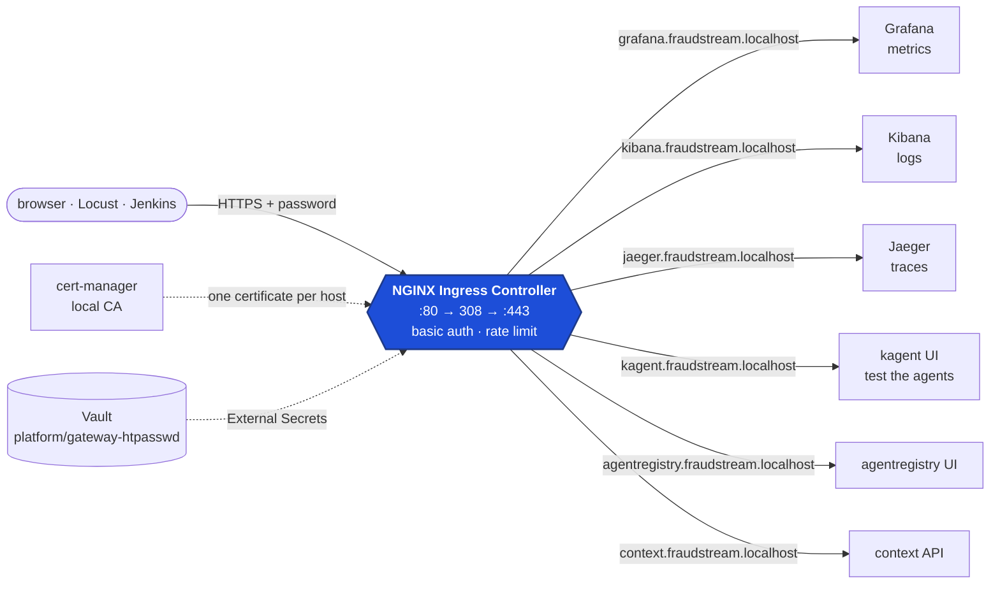
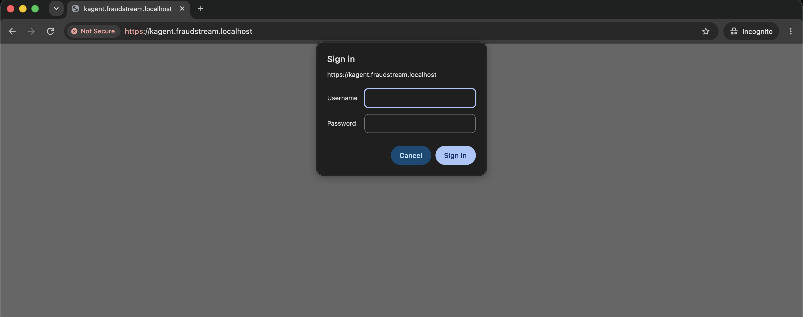
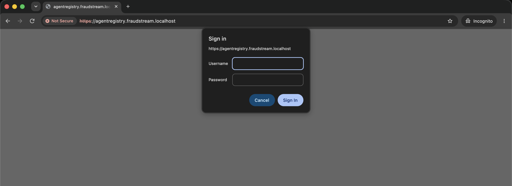
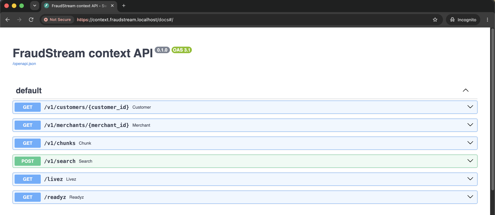
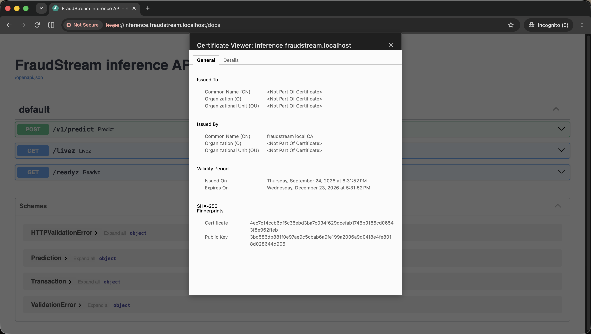
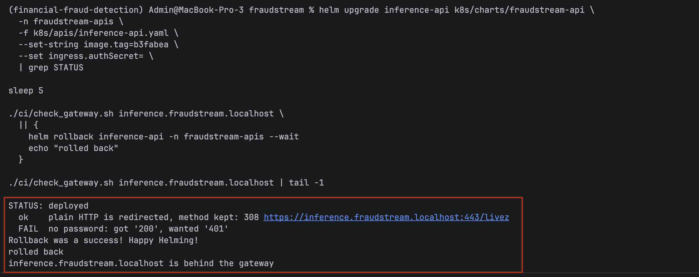

# External Routing and Gateway

Every service a person opens sits behind one NGINX Ingress Controller: its own domain
under `fraudstream.localhost`, HTTPS from a local certificate authority, the gateway's
username and password, and a rate limit. Services talking to each other inside the
cluster don't pass it: the agents reach their gateways and APIs by Service name.



## The controller

NGINX Ingress Controller runs on the kind node's ports 80 and 443, as the cluster's default
ingress class ([`platform/nginx-ingress-values.yaml:1`](../../k8s/platform/nginx-ingress-values.yaml#L1)).
cert-manager signs every host's certificate with one local CA
([`platform/local-ca-issuer.yaml:26`](../../k8s/platform/local-ca-issuer.yaml#L26)), which a
browser or curl trusts once its certificate is added. `*.localhost` always points at the
local machine, so the names need no DNS server and no hosts file.

Every route uses the same annotations, for example Grafana's:

| Setting | Annotation | Why | Where |
|---|---|---|---|
| HTTPS | `cert-manager.io/cluster-issuer: local-ca`, a `tls` block for the host | nothing crosses the network in clear | [`observability/ingress.yaml:7`](../../k8s/observability/ingress.yaml#L7), [`observability/ingress.yaml:17`](../../k8s/observability/ingress.yaml#L17) |
| Plain HTTP redirected | `nginx.org/http-redirect-code: "308"` | 308 keeps the method, so a POST stays a POST | [`observability/ingress.yaml:8`](../../k8s/observability/ingress.yaml#L8) |
| Basic auth | `nginx.org/basic-auth-secret: gateway-htpasswd` | none of these UIs has a login of its own here | [`observability/ingress.yaml:9`](../../k8s/observability/ingress.yaml#L9) |
| Rate limit | `limit-req-rate`, `limit-req-burst`, answered with 429 | one client can't flood a service, and guessing passwords is limited too | [`observability/ingress.yaml:11`](../../k8s/observability/ingress.yaml#L11) |

The password file `gateway-htpasswd` is synced from Vault into each namespace by External
Secrets; the plain password is in Vault only ([20_security.md](20_security.md)).

## The services behind it

| Service | Host | Rate limit | Where |
|---|---|---|---|
| Metrics: **Grafana** | `grafana.fraudstream.localhost` | 60 a second, burst 200 | [`observability/ingress.yaml:1`](../../k8s/observability/ingress.yaml#L1) |
| Traces: **Jaeger** | `jaeger.fraudstream.localhost` | 60 a second, burst 200 | [`observability/ingress.yaml:33`](../../k8s/observability/ingress.yaml#L33) |
| Logs: **Kibana** | `kibana.fraudstream.localhost` | 60 a second, burst 200 | [`observability/ingress.yaml:65`](../../k8s/observability/ingress.yaml#L65) |
| UI to test the agents: **kagent** | `kagent.fraudstream.localhost` | 30 a second, burst 100; read timeout 600 s, buffering off | [`agents/ingress.yaml:1`](../../k8s/agents/ingress.yaml#L1) |
| UI for the agent registry: **agentregistry** | `agentregistry.fraudstream.localhost` | 30 a second, burst 100 | [`agents/ingress.yaml:35`](../../k8s/agents/ingress.yaml#L35) |
| The web API that pulls data: **context API** | `context.fraudstream.localhost` | 60 a second, burst 60 | [`apis/context-api.yaml:24`](../../k8s/apis/context-api.yaml#L24), [`fraudstream-api/templates/ingress.yaml:1`](../../k8s/charts/fraudstream-api/templates/ingress.yaml#L1) |

The inference and drift detection APIs, the Pushgateway and the Kubeflow Pipelines UI sit
behind the same gateway: their routes are in [`k8s/charts/fraudstream-api/templates/ingress.yaml`](../../k8s/charts/fraudstream-api/templates/ingress.yaml), [`k8s/observability/ingress.yaml`](../../k8s/observability/ingress.yaml) and [`k8s/gateway/pipelines.yaml`](../../k8s/gateway/pipelines.yaml).

**The registry is reachable only from NGINX.** The open-source registry lets any caller
write, so a NetworkPolicy lets only the ingress controller's namespace reach its server
pod ([`agents/ingress.yaml:67`](../../k8s/agents/ingress.yaml#L67)). Without it, a pod in the
cluster could change the catalog without the login.

**The kagent UI waits for long answers.** A coordinator answer waits on a specialist for
minutes, so its read timeout is 600 s and responses are streamed, not buffered
([`agents/ingress.yaml:15`](../../k8s/agents/ingress.yaml#L15)).

## Basic authentication and rate limit for the agent UI

The kagent UI asks for the gateway login over HTTPS before anything loads, and its API has
no authentication of its own, so this login is the only door
([`agents/ingress.yaml:9`](../../k8s/agents/ingress.yaml#L9),
[`agents/ingress.yaml:11`](../../k8s/agents/ingress.yaml#L11)). The rate limit is 30 requests
a second with a burst of 100, since one page load is about 40 requests.





## A domain and HTTPS for the web API that pulls data

The context API's chart values give it its host
([`apis/context-api.yaml:25`](../../k8s/apis/context-api.yaml#L25)); the shared chart's
ingress adds the certificate, the redirect, the login and the rate limit for that host
([`fraudstream-api/templates/ingress.yaml:13`](../../k8s/charts/fraudstream-api/templates/ingress.yaml#L13),
[`fraudstream-api/values.yaml:45`](../../k8s/charts/fraudstream-api/values.yaml#L45)).



The certificate is issued by `fraudstream local CA` for the host, and cert-manager renews it:



## Proof

[`cicd/check_gateway.sh`](../../cicd/check_gateway.sh) checks a host from outside: plain
HTTP gets 308 to HTTPS ([`cicd/check_gateway.sh:30`](../../cicd/check_gateway.sh#L30)),
no password and a wrong one get 401, and the right one 200 with the certificate trusted
([`cicd/check_gateway.sh:32`](../../cicd/check_gateway.sh#L32)). The rate limit isn't
checked after a deploy: a burst was sometimes let through whole, failing deploys at
random. [`cicd/check_ui.sh`](../../cicd/check_ui.sh) does the same for a UI.

```bash
. infra/vault/env.sh
GATEWAY_ADDRESS=127.0.0.1 ./cicd/check_gateway.sh context.fraudstream.localhost
GATEWAY_ADDRESS=127.0.0.1 ./cicd/check_gateway.sh kagent.fraudstream.localhost /health
GATEWAY_ADDRESS=127.0.0.1 ./cicd/check_ui.sh grafana.fraudstream.localhost /api/health
```

CI runs it after each deploy: the context API is rolled back if the check fails
([`Jenkinsfile:93`](../../Jenkinsfile#L93)), and the kagent UI is checked after the
coordinator ([`Jenkinsfile:307`](../../Jenkinsfile#L307)). An API deployed with auth switched
off was caught (`no password: got '200', wanted '401'`) and rolled back:



## Where things are

| What | Where |
|---|---|
| The controller and the local CA | [`k8s/platform/nginx-ingress-values.yaml`](../../k8s/platform/nginx-ingress-values.yaml), [`k8s/platform/local-ca-issuer.yaml`](../../k8s/platform/local-ca-issuer.yaml) |
| Grafana, Jaeger, Kibana routes | [`k8s/observability/ingress.yaml`](../../k8s/observability/ingress.yaml) |
| kagent and registry routes | [`k8s/agents/ingress.yaml`](../../k8s/agents/ingress.yaml) |
| The web APIs' route | [`k8s/charts/fraudstream-api/templates/ingress.yaml`](../../k8s/charts/fraudstream-api/templates/ingress.yaml), [`k8s/apis/context-api.yaml`](../../k8s/apis/context-api.yaml) |
| The password from Vault | [`k8s/observability/secrets.yaml`](../../k8s/observability/secrets.yaml), [`k8s/agents/secrets.yaml`](../../k8s/agents/secrets.yaml) |
| Checks | [`cicd/check_gateway.sh`](../../cicd/check_gateway.sh), [`cicd/check_ui.sh`](../../cicd/check_ui.sh) |
| The API, Pushgateway and Pipelines routes | [`k8s/charts/fraudstream-api/templates/ingress.yaml`](../../k8s/charts/fraudstream-api/templates/ingress.yaml), [`k8s/observability/ingress.yaml`](../../k8s/observability/ingress.yaml), [`k8s/gateway/pipelines.yaml`](../../k8s/gateway/pipelines.yaml) |
| Screenshots | [`images/gateway/`](../../images/gateway/), [`images/agents/`](../../images/agents/) |
