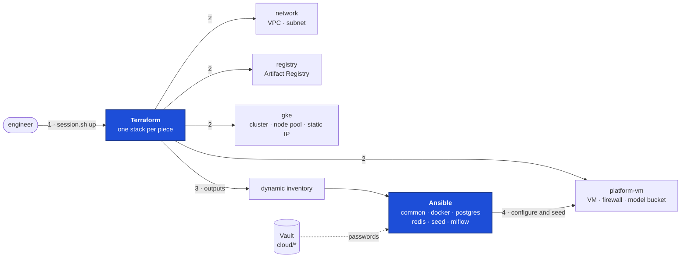
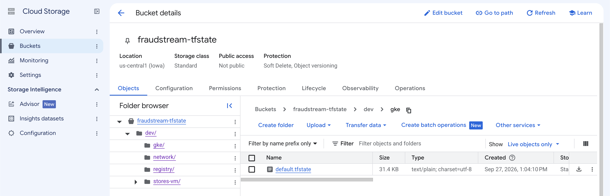
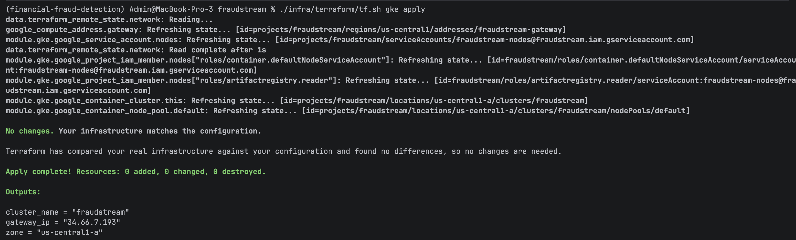
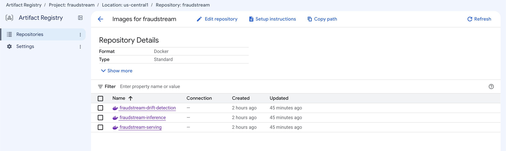
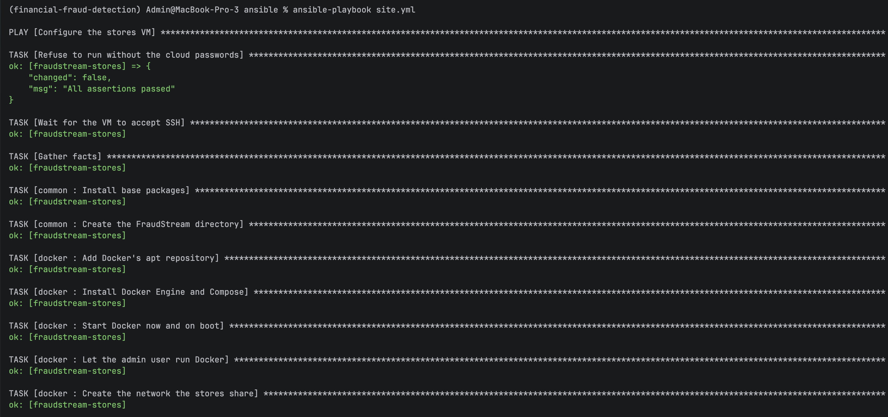
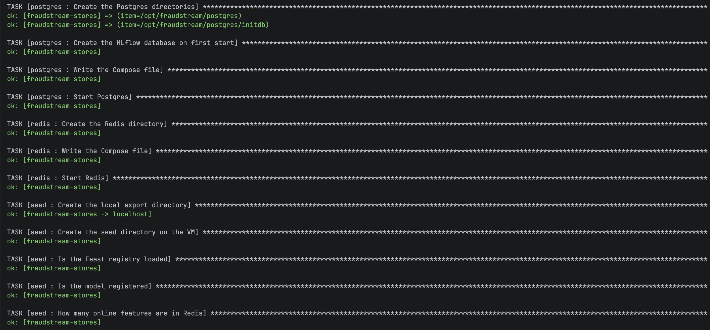
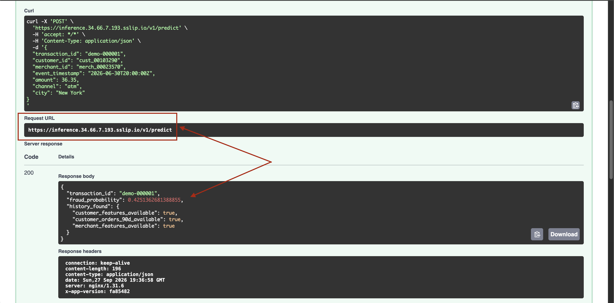
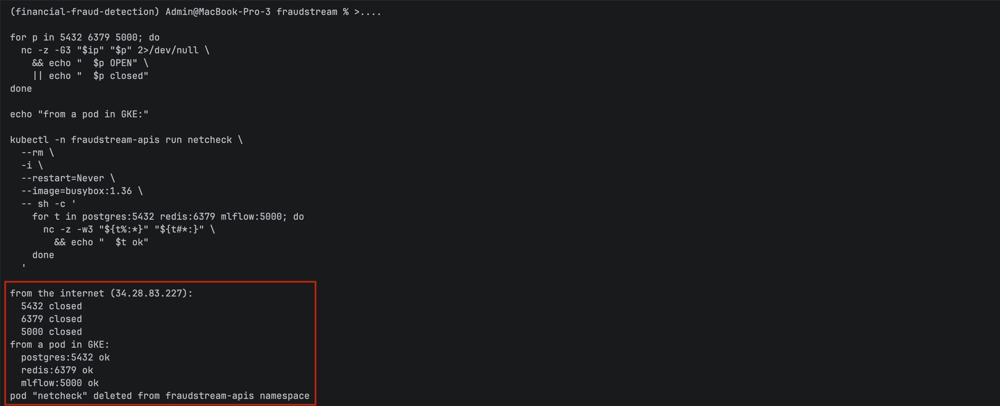

# Infrastructure as Code

The serving path also runs on Google Cloud, brought up and taken down with one command:
Terraform builds the network, the image registry, a GKE cluster and a VM for the stores,
and Ansible configures that VM and seeds it. A session costs about $0.20 an hour and is
started when a demo is due.



## Terraform: one folder per service

Each piece is its own stack under [`infra/terraform/envs/dev/`](../../infra/terraform/envs/dev/),
with its own state, built from a reusable module under
[`infra/terraform/modules/`](../../infra/terraform/modules/). Destroying the cluster can
never touch the network, and a mistake in one stack stays in it.

| Stack | Builds | Module | Kept |
|---|---|---|---|
| `bootstrap` | the APIs, the state bucket, a $30 monthly budget with alerts | [`dev/bootstrap/main.tf:13`](../../infra/terraform/envs/dev/bootstrap/main.tf#L13), [`dev/bootstrap/main.tf:39`](../../infra/terraform/envs/dev/bootstrap/main.tf#L39) | always |
| `network` | VPC, subnet, IP ranges for pods and services, and the gateway's static IP, so its addresses stay the same | [`modules/network/main.tf:1`](../../infra/terraform/modules/network/main.tf#L1), [`dev/network/main.tf:11`](../../infra/terraform/envs/dev/network/main.tf#L11) | always |
| `registry` | Artifact Registry, 5 images kept | [`modules/registry/main.tf:3`](../../infra/terraform/modules/registry/main.tf#L3) | always |
| `gke` | the cluster and its node pool | [`modules/gke/main.tf:16`](../../infra/terraform/modules/gke/main.tf#L16), [`modules/gke/main.tf:54`](../../infra/terraform/modules/gke/main.tf#L54) | one session |
| `platform-vm` | the VM, its firewall rules, the model bucket | [`modules/vm/main.tf:13`](../../infra/terraform/modules/vm/main.tf#L13), [`modules/vm/main.tf:45`](../../infra/terraform/modules/vm/main.tf#L45), [`dev/platform-vm/main.tf:40`](../../infra/terraform/envs/dev/platform-vm/main.tf#L40) | one session |

- **State in a GCS bucket**, one folder and one lock per stack
  ([`dev/gke/versions.tf:9`](../../infra/terraform/envs/dev/gke/versions.tf#L9)), so two runs
  can never change the same stack at once.
- **Stacks read each other's outputs** through `terraform_remote_state`, never copied
  values ([`dev/gke/main.tf:1`](../../infra/terraform/envs/dev/gke/main.tf#L1)).
- [`infra/terraform/tf.sh`](../../infra/terraform/tf.sh) runs one stack:
  `./infra/terraform/tf.sh gke apply`.



Applying the gke stack again on a running cluster finds nothing to change:





## Ansible: the platform VM, in roles

The VM runs the laptop's own `docker-compose.yml`, with
[`docker-compose.cloud.yml`](../../docker-compose.cloud.yml) on top: ports bound to the
VM's internal IP, and the cluster's names. The playbook
[`infra/ansible/site.yml`](../../infra/ansible/site.yml) waits for SSH, then applies six
roles in order ([`ansible/site.yml:11`](../../infra/ansible/site.yml#L11)):

| Role | Does | Where |
|---|---|---|
| `common` | base packages, the repo at HEAD, and the cloud settings in `.env` | [`roles/common/tasks/main.yml`](../../infra/ansible/roles/common/tasks/main.yml) |
| `docker` | Docker and Compose | [`roles/docker/tasks/main.yml`](../../infra/ansible/roles/docker/tasks/main.yml) |
| `vault` | Vault, restored from the laptop's snapshot and unseal key | [`roles/vault/tasks/main.yml`](../../infra/ansible/roles/vault/tasks/main.yml) |
| `platform` | the whole Compose stack, its secrets read from Vault | [`roles/platform/tasks/main.yml`](../../infra/ansible/roles/platform/tasks/main.yml) |
| `datahub` | DataHub's quickstart | [`roles/datahub/tasks/main.yml`](../../infra/ansible/roles/datahub/tasks/main.yml) |
| `seed` | the Feast registry, MLflow's database and model files, and Redis's features, restored from a dump | [`roles/seed/tasks/main.yml`](../../infra/ansible/roles/seed/tasks/main.yml) |

The VM gets a new IP every session, so the inventory is read from the platform-vm stack's
outputs ([`inventory/terraform.py`](../../infra/ansible/inventory/terraform.py)). A second
run changes nothing:





## One command per session

[`infra/session.sh`](../../infra/session.sh) runs the stacks, then Ansible, then the GKE
deploy ([`infra/session.sh:25`](../../infra/session.sh#L25)); `down` destroys the session
stacks and then looks for anything left that still costs money
([`infra/session.sh:53`](../../infra/session.sh#L53)).

```bash
./infra/session.sh up          # Terraform, Ansible, the GKE deploy
./infra/session.sh down        # destroy gke and platform-vm, then check for leftovers
```

A payment scored on GKE gets the same score as on the laptop, to the last decimal:



The stores are closed to the internet and open to the cluster:



The whole cloud session, with every check, is one script:
[`infra/session.sh`](../../infra/session.sh).

## Where things are

| What | Where |
|---|---|
| Terraform stacks | [`infra/terraform/envs/dev/`](../../infra/terraform/envs/dev/) |
| Terraform modules | [`infra/terraform/modules/`](../../infra/terraform/modules/) |
| Running one stack | [`infra/terraform/tf.sh`](../../infra/terraform/tf.sh) |
| Ansible playbook, roles, inventory | [`infra/ansible/`](../../infra/ansible/) |
| One command per session | [`infra/session.sh`](../../infra/session.sh) |
| The GKE deploy | [`k8s/gke/`](../../k8s/gke/) |
| Screenshots | [`images/iac/`](../../images/iac/) |
