# Observability

Every request leaves a count, a log line and a trace. Prometheus keeps the metrics,
Elasticsearch the logs, Jaeger the traces, and Grafana reads all three, behind the gateway
([16_external_routing.md](16_external_routing.md)). The LLM gateway counts tokens, timing
and PII catches per caller; the agents are counted from their own spans; the MCP servers
count every tool call and how it ended.

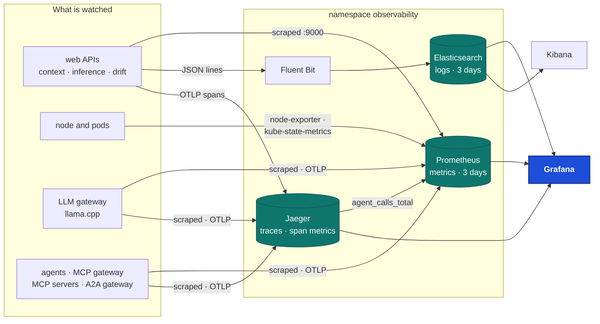

Prometheus scrapes every 15 seconds, through the ServiceMonitors in
[`k8s/observability/servicemonitors.yaml`](../../k8s/observability/servicemonitors.yaml).
Everything is installed by [`k8s/observability/install.sh`](../../k8s/observability/install.sh).

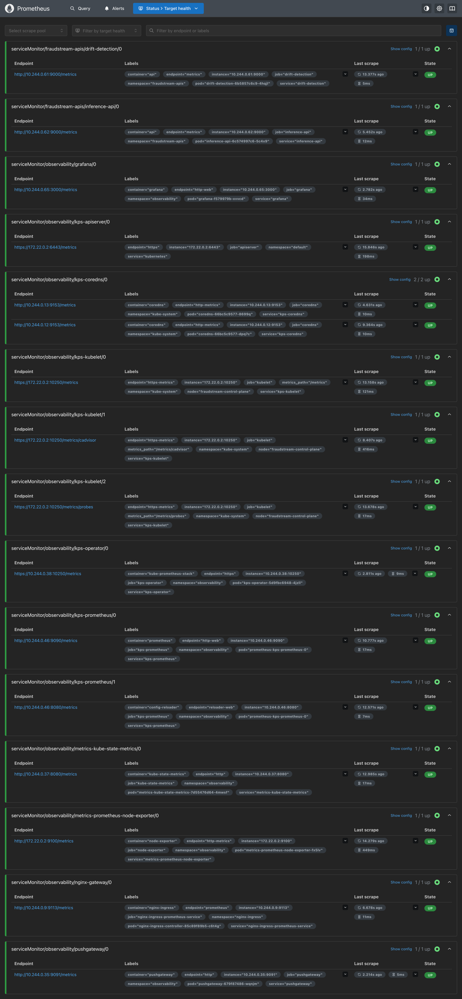

## Web API metrics

Every API counts and times its requests in one ASGI middleware, the probes left out
([`fraudstream_api/metrics.py:27`](../../api/src/fraudstream_api/metrics.py#L27)), and
serves them on port 9000, which the gateway never routes to
([`fraudstream_api/metrics.py:58`](../../api/src/fraudstream_api/metrics.py#L58)). The
context API adds it like the others ([`context/app.py:53`](../../api/src/fraudstream_api/context/app.py#L53)).

| Metric | What it gives | Where |
|---|---|---|
| `http_requests_total{method, route, status}` | number of requests, requests per second, failures (5xx) and refusals (4xx) | [`fraudstream_api/metrics.py:13`](../../api/src/fraudstream_api/metrics.py#L13) |
| `http_request_duration_seconds{method, route}` | answer time, p50 to p99, buckets around the SLA | [`fraudstream_api/metrics.py:18`](../../api/src/fraudstream_api/metrics.py#L18) |
| `http_requests_in_progress` | requests being answered right now | [`fraudstream_api/metrics.py:24`](../../api/src/fraudstream_api/metrics.py#L24) |

The dashboard **FraudStream · Web APIs** shows requests per second, requests in the last
hour, failures per second, the error ratio, answer time, refusals, requests in progress,
the model's answer time, the gateway, KEDA's replicas, and the API pods' CPU and memory
([`dashboards/web-apis.yaml:18`](../../k8s/observability/dashboards/web-apis.yaml#L18)).

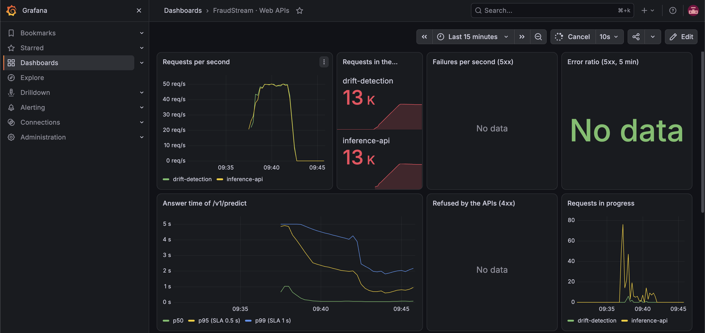

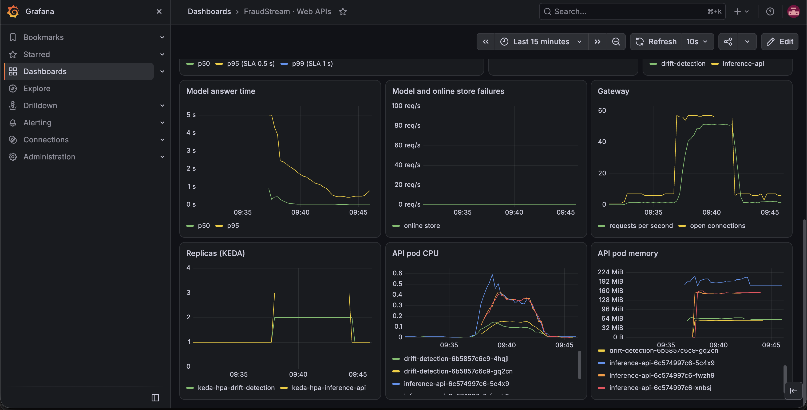

## Compute: metrics, logs and traces

**Metrics.** node-exporter and kube-state-metrics from kube-prometheus-stack, kept 3 days
([`observability/prometheus-values.yaml:15`](../../k8s/observability/prometheus-values.yaml#L15),
[`observability/prometheus-values.yaml:26`](../../k8s/observability/prometheus-values.yaml#L26)).
The dashboard **FraudStream · Compute** shows CPU, memory, disk used, disk read and write,
network and pod restarts, then CPU, memory and network by namespace
([`dashboards/compute.yaml:18`](../../k8s/observability/dashboards/compute.yaml#L18)).

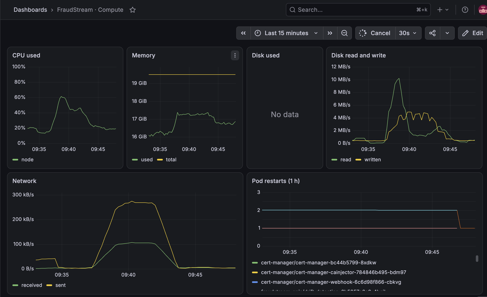

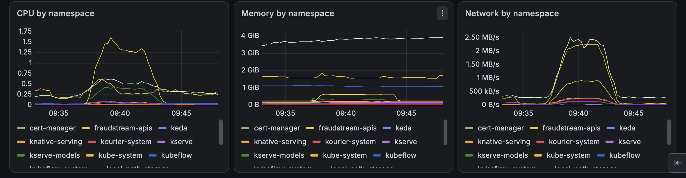

**Logs.** The APIs write one JSON object per line, and a line written during a request
carries its `trace_id` ([`fraudstream_api/logs.py:21`](../../api/src/fraudstream_api/logs.py#L21),
[`k8s/Dockerfile.context:44`](../../k8s/Dockerfile.context#L44)). Fluent Bit tails the
containers of the APIs, the model, the gateway and Kubeflow
([`observability/fluent-bit-values.yaml:5`](../../k8s/observability/fluent-bit-values.yaml#L5))
and ships them to one Elasticsearch node, which deletes them after 3 days
([`observability/logging-setup.yaml:22`](../../k8s/observability/logging-setup.yaml#L22)).
Kibana and Grafana both read them.

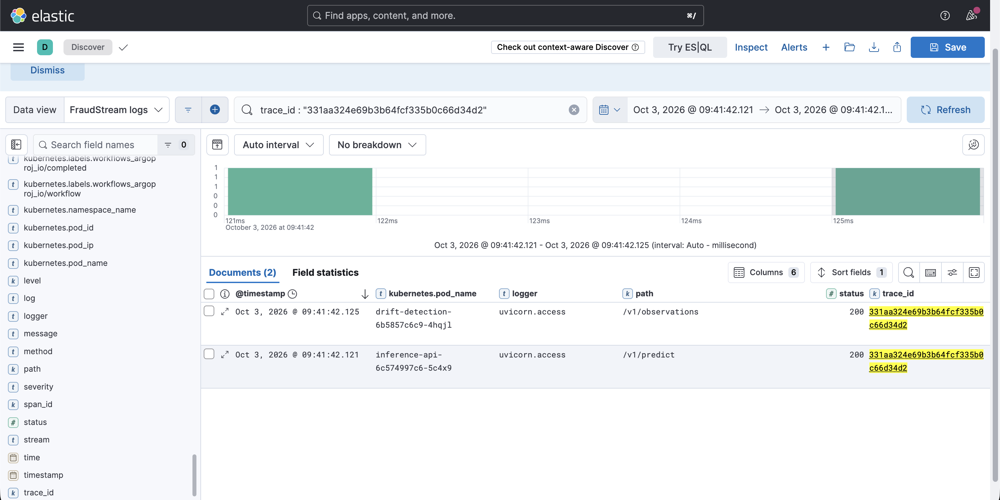

**Traces.** The APIs send OpenTelemetry spans over OTLP to Jaeger: one per request, plus the
Redis reads and the HTTP calls to the model and the drift API
([`fraudstream_api/tracing.py:19`](../../api/src/fraudstream_api/tracing.py#L19)). In Grafana a
log line links to its trace and back.

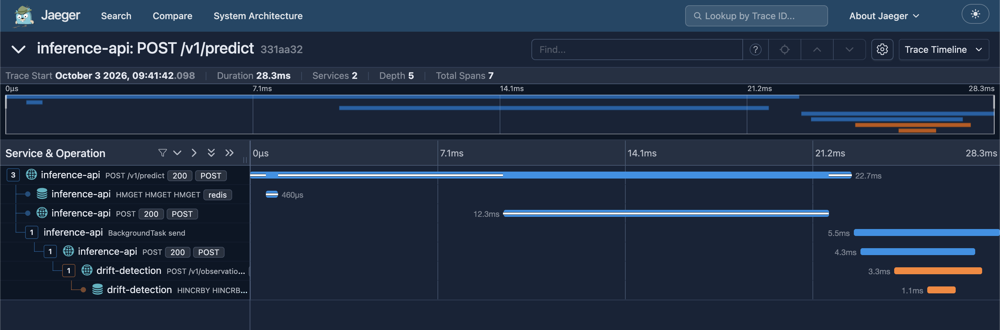

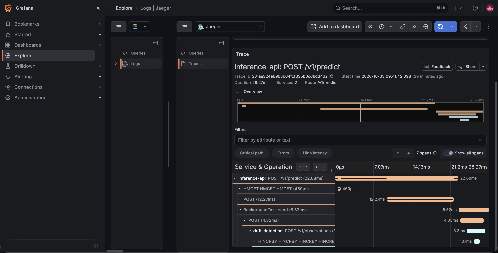

## LLM telemetry

agentgateway measures every generation it forwards, and llama.cpp reports its own queue and
tokens. Each gateway metric carries the caller's `consumer`, taken from its key
([`llm/policy.yaml:38`](../../k8s/llm/policy.yaml#L38)), so agents and the benchmark are
counted apart. The dashboard is **FraudStream · LLM**
([`dashboards/llm.yaml:12`](../../k8s/observability/dashboards/llm.yaml#L12)).

| Required | Metric | Panel |
|---|---|---|
| Input, output and total tokens per request | `agentgateway_gen_ai_client_token_usage{gen_ai_token_type}`, a histogram per request | [`dashboards/llm.yaml:44`](../../k8s/observability/dashboards/llm.yaml#L44) |
| Total round trip of a generation | `agentgateway_gen_ai_server_request_duration` | [`dashboards/llm.yaml:38`](../../k8s/observability/dashboards/llm.yaml#L38) |
| Time to first token | `agentgateway_gen_ai_server_time_to_first_token` | [`dashboards/llm.yaml:26`](../../k8s/observability/dashboards/llm.yaml#L26) |
| How often the PII guard catches a prompt | `agentgateway_guardrail_checks_total{phase, action}`, per minute and as a share of prompts | [`dashboards/llm.yaml:65`](../../k8s/observability/dashboards/llm.yaml#L65), [`dashboards/llm.yaml:69`](../../k8s/observability/dashboards/llm.yaml#L69) |
| Also | time per output token, tokens by consumer, requests waiting and running per pod, refused requests by status | [`dashboards/llm.yaml:32`](../../k8s/observability/dashboards/llm.yaml#L32), [`dashboards/llm.yaml:50`](../../k8s/observability/dashboards/llm.yaml#L50), [`dashboards/llm.yaml:55`](../../k8s/observability/dashboards/llm.yaml#L55), [`dashboards/llm.yaml:61`](../../k8s/observability/dashboards/llm.yaml#L61) |

Time to first token is measured only for streamed replies, so the LLM check sends one
streamed request, and then fails unless every panel of the dashboard has data
([`llm/check.sh:61`](../../k8s/llm/check.sh#L61)).

During a benchmark run:

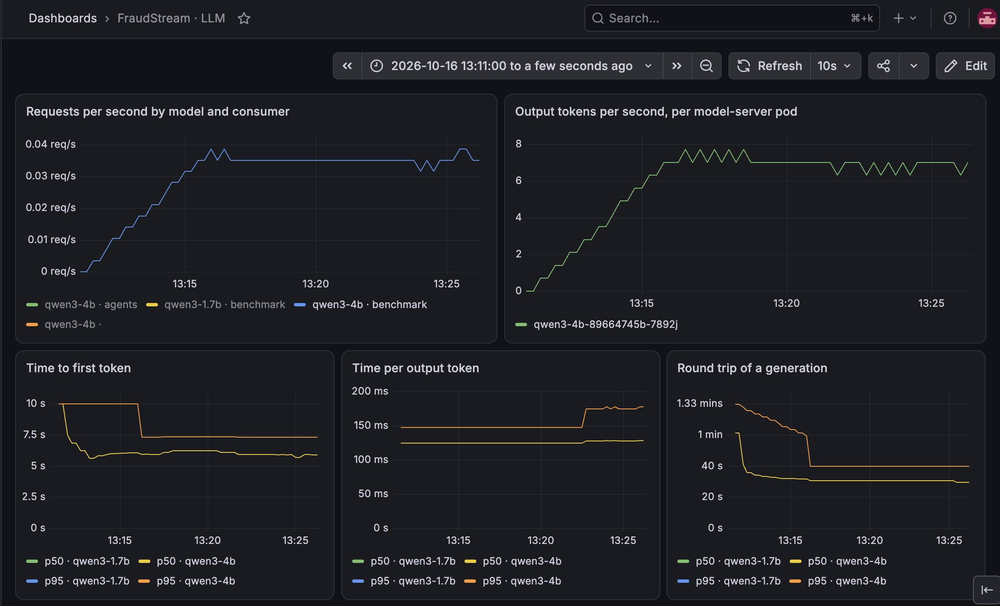

- **Top:** requests per second by model and consumer, output tokens per second per pod.
- **Timing:** time to first token, time per output token and round trip, p50 and p95.

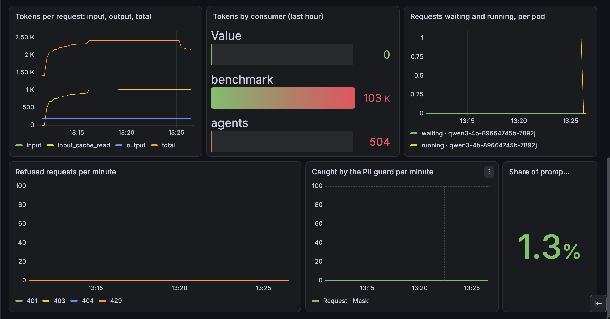

- **Tokens per request:** here 1,213 in, 1,010 of them read from cache, and 200 out.
- **PII guard catches** per minute, and the share of prompts caught.

Every call is also a trace: the request, the call to the picker and the call to the pod.

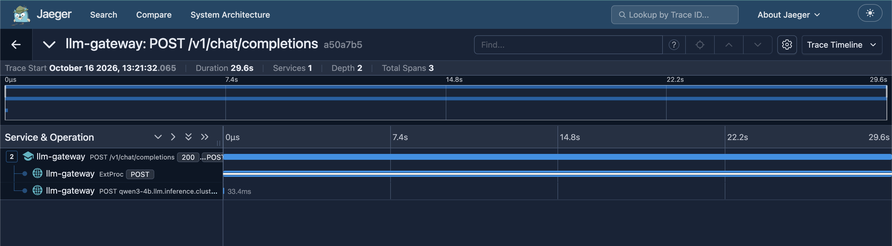

## Agent telemetry

kagent has no request metrics of its own, so calls to an agent are counted from traces.
Every agent pod opens one `invoke_agent` span for each call it runs, from a person or from
another agent. A second pipeline in Jaeger keeps only those spans (the controller's own is
dropped, so a call is counted once) and turns them into metrics with its `spanmetrics`
connector ([`observability/jaeger.yaml:51`](../../k8s/observability/jaeger.yaml#L51),
[`observability/jaeger.yaml:62`](../../k8s/observability/jaeger.yaml#L62)). Tool calls are
counted in the MCP servers, because a failed tool call is an MCP result with `isError`, sent
with HTTP 200: to a gateway it looks like a good one.

| Required | Metric | Counted in | Panel |
|---|---|---|---|
| Number of times each agent is called | `agent_calls_total{gen_ai_agent_name, status_code}` | Jaeger's span metrics | [`dashboards/agents.yaml:18`](../../k8s/observability/dashboards/agents.yaml#L18) |
| Number of times each MCP tool is called | `mcp_tool_calls_total{server, tool, outcome}` | the MCP servers, around every tool ([`fraudstream_mcp/common.py:18`](../../mcp_servers/src/fraudstream_mcp/common.py#L18), [`fraudstream_mcp/common.py:125`](../../mcp_servers/src/fraudstream_mcp/common.py#L125)) | [`dashboards/agents.yaml:22`](../../k8s/observability/dashboards/agents.yaml#L22) |
| Failures for each tool call | the same counter, `outcome` = `not_found`, `rejected` or `failed` ([`fraudstream_mcp/common.py:51`](../../mcp_servers/src/fraudstream_mcp/common.py#L51)) | the MCP servers | [`dashboards/agents.yaml:23`](../../k8s/observability/dashboards/agents.yaml#L23) |
| Also | calls per minute by status, calls in flight against replicas, call time, tool calls per agent at the MCP gateway, tool call time, calls between agents at the A2A gateway | | [`dashboards/agents.yaml:19`](../../k8s/observability/dashboards/agents.yaml#L19) |

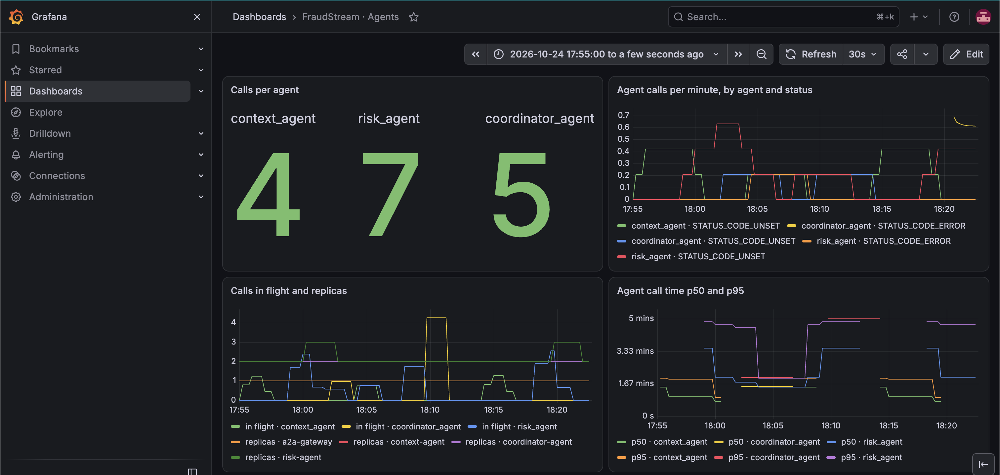

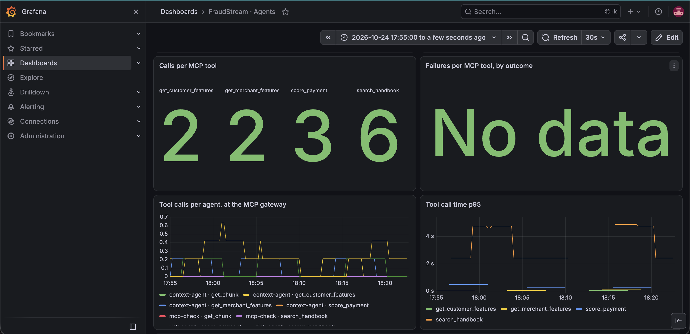

The errors on the second chart came from one risk-agent pod that kept an old tool address
after the A2A gateway was switched on; the network now blocks that address, and the agent
check reads each pod's tool address at start.

## Drift and retraining

A daily DAG, [`airflow/dags/drift_monitoring.py`](../../airflow/dags/drift_monitoring.py),
compares the model's live inputs with its training data without waiting for labels
([`dags/drift_monitoring.py:41`](../../airflow/dags/drift_monitoring.py#L41)), pushes the PSI
to Prometheus through the Pushgateway, and starts a training run on Kubeflow when the inputs
moved ([`dags/drift_monitoring.py:61`](../../airflow/dags/drift_monitoring.py#L61),
[`fraudstream_monitoring/retrain.py:69`](../../monitoring/src/fraudstream_monitoring/retrain.py#L69)).

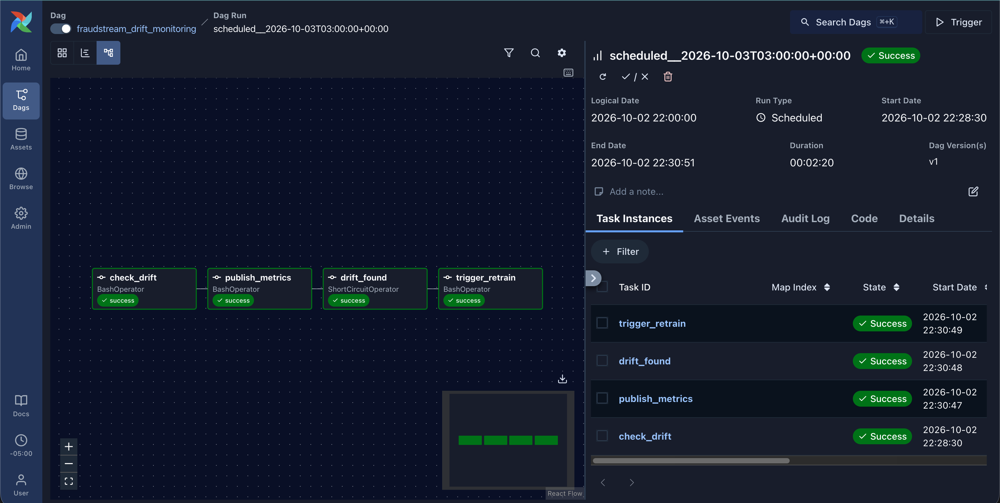

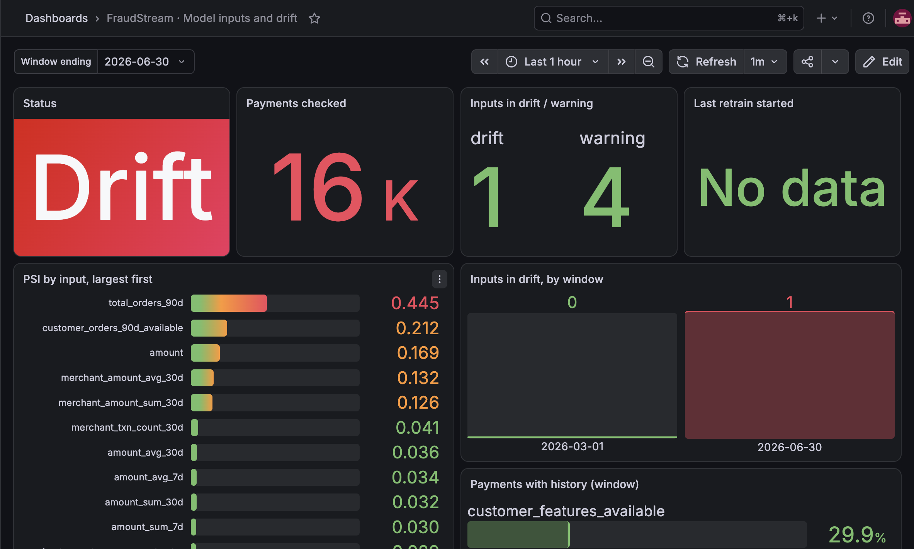

The drift pipeline is [`airflow/dags/drift_monitoring.py`](../../airflow/dags/drift_monitoring.py); its performance estimate is in [22_nannyml.md](22_nannyml.md).

## Where things are

| What | Where |
|---|---|
| Install | [`k8s/observability/install.sh`](../../k8s/observability/install.sh) |
| Scraping | [`k8s/observability/servicemonitors.yaml`](../../k8s/observability/servicemonitors.yaml), [`k8s/observability/prometheus-values.yaml`](../../k8s/observability/prometheus-values.yaml) |
| Logs | [`k8s/observability/fluent-bit-values.yaml`](../../k8s/observability/fluent-bit-values.yaml), [`k8s/observability/logging.yaml`](../../k8s/observability/logging.yaml), [`api/src/fraudstream_api/logs.py`](../../api/src/fraudstream_api/logs.py) |
| Traces and agent span metrics | [`k8s/observability/jaeger.yaml`](../../k8s/observability/jaeger.yaml), [`api/src/fraudstream_api/tracing.py`](../../api/src/fraudstream_api/tracing.py) |
| API metrics | [`api/src/fraudstream_api/metrics.py`](../../api/src/fraudstream_api/metrics.py) |
| Tool call metrics | [`mcp_servers/src/fraudstream_mcp/common.py`](../../mcp_servers/src/fraudstream_mcp/common.py) |
| LLM telemetry labels | [`k8s/llm/policy.yaml`](../../k8s/llm/policy.yaml) |
| Dashboards | [`k8s/observability/dashboards/`](../../k8s/observability/dashboards/) |
| Drift pipeline | [`airflow/dags/drift_monitoring.py`](../../airflow/dags/drift_monitoring.py), [`monitoring/src/fraudstream_monitoring/`](../../monitoring/src/fraudstream_monitoring/) |
| Screenshots | [`images/observability/`](../../images/observability/), [`images/llm/`](../../images/llm/), [`images/multi_agents/`](../../images/multi_agents/) |
