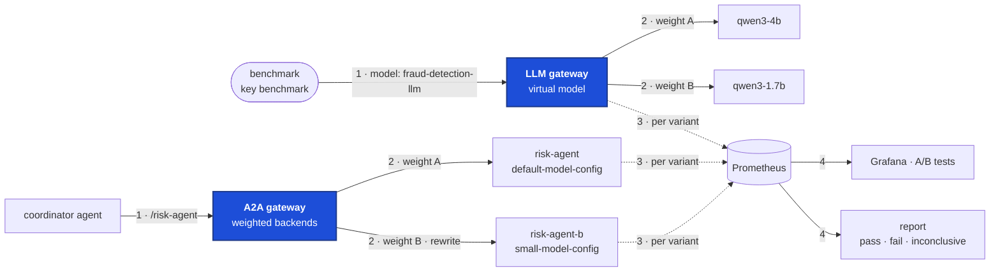
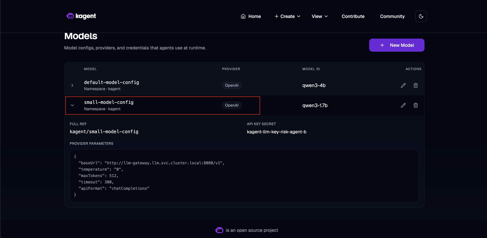
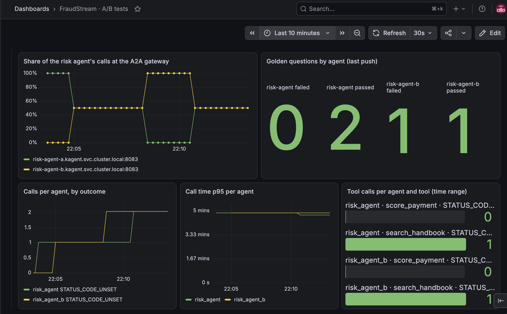
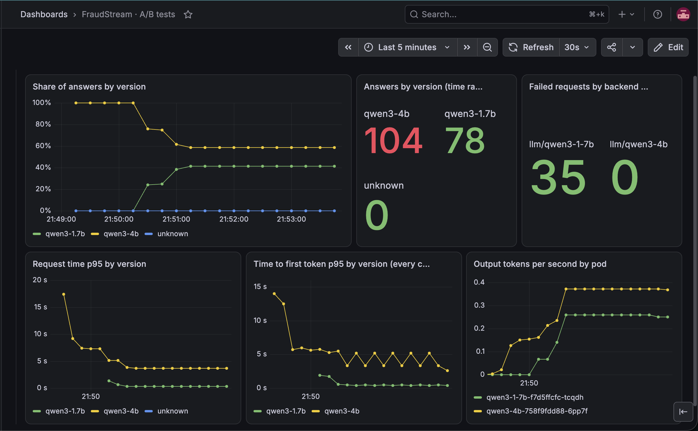

# A/B Testing

A new LLM version, or a cheaper model for an agent, never replaces the current one
directly. It takes a weighted share of real traffic next to it, is measured the same way
on one dashboard, and is judged by rules fixed before the test. Two splits do this:

- **Agents with different model configs:** does the risk agent still do its job on a
  smaller model?
- **LLM versions on the inference platform:** does the new version serve requests as well
  as the current one?

Both compare Qwen3-4B, the current model, with Qwen3-1.7B, less than half its size. The
fraud detection model's own canary on KServe works the same way and is in
[`docs/ml/27_ab_testing.md`](../ml/27_ab_testing.md).



1. **One name.** Callers keep calling one name: the model `fraud-detection-llm`, or the path
   `/risk-agent`. They don't know a test is running.
2. **Weights.** The gateway sends each request to A or B by weight. The weights live in git,
   so every step is a commit that can be reviewed and reverted.
3. **Measure.** The LLM gateway counts requests per version; Jaeger turns each agent's spans
   into calls, failures and call time; the golden questions' results go to the Pushgateway.
4. **Judge.** One dashboard shows A and B side by side, and a report reads the same numbers.

## The rules

B fails if any of these holds ([`fraudstream_agents/ab_testing.py:49`](../../agents/src/fraudstream_agents/ab_testing.py#L49)):

| Rule | Why | Where |
|---|---|---|
| B fails more than 2 points more often than A | one broken answer already matters | [`fraudstream_agents/ab_testing.py:15`](../../agents/src/fraudstream_agents/ab_testing.py#L15) |
| more than 1% of LLM calls fail before reaching a version | a broken split hides a version's failures | [`fraudstream_agents/ab_testing.py:16`](../../agents/src/fraudstream_agents/ab_testing.py#L16) |
| B passes fewer golden questions than A | the agent split checks the answers, not only their speed | [`fraudstream_agents/ab_testing.py:58`](../../agents/src/fraudstream_agents/ab_testing.py#L58) |
| B's p95 is over 1.2 × A's, once B has 20 LLM calls or 10 agent calls | a p95 from a handful of calls is noise | [`fraudstream_agents/ab_testing.py:14`](../../agents/src/fraudstream_agents/ab_testing.py#L14), [`fraudstream_agents/ab_testing.py:17`](../../agents/src/fraudstream_agents/ab_testing.py#L17) |

Otherwise B passes, or is **inconclusive** while it has too few calls: too little traffic
can never pass. The report exits 0 on pass, 10 on fail, 12 when inconclusive
([`k8s/agents/ab-testing-report.sh`](../../k8s/agents/ab-testing-report.sh)). A test steps
10%, then 50%, then promotes or rolls back; a person moves the weights, the report judges.

## A/B test of agents with different model configs

**Variant B, `risk-agent-b`,** is the risk agent's own manifest with one field changed, its
model config ([`agents/risk-agent-b.sh:10`](../../k8s/agents/risk-agent-b.sh#L10)). Same
prompt, tools and keys. `small-model-config` points at `qwen3-1.7b` through the LLM gateway,
with a key that may use only that model
([`agents/small-model-config.yaml:8`](../../k8s/agents/small-model-config.yaml#L8),
[`llm/secrets.yaml:107`](../../k8s/llm/secrets.yaml#L107)).



**The split is at the A2A gateway**, on the risk agent's rule of the `agents` route:

- **Weights** on two backends, `risk-agent-a` and `risk-agent-b`, both Services in front of
  kagent's controller, separate so each variant is counted as its own backend
  ([`agents/a2a-gateway.yaml:112`](../../k8s/agents/a2a-gateway.yaml#L112)).
- **A rewrite for B.** The coordinator always calls `/risk-agent`; on B's backend the path is
  rewritten to `/risk-agent-b` ([`agents/a2a-gateway.yaml:119`](../../k8s/agents/a2a-gateway.yaml#L119)).
- **The card is pinned to A** by a longer rule for `/risk-agent/.well-known`
  ([`agents/a2a-gateway.yaml:125`](../../k8s/agents/a2a-gateway.yaml#L125)), so the
  coordinator only ever learns the one `/risk-agent` address and every call meets the split.
- **Calls go through the gateway** because kagent writes the gateway's address into the
  cards it serves ([`agents/kagent-values.yaml:50`](../../k8s/agents/kagent-values.yaml#L50)).

After the golden questions, the check pushes each agent's passed and failed counts to the
Pushgateway ([`tools/check_agent.py:72`](../../agents/tools/check_agent.py#L72)).

**Result.** At 50%, the coordinator's calls alternated between A and B and both answered
without errors. B passed 1 of its 2 golden questions, A both: asked who must agree before a
large payment is blocked, B also stated a fraud model decision though no payment had been
scored. The golden rule failed B, and the risk agent's calls went back to A at 100%
(the committed weights, 100 and 0).



## A/B test of LLM versions

`fraud-detection-llm` is a virtual model on the LLM gateway: one name with weighted targets,
each a real model with its own model server ([`llm/gateway.yaml:119`](../../k8s/llm/gateway.yaml#L119)).
Every answer carries the name of the model that wrote it, so each request is counted for the
version that served it.

- **Only the benchmark key calls it**, so test traffic is told apart from everything else.
  The agents stay on `qwen3-4b`: an agent's conversation makes several LLM calls, and a
  per-request split would mix both versions inside one conversation.
- **Weights are 1 or more**, so promoting or rolling back removes a target.
- **Traffic:** [`k8s/llm/check-split.sh`](../../k8s/llm/check-split.sh) sends short requests
  and counts which version answered each, next to the live weights
  ([`llm/check-split.sh:20`](../../k8s/llm/check-split.sh#L20)); `bench.sh` runs the full
  benchmark against the virtual model.

**Result.** At 50%, `qwen3-1.7b` answered 78 requests and `qwen3-4b` 104. `qwen3-1.7b` was
much faster, about 0.4 s against 3.7 s at p95, but refused 35 requests in a burst in its
first 40 seconds, far over the 2-point rule. The test failed, and `fraud-detection-llm` was
rolled back to `qwen3-4b` alone ([`llm/gateway.yaml:135`](../../k8s/llm/gateway.yaml#L135)).



## The dashboard

**FraudStream · A/B tests** has a row per split: share of answers by version, answers and
failures by version, request time and time to first token by version, then the agent row
with calls, failures, call time and golden questions per variant
([`dashboards/ab-tests.yaml:18`](../../k8s/observability/dashboards/ab-tests.yaml#L18)).

## How to run it

```bash
./k8s/llm/check-split.sh 100                                    # LLM split: traffic, and each version answers
./k8s/agents/check.sh --agent risk-agent --agent risk-agent-b   # golden questions, pushed per agent
./k8s/agents/check.sh --load 4 --agent coordinator-agent --concurrency 2
./k8s/agents/ab-testing-report.sh llm 10m
./k8s/agents/ab-testing-report.sh agent 3h
```

To move a split, edit the weights in `k8s/llm/gateway.yaml` or `k8s/agents/a2a-gateway.yaml`,
commit, and apply.

## Where things are

| What | Where |
|---|---|
| The LLM split | [`k8s/llm/gateway.yaml`](../../k8s/llm/gateway.yaml), [`k8s/llm/check-split.sh`](../../k8s/llm/check-split.sh) |
| The agent split | [`k8s/agents/a2a-gateway.yaml`](../../k8s/agents/a2a-gateway.yaml), [`k8s/agents/risk-agent-b.sh`](../../k8s/agents/risk-agent-b.sh), [`k8s/agents/small-model-config.yaml`](../../k8s/agents/small-model-config.yaml) |
| The rules and the report | [`agents/src/fraudstream_agents/ab_testing.py`](../../agents/src/fraudstream_agents/ab_testing.py), [`agents/tools/ab_testing_report.py`](../../agents/tools/ab_testing_report.py), [`k8s/agents/ab-testing-report.sh`](../../k8s/agents/ab-testing-report.sh) |
| The dashboard | [`k8s/observability/dashboards/ab-tests.yaml`](../../k8s/observability/dashboards/ab-tests.yaml) |
| The fraud detection model's canary | [`docs/ml/27_ab_testing.md`](../ml/27_ab_testing.md) |
| Screenshots | [`images/llm_ab_testing/`](../../images/llm_ab_testing/) |
