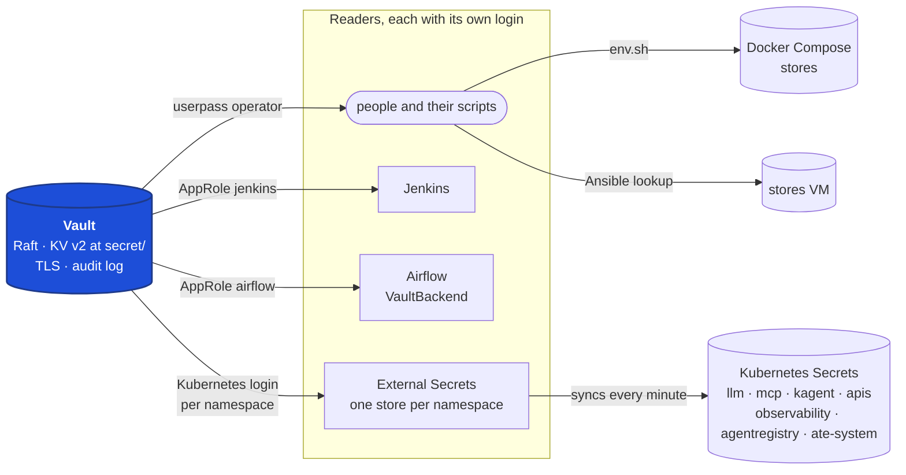
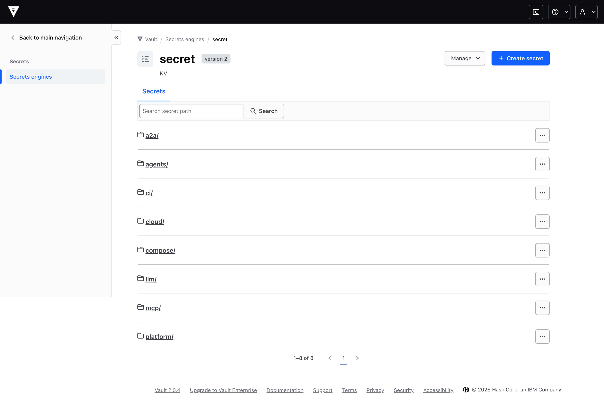
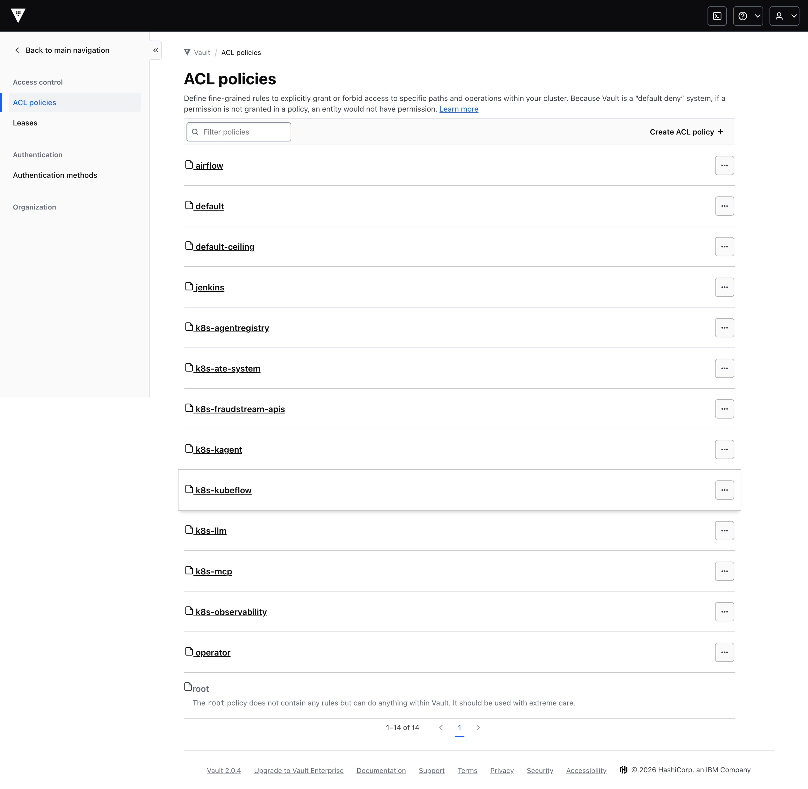
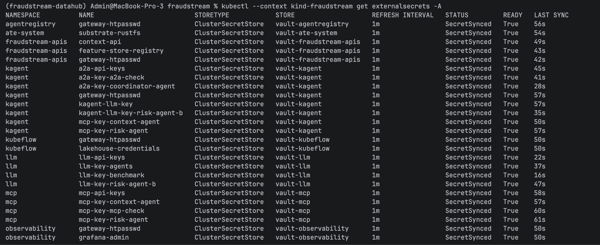
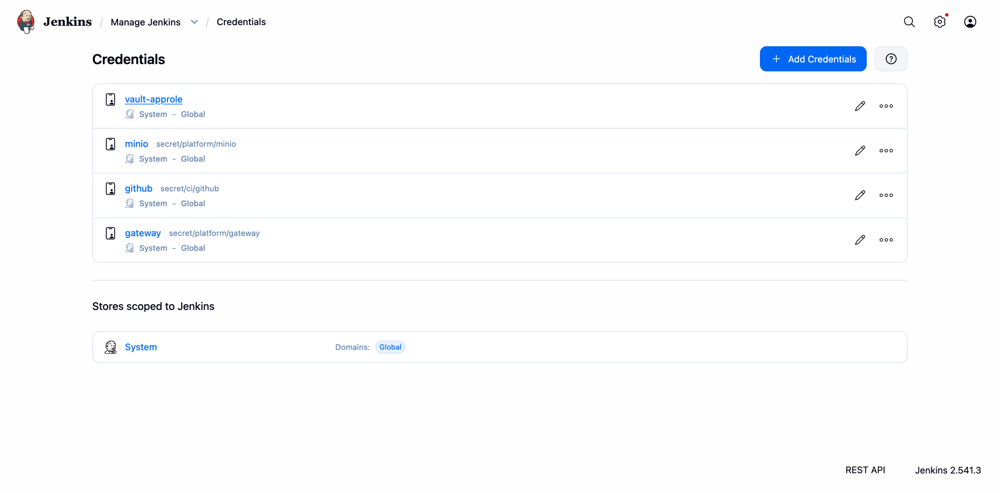
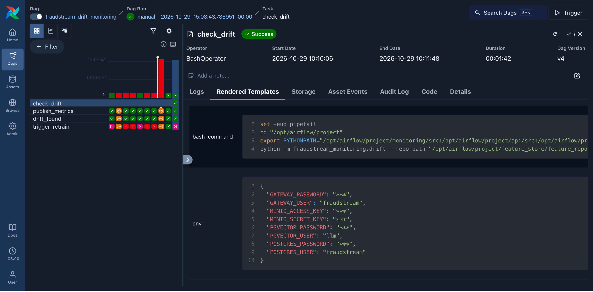
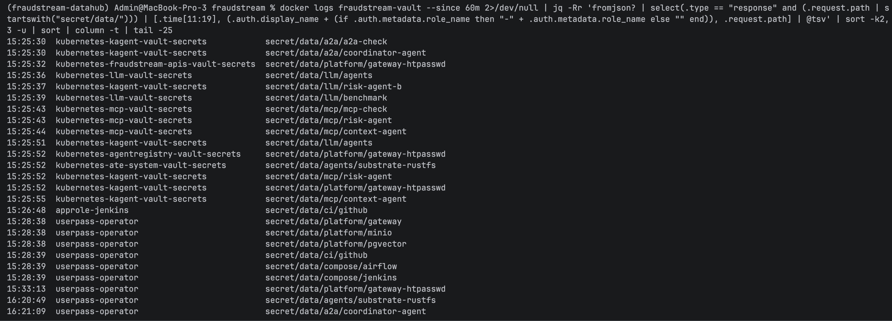
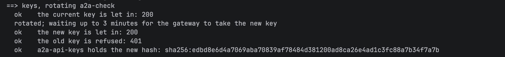

# Security: Centralized Secrets in HashiCorp Vault

Every password, key and token in the platform lives in one HashiCorp Vault, and nothing
else keeps a copy written by hand: the stores' passwords, the gateway login, every LLM, MCP
and A2A key, CI's GitHub token and the cloud's database password. Every reader has its own
login and may read only its own entries, and Vault's audit log records every read. The
repository and `.env` hold no secret.

Vault runs in Docker Compose next to the stores, not in the cluster: the stores start before
kind and need their passwords first, and deleting the cluster must not delete Vault's data.
It serves TLS from its own small CA ([`infra/vault/tls.sh`](../../infra/vault/tls.sh)) and
turns on the audit log at start ([`vault/init.sh:26`](../../infra/vault/init.sh#L26)).

## Where each secret lives

| Path under `secret/` | Read by |
|---|---|
| `platform/postgres`, `platform/minio`, `platform/pgvector`, `platform/gateway` | Compose, Airflow, Jenkins and the namespaces that use them |
| `platform/gateway-htpasswd` | every namespace behind the NGINX gateway |
| `ci/github` | Jenkins |
| `llm/<consumer>` | `llm`, and `kagent` for the agents' own key |
| `mcp/<consumer>`, `a2a/<consumer>` | `mcp`, `kagent` |
| `agents/substrate-rustfs` | `ate-system` |
| `cloud/postgres` | the operator: Ansible and the GKE deploy |

## Who may read what

Every reader logs in as itself and gets a token with one policy, listing only the paths it
may read ([`infra/vault/policies/`](../../infra/vault/policies/)). The agents' namespace may
read its own keys and the gateway login, nothing else
([`policies/k8s-kagent.hcl:1`](../../infra/vault/policies/k8s-kagent.hcl#L1)); the LLM
namespace only the LLM keys ([`policies/k8s-llm.hcl:1`](../../infra/vault/policies/k8s-llm.hcl#L1)).

| Reader | Login | Where |
|---|---|---|
| People and their scripts | userpass, the user `operator` | [`vault/init.sh:28`](../../infra/vault/init.sh#L28) |
| Every policy, written from its file | | [`vault/configure.sh:28`](../../infra/vault/configure.sh#L28) |
| Jenkins, Airflow | an AppRole each | [`vault/configure.sh:33`](../../infra/vault/configure.sh#L33) |
| Each namespace | Kubernetes login with its ServiceAccount `vault-secrets`, checked by the cluster's API server | [`vault/configure.sh:44`](../../infra/vault/configure.sh#L44) |

A pod in `observability` that asks for `platform/postgres` is refused with 403.
[`infra/vault/check.sh`](../../infra/vault/check.sh) checks every reader against the paths it
may and may not read.

## How a secret reaches each reader

**The cluster, for the LLM platform and the agents.** Each namespace has a
`ClusterSecretStore` limited to it and one `ExternalSecret` per Secret. External Secrets
logs in as the namespace, reads Vault, writes the Secret and checks again every minute
([`llm/secrets.yaml:8`](../../k8s/llm/secrets.yaml#L8), [`agents/secrets.yaml:109`](../../k8s/agents/secrets.yaml#L109)).
The gateways' key lists are built by a template that hashes each key as it syncs, so only the
hash reaches a gateway ([`llm/secrets.yaml:105`](../../k8s/llm/secrets.yaml#L105),
[`mcp/secrets.yaml:105`](../../k8s/mcp/secrets.yaml#L105), [`agents/secrets.yaml:94`](../../k8s/agents/secrets.yaml#L94)).

**Docker Compose.** Every secret in `docker-compose.yml` is written as
`${POSTGRES_PASSWORD:?run . infra/vault/env.sh …}`, with no fallback. Sourcing
[`infra/vault/env.sh`](../../infra/vault/env.sh) reads them from Vault into the shell
([`vault/env.sh:15`](../../infra/vault/env.sh#L15)); without it, Compose stops instead of
starting with a known password.

**Jenkins.** It logs in with its AppRole, and each credential is a Vault path read when a
build uses it ([`cicd/jenkins/jenkins.yaml:17`](../../cicd/jenkins/jenkins.yaml#L17)).

**Airflow.** Its secrets backend is `VaultBackend` with its own AppRole
([`docker-compose.yml:22`](../../docker-compose.yml#L22)): a connection called `postgres` is
read from `secret/platform/postgres` when a task runs, so the RAG and feature pipelines'
logins never sit in a DAG. Airflow shows them as `***`.

**Ansible** reads the cloud's database password with a Vault lookup
([`ansible/group_vars/stores.yml:5`](../../infra/ansible/group_vars/stores.yml#L5)).

**Every read is logged**, with who asked and for which path; values are hashed in the log.

## Making and rotating keys

A new key is made in Vault once, with check-and-set 0, so running an install again never
replaces it, and the key is never printed ([`vault/new-key.sh:21`](../../infra/vault/new-key.sh#L21)).
Every LLM, MCP and A2A key is made this way by its install
([`llm/install.sh:51`](../../k8s/llm/install.sh#L51), [`mcp/install.sh:28`](../../k8s/mcp/install.sh#L28),
[`agents/install.sh:31`](../../k8s/agents/install.sh#L31)). Rotating writes a new version
checked against the current one ([`vault/rotate-key.sh:15`](../../infra/vault/rotate-key.sh#L15)).
External Secrets syncs it within a minute, and the gateway lets the new key in and refuses
the old one, with nothing redeployed.

## Known limits

- **RustFS's keys reach Substrate's chart as `--set` values**
  ([`agents/substrate.sh:32`](../../k8s/agents/substrate.sh#L32)): the 0.0.9 chart takes them
  no other way, so they sit in its pod spec in plain text.
- **The GKE deploy makes its two Secrets by hand** from what it read in Vault, since GKE can't
  reach the laptop's Vault.

The whole setup, with start-up and checks, is in [`infra/vault/`](../../infra/vault/).

## Where things are

| What | Where |
|---|---|
| Vault's Compose file, config and TLS | [`infra/vault/compose.yml`](../../infra/vault/compose.yml), [`infra/vault/config.hcl`](../../infra/vault/config.hcl), [`infra/vault/tls.sh`](../../infra/vault/tls.sh) |
| Start, unseal and configure | [`infra/vault/init.sh`](../../infra/vault/init.sh), [`infra/vault/unseal.sh`](../../infra/vault/unseal.sh), [`infra/vault/configure.sh`](../../infra/vault/configure.sh) |
| Policies | [`infra/vault/policies/`](../../infra/vault/policies/) |
| Keys | [`infra/vault/new-key.sh`](../../infra/vault/new-key.sh), [`infra/vault/rotate-key.sh`](../../infra/vault/rotate-key.sh) |
| Secrets in the shell | [`infra/vault/env.sh`](../../infra/vault/env.sh) |
| Synced into the cluster | [`k8s/llm/secrets.yaml`](../../k8s/llm/secrets.yaml), [`k8s/mcp/secrets.yaml`](../../k8s/mcp/secrets.yaml), [`k8s/agents/secrets.yaml`](../../k8s/agents/secrets.yaml), [`k8s/apis/secrets.yaml`](../../k8s/apis/secrets.yaml) |
| Checks | [`infra/vault/check.sh`](../../infra/vault/check.sh) |
| Screenshots | [`images/security/`](../../images/security/) |
