# Fraud Rings in a Graph

Fraud rings reuse the same devices and IP addresses across many stolen cards. The
platform's model sees only the customer, the merchant and the payment, so a device that
hundreds of cards share looks like any other. In the batch data, a payment on one of the
ten ring devices is 25 times as likely to be fraud, and those devices carry 28.6% of all
fraud, yet the production model catches only 15% of it.

This adds a graph of who pays on which device and from which IP, in two places:

- **For the model:** Spark counts each device's crowd every day. Feast serves the counts
  as four new model inputs.
- **For the analyst:** Memgraph keeps the live payment graph. The risk agent asks it who
  else pays on a device.

## Architecture

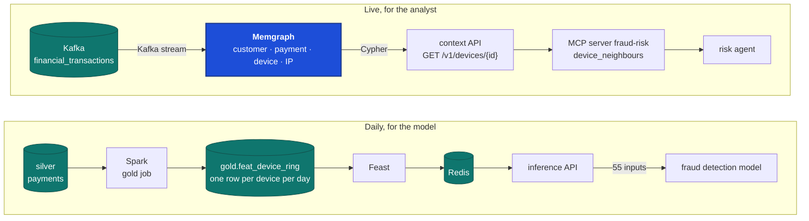

Why two paths? Training needs every day of six months, point in time, and that is
Spark's job on the lakehouse. Memgraph holds the graph in memory, so it answers "who is on
this device right now" in milliseconds, but it only holds the stream.

## The graph

Every payment links its customer to its device and its IP; an in-store payment has no
device. `MERGE` makes a payment sent twice still one node, and a device seen again the
same device.

```
(:Customer)-[:MADE]->(:Payment)-[:ON]->(:Device)
                     (:Payment)-[:FROM]->(:Ip)
```

Memgraph reads the topic itself: a Kafka stream runs a Python transform on each batch of
messages, so no extra consumer is needed.

| Piece | Where |
|---|---|
| The stream, created at start-up | `infra/memgraph/init.sh:14` |
| Message → `MERGE` query | `src/fraudstream/graph/payments_transform.py:15`, `:30` |
| The three ring counts | `src/fraudstream/graph/ring.py:22` |
| Memgraph and Memgraph Lab | `docker-compose.yml:369`, `:403` |

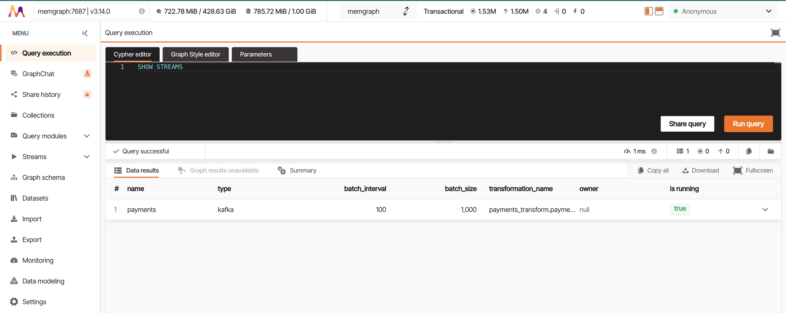

After the 7-day stream replay, the graph holds 500,000 payments, 197,333 customers,
347,424 devices and 485,637 IPs:

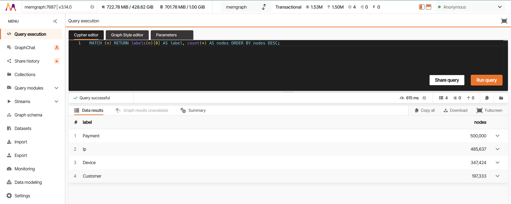


## What the graph shows

One ring device, `dev_stream_ring_0001`, sits in the middle of hundreds of payments, each
from a different customer, all through the same IP:

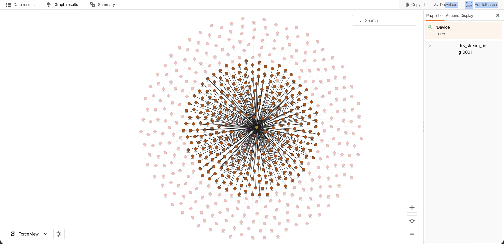

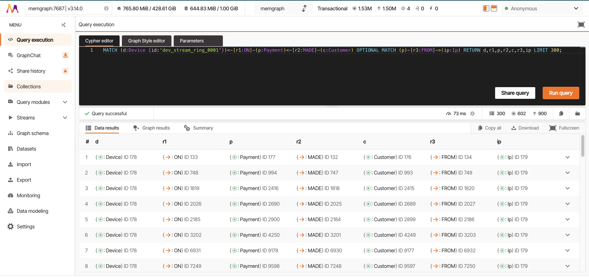

An ordinary device belongs to one customer, like `dev_stream_00084704_03`:

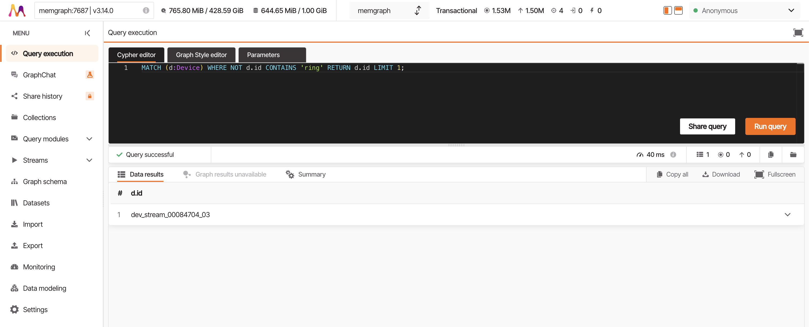

Ranked by payments, the eight ring devices are the top eight, each with more than 800
customers and almost one customer per payment. The next device has one customer:

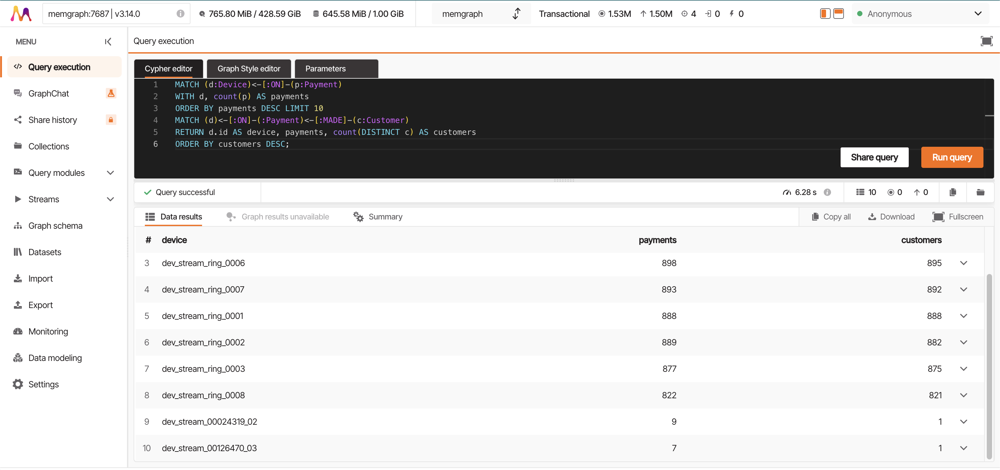

The first `MATCH` keeps only the ten busiest devices, so `count(DISTINCT c)` runs on ten
devices, not 347,424. Counting distinct customers for every device at once goes past
Memgraph's 1 GiB memory limit.

## For the model

The gold job builds `gold.feat_device_ring` from silver: for each device and day, how many
customers paid on it in the last 30 days, how many of them had a fraud payment on it, and
the largest crowd on one of its IPs. A ring device has tens of thousands of customers in
30 days; an ordinary device has one or two.

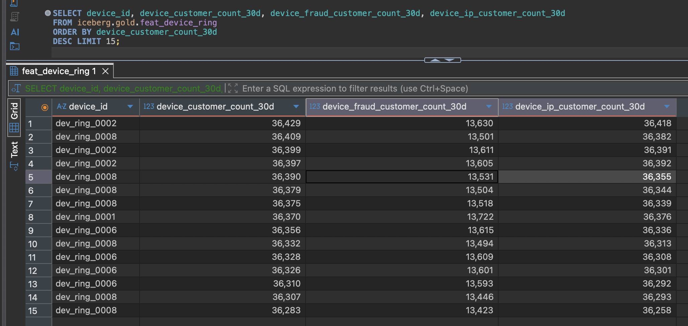

| Step | Where |
|---|---|
| The daily build | `src/fraudstream/jobs/gold/transactions.py:1308`, written by `src/fraudstream/jobs/gold/offline_features.py:313` |
| The `device` entity and its feature view | `feature_store/feature_repo/definitions.py:32`, `:177` |
| Training reads the device from silver | `ml/src/fraudstream_ml/dataset.py:41`, `:87` |
| Three counts plus `device_features_available` = 55 inputs | `ml/src/fraudstream_ml/features.py:56` |
| The inference API takes an optional `device_id` | `api/src/fraudstream_api/inference/schemas.py:22` |

The device id is only the key Feast looks up by. The model sees the counts, never the id.
The production model was trained before these inputs existed. The next retrain picks them
up with no code change.

## For the analyst

The context API asks Memgraph for one device's 30 days up to its newest payment: the
three counts and up to ten customers, fraud first.

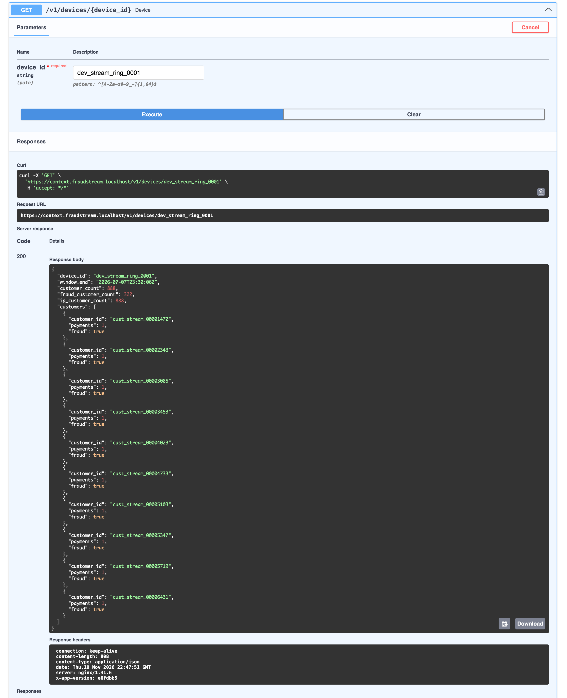

The `fraud-risk` MCP server wraps it as `device_neighbours`. When a question names a
device, the risk agent calls it next to `score_payment` and `search_handbook`, and quotes
the counts in its answer.

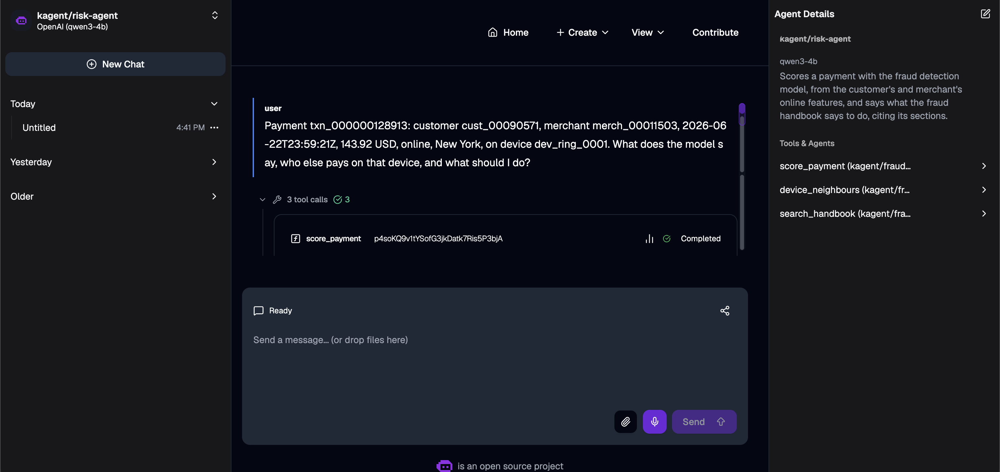

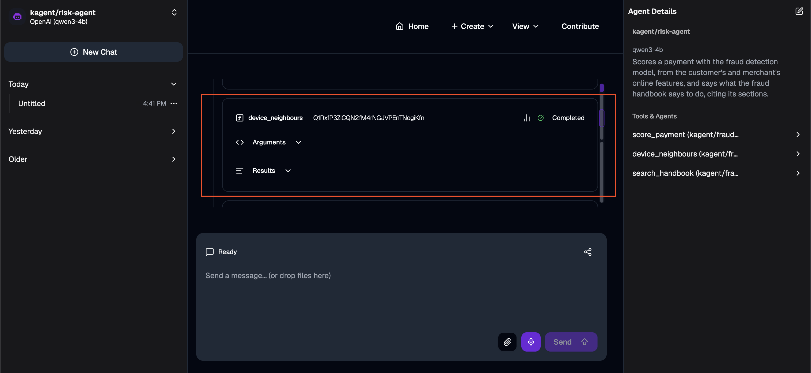

| Step | Where |
|---|---|
| The endpoint | `api/src/fraudstream_api/context/app.py:80` |
| The Cypher queries | `api/src/fraudstream_api/context/stores.py:143` |
| The tool | `mcp_servers/src/fraudstream_mcp/risk_server.py:52` |
| When the agent calls it | `agents/prompts/risk-agent.md:11` |

## Limits

- **The generator's rings are one hop:** one device and one IP each. A plain count finds
  them. Rings that hop across devices would need graph algorithms.
- **Batch and stream use different device ids.** Redis holds the batch ids
  (`dev_ring_0001`), Memgraph the stream ids (`dev_stream_ring_0001`), because the two
  data sets are generated apart.
- **Memgraph holds everything in memory**, capped at 1 GiB. Queries over every device must
  narrow first, as above.
- **A label counts as soon as it is known**, the same as `fraud_txn_count_30d`.

## Where things are

| What | Where |
|---|---|
| The graph code | [`src/fraudstream/graph/`](../../src/fraudstream/graph/) |
| The Memgraph stream | [`infra/memgraph/init.sh`](../../infra/memgraph/init.sh) |
| The daily device features | [`src/fraudstream/jobs/gold/transactions.py`](../../src/fraudstream/jobs/gold/transactions.py) |
| The feature view | [`feature_store/feature_repo/definitions.py`](../../feature_store/feature_repo/definitions.py) |
| The model inputs | [`ml/src/fraudstream_ml/features.py`](../../ml/src/fraudstream_ml/features.py) |
| The device endpoint | [`api/src/fraudstream_api/context/`](../../api/src/fraudstream_api/context/) |
| The `device_neighbours` tool | [`mcp_servers/src/fraudstream_mcp/risk_server.py`](../../mcp_servers/src/fraudstream_mcp/risk_server.py) |
| Screenshots | [`images/memgraph/`](../../images/memgraph/) |
