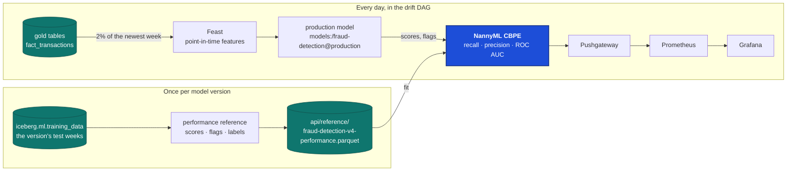
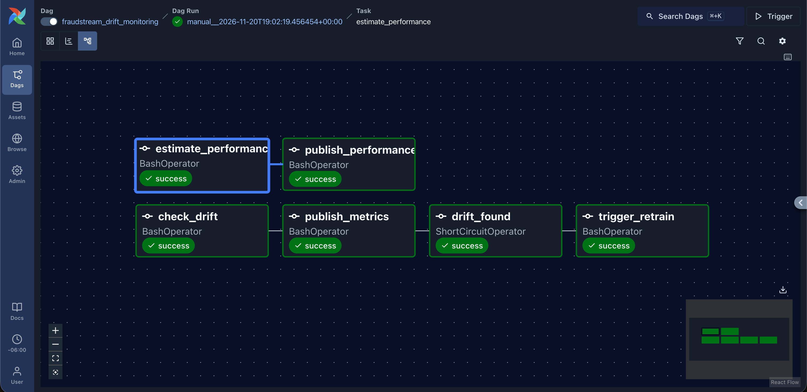
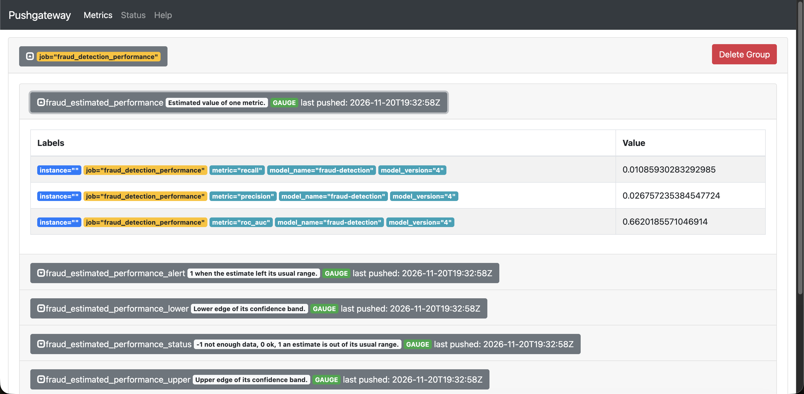
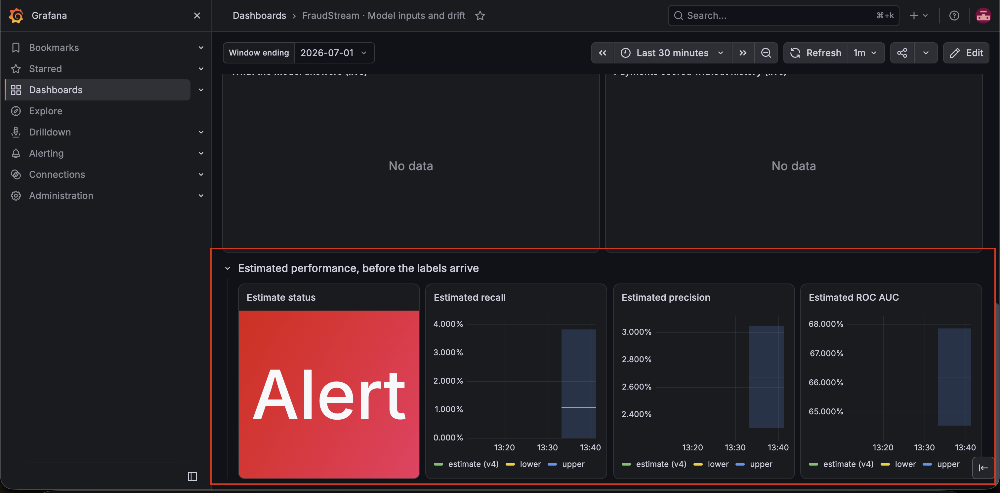
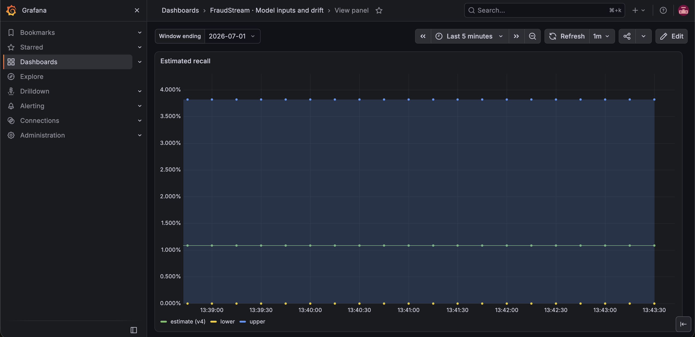
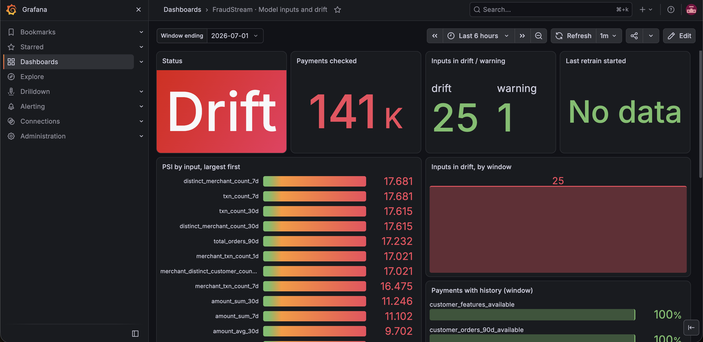

# Estimating Performance Before the Labels Arrive

Fraud is confirmed weeks after the payment, so the model's real recall is always weeks
late. The drift check already says *which inputs* moved. This adds *what that costs*:
every day NannyML estimates the fraud detection model's recall, precision and ROC AUC on
the newest week, from the model's own scores alone, and puts the estimate in Grafana with
its confidence band.

The method is CBPE (confidence-based performance estimation). If the scores are
calibrated, a payment scored 0.3 is fraud 30% of the time, so the expected confusion
matrix, and every metric built on it, can be added up without a single label. NannyML
calibrates the scores on a labelled reference first, so the model's own scores need not
be calibrated.

## Architecture



Two inputs, two moments:

- **The reference** is built once per version, from the weeks that version was tested on,
  with the labels: `monitoring/src/fraudstream_monitoring/performance.py:148`. It reads the
  frozen training snapshot, scores it with that version and saves scores, flags and labels.
- **The analysis window** is built every day without labels: the newest week from the
  offline store, scored by whichever version serves now.

The estimate never starts a retrain. Only PSI does; the estimate tells you whether the
drift hurts.

## The daily run



The estimate is a second branch of `fraudstream_drift_monitoring`
(`airflow/dags/drift_monitoring.py:80`), beside the PSI branch, with no edge between them.
Both run Spark through Feast, so both take the one-slot Spark pool and run one after the
other, never together. Each branch stands alone: a failed estimate never blocks a retrain.

`estimate_performance` (`monitoring/src/fraudstream_monitoring/performance.py:184`):

1. Resolves `models:/fraud-detection@production` to its version number
   (`monitoring/src/fraudstream_monitoring/model.py:31`) and loads that version's reference.
   A version without one fails, with the file it looked for in the message.
2. Finds the newest payment (`monitoring/src/fraudstream_monitoring/drift.py:43`), because
   the stored data lives in the past and today's date would find nothing.
3. Pulls the week through Feast with `labels=False`, keeping 2% of the payments
   (`monitoring/src/fraudstream_monitoring/drift.py:27`).
4. Scores each payment with the model's own inputs in the model's own order
   (`monitoring/src/fraudstream_monitoring/performance.py:67`).
5. Fits CBPE on the reference and estimates the window as one chunk
   (`monitoring/src/fraudstream_monitoring/performance.py:111`). The reference is cut into
   chunks of the same size, so the alert range is how much one week of that size varies.

`publish_performance` pushes the summary under the job `fraud_detection_performance`
(`monitoring/src/fraudstream_monitoring/performance.py:232`).

### Why 2%

A week holds about 7 million payments. Feast's point-in-time join matches each payment to
about 31 daily feature rows before it keeps the newest one; one join reached 218 million
rows, spilled 15 GB and ran for over an hour. 2% is about 140,000 payments, and about
2,200 expected frauds, far above the 100 the estimate needs
(`monitoring/src/fraudstream_monitoring/performance.py:32`). The sample is picked by
`pmod(hash(transaction_id), 100)` (`ml/src/fraudstream_ml/dataset.py:83`), so a rerun reads
the same payments, and the hash knows nothing about fraud. Training still reads every
payment. The run went from over an hour to 15 minutes.

### Too few frauds

Below 100 expected frauds (the reference's fraud rate times the window's rows), the
estimate is noise, so the summary says `not_enough_data` and publishes only that status.

## What it showed

The run checked 2026-06-24 to 2026-07-01 with version 4:

```
version 4, 140,819 payments from 2026-06-24 to 2026-07-01: alert.
recall 0.011 [0.000, 0.038], precision 0.027 [0.023, 0.030], roc_auc 0.662 [0.645, 0.679]
```



The Pushgateway holds one group, `job="fraud_detection_performance"`, with five gauges
(`monitoring/src/fraudstream_monitoring/performance.py:130`):

| Gauge | Value here |
|---|---|
| `fraud_estimated_performance` | recall 0.0109, precision 0.0268, ROC AUC 0.662 |
| `fraud_estimated_performance_lower` / `_upper` | the confidence band of each |
| `fraud_estimated_performance_alert` | 1 for all three: each left its usual range |
| `fraud_estimated_performance_status` | 1, an estimate is out of range (-1 not enough data, 0 ok) |

Every series carries `model_name` and `model_version`, so a new version starts its own line.
The group has no date label on purpose: each push replaces the last, and Prometheus keeps
the history as a time series.



The new row on the model drift dashboard
(`k8s/observability/dashboards/model-drift.yaml:77`):

- **Estimate status** is red **Alert**: at least one metric left the range the reference allows.
- **Recall, precision and ROC AUC** each draw the estimate as a line (green), inside the
  shaded band between `lower` and `upper`. The panels above are the live inference charts;
  they read "No data" because the inference service was scaled down for this run.



Up close, the estimated recall is **1.1%**, with a band from **0% to 3.8%**. The labelled
reference says the same version caught **28%** of fraud in its last week. Even the top of
the band is nowhere near it.

### Why the recall collapsed

Not a bug: version 4 was trained on a far smaller dataset than the one in the gold tables
now. One day compared side by side:

| 2026-06-28 | Training rows of v4 | Today's window |
|---|---|---|
| Payments that day | 2,240 | 730,136 |
| Customer history available | 30% | 100% |
| Device features available | 0% | 99.7% |
| `merchant_txn_count_30d` | normal | 405 standard deviations higher |
| Share the model flags | 14.8% | 0.5% |
| Amount, hour, channel mix | 156.7 · 13.6 · 45% card present | 155.7 · 13.7 · 43% card present |

The payments look the same; the traffic does not. The data was regenerated about 300 times
larger, so every count feature (merchant traffic, customer orders) sits far outside what
v4 learned. The model barely flags anything, and CBPE turns that into an estimated recall
of 1%. The PSI branch of the same run agrees:



- **Status Drift, 141k payments checked:** the same 2% sample the estimate scored.
- **25 inputs in drift, 1 in warning.** A PSI above 0.25 is drift; here the count inputs
  sit between 16 and 18 (`distinct_merchant_count_7d` and `txn_count_7d` 17.68,
  `total_orders_90d` 17.23, `merchant_txn_count_1d` 17.02), and the money sums near 11.
  Values that large mean almost every payment fell in a bin the training data barely used.
- **Payments with history 100%:** v4 trained with history for 30% of payments, and
  with no device features at all. The device ring inputs are new since v4 was trained,
  so v4 cannot use them yet.
- **Last retrain started: No data.** Drift asked for a retrain, but Kubeflow was scaled
  down for this run, so none was started.

That is the two checks working together, weeks before a label: PSI names the inputs that
moved, the estimate says the model now misses almost all fraud. The answer is to retrain
on the current data.

## Limits

- **CBPE trusts the calibration.** It assumes the link between score and fraud is what it
  was in the reference. If fraudsters change so the same score means something else
  (concept drift), the estimate cannot see it; only the labels can.
- **Only covariate shift is covered.** Here that was exactly the problem; it will not
  always be.
- **One week, one chunk.** A sudden one-day attack is averaged into its week.
- **The reference is per version.** A newly promoted version has no estimate until its
  reference is built: `python -m fraudstream_monitoring.performance reference`.

## Where things are

| What | Where |
|---|---|
| Reference, estimate, publish | [`monitoring/src/fraudstream_monitoring/performance.py`](../../monitoring/src/fraudstream_monitoring/performance.py) |
| The 2% sample | [`ml/src/fraudstream_ml/dataset.py`](../../ml/src/fraudstream_ml/dataset.py), [`monitoring/src/fraudstream_monitoring/drift.py`](../../monitoring/src/fraudstream_monitoring/drift.py) |
| Loading the production version | [`monitoring/src/fraudstream_monitoring/model.py`](../../monitoring/src/fraudstream_monitoring/model.py) |
| The DAG | [`airflow/dags/drift_monitoring.py`](../../airflow/dags/drift_monitoring.py) |
| NannyML in the Airflow image | [`airflow/Dockerfile`](../../airflow/Dockerfile) |
| Version 4's reference | [`api/reference/fraud-detection-v4-performance.parquet`](../../api/reference/fraud-detection-v4-performance.parquet) |
| The dashboard row | [`k8s/observability/dashboards/model-drift.yaml`](../../k8s/observability/dashboards/model-drift.yaml) |
| Tests | [`monitoring/tests/test_performance.py`](../../monitoring/tests/test_performance.py) |
| Screenshots | [`images/nannyml/`](../../images/nannyml/) |
