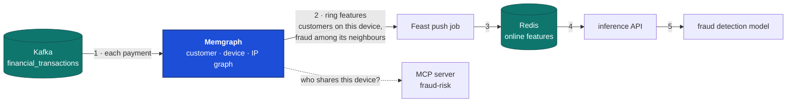
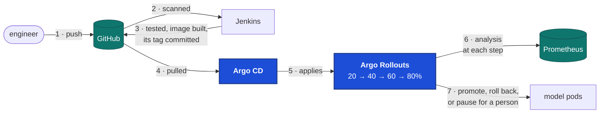

# Novel Ideas: Fraud Rings in a Graph, and GitOps for Every Deploy

Two technologies this platform doesn't use yet, each chosen for a weakness the platform
has today. Each section says what the weakness is, measured on the running platform, and
shows the idea working there before anything is built.

1. **A graph database finds fraud rings.** The fraud detection model scores every payment
   on its own and never sees the device or IP it came from, so it can't see payments
   sharing one.
2. **Argo CD and Argo Rollouts deploy from Git.** Today Jenkins pushes every change into
   the cluster, and 613 lines of the platform's own code step the model's canary.

## 1. A graph database finds fraud rings

### Why it matters here

Fraud rarely works alone. A ring reuses the same devices and IP addresses across many
stolen cards. The generator builds exactly that on purpose: ten ring devices, each
behind its own IP, used by online and mobile-wallet payments in high-risk categories.
The rest of the platform never looks at it.

### The weakness

The model's 51 inputs are the customer's history, the merchant's history and the payment
itself ([`dataset.py`](../../ml/src/fraudstream_ml/dataset.py#L12)). No input mentions a
device or an IP, so a payment from a device three hundred other cards used yesterday looks
like any other.

Measured on the 258,398 silver payments that carry a device:

| | Payments | Fraud rate | Share of all fraud |
|---|---|---|---|
| All payments with a device | 258,398 | 1.57% | 100% |
| On one of the 10 ring devices | 3,001 | **38.6%** | **28.6%** |

A payment on a ring device is 25 times as likely to be fraud, and those ten devices carry
more than a quarter of all fraud. Each one is shared by about 300 different customers; a
normal device has one or two.

The production model (version 4, threshold 0.626) doesn't see this. On the newest week's
fraud, scored with the inference API's own feature code:

| Newest week's fraud | Payments | Caught |
|---|---|---|
| On a ring device | 80 | 15.0% |
| Everywhere else | 167 | 18.0% |

The ring's strongest signal is invisible to the model, so it catches ring fraud no better
than any other fraud.

### The idea

[Memgraph](https://memgraph.com) is an in-memory graph database that reads straight from
Kafka. Customers, devices and IP addresses become nodes; every payment links its customer
to its device and IP. Graph algorithms then answer questions a table can't: how many
customers share this device, how far is this card from a known fraud, which cluster is
this payment part of.



1. Memgraph reads `financial_transactions`, the topic Flink reads.
2. For each payment it computes a few ring features.
3. The Feast push job already writes streaming features to the online store, so these
   features go to the online store the same way.
4. The inference API reads them like any other feature.
5. The model, retrained with them, sees the ring.

The risk agent gets one more tool, so it can cite the ring. One real ring device, `dev_ring_0001`, was used by
301 customers, and 104 of them made a fraudulent payment.

### Shown on the running platform

The figures above come from the real silver table. The scores come from version 4, with the features read from the online
store by the inference API's own code.

Two things the graph showed that the design has to respect:
- **Cluster size alone is too blunt.** Random device ids sometimes collide, which chains
  12,168 customers into one cluster with an ordinary fraud rate. The features have to be
  about the device: how many customers share it, and how many of its neighbours were fraud.
- **The generator's rings are one hop.** One device and one IP per ring, so a plain count
  of customers per device would already catch them. Real rings rotate devices and
  connect through shared IPs and cards, several hops apart. Following those hops is what
  a graph does well and SQL does badly.

### What it takes

- Memgraph in Docker Compose, with a Kafka stream on `financial_transactions` and a small
  transformation that writes nodes and edges.
- Two or three ring features in Feast, and a retrain of the model with them.
- A `device_neighbours` tool on the fraud-risk MCP server.

One caveat on the scores: they used today's online features, not the features as they
were at each payment, so they're a fair picture, not an exact replay.

## 2. Argo CD and Argo Rollouts deploy from Git

### Why it matters here

This platform already treats Git as the truth for the model: every canary step is a
commit, so Git says what the cluster serves. But Git doesn't apply itself. Jenkins pushes
every change in with `kubectl` and `helm`, and a separate job of the platform's own walks
the canary from 20% to 80%.

### The weakness

Keeping Git and the cluster in step by pushing takes a lot of code that guards against
races:

| Today | Lines |
|---|---|
| Stepping the canary and judging each step: `rollout.py`, `rollout_analysis.py`, `rollout_metrics.py`, `rollout_manifest.py` | 448 |
| The rollout Jenkins job | 85 |
| Applying the model and checking the split: `apply_model.sh`, `check_model_split.sh` | 80 |

On top of that:
- **A file lock in the deploy stage.** A build of an older commit must not apply an older
  split over a newer one.
- **A check that the cluster serves what Git says** before every step, because a push can
  be late.
- **Jenkins holds a kubeconfig with write access to the cluster.**
- **Nothing puts back** a change someone made by hand with `kubectl`.

### The idea

GitOps turns the push around: the cluster pulls.
- **[Argo CD](https://argo-cd.readthedocs.io)** watches the repository and keeps the
  cluster equal to it. If it drifts, Argo CD puts it back.
- **[Argo Rollouts](https://argo-rollouts.readthedocs.io)** replaces a Deployment with a
  Rollout that knows how to step a canary. It runs its own analysis against Prometheus
  at every step, and promotes, rolls back or pauses.



Jenkins still tests and builds. Its last step becomes a commit of the new image tag. It no
longer needs any access to the cluster.

Your rollout policy maps onto Argo Rollouts directly:

| Today | With Argo Rollouts |
|---|---|
| `steps: [20, 40, 60, 80]` in `rollout.yaml` | `setWeight` steps with a `pause` between them |
| Health checked every minute, rollback on failure | `failures` and `latency` metrics, `interval: 1m`, `failureLimit: 0` |
| A step judged on flag rate and median score | `flag-rate-gap` and `median-score-shift` metrics |
| A hold, waiting for a person | an inconclusive measurement: the Rollout pauses until someone promotes or aborts it |
| Every step committed by the job | not needed: the Rollout's state is in the cluster, and Git holds the desired version |

The steps, and one of the four metrics:

```yaml
strategy:
  canary:
    analysis:
      templates:
        - templateName: fraud-detection-canary
    steps:
      - setWeight: 20
      - pause: {duration: 3m}
      - setWeight: 40
      - pause: {duration: 3m}
      - setWeight: 60
      - pause: {duration: 3m}
      - setWeight: 80
      - pause: {duration: 3m}
```

```yaml
- name: flag-rate-gap
  interval: 3m
  successCondition: len(result) == 0 || result[0] <= 0.03
  failureCondition: len(result) > 0 && result[0] > 0.5
```

Between "success" and "failure" a measurement is inconclusive, and that's the hold: the
same 3-point limit on the flag rate gap as today.

### Shown on the running platform

I wrote the three manifests: an Argo CD `Application` for `k8s/models`, the model as a
`Rollout`, and the `AnalysisTemplate` with all four checks from today's rollout.
- **They're valid against the official schemas** of Argo Rollouts 1.10.1 and Argo CD
  3.5.6, checked strictly, so an unknown field is an error. A deliberate typo
  (`setWieght`) is caught.
- **All four analysis queries run on this platform's Prometheus**, with version 5 as the
  canary and 4 as stable. They use the metrics the inference API already publishes:
  `fraud_score`, `fraud_flagged_total`, `fraud_model_request_duration_seconds` and
  `http_requests_total`.
- **With no traffic, `failures` reads 0 and the other three read nothing**, which the
  conditions treat as a pass rather than an error.

### What it costs

- **The model leaves KServe.** Argo Rollouts steps Deployments, not KServe
  InferenceServices, and nothing documents driving one. The model server already
  carries its model inside its image and serves plain HTTP, so it runs as a Rollout
  unchanged. What goes is KServe's Knative revisions and its scaling.
- **Exact 20% steps need five pods or a traffic router.** Without a router, Argo Rollouts
  splits traffic by pod count: five pods, one of them the canary, is 20%. That's about
  2.5 GiB of memory requests. With the Gateway API plugin and agentgateway, which is
  already in the cluster, the split is exact with one pod each.
- **Argo CD and Argo Rollouts take memory too**, on a node already at 95% of its CPU
  requests.

## Where things are

| Area | Location |
|---|---|
| The model's inputs | `ml/src/fraudstream_ml/dataset.py` |
| Fraud rings in the generator | `src/fraudstream/generators/offline_transactions.py` (`FraudRing`) |
| Streaming features into the online store | `feature_store/src/fraudstream_feast/stream_push.py` |
| The risk agent's tools | `mcp_servers/src/fraudstream_mcp/risk_server.py` |
| Today's canary rollout | `monitoring/src/fraudstream_monitoring/rollout*.py`, `k8s/models/rollout.yaml` |
| The rollout job and the model deploy | `cicd/jenkins/model-rollout.Jenkinsfile`, `cicd/apply_model.sh`, `Jenkinsfile` (`Model server`) |
| The model manifest | `k8s/models/fraud-detection.yaml` |
