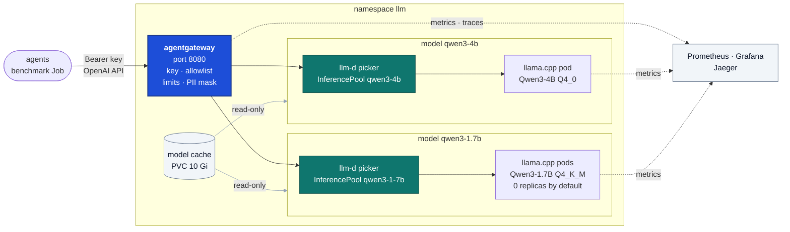
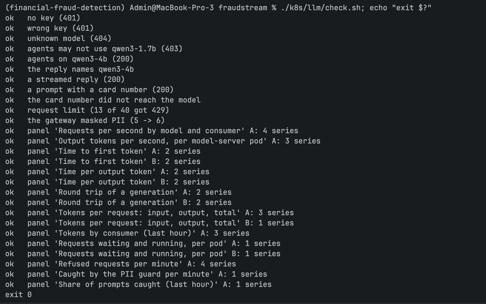
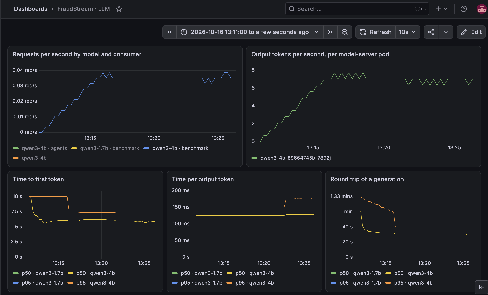
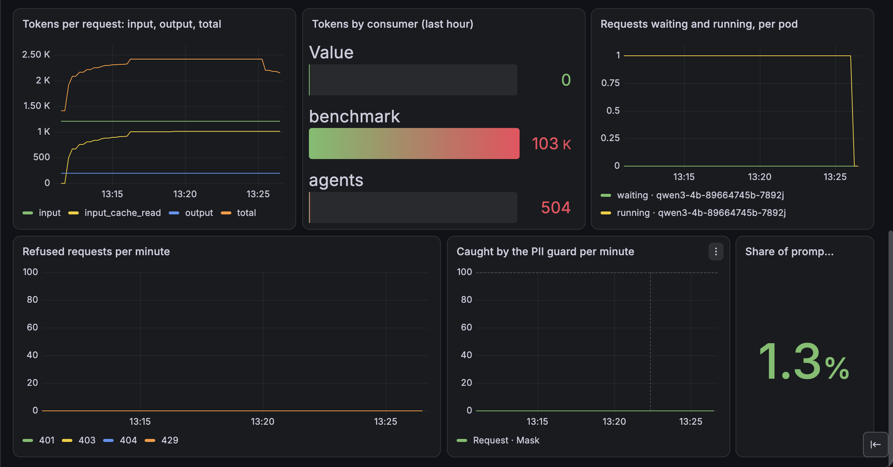
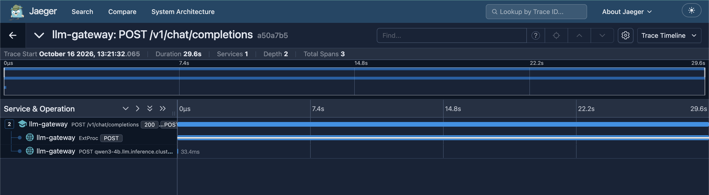
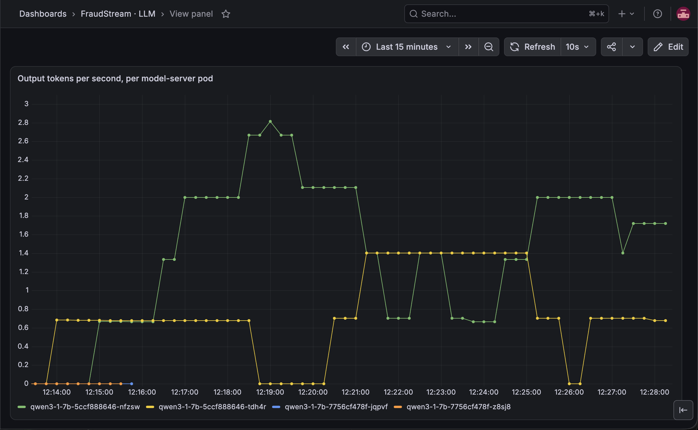
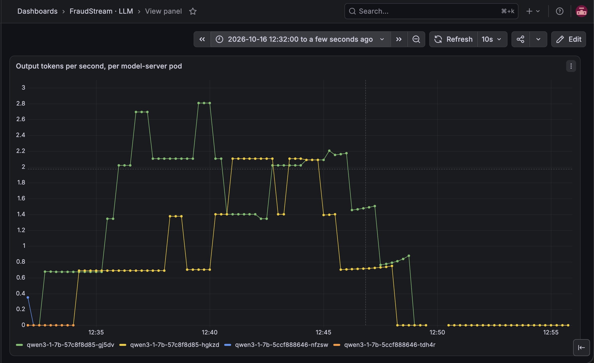

# LLM Inference Platform: Qwen3 on llama.cpp behind llm-d and agentgateway

The analyst copilot's agents need a language model to read facts and explain them. This
is that model's endpoint inside the cluster: one OpenAI-compatible address,
`http://llm-gateway.llm.svc.cluster.local:8080/v1`. Every request needs a key, may use
only the models its key allows, is rate limited, and has card numbers, emails and phone
numbers masked before the model sees them. Every request is measured too: tokens, time to
the first token, round trip and PII guard catches. The fraud model still makes every fraud
decision. The LLM only explains.

## Architecture



One request, `POST /v1/chat/completions` with `"model": "qwen3-4b"`:

1. **Key.** agentgateway hashes the `Bearer` key and looks it up. No key, or a wrong one: 401.
2. **Model.** The `model` field must match a declared model. Anything else: 404.
3. **Allowlist.** The key lists the models its consumer may use. `agents` asking for
   `qwen3-1.7b`: 403.
4. **Limits.** Requests and tokens per minute, per consumer. Over the limit: 429.
5. **Masking.** Card numbers (Luhn-checked), emails and phone numbers in the prompt are
   replaced before the model sees them.
6. **Picker.** agentgateway asks the model's llm-d picker which pod should answer. The
   picker prefers a pod that already holds the prompt's prefix in cache, then the least
   busy one.
7. **Pod.** llama.cpp answers. The reply is masked on the way back, and the gateway records
   tokens and timing with the caller's consumer name.

All policy lives in one proxy, and there is one hop to the model pod. The pickers only
choose pods; they are not in the data path.

## The model

**Qwen3-4B, Q4_0, on llama.cpp.** Before building, twenty fraud analyst questions with the
agents' four tools were sent to three Qwen3 sizes on my laptop. The 4B picked the right
tool with the right arguments 20 times out of 20, the 1.7B 16 times, and the 0.6B 10 times.
The 4B Q4_0 file, which the benchmark kept because it runs 2× faster, scores 19/20 on the
same test.

The files are downloaded once by the Job in `k8s/llm/models/fetch.yaml` into a 10 Gi
volume, from a pinned Hugging Face revision. A file is kept only if its SHA-256 matches;
one that is already correct is skipped on the next install. The model pods mount the
volume read-only.

| File | Size | Serves |
|---|---|---|
| `Qwen3-4B-Q4_0.gguf` | 2.4 GB | `qwen3-4b` |
| `Qwen3-4B-Q4_K_M.gguf` | 2.5 GB | the baseline only |
| `Qwen3-1.7B-Q4_K_M.gguf` | 1.1 GB | `qwen3-1.7b`, for the routing benchmark |

The 4B server runs `--threads 8 --parallel 1 --ctx-size 8192 --jinja`. `--jinja` turns on
Qwen's chat template, which handles tool calls.

## Policy

| Check | How | Answer |
|---|---|---|
| API key | `apiKeyAuthentication`, `Strict`, keys from Secret `llm-api-keys` | 401 |
| Model exists | only declared `AgentgatewayModel`s match | 404 |
| Model allowed | `"<model>" in apiKey.models`, per model | 403 |
| Request and token limits | `rateLimit` per consumer, from the key | 429 |
| PII guard | `promptGuard`, built-ins `CreditCard`, `Email`, `PhoneNumber`, action `Mask`, on request and reply | masked, not refused |

| Consumer | Models | Requests | Tokens |
|---|---|---|---|
| `benchmark` | `qwen3-4b`, `qwen3-1.7b` | 600 a minute | 2,000,000 a minute |
| `agents` | `qwen3-4b` | 30 a minute | 20,000 a minute |

**Keys.** `install.sh` makes each consumer's key once with `openssl rand`, and keeps it
across installs. The plain key goes to `llm-key-<consumer>` for the caller to mount. The
gateway's Secret `llm-api-keys` holds only its SHA-256 hash, the consumer's name and its
models. To rotate a key, delete `llm-key-<consumer>` and run `install.sh` again: the old
key gets 401 at once.

`check.sh` sends each case through the gateway from inside the cluster:



## Telemetry

agentgateway measures every generation it forwards, and llama.cpp reports its own queue
and tokens. Prometheus scrapes both every 15 seconds. Each gateway metric carries a
`consumer` label taken from the caller's key, so agents and the benchmark are counted
apart.

The "FraudStream · LLM" dashboard, during a benchmark run:



- **Top row:** requests per second by model and consumer, and output tokens per second per
  model pod.
- **Timing row:** time to first token, time per output token and round trip, p50 and p95.



- **Tokens per request:** input, input read from cache, output and total. Here 1,213 in,
  1,010 of them from cache, and 200 out.
- **Tokens by consumer** over the last hour, and **requests waiting and running** per pod.
- **Refused requests** by status (401, 403, 404, 429), **PII guard catches** per minute,
  and the **share of prompts caught**.

Every call is also a trace in Jaeger: the request, the call to the picker (`ExtProc`) and
the call to the chosen pod.



## Benchmark

**Workload.** guidellm, as a Job in the cluster, sends chat requests through the gateway
with the benchmark key. Each has a 1,000-token prefix shared by all requests, 200 tokens
of its own, and asks for 200 tokens back, streamed.

**SLA, fixed before any run.** Time to first token ≤ 8 s and time per output token ≤ 400 ms
for 95% of requests. guidellm searches for the highest number of concurrent requests that
still meets it: the **goodput**. Each level runs for 15 minutes.

**Limitation.** The model runs on a MacBook's CPU inside Docker: no GPU, and about 4–5 usable
cores. 8 s is already lenient, since interactive chat usually aims for 1–2 s. The limit was
kept rather than raised until something passed. Runs on this laptop vary by up to 25%, so
smaller changes count as noise.

| # | Change from the best so far | Goodput | Output tokens/s | TTFT p50 / p95 | Time per token p50 / p95 | Kept? |
|---|---|---|---|---|---|---|
| 0 | Baseline: Q4_K_M, 8 threads, 1 slot | none | 4.0 | 13.0 / 13.5 s | 239 / 263 ms | baseline |
| 1 | Q4_K_M → **Q4_0** weights | **1** | **7.6** | **5.1 / 5.4 s** | **125 / 140 ms** | **yes** |
| 2 | 1 → 2 slots | 1 | 6.9 | 5.4 / 6.5 s | 139 / 188 ms | no |
| 3 | 8-bit KV cache | none | 6.0 | 6.4 / 9.4 s | 136 / 289 ms | no |
| 4 | 8 → 6 threads | 1 | 6.4 | 7.2 / 7.8 s | 151 / 165 ms | no |

- **Q4_0 is the only win.** llama.cpp has a faster arm64 path for Q4_0 weights, which
  halves both prompt reading and token time. One request at a time now meets the SLA.
  Tool-call quality stays at 19/20, so it is kept.
- **Two slots** let two requests run side by side instead of queueing, but they share the
  same cores: 95% met the SLA at two, right at the bar, so goodput stays 1.
- **The 8-bit KV cache** saves memory, which is not short here, and costs speed to convert.
- **Six threads** use fewer of the cores the laptop frees up, and are slower.
- **Prompt cache reuse** was not tried: llama.cpp already serves the shared prefix from
  its cache (1,010 of 1,213 tokens on every request).

Every row, with the exact flag change and each run's report, is in
[`k8s/llm/bench/results/summary.md`](../../k8s/llm/bench/results/summary.md).

### Routing: plain Service against the llm-d picker

Two Qwen3-1.7B pods, and requests with 4 different shared prefixes, as if four agents with
different system prompts used the model. The 4B is scaled to 0 to free memory. Only the
model's `backendRef` changes between the two runs.

| Route | Prefix found in cache | TTFT p50 / p95 | Time per token p50 |
|---|---|---|---|
| plain Service, round-robin | 5 of 13 requests | 47.0 / 48.7 s | 389 ms |
| **llm-d picker** | **9 of 14 requests** | **10.7** / 48.9 s | **213 ms** |

The picker sends a request to the pod that already holds its prefix, so most requests skip
reading 1,000 tokens and the median first token comes 4× sooner. A request that misses the
cache costs the same either way, so p95 does not move. Neither run meets the SLA: two pods
share the same cores, and Q4_K_M has no fast arm64 path. Both pods work in both runs, so
the gain comes from where requests land, not from balance.

The two screenshots show output tokens per second for each of the two pods, one line per pod.

**Before: plain Service (round-robin).** A request often lands on the pod that doesn't hold
its prefix, so the pod spends its time re-reading the prompt instead of writing tokens. One
pod sits at 0 tokens a second twice during the run.



**After: llm-d picker (better).** Requests go to the pod that already has their prefix, so
both pods keep writing tokens for the whole run, often near 2 tokens a second each at the
same time.



## Memory

Measured with `kubectl top` during a benchmark run.

| Component | Memory |
|---|---|
| `qwen3-4b` model pod (Q4_K_M) | 3.8 GiB |
| agentgateway proxy | 27 MiB |
| agentgateway controller | 52 MiB |
| llm-d picker, each | 34–38 MiB |
| guidellm Job, while it runs | 760 MiB |

The model pod is almost all of it. The 4B pod asks for 4 GiB and is limited to 5 GiB. The
Q4_0 file is 120 MB smaller than Q4_K_M.

## How to run it

```bash
./k8s/llm/install.sh                       # CRDs, agentgateway, models, pickers, keys, Gateway, policy, dashboard
./k8s/llm/check.sh; echo "exit $?"         # every policy case and every dashboard panel
./k8s/llm/bench.sh <label>                 # one goodput search, saved to k8s/llm/bench/results/<label>.json
```

One request by hand:

```bash
key=$(kubectl -n llm get secret llm-key-agents -o jsonpath='{.data.key}' | base64 -d)
kubectl -n llm port-forward svc/llm-gateway 18090:8080 &
curl -s localhost:18090/v1/chat/completions -H "Authorization: Bearer $key" \
  -H 'Content-Type: application/json' \
  -d '{"model":"qwen3-4b","max_tokens":50,"messages":[{"role":"user","content":"What is card testing? /no_think"}]}'
```

## Things worth knowing

**llm-d has no llama.cpp engine built in.** It knows vLLM's and SGLang's metric names. The
picker reads llama.cpp's queue, running requests and KV cache use through an engine
defined in `router-values.yaml`.

**Two picker releases clash on one Secret.** Both charts create a metrics-reader Secret
with the same name, so the second install fails. Each release names its own.

**agentgateway ignores InferencePools unless told.** The chart's `inferenceExtension.enabled`
is off by default. Without it, every model answers `route not found`.

**The chat port is 8080.** Port 15020 on the proxy serves only metrics and answers 404 to
chat requests.

**Time to first token is measured only for streamed replies.** A plain reply has no first
token, so it shows in the round trip but not in the timing panels. `check.sh` sends one
streamed request so those panels have data.

**Streamed replies are not masked.** agentgateway masks streamed prompts but not streamed
replies. Agents call without streaming, so their replies are masked too.

**guidellm checks `/health` before it starts.** The gateway routes only model requests and
answers 404, so the benchmark turns that check off.

**llama.cpp wants each flag and value as separate arguments.** `--model=/models/...` fails
to start; `--model`, `/models/...` works. Not every llama.cpp build is published as an
image either, so the tag is one that exists for amd64 and arm64.

**A fresh pod's first request is slow.** Its cache is empty, so the first request reads the
whole prompt: 24 s to the first token, against about 6 s once the prefix is cached.

## Where things are

| Area | Location |
|---|---|
| Install everything | `k8s/llm/install.sh` |
| Pinned versions | `k8s/versions.sh` |
| agentgateway values | `k8s/llm/agentgateway-values.yaml` |
| Gateway and the two models | `k8s/llm/gateway.yaml` |
| Keys, limits, telemetry labels and traces | `k8s/llm/policy.yaml` |
| llm-d pickers | `k8s/llm/router-values.yaml` |
| Model cache Job | `k8s/llm/models/fetch.yaml` |
| Model servers | `k8s/llm/models/qwen3-4b.yaml`, `qwen3-1-7b.yaml` |
| Acceptance check | `k8s/llm/check.sh`, `check-requests.sh` |
| Benchmark | `k8s/llm/bench.sh`, `k8s/llm/bench/job.yaml` |
| Benchmark results | `k8s/llm/bench/results/` |
| Scraping | `k8s/observability/servicemonitors.yaml` |
| LLM dashboard | `k8s/observability/dashboards/llm.yaml` |
| Screenshots | `images/llm/` |
