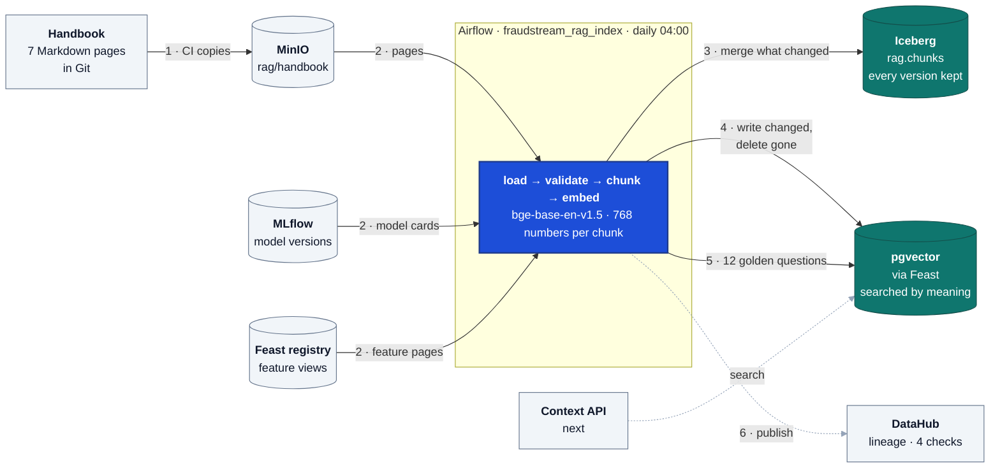
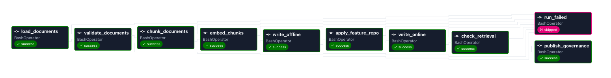
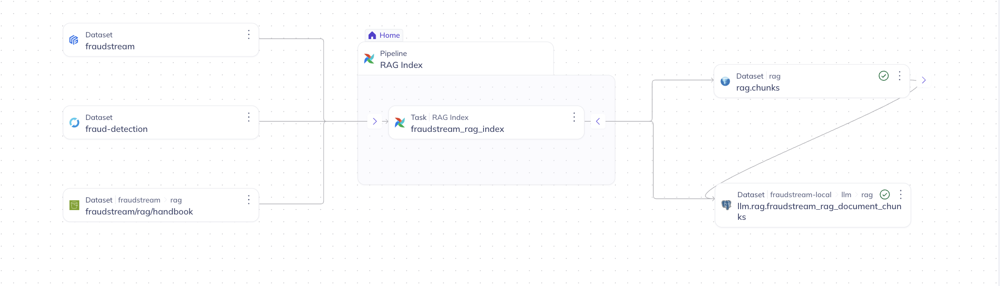
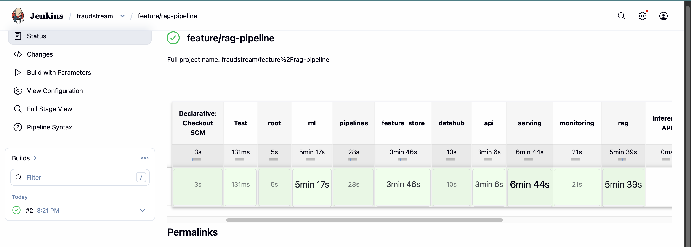
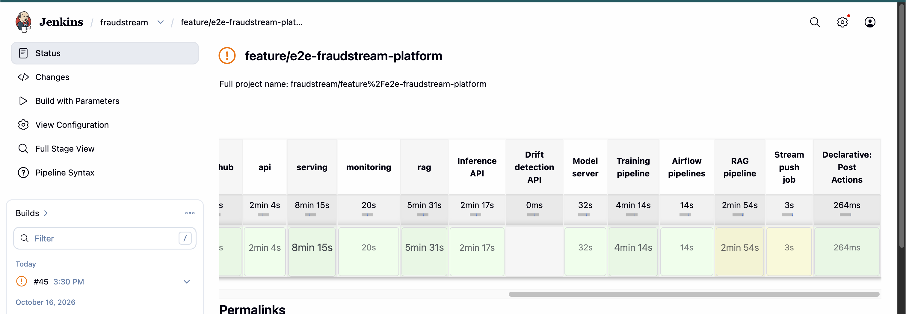
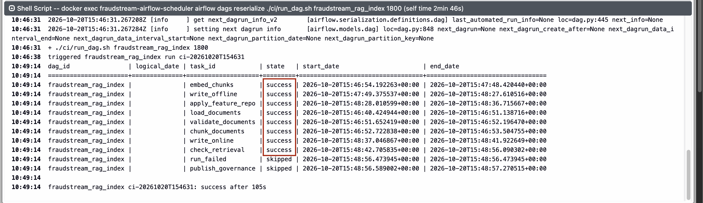

# RAG data pipeline

The analyst copilot answers from documents, not from memory. This pipeline prepares
them: the fraud handbook, a card for every version of the fraud detection model, and a
page for every feature view. Each is cut into sections, turned into a vector by one
pinned embedding model, and stored so a question can find the sections closest to it.
It runs daily, and only sections that changed are written. The fraud detection model
still makes every fraud decision; the copilot only cites.

## Architecture



One run, in the order of the numbers:

1. **Copy.** CI copies the handbook from Git to MinIO, so Airflow reads one place.
2. **Load.** Three sources are read: the handbook pages, one card per registered model
   version (from MLflow), one page per feature view (from Feast).
3. **Validate, chunk, embed.** An empty source, a bad id or a card number in the handbook
   stops the run before anything is written. Each document is cut by heading and embedded.
4. **Merge into Iceberg.** Only chunks whose hash changed are written; chunks that no
   longer exist are deleted.
5. **Write to pgvector.** The same rule, through Feast.
6. **Check and publish.** Twelve golden questions must find their page, then DataHub
   gets the lineage and the results. A failed check still publishes, so DataHub shows
   which one failed.



`run_failed` is skipped on a good run. It exists because Airflow judges a run by its last
task, and `publish_governance` runs even after a failure.

## What the copilot can cite

| Source | Documents | Chunks | Comes from |
|---|---|---|---|
| Handbook | 7 | 31 | Markdown in `rag/handbook/`, written by hand |
| Model cards | 5 | 25 | MLflow: threshold, quality, training data, settings, per version |
| Feature pages | 5 | 15 | Feast: features, types, freshness, source, per feature view |

The handbook pages: `review-policy` (when a payment is held, released or escalated),
`customer-contact`, `data-handling`, and four typologies: `typology-card-testing`,
`typology-account-takeover`, `typology-fraud-rings`,
`typology-high-value-cross-border`.

Model cards and feature pages are written from the registries on every run, so they
never drift from what is deployed. The production version's card says, for example,
"held for review when the score of version 4 is at or above 0.6264".

## Chunks and the embedding model

- **One chunk per heading.** The intro under the title is a chunk too. A section over
  300 words is split between paragraphs.
- **The title and heading go in front** of the text that is embedded, so a section
  called "What to do" still knows its topic.
- **Ids come from headings**, not positions. Adding a section moves no other id.
- **The hash covers the model and the exact text.** Change either and the chunk is
  written again; change nothing and it is skipped.
- **bge-base-en-v1.5** on onnxruntime, pinned by revision and file hash, shipped inside
  the Airflow image and shared with the context API. 768 numbers per chunk, each vector
  scaled to length 1. On the golden questions its query instruction changed nothing, so
  questions are embedded like documents.

## Two stores

| | Iceberg `rag.chunks` | pgvector (Feast `fraudstream_rag`) |
|---|---|---|
| For | History and rebuilding | Searching by meaning |
| Keeps | One snapshot per real change | The current chunks |
| Why | Answers "what did the copilot know on that day" | Answers a question in milliseconds |

Both compare the new chunks with what they hold now. Iceberg skips the merge when
nothing changed, because even an empty merge rewrites the table. Feast writes and
searches pgvector, but cannot list or delete rows in version 0.66, so those two use SQL on the
table Feast made.

## Checks

The golden set is twelve questions, each with the page that must come back in the top
five. The bar is 90%, set before the first run. The first run found all twelve; eleven
rank first.

DataHub shows the lineage from the three sources to both stores:



A contract adds four checks, read from the run's summary:

| Check | Passes when |
|---|---|
| Sources present | Every source gave documents and none failed validation |
| Chunks embedded | Every vector has 768 numbers and length 1 |
| Stores agree | Iceberg and pgvector hold exactly the current chunks |
| Golden retrieval | The twelve questions found their page |

A missing summary is an error in DataHub, never a pass.

## CI/CD

Every push runs the `rag` tests. On the deploy branch a `RAG pipeline` stage builds the
Airflow image, copies the handbook to MinIO and runs the DAG, then waits for it.





The stage is yellow when Airflow still runs an older image. Recreating Airflow would
kill running tasks, so a person does it:
`docker compose --profile orchestration up -d`.



## Testing

- **128 tests, 99.7% coverage**, with 90% required.
- **Properties:** the change plan is checked with Hypothesis and CrossHair, for example
  "applying the plan always leaves exactly the current chunks".
- **Mutation testing:** 1,660 mutants, about 1,345 killed and 195 survived, **87%**. The
  survivors are mostly file-name case, parquet options, printed wording and the command
  line. Another 111 crashed the test process inside the command-line wiring, which is
  not a verdict, so they are left out of the score.

## Memory and size

| Part | Measured |
|---|---|
| pgvector, idle | 24 MiB |
| Airflow scheduler, after a run | 669 MiB |
| Airflow image | 5.8 GB |

## How to run it

```bash
./cicd/run_dag.sh fraudstream_rag_index          # run it and wait; exit 0 only on success
```

Search from a laptop terminal, against the running stores:

```bash
cd rag && set -a && . ../.env && set +a
export PGVECTOR_HOST=localhost PGVECTOR_PORT=5433 PGVECTOR_DB=llm PGVECTOR_USER=llm \
  PGVECTOR_PASSWORD=llm_local_password FEAST_SPARK_MASTER="local[1]" \
  FRAUDSTREAM_WAREHOUSE_URI=s3a://fraudstream/warehouse
PYTHONPATH=src:../src:../feature_store/src uv run python -c '
import sys
from feast import FeatureStore
from fraudstream_rag.retrieval import search
for hit in search(FeatureStore(repo_path="feature_repo"), sys.argv[1], top_k=3):
    print(round(hit["distance"], 3), hit["chunk_id"])
' "When can an analyst release a held payment?"
```

```text
0.232 handbook/review-policy#releasing-a-payment
0.288 handbook/review-policy#who-decides
0.313 handbook/review-policy#review-queue
```

A smaller distance is a closer match.

Each step also runs alone, for example
`python -m fraudstream_rag.steps embed --run-dir <folder>`; every step reads the
previous step's files from the run folder.

## Things worth knowing

- **Feast creates its tables but not the `vector` extension.** The pgvector container
  creates it on first start.
- **Feast's Postgres store defaults to `sslmode: require`.** The local one has no TLS, so
  the repo sets `disable`.
- **`feast apply --skip-source-validation`** keeps apply from starting Spark to check the
  Iceberg table.
- **A mutated command line can start a real Spark session** and hang the mutation run;
  those mutants are excluded.
- **The DataHub SDK has its own virtualenv in the image**, so its large dependency tree
  stays out of the one Airflow and Feast run in.
- **DataHub's metadata service is on port 18087** and Kafka's host port is 9093, so
  neither clashes with Trino or DataHub's own Kafka.

## Where things are

| What | Where |
|---|---|
| Embedding model, pin and helpers | `rag/src/fraudstream_rag/embedding.py` |
| Chunking | `rag/src/fraudstream_rag/chunking.py` |
| Documents and validation | `rag/src/fraudstream_rag/documents.py`, `sources.py` |
| Handbook | `rag/handbook/` |
| Change plan | `rag/src/fraudstream_rag/changes.py` |
| Iceberg and pgvector writes | `rag/src/fraudstream_rag/offline.py`, `online.py` |
| Feast project | `rag/feature_repo/` |
| Search and golden questions | `rag/src/fraudstream_rag/retrieval.py`, `rag/checks/golden_questions.yaml` |
| The steps | `rag/src/fraudstream_rag/steps.py` |
| DAG | `airflow/dags/rag_index.py` |
| Image and settings | `airflow/Dockerfile`, `docker-compose.yml`, `airflow/config/variables.json` |
| pgvector extension | `infra/pgvector/init/001_enable_vector.sql` |
| DataHub contract and checks | `datahub/contracts/rag_index.contract.yaml`, `datahub/src/fraudstream_datahub/model.py` |
| CI/CD | `Jenkinsfile`, `cicd/run_dag.sh`, `cicd/sync_airflow.sh` |
| Screenshots | `images/rag/` |
