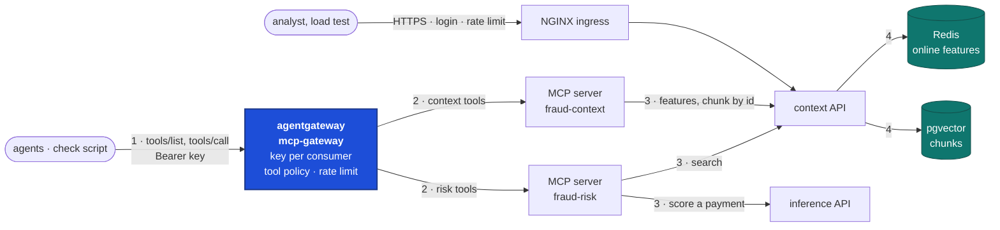
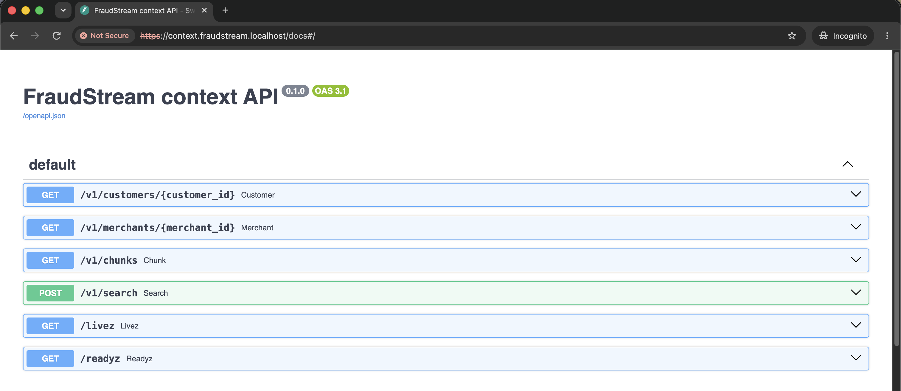
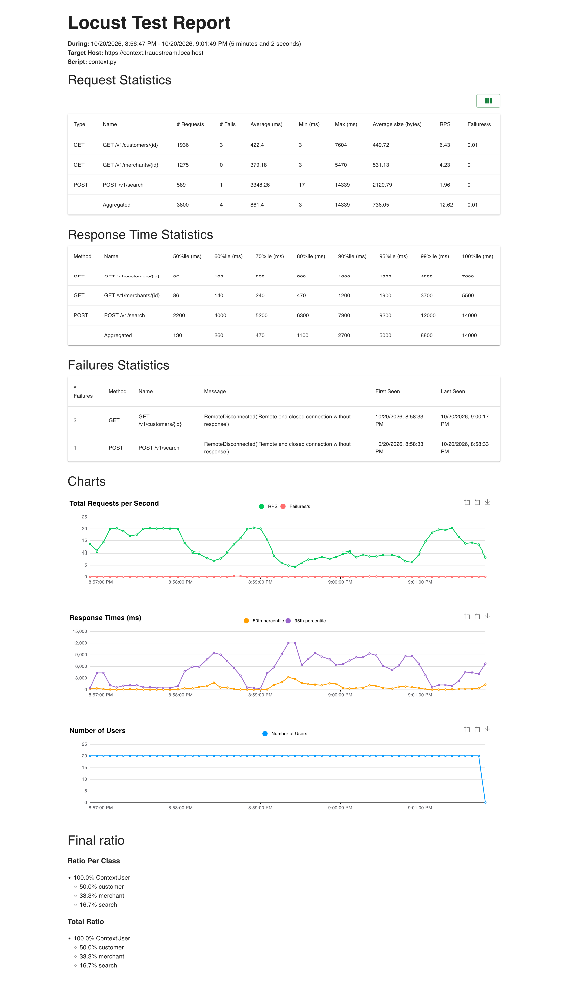
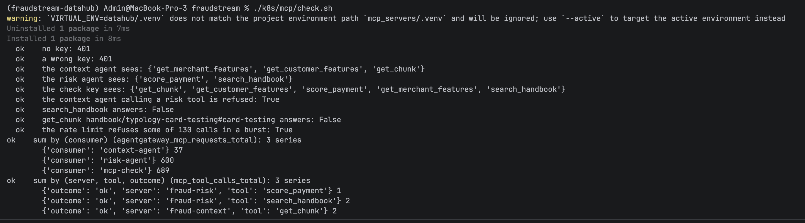
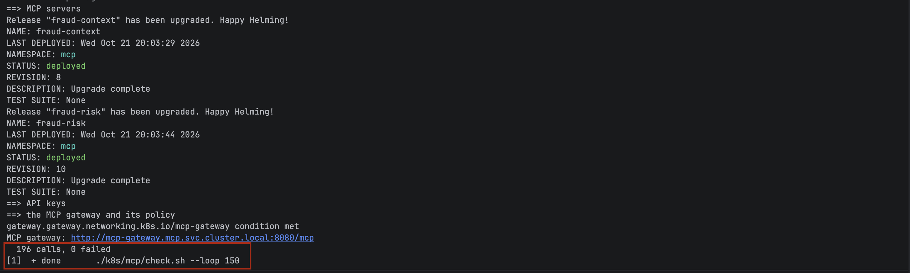
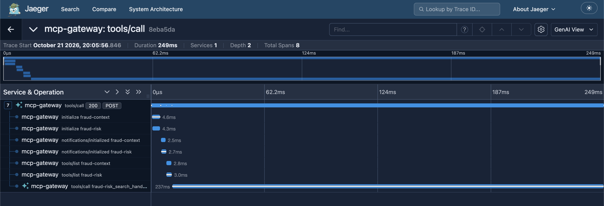

# Context API and MCP servers

The context API and the inference API are data contracts: plain REST, tested and
load-tested on their own. The two MCP servers are the contract for the model: five
tools with short descriptions, in front of those APIs, behind one MCP gateway that
decides which agent may see which tool.

## Architecture



1. An agent calls the gateway with its own key.
2. The gateway shows it only the tools its key allows and forwards each call to the
   server that owns the tool.
3. Each server turns the call into one request to a REST API.
4. The context API reads Redis and pgvector through Feast.

## The context API

| Endpoint | Answers |
|---|---|
| `GET /v1/customers/{id}` | the customer's views from the online store, each with `as_of` |
| `GET /v1/merchants/{id}` | the merchant's risk view, with `as_of` |
| `GET /v1/chunks?chunk_id=…` | one section of the handbook, a model card or a feature page |
| `POST /v1/search` | the `top_k` (1–10, default 5) sections closest to a question |

- **404 means nothing is stored**, with a sentence the model can repeat: "the online
  store has no features for customer cust_9", "no chunk x". **503 means a store can't be
  reached.** The tool layer turns the first into `not_found` and the second into
  `failed`.
- **Chunk ids are a query parameter.** Every id has a `#`
  (`handbook/typology-card-testing#signs`), which a URL path would cut off as a fragment.
- **Customer and merchant ids must match `^[A-Za-z0-9_-]{1,64}$`**, so an id like
  `../search` can't reach another endpoint.
- **No freshness rule.** The inference API drops views older than their TTL at the
  payment's time. The context API answers "what the store holds now" and returns each
  view's `as_of`, so whoever reads it sees how old it is.
- Search embeds the question with the RAG pipeline's own pinned model and searches with
  its own `search()`, so a question is matched exactly as the golden check matches it.

It runs as a release of the shared chart: rolling update with no unavailable pod,
rollback on failure, behind NGINX at `context.fraudstream.localhost` with HTTPS, a
login and a rate limit.



### Load test

The SLA was fixed before the run: p95 ≤ 500 ms, p99 ≤ 1,000 ms, failures ≤ 1%, at
20 users each starting one request a second, weighted 3 customer : 2 merchant :
1 search.

| Measure | Target | Measured |
|---|---|---|
| p95 | ≤ 500 ms | **5,000 ms** |
| p99 | ≤ 1,000 ms | **8,800 ms** |
| failures | ≤ 1% | 4 of 3,800 (0.1%) |
| throughput | 20 req/s | 12.6 req/s |

**The SLA was missed.** Search is the cause: its p95 was 9.2 s against 1.9 s for the
feature lookups. Each search embeds the question on the CPU, and the pod is limited to
2 CPUs with at most two replicas, so searches queue behind each other and slow the
lookups that share the pod. The report is
[load_test_context_api.html](../../reports/load_test_context_api.html).



The pod idles at 622 MiB, most of it the embedding model.

## The MCP servers

| Tool | Server | Calls |
|---|---|---|
| `get_customer_features(customer_id)` | fraud-context | `GET /v1/customers/{id}` |
| `get_merchant_features(merchant_id)` | fraud-context | `GET /v1/merchants/{id}` |
| `get_chunk(chunk_id)` | fraud-context | `GET /v1/chunks?chunk_id=…` |
| `score_payment(transaction_id, customer_id, merchant_id, event_timestamp, amount, channel, city)` | fraud-risk | `POST /v1/predict` on the inference API |
| `search_handbook(query, top_k=5)` | fraud-risk | `POST /v1/search` |

- **One image, two servers.** `MCP_SERVER=context` or `risk` picks which one runs.
  Each idles at 53 MiB.
- **Stateless streamable HTTP with JSON answers.** No session lives in a pod, so any
  replica answers any call and a rolling update breaks no caller.
- **The Host check.** The MCP SDK refuses every Host but localhost when it thinks it is
  bound to localhost, which would refuse every call from the gateway. Building the app
  with `host="0.0.0.0"` turns that check off; the gateway is the only way in.
- **Readiness asks the APIs behind the tools.** A pod that can't reach its API can't
  answer any tool, so it never becomes ready. A release with a wrong API URL fails its
  rollout, and Helm rolls it back.
- **`score_payment` takes the payment's fields, not just its id.** Payments live in
  Iceberg, not in an online store. The model extracts the fields from the alert, and the
  inference API's 422 names any field it got wrong.
- **The inference API now returns `threshold` and `flagged`,** so the risk agent reports
  the fraud detection model's decision and never works one out.

Two replicas per server, at most three, scaled on CPU by KEDA.

## The MCP gateway

agentgateway is already the LLM gateway. The MCP gateway is a second, separate Gateway
of the same controller, `mcp-gateway` in the namespace `mcp`, so LLM keys and MCP keys
never mix and each can be changed without touching the other. It idles at 25 MiB.

### Setup

Everything is in two files, applied by [`install.sh`](../../k8s/mcp/install.sh):

| Object | File | What it does |
|---|---|---|
| `AgentgatewayParameters` | [gateway.yaml](../../k8s/mcp/gateway.yaml), [line 7](../../k8s/mcp/gateway.yaml#L7) | the gateway pod's size and its Service type |
| `Gateway` `mcp-gateway` | [gateway.yaml](../../k8s/mcp/gateway.yaml), [line 23](../../k8s/mcp/gateway.yaml#L23) | one HTTP listener on port 8080 |
| `AgentgatewayBackend` | [gateway.yaml](../../k8s/mcp/gateway.yaml), [line 43](../../k8s/mcp/gateway.yaml#L43) | both MCP servers as targets of one backend, so an agent sees one tool list |
| `HTTPRoute` | [gateway.yaml](../../k8s/mcp/gateway.yaml), [line 69](../../k8s/mcp/gateway.yaml#L69) | sends `/mcp` to that backend |
| `AgentgatewayPolicy` `mcp-gateway` | [policy.yaml](../../k8s/mcp/policy.yaml), [line 2](../../k8s/mcp/policy.yaml#L2) | on the Gateway: keys, rate limit, metrics, tracing |
| `AgentgatewayPolicy` `fraud-detection-tools` | [policy.yaml](../../k8s/mcp/policy.yaml), [line 34](../../k8s/mcp/policy.yaml#L34) | on the backend: which tools each key may see and call |
| `ReferenceGrant` | [policy.yaml](../../k8s/mcp/policy.yaml), [line 52](../../k8s/mcp/policy.yaml#L52) | lets the policy in `mcp` send traces to Jaeger in `observability` |
| Secret `mcp-api-keys` | [install.sh](../../k8s/mcp/install.sh), [line 28](../../k8s/mcp/install.sh#L28) | one entry per consumer: the key's hash and its metadata |

A key is made once per consumer and kept in its own Secret, `mcp-key-<consumer>`, for
the agent that uses it. The gateway's Secret holds only the SHA-256 hash, with the
consumer's name and the servers it may use:

```json
{"keyHash": "sha256:…", "metadata": {"consumer": "context-agent", "servers": ["fraud-context"]}}
```

The two rules that matter, from [policy.yaml](../../k8s/mcp/policy.yaml):

```yaml
traffic:
  apiKeyAuthentication:
    mode: Strict
    secretRef: {name: mcp-api-keys}
  rateLimit:
    local:
      - {requests: 120, unit: Minutes, key: apiKey.consumer}
---
backend:
  mcp:
    authorization:
      action: Allow
      policy:
        matchExpressions:
          - mcp.tool.target in apiKey.servers
```

### Security and policy settings

| Setting | Value | Why | Where |
|---|---|---|---|
| Only inside the cluster | Service `ClusterIP`, no Ingress | agents run in the cluster; nothing outside needs the tools, so there is nothing to expose | [gateway.yaml](../../k8s/mcp/gateway.yaml), [line 20](../../k8s/mcp/gateway.yaml#L20) |
| Routes from its own namespace only | `allowedRoutes: Same` | a route created elsewhere can't attach itself to the MCP gateway | [gateway.yaml](../../k8s/mcp/gateway.yaml), [line 38](../../k8s/mcp/gateway.yaml#L38) |
| A key on every call | `apiKeyAuthentication`, `mode: Strict` | a call with no key or a wrong one is refused with 401; nothing is anonymous | [policy.yaml](../../k8s/mcp/policy.yaml), [line 12](../../k8s/mcp/policy.yaml#L12) |
| A key per consumer | `context-agent`, `risk-agent`, `mcp-check` | the gateway knows who is calling, so limits, metrics and traces are per agent, and one key can be replaced without the others | [install.sh](../../k8s/mcp/install.sh), [line 28](../../k8s/mcp/install.sh#L28) |
| Only hashes at the gateway | `keyHash: sha256:…` | reading the gateway's Secret doesn't give away a key | [install.sh](../../k8s/mcp/install.sh), [line 33](../../k8s/mcp/install.sh#L33) |
| A tool policy per key | `mcp.tool.target in apiKey.servers` | each agent sees and calls only its own tools. A small model given fewer tools picks the right one more often, and a prompt injection reaching the risk agent can't read customer data | [policy.yaml](../../k8s/mcp/policy.yaml), [line 48](../../k8s/mcp/policy.yaml#L48) |
| A rate limit per consumer | 120 requests a minute, keyed on `apiKey.consumer` | one runaway agent can't starve the others. A throttled call gets HTTP 200 with a JSON-RPC error, as MCP requires | [policy.yaml](../../k8s/mcp/policy.yaml), [line 16](../../k8s/mcp/policy.yaml#L16) |
| No server prefix on tool names | `prefixMode: Never` | agents see `get_customer_features`, not `fraud-context_get_customer_features`, which a small model calls more reliably | [gateway.yaml](../../k8s/mcp/gateway.yaml), [line 51](../../k8s/mcp/gateway.yaml#L51) |
| No session in the gateway | `sessionRouting: Stateless` | matches the servers: any replica answers, so a rolling update breaks no caller | [gateway.yaml](../../k8s/mcp/gateway.yaml), [line 49](../../k8s/mcp/gateway.yaml#L49) |
| One server down, the other still works | `failureMode: FailOpen` | if the risk server is down, the context tools keep answering | [gateway.yaml](../../k8s/mcp/gateway.yaml), [line 50](../../k8s/mcp/gateway.yaml#L50) |
| Calls counted per consumer | metrics attribute `consumer` | the dashboard shows which agent made which calls | [policy.yaml](../../k8s/mcp/policy.yaml), [line 20](../../k8s/mcp/policy.yaml#L20) |
| Every call traced | OTLP to Jaeger | a tool call can be followed from the gateway to the server that answered | [policy.yaml](../../k8s/mcp/policy.yaml), [line 25](../../k8s/mcp/policy.yaml#L25) |
| A small pod | 50m CPU, 64 MiB, at most 256 MiB | it only routes; it idles at 25 MiB | [gateway.yaml](../../k8s/mcp/gateway.yaml), [line 7](../../k8s/mcp/gateway.yaml#L7) |

### Proof

```bash
./k8s/mcp/install.sh     # servers, keys, gateway, policy
./k8s/mcp/check.sh       # every rule, checked from outside
```

The check proves each rule: no key and a wrong key get 401, each agent sees only its
own tools, the context agent is refused a risk tool, real calls reach both servers,
a burst is throttled, and Prometheus has calls per consumer and per tool.



`./k8s/mcp/check.sh --loop 150` calls a tool every 0.6 s while both servers roll to a
new image. 196 calls, none failed:



One `tools/call` in Jaeger: the gateway opens both servers, lists their tools, and
sends the call to `fraud-risk`.



## Telemetry

- **At the gateway:** calls per consumer and per tool, from
  `agentgateway_mcp_requests_total` with the `consumer` label added from the key.
- **In the servers:** `mcp_tool_calls_total{server, tool, outcome}` and a duration
  histogram. The outcome is `ok`, `not_found`, `rejected` (the API refused the
  arguments) or `failed` (the API errored or couldn't be reached).

Failures have to be counted in the servers. A tool error is an MCP result with
`isError`, sent with HTTP 200, so to the gateway a failed call looks like a good one.

## Validation

| Check | `api/` | `mcp_servers/` |
|---|---|---|
| Line and branch coverage | 100% | 99% |
| Tests | 250 | 59 |
| Mutation score | 94.2% in `context`, 89.6% overall | 91.5% |

- **Boundary cases** cover every limit: id length and characters, `top_k`, question and
  chunk-id length, and each status-code edge of the tool outcome.
- **CrossHair** proves only a 2xx status is `ok`. A planted `200 < status` was found at
  once, at `status=200`.
- **Mutation testing** found holes the tests then closed, such as readiness never
  checked through the served app and connection settings a mocked Feast never sees. The
  survivors left can't change behaviour: prompt wording, Feast's defaults, the docs
  title. Full detail in
  [22_validation_and_verification.md](../ml/22_validation_and_verification.md).

## Where things are

| What | Where |
|---|---|
| Context API | `api/src/fraudstream_api/context/` |
| Its image and chart values | `k8s/Dockerfile.context`, `k8s/apis/context-api.yaml` |
| Load test | `api/loadtest/context.py`, `api/loadtest/sla.py` |
| MCP servers | `mcp_servers/src/fraudstream_mcp/` |
| Their image, values and install | `k8s/Dockerfile.mcp`, `k8s/mcp/fraud-context.yaml`, `k8s/mcp/fraud-risk.yaml`, `k8s/mcp/install.sh` |
| MCP gateway and its policy | `k8s/mcp/gateway.yaml`, `k8s/mcp/policy.yaml` |
| Gateway check | `k8s/mcp/check.sh`, `mcp_servers/tools/check_gateway.py` |
| Scraping | `k8s/observability/servicemonitors.yaml` |
| CI/CD | `Jenkinsfile`, `cicd/test.sh`, `cicd/jenkins/jenkins.yaml` |
| Tests | `api/tests/test_context_*.py`, `mcp_servers/tests/` |
| Load test report | `reports/load_test_context_api.html` |
| Screenshots | `images/mcp/` |
