# The agent platform and the context agent

Agents are kagent resources. They share one model config, read their system
prompt from MLflow, and reach tools only through the MCP gateway, each with a key
of its own. The context agent is the first of them: it answers what the platform
knows about a customer, a merchant or a handbook section.

## Architecture

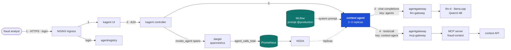

1. The analyst opens the kagent UI through NGINX, with the gateway login.
2. The UI sends the question to kagent's controller, which passes it to the agent
   over A2A.
3. The agent asks Qwen3-4B, through the LLM gateway, which tool to call.
4. It calls the tool through the MCP gateway with its own key, then asks the
   model again to write the answer from what the tool returned.

## The platform

kagent 0.10.3 runs in namespace `kagent`: a controller, the UI and the Postgres its
chart bundles for sessions and tasks. Everything else the chart ships is off: ten
sample agents, kagent's own tool server, a Grafana tool server and the controller
for MCP servers kagent would run itself. Every agent in the cluster is one written
here.

**One model config for every agent.** It is the chart's `default-model-config`,
set in [kagent-values.yaml](../../k8s/agents/kagent-values.yaml), [line 1](../../k8s/agents/kagent-values.yaml#L1).
Every Agent names it, so changing the model for all of them is one change.

| Setting | Value | Why |
|---|---|---|
| Provider and address | OpenAI-compatible, `llm-gateway.llm:8080/v1` | the LLM gateway applies the key, the rate limits and the PII guard to every agent call |
| Model | `qwen3-4b` | the only size that picked every tool right when the models were compared |
| Key | `agents`, from the Secret `kagent-llm-key` | its hash is in the gateway; the key itself is never in a file |
| Temperature | 0 | the same question picks the same tool |
| Max tokens | 512 | a few bullet points or one tool call |
| Timeout | 300 s | the model answers one request at a time on the CPU, so a request may wait behind several others. At 120 s, five of six questions sent together failed |

**Thinking is off at the model server.** Qwen3 writes a hidden reasoning block
before it answers. On this CPU that adds a minute or more per call and can use up
the 512 tokens before the tool call is written. kagent can't turn it off per
request, so llama.cpp runs with `--reasoning off`
([qwen3-4b.yaml](../../k8s/llm/models/qwen3-4b.yaml), [line 28](../../k8s/llm/models/qwen3-4b.yaml#L28)).
The model server is replaced, not rolled, on an update: the node can't hold two
copies of the model.

**The PII guard no longer masks phone numbers.** It read every date in an answer,
`2026-06-23`, as a phone number and replaced it with `<PHONE_NUMBER>`. Card numbers
and emails stay masked
([gateway.yaml](../../k8s/llm/gateway.yaml), [line 75](../../k8s/llm/gateway.yaml#L75)).

## The context agent

[context-agent.yaml](../../k8s/agents/context-agent.yaml) holds the agent, its tools,
its network rules and its scaler.

### Its prompt comes from MLflow

The text lives in git, [agents/prompts/context-agent.md](../../agents/prompts/context-agent.md).
`install.sh` registers it in MLflow's Prompt Registry, which makes a new version
only when the text changed, points the alias `production` at it, and renders that
version into the ConfigMap the agent reads
([context-agent.yaml#L28](../../k8s/agents/context-agent.yaml#L28)). The ConfigMap is annotated with
the version it holds, `prompts:/context-agent/2`, and kagent rolls the agent's
pods when it changes. A prompt is refused if it is blank, longer than 4,000
characters, or contains `{{`, which both MLflow and kagent would read as a
variable.

### Its tools come from the MCP gateway, with its own key

The agent's tools come from a `RemoteMCPServer` that points at the MCP gateway and
sends the context agent's key
([context-agent.yaml#L2](../../k8s/agents/context-agent.yaml#L2)). kagent discovers the tools with
the same key, so the gateway's policy decides what the agent can see: the three
context tools, never `score_payment` or `search_handbook`. The Agent also lists
the three by name ([context-agent.yaml#L38](../../k8s/agents/context-agent.yaml#L38)).

In the kagent UI the agent runs on `qwen3-4b` and lists exactly those three tools.
Asked about a customer, it calls `get_customer_features` once:

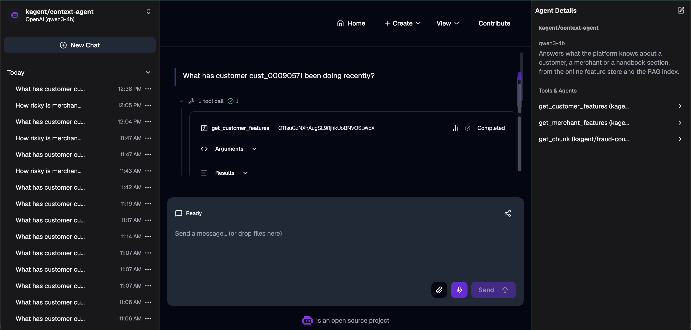

and answers with the stored values and when they were computed:

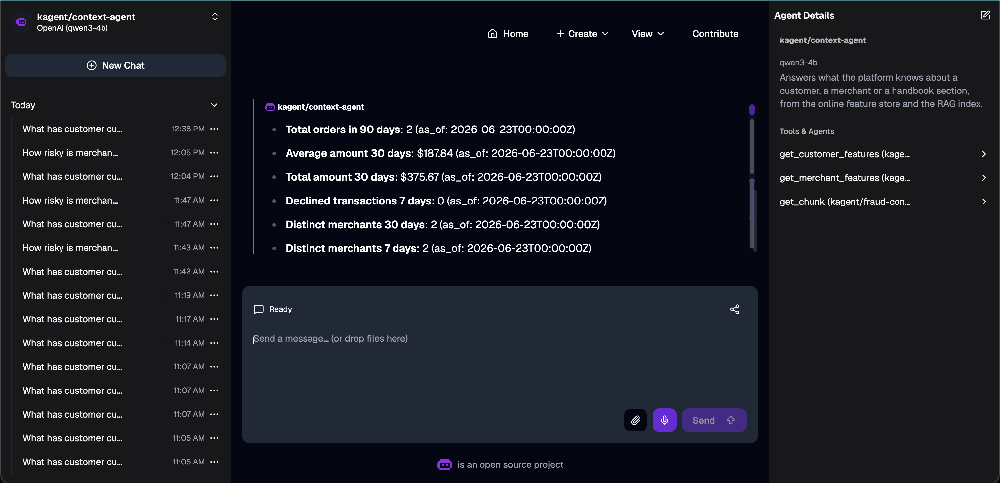

### It can reach only the gateways

A NetworkPolicy ([context-agent.yaml#L61](../../k8s/agents/context-agent.yaml#L61)) lets the agent's
pods reach DNS, the kagent controller, the two gateways and Jaeger, and only the
controller may call them. An agent is driven by text it reads, so a prompt
injection could make it try any address; this way the gateway's key and tool
policy can't be gone around. Checked from a short-lived pod that carries the
agent's label, so the same policy applies to it:

```bash
img=$(kubectl -n mcp get deploy fraud-context -o jsonpath='{.spec.template.spec.containers[0].image}')
kubectl -n kagent run network-probe --rm -i --restart=Never --image="$img" \
  --labels=app.kubernetes.io/name=context-agent --command -- python -c "..."
```

A direct call to `fraud-context` times out; the MCP gateway answers 401, since the
probe sends no key.

kagent 0.10 runs sandboxed agents only on Agent Substrate, which needs gVisor, so
the sandbox runs on the GKE cluster with the agent fleet.

### Replicas and KEDA

KEDA keeps two to three replicas ([context-agent.yaml#L123](../../k8s/agents/context-agent.yaml#L123)).

| Setting | Value | Why |
|---|---|---|
| Trigger | `sum(rate(agent_duration_seconds_sum[2m]))` | the seconds of calling per second is the average number of calls in progress. CPU says nothing: the agent waits on the model |
| Target | 1 call in flight per replica | a third replica once more than two questions wait |
| Fallback | 2 replicas after 3 failed reads | a Prometheus outage leaves the agent as it is |
| Scale down | after 2 minutes | questions come in bursts |
| Agent's own replica count | not set | kagent then never writes it, so KEDA is its only owner |

Three questions sent at once put more than one call in flight per replica: the
HPA reads 1.16 against a target of 1 and asks for 3 replicas, and a third pod
starts.

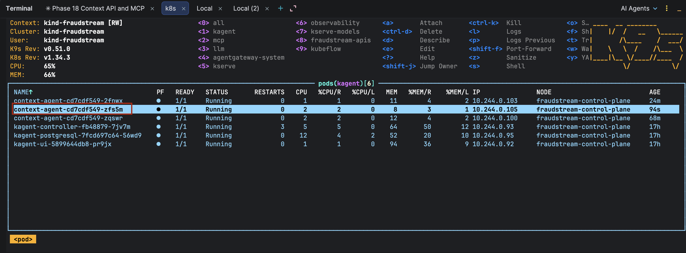

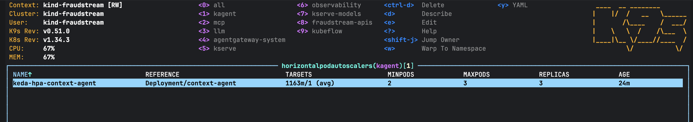

Restarting kagent's controller while at 3 replicas leaves 3: kagent doesn't touch
the count, so it never fights KEDA.

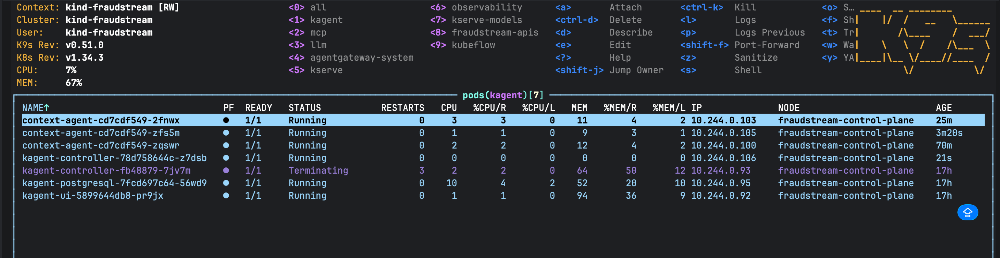

More replicas don't make answers faster. The model answers one request at a time,
about 20 to 35 s each, and a question takes two: one answer arrives every 40 to 70 s.
Replicas keep the agent up while a pod restarts and hold the waiting
conversations.

## The agent registry

agentregistry 0.4.0 runs in namespace `agentregistry`, with the Postgres its chart
bundles. It is a catalog only: no cluster permissions
([agentregistry-values.yaml](../../k8s/agents/agentregistry-values.yaml), [line 12](../../k8s/agents/agentregistry-values.yaml#L12))
and no runtimes, so it can't deploy anything. `install.sh` publishes two records
from [registry.yaml](../../k8s/agents/registry.yaml) with `arctl`, downloaded once
and checked against its release's checksum:

- `fraud-context`, a remote MCP server at the MCP gateway's address, with no key;
- `contextagent`, the agent, linking its image, this repository and the MCP
  server. Registry agent names can't contain hyphens.

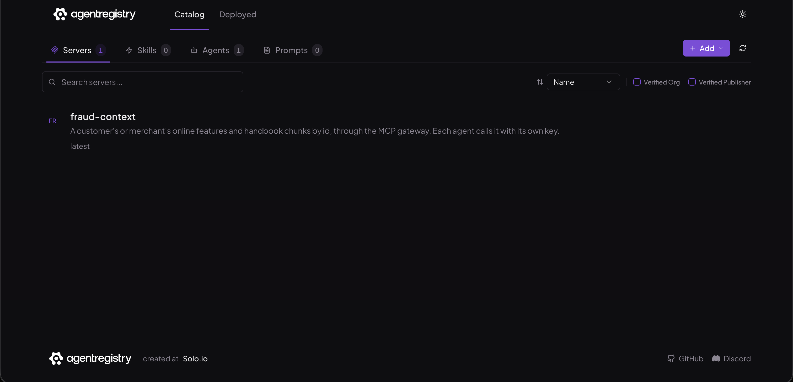

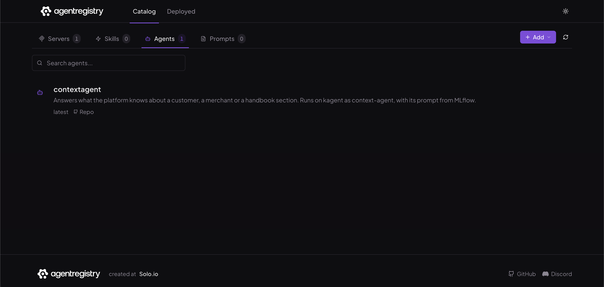

## The UIs behind NGINX

Both are in [ingress.yaml](../../k8s/agents/ingress.yaml).

| Setting | Value | Why | Where |
|---|---|---|---|
| Domain | `kagent.fraudstream.localhost`, `agentregistry.fraudstream.localhost` | one name per service, like the other UIs | [ingress.yaml#L2](../../k8s/agents/ingress.yaml#L2), [ingress.yaml#L36](../../k8s/agents/ingress.yaml#L36) |
| HTTPS | a certificate from the local CA, made by cert-manager | nothing crosses the network in clear | [ingress.yaml#L7](../../k8s/agents/ingress.yaml#L7) |
| Login | the gateway's basic auth | kagent's own API runs without authentication | [ingress.yaml#L9](../../k8s/agents/ingress.yaml#L9) |
| Rate limit | 30 requests a second, a burst of 100 | one page load is about 40 requests | [ingress.yaml#L11](../../k8s/agents/ingress.yaml#L11) |
| Read timeout | 300 s, buffering off, kagent UI only | an answer streams for up to two minutes | [ingress.yaml#L15](../../k8s/agents/ingress.yaml#L15) |
| Registry reachable only from NGINX | a NetworkPolicy on the registry's server pod | the open-source registry lets any caller write, so a pod inside the cluster could otherwise change the catalog without the login | [ingress.yaml#L68](../../k8s/agents/ingress.yaml#L68) |

`ci/check_gateway.sh <host> /health` checks each: plain HTTP redirected, 401
without or with a wrong password, 200 with the right one, and 429 in a burst.

Both ask for the login over HTTPS before anything loads:

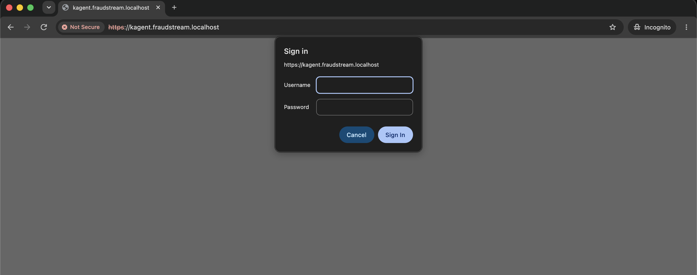

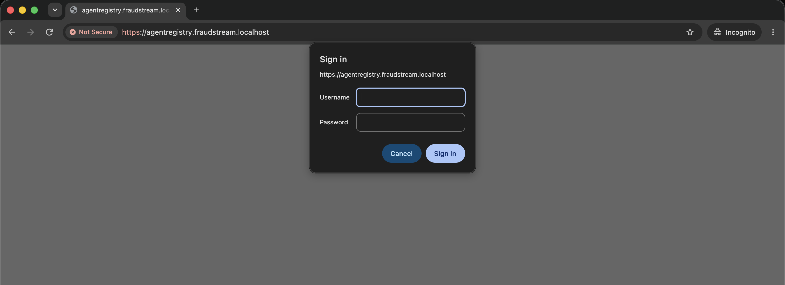

## Telemetry

| Metric | From | Shows |
|---|---|---|
| `agent_calls_total{gen_ai_agent_name, status_code}` | Jaeger, from the controller's spans | calls per agent, and how many failed |
| `agent_duration_seconds` | the same | how long calls take, and how many are in flight |
| `mcp_tool_calls_total{server, tool, outcome}` | the MCP servers | calls per tool and failures per tool: `not_found`, `rejected`, `failed` |
| `agentgateway_mcp_requests_total{consumer, resource}` | the MCP gateway | which agent called which tool |

**Calls per agent come from spans** because kagent has no request metrics of its
own: its controller exports only a build-info metric, and the agent pods only
traces. Every call to an agent passes the controller, which opens one
`invoke_agent` span named after the agent. Jaeger keeps a second pipeline next to
the one that stores traces: it drops every span but those, and its `spanmetrics`
connector turns them into the two metrics above
([jaeger.yaml](../../k8s/observability/jaeger.yaml), [line 15](../../k8s/observability/jaeger.yaml#L15)).
The agent's own `invoke_agent context_agent` span is dropped too, so each call is
counted once.

The dashboard **FraudStream · Agents** shows calls per agent, calls per minute by
status, calls in flight against replicas, call time, calls and failures per tool,
tool calls per agent, and tool call time.

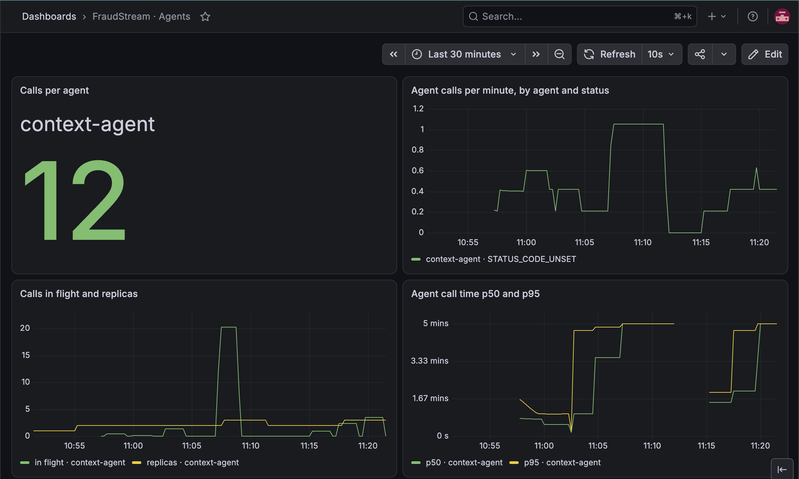

Calls in flight peak with the load tests, and the replicas follow them from 2 to 3. The call time's p95 reaches 5 minutes during the load: questions wait for the
model's single slot, as described above.

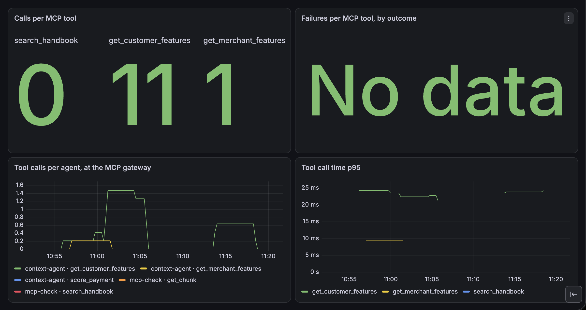

No tool call failed. A tool call itself takes about 25 ms; the minutes go to the
model.

## Validation

| Check | `agents/` |
|---|---|
| Line and branch coverage | 98% |
| Tests | 69 |
| Mutation score | 95.0% (364 of 383) |

- **Boundary cases** cover every limit: names of 63 and 64 characters, prompts of
  4,000 and 4,001 characters, numbers exactly 1% and just over 1% from the tool's
  value, values just below 1.
- **CrossHair** proves a number counts exactly when it is within 1%. A planted `<`
  for `<=` was found at once, at `value=100, offset=1`.
- **Hypothesis** shows registering the same text twice never makes a second
  version, for any text.
- **The survivors left** change only the command line's help text and the JSON's
  indent.
- **End to end,** `k8s/agents/check.sh` asks the agent about a customer and a
  merchant and wants an answer that quotes a number the store holds, not just any
  answer: a model that skipped the tool would still answer politely.

More in [22_validation_and_verification.md](../ml/22_validation_and_verification.md).

## Where things are

| What | Where |
|---|---|
| kagent, the model config and the install | `k8s/agents/kagent-values.yaml`, `k8s/agents/install.sh` |
| The context agent, its tools, network rules and scaler | `k8s/agents/context-agent.yaml` |
| Its prompt and the prompt tool | `agents/prompts/context-agent.md`, `agents/src/fraudstream_agents/prompts.py` |
| The registry and its records | `k8s/agents/agentregistry-values.yaml`, `k8s/agents/registry.yaml` |
| The UIs behind NGINX | `k8s/agents/ingress.yaml` |
| Agent call metrics and the dashboard | `k8s/observability/jaeger.yaml`, `k8s/observability/servicemonitors.yaml`, `k8s/observability/dashboards/agents.yaml` |
| The model servers and the PII guard | `k8s/llm/models/`, `k8s/llm/gateway.yaml` |
| The end-to-end check | `k8s/agents/check.sh`, `agents/tools/check_agent.py`, `agents/src/fraudstream_agents/a2a.py` |
| Gateway check | `ci/check_gateway.sh` |
| Tests | `agents/tests/` |
| Screenshots | `images/agents/` |
