# The risk agent, the A2A gateway and the coordinator

Fraud analysts talk to one agent, the coordinator. It answers by asking two
specialists: the context agent, for what the platform stores about a customer or a
merchant, and the risk agent, for what the fraud detection model says about a payment
and what the handbook says to do. Every call between agents goes through the A2A
gateway, which checks who is calling whom.

## Architecture

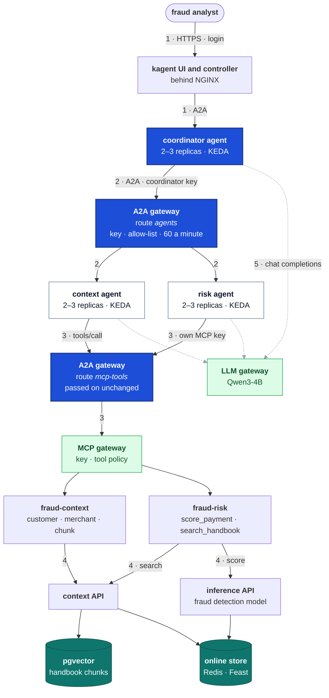

One question, in the order of the numbers:

1. **Ask.** The analyst asks the coordinator in the kagent UI, behind the NGINX login.
   kagent's controller passes the question on over A2A.
2. **Delegate.** The coordinator calls a specialist as a tool. The call goes to the A2A
   gateway with the coordinator's key. The gateway checks the key, that this caller may
   call this agent, and the rate limit, then forwards it.
3. **Use tools.** The specialist calls its MCP tools. That call also goes to the A2A
   gateway, which passes it on unchanged to the MCP gateway. The MCP gateway checks the
   specialist's own key and which tools it may use.
4. **Read the stores.** `score_payment` asks the inference API, which reads the
   customer's and merchant's history from the online store and scores the payment with
   the fraud detection model. The other tools read the context API.
5. **Write.** Every agent asks Qwen3-4B through the LLM gateway, which tool to call and
   then how to word the answer.

The fraud detection model makes every decision. The agents report it and cite the
handbook.

## The risk agent

[risk-agent.yaml](../../k8s/agents/risk-agent.yaml) holds the agent, its tools and its
scaler. It is built like the context agent: its prompt comes from MLflow, it runs on 2–3
replicas, and only the controller and the A2A gateway may call it.

**Two tools, through its own key.** `score_payment` and `search_handbook` come from the
`fraud-risk` MCP server, through the MCP gateway with the key `risk-agent`
([risk-agent.yaml#L2](../../k8s/agents/risk-agent.yaml#L2),
[#L38](../../k8s/agents/risk-agent.yaml#L38)). The gateway's tool policy gives that key
`fraud-risk` only, so the risk agent can't see the context tools, and the other way round.

**Its prompt** ([agents/prompts/risk-agent.md](../../agents/prompts/risk-agent.md)) sorts
every question into one of two kinds and gives each its own answer:

| Question | Tools | Answer |
|---|---|---|
| Gives a payment (a transaction id with its values) | `search_handbook`, then `score_payment` with the values as written | the probability, threshold and version from the model; whether the customer's and merchant's history was in the online store; the handbook's steps with their chunk ids; last line `Model decision: flagged` or `not flagged`, copied from the model |
| Anything else | `search_handbook` only | the handbook's points with their chunk ids, and nothing about the model |

The handbook search always comes first: when the models were compared, every wrong
answer was a policy question answered from memory. The decision line is copied, never
worked out, so the check can compare it with the inference API's own answer. The first
version of the prompt had a single answer template, and the 4B model filled every part
of it, writing a made-up decision under a policy question every time. Two separate
templates stopped that.

Asked about a payment, it calls both tools:

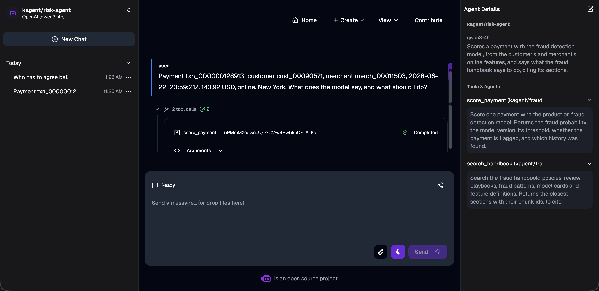

and answers with the model's numbers, whether the history was found, and the
handbook's steps:

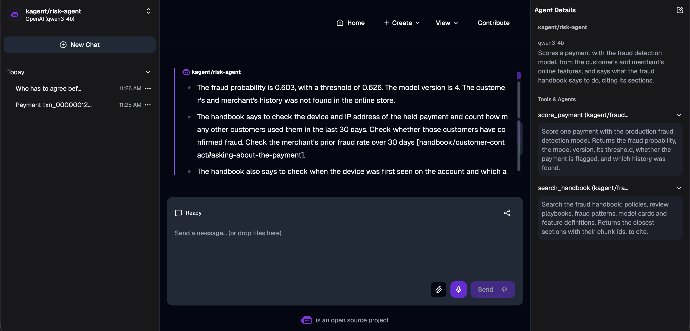

For this June 2026 payment the online store no longer held the customer's or the
merchant's history, so the model scored it without, and the answer says so.

**KEDA** scales it like the context agent: 2–3 replicas, on calls in flight, read from
`agent_duration_seconds` for `risk_agent`
([risk-agent.yaml#L60](../../k8s/agents/risk-agent.yaml#L60)). Three questions at once
read 2.55 calls per replica against a target of 1, and a third pod starts:

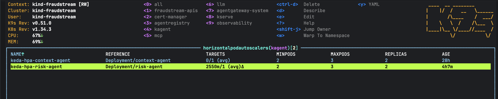

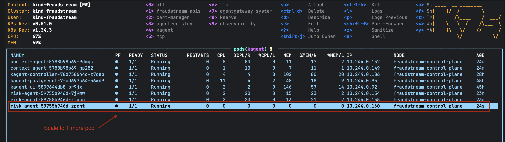

## The A2A gateway

kagent calls a sub-agent at its Service, `http://risk-agent.kagent:8080`, and an Agent
tool has no field to change that address. What kagent does have is one proxy setting
for the whole platform: `proxy.url`
([kagent-values.yaml#L47](../../k8s/agents/kagent-values.yaml#L47)). With it set, every
call an agent makes inside the cluster goes to the proxy instead, with a header naming
where it was meant to go:

```text
POST http://a2a-gateway.kagent.svc.cluster.local:8080/
x-kagent-host: risk-agent.kagent
Authorization: Bearer <the coordinator's A2A key>
```

The A2A gateway is an agentgateway Gateway in `kagent`
([a2a-gateway.yaml](../../k8s/agents/a2a-gateway.yaml)) that routes on that header:

| Route | Matches `x-kagent-host` | Goes to | Checks |
|---|---|---|---|
| `agents` ([#L38](../../k8s/agents/a2a-gateway.yaml#L38)) | `context-agent.kagent`, `risk-agent.kagent` | that agent's Service | the policy below |
| `mcp-tools` ([#L63](../../k8s/agents/a2a-gateway.yaml#L63)) | `mcp-gateway.mcp.svc.cluster.local` | the MCP gateway | none here; the MCP gateway checks its own keys |

The second route exists because the proxy setting also catches the specialists' tool
calls: the MCP gateway's address is inside the cluster too. Passing them on unchanged
keeps the MCP gateway's keys and tool policy exactly as they were.

**The policy** on the route `agents` ([a2a-policy.yaml](../../k8s/agents/a2a-policy.yaml)):

| Setting | Value | Why | Where |
|---|---|---|---|
| Key | required, one per caller, stored as a hash in `a2a-api-keys` | only a caller with a key reaches an agent; the specialists have none, so they can't call each other | [#L51](../../k8s/agents/a2a-policy.yaml#L51) |
| Allow-list | `request.headers["x-kagent-host"] in apiKey.agents` | each key names the agents it may call: `coordinator-agent` both specialists, the check's key only the context agent | [#L58](../../k8s/agents/a2a-policy.yaml#L58) |
| Rate limit | 60 requests a minute per caller | a delegated question is one request and the model answers far fewer, so only a runaway loop meets it | [#L62](../../k8s/agents/a2a-policy.yaml#L62) |
| Telemetry | the caller as `consumer` on the metrics, traces to Jaeger | who called whom, and one trace across agents | [#L11](../../k8s/agents/a2a-policy.yaml#L11) |

Nothing can call the coordinator through the gateway: there is no route to it.

**Agent cards point at the gateway.** A caller first reads the agent's card, which says
where to send messages. kagent marks an agent's Service port with
`appProtocol: kgateway.dev/a2a`, and agentgateway rewrites the card's address to its
own. Without that, the coordinator's next call would go straight to the pod.

**Keys** are made once per caller and kept by `install.sh`
([install.sh#L29](../../k8s/agents/install.sh#L29)): the caller's Secret holds the key,
and `a2a-api-keys` holds only its hash with the caller's name and allow-list. It is the
same pattern as the MCP gateway's keys.

**The network.** One NetworkPolicy covers every pod kagent runs
([network.yaml](../../k8s/agents/network.yaml)): DNS, the controller, the LLM gateway,
the A2A gateway and Jaeger, and no other way out. A second one lets only the controller
and the A2A gateway reach the two specialists
([network.yaml#L63](../../k8s/agents/network.yaml#L63)). The agents can no longer reach
the MCP gateway directly.

`check.sh` proves the policy: 401 without a key, 403 for an agent off the key's list,
200 for one on it, and the card pointing at the gateway.

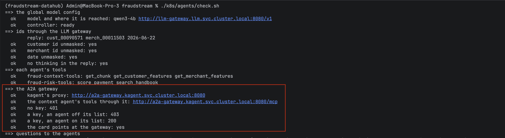

## The coordinator

[coordinator-agent.yaml](../../k8s/agents/coordinator-agent.yaml) gives it two tools,
both of them agents, and no MCP tools. kagent shows them to the model as
`kagent__NS__context_agent` and `kagent__NS__risk_agent`, so the prompt
([agents/prompts/coordinator-agent.md](../../agents/prompts/coordinator-agent.md)) uses
those names. It says when to ask which, to pass ids and payment values on as written, to
keep the specialists' numbers, chunk ids and decision line, and never to judge a payment
itself.

| Setting | Value | Why | Where |
|---|---|---|---|
| Key | `Authorization` from `a2a-key-coordinator-agent` on both tools | the gateway lets this key call both specialists | [#L20](../../k8s/agents/coordinator-agent.yaml#L20) |
| `isolateSessions` | `true` on both tools | by default every call from a pod reuses one specialist session. Every analyst's question would pile into it, outgrow the model's 8,192 tokens within a few questions, and mix one chat's payment into the next | [#L19](../../k8s/agents/coordinator-agent.yaml#L19) |
| A2A card | none | nothing calls the coordinator through the gateway | |

Asked about a customer and a payment, it calls both specialists:

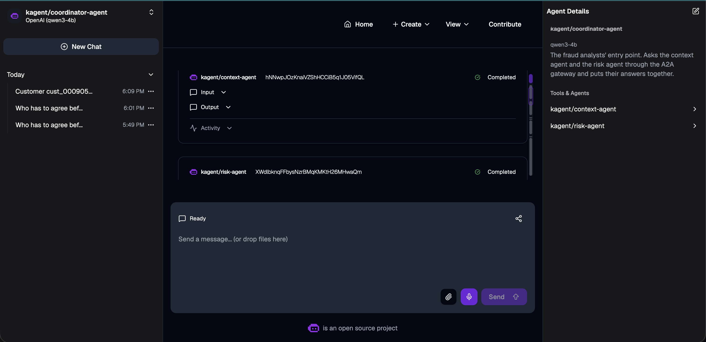

and puts their answers together, saying which agent each point came from:

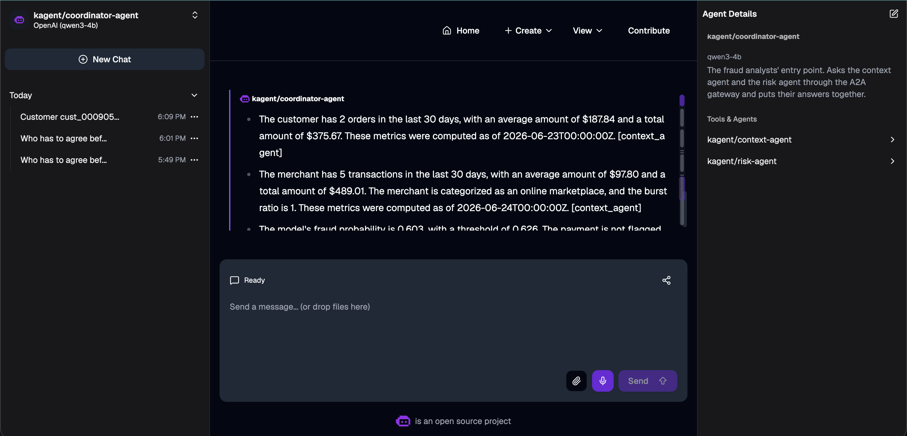

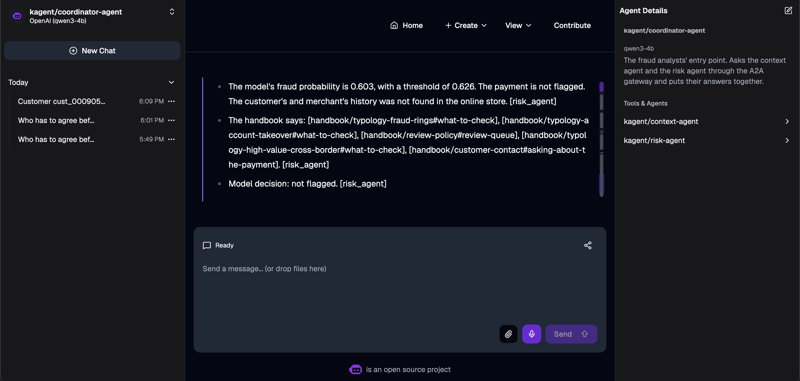

A policy question goes to the risk agent alone, and comes back with the right chunk and
no model decision:

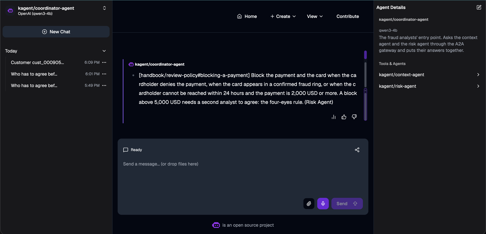

**KEDA** reads the coordinator's calls in flight over 5 minutes, not 2
([coordinator-agent.yaml#L46](../../k8s/agents/coordinator-agent.yaml#L46)). Its calls
take minutes, and a call is counted only when it ends, so a 2-minute window reads 0
during a burst and then jumps. The cost: it scales a few minutes into a burst.

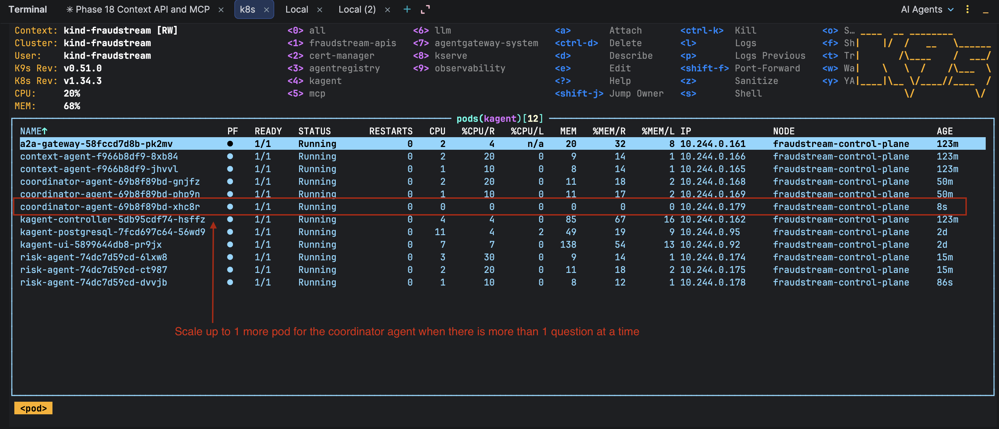

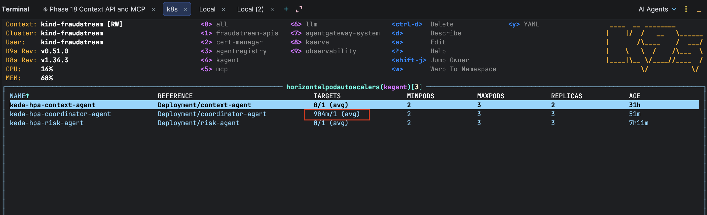

## The registry

`install.sh` publishes three agents and two MCP servers
([registry.yaml](../../k8s/agents/registry.yaml)). The registry has no field linking an
agent to the agents it calls, so the coordinator's description names them.

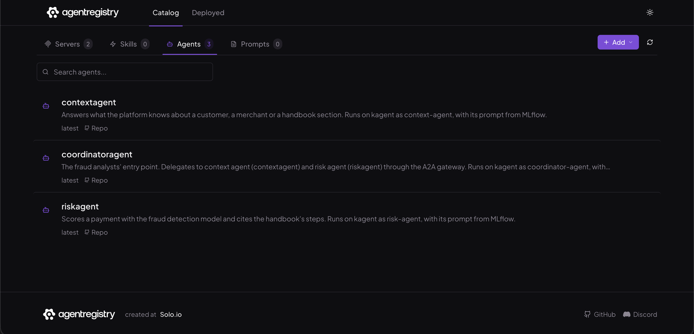

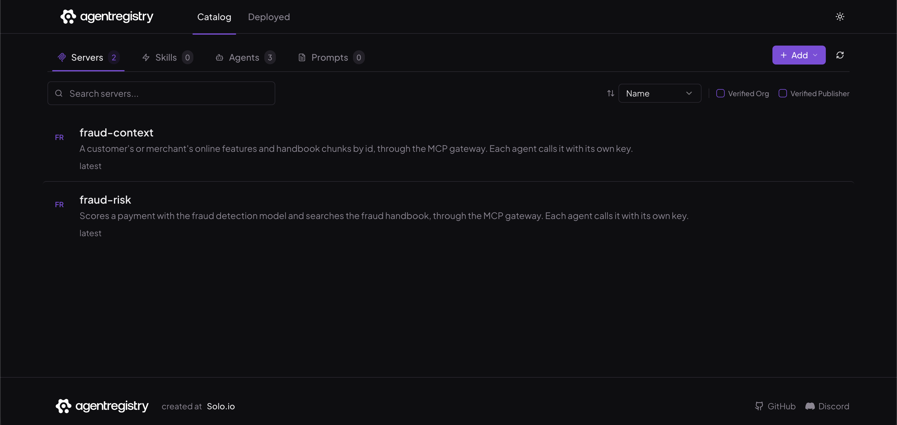

## Telemetry

**Calls are counted at each agent.** The context agent's calls used to be counted from
the controller's `invoke_agent` span. That misses every call the coordinator makes,
because kagent sends it straight to the specialist, never through the controller. Every
agent pod opens its own `invoke_agent <agent>` span for each call it runs, whoever sent
it, so Jaeger's span-metrics pipeline now counts those and drops the controller's
([jaeger.yaml#L48](../../k8s/observability/jaeger.yaml#L48)). The agent names in the
metrics become kagent's runtime names, `context_agent`, `risk_agent` and
`coordinator_agent`, and the KEDA queries use them.

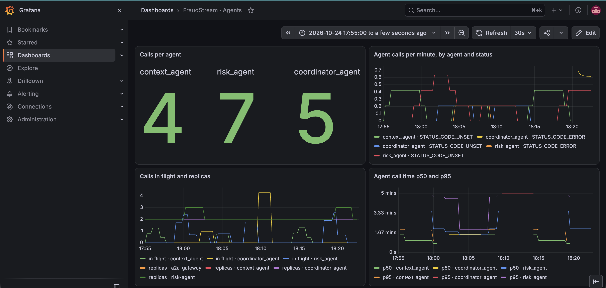

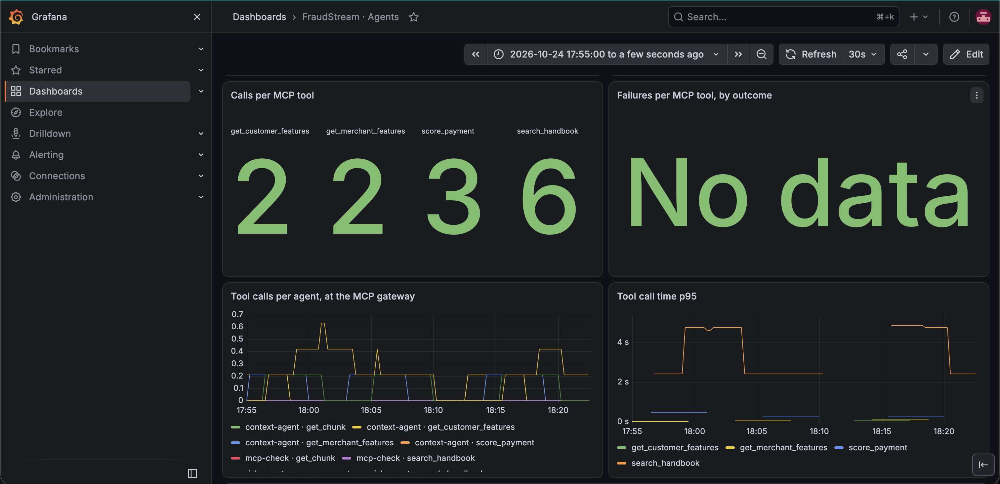

The errors on the chart are from one risk-agent pod that kept the old tool address; see
below.

A new panel counts calls between agents at the A2A gateway, by caller, agent and status:

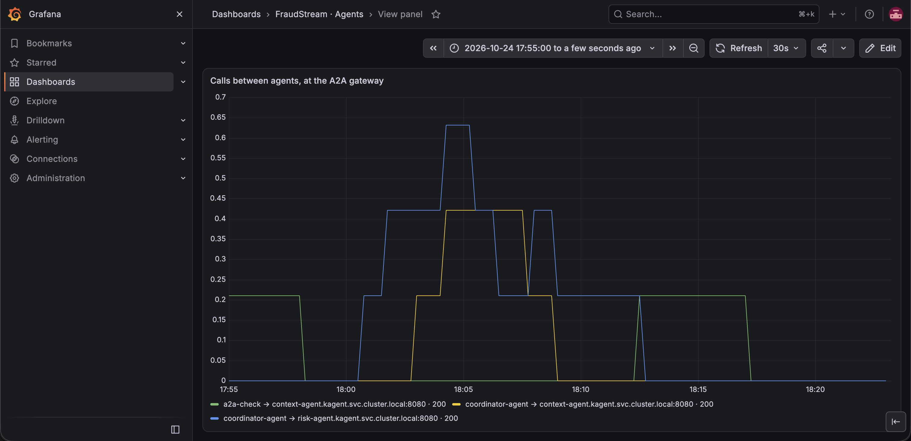


**One trace runs from the controller to the specialists.** kagent's A2A client and
server carry the trace context, and so does the gateway, so a coordinator question is
one trace: controller, coordinator, A2A gateway, then the specialist with its own
`execute_tool` and `generate_content` spans. `check.sh` looks for exactly that.

kagent's MCP and model clients don't pass the trace on, so an agent's tool call starts a
new trace at the A2A gateway. From there it stays one trace through the MCP gateway:

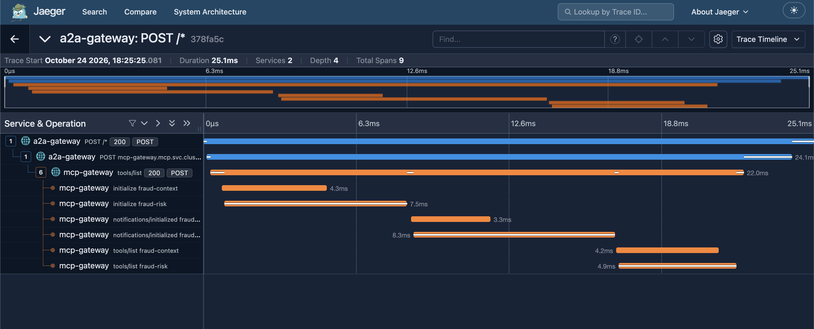

## The eval questions

Six analyst questions, each with the agent to ask, the tool calls it must make and what
the answer must hold ([evals.py#L48](../../agents/src/fraudstream_agents/evals.py#L48)).
The truth is read at check time: stored values and chunks from the context API, and the
model's answer for the same payment from the inference API.

| Agent | Question | Must call | The answer must | Time |
|---|---|---|---|---|
| context | the customer's recent activity | `get_customer_features` | quote a stored value | 84 s |
| context | how risky the merchant is | `get_merchant_features` | quote a stored value | 46 s |
| risk | a payment: what the model says, what to do | `score_payment`, `search_handbook` | carry the model's decision and threshold; cite an existing chunk | 183 s |
| risk | who agrees before a block above 5,000 USD | `search_handbook` | cite a chunk under `handbook/review-policy`; no decision line | 48 s |
| coordinator | the same policy question | `kagent__NS__risk_agent` | the same as the risk agent's | 100–270 s |
| coordinator | the customer and the payment | both agent tools | a stored value of the customer, the decision and threshold, an existing chunk | 135–450 s |

The tool calls are read from the A2A task's history, where kagent records each one. An
answer that ends with a decision line when no payment was scored fails: that would be a
decision the model never made.

## Validation

| Check | `agents/` |
|---|---|
| Line and branch coverage | 99% |
| Tests | 132 |
| Mutation score | 96.6% (539 of 558) |

- **Boundary cases:** the 1% threshold match just inside and just outside, a decision
  line in any case or position, chunk ids with and without brackets, a second missing
  citation after the first.
- **Hypothesis:** the decision line is read wherever it sits in an answer, and the
  cited chunks are exactly the bracketed ids, each once.
- **The 19 survivors** change only the prompt tool's command-line help and indent,
  as before.

More in [22_validation_and_verification.md](../ml/22_validation_and_verification.md).

## Memory

| Pod | Measured |
|---|---|
| An agent (each of the three) | 7–15 MiB |
| The A2A gateway | 20 MiB |

Each agent requests 10m CPU and 64 MiB, near what it uses; the kind node had no CPU left
to reserve at the old 100m.

## Known limits

- **No sandbox on the laptop.** kagent 0.10 runs sandboxed agents only on Agent
  Substrate, which needs gVisor; the risk agent gets it with the context agent on GKE.
- **One model slot sets the speed.** A coordinator question waits for two or three
  model answers in turn, so it takes minutes, and more replicas add availability, not
  speed.
- **The controller is a side door.** Agents still reach the controller, where they keep
  their sessions, and its A2A endpoint has no login on kind. The gateway's policy covers
  the calls kagent routes through it.
- **A pod can keep an old address.** When the proxy was switched on, one risk-agent pod
  started before its new config was written and kept calling the MCP gateway directly,
  which the network now blocks. It carried the same config hash, so kagent never
  restarted it. `check.sh` now reads each specialist pod's startup log for the tool
  address it loaded.
- **The model doesn't always follow the prompt.** The checks catch it: a missing tool
  call, an unquoted value, a made-up decision or a chunk that doesn't exist each fails
  the question.

## Things worth knowing

- **Feast 0.66 returned search hits under the wrong chunk ids.** Its vector search
  sorts the ids apart from the other columns, so an agent cited one section's text
  under another's id. Search now reads the returned ids back and pairs each hit with
  its id by its fields ([retrieval.py#L56](../../rag/src/fraudstream_rag/retrieval.py#L56)).
- **Registry names can't contain hyphens:** `riskagent`, `coordinatoragent`.
- **The kagent UI's read timeout is 600 s**, since a coordinator answer waits on a
  specialist ([ingress.yaml#L15](../../k8s/agents/ingress.yaml#L15)).
- **Jaeger keeps traces in memory** and the APIs' health pings fill it within hours, so
  look at a trace soon after the run.

## How to run it

```bash
./k8s/agents/install.sh                                     # everything, safe to run again
./k8s/agents/check.sh                                       # every check, all six questions
./k8s/agents/check.sh --load 3 --agent coordinator-agent    # three at once, to watch KEDA
```

Jenkins deploys each agent through its eval questions on a push; see [CI/CD](../ml/23_ci_cd.md#mcp-servers-and-agents).

## Where things are

| What | Where |
|---|---|
| The risk agent, its tools and scaler | `k8s/agents/risk-agent.yaml` |
| The coordinator and its scaler | `k8s/agents/coordinator-agent.yaml` |
| The prompts | `agents/prompts/risk-agent.md`, `agents/prompts/coordinator-agent.md` |
| The A2A gateway, its routes and policy | `k8s/agents/a2a-gateway.yaml`, `k8s/agents/a2a-policy.yaml` |
| kagent's proxy setting | `k8s/agents/kagent-values.yaml` |
| Network rules for every agent | `k8s/agents/network.yaml` |
| Keys, install and checks | `k8s/agents/install.sh`, `k8s/agents/check.sh` |
| Registry records | `k8s/agents/registry.yaml` |
| The UI's timeout | `k8s/agents/ingress.yaml` |
| The eval questions and the A2A client | `agents/src/fraudstream_agents/evals.py`, `agents/src/fraudstream_agents/a2a.py`, `agents/tools/check_agent.py` |
| Calls counted at each agent | `k8s/observability/jaeger.yaml` |
| Deploying an agent from Jenkins | `cicd/deploy_agent.sh`, `Jenkinsfile` |
| The A2A metrics and panel | `k8s/observability/servicemonitors.yaml`, `k8s/observability/dashboards/agents.yaml` |
| The search fix | `rag/src/fraudstream_rag/retrieval.py` |
| Tests | `agents/tests/`, `rag/tests/test_retrieval.py` |
| Screenshots | `images/multi_agents/` |
