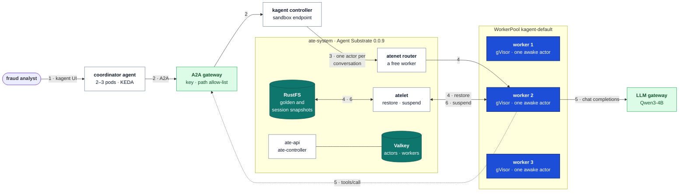
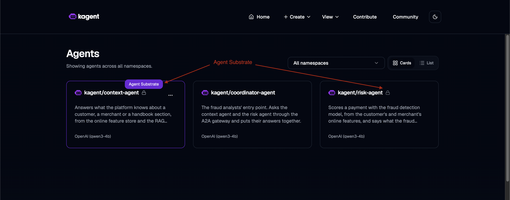
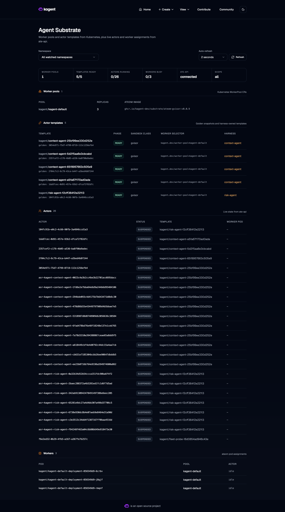
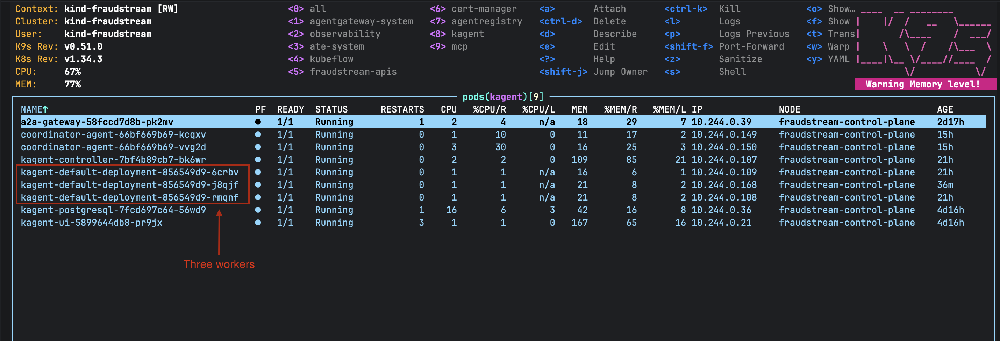
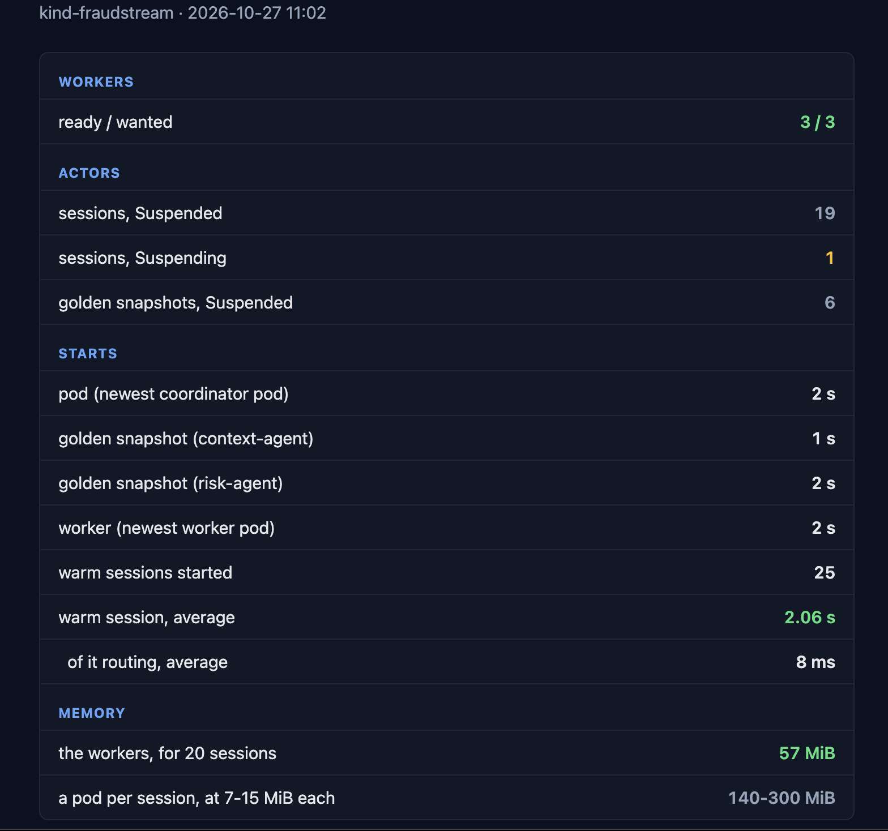

# The agent fleet: sandboxed agents on warm workers

The context agent and the risk agent no longer run as pods of their own. Every
conversation with them runs in its own gVisor sandbox, restored in about two seconds
from a snapshot of the agent, on a small pool of workers it shares with every other
conversation.

## Architecture



One question to a specialist, in the order of the numbers:

1. **Ask.** The analyst asks the coordinator in the kagent UI. The coordinator is
   still an ordinary agent with pods, scaled by KEDA.
2. **Delegate.** It calls the specialist through the A2A gateway, which now sends the
   call to kagent's controller, the front door of every sandboxed agent.
3. **Route.** Each call carries a conversation id. A new id gets a new actor, a
   sandboxed copy of the agent kept for that conversation only.
4. **Warm start.** atelet, Substrate's node agent, restores the actor from the agent's
   golden snapshot onto a free worker.
5. **Answer.** The actor asks the model and calls its MCP tools, through the same
   gateways as before.
6. **Suspend.** Once it has answered, the actor is snapshotted to RustFS and its worker
   is free for the next conversation.

## Sandboxed agents

The specialists are `SandboxAgent`s in place of `Agent`s: the same prompt, tools,
keys and skills, plus the pool they run on
([context-agent.yaml#L51](../../k8s/agents/context-agent.yaml#L51)). kagent's UI marks
them with the Agent Substrate badge and a lock:



kagent 0.10.3 ships the fleet: `controller.substrate` points it at Substrate, and
`substrateWorkerPool` makes the pool
([kagent-values.yaml#L49](../../k8s/agents/kagent-values.yaml#L49)). Substrate
0.0.9 itself is installed by [substrate.sh](../../k8s/agents/substrate.sh): its
control plane, the router, atelet on every node, a six-node Valkey cluster for its
state and RustFS for the snapshots.

**How calls find them.** A sandboxed agent has no Service of its own. Its address is
`/api/a2a-sandboxes/kagent/<agent>/` on the controller's port 8083, and that address
needs a conversation id on every call
([a2a.py#L40](../../agents/src/fraudstream_agents/a2a.py#L40)). The A2A gateway's route
`agents` matches the controller's host and the agent's path
([a2a-gateway.yaml#L54](../../k8s/agents/a2a-gateway.yaml#L54)), and each key's
allow-list now holds paths
([a2a-policy.yaml#L59](../../k8s/agents/a2a-policy.yaml#L59)). The Service
`sandbox-agents` in front of the controller carries `appProtocol: kgateway.dev/a2a`,
so agent cards still point at the gateway
([a2a-gateway.yaml#L38](../../k8s/agents/a2a-gateway.yaml#L38)).

## Warm start

Without a fleet, a new conversation on an idle system would wait for a pod or a worker
to start, then for the agent to boot. The fleet does both ahead of time:

- **Warm workers.** Three worker pods are always running, each with gVisor in its
  image, so no node needs a runtime installed.
- **Golden snapshots.** For each version of an agent, kagent makes an ActorTemplate and
  Substrate boots it once, then freezes it. That frozen copy is the golden snapshot.
  Every new conversation is a restore of it, not a boot.

kagent's Agent Substrate page shows both: each agent version's template with its golden
snapshot, then every actor, the golden snapshots and the conversations, all suspended
in RustFS while the three workers sit idle:



**A new prompt is a new version.** A session restored from a golden snapshot keeps the
prompt the snapshot was taken with. When the prompt changed, a fresh session still
answered with the old one. So [apply.sh](../../k8s/agents/apply.sh) writes the prompt's
MLflow version into the agent as `PROMPT_VERSION`: a new prompt changes the agent,
kagent makes a new template, and Substrate takes a new golden snapshot.
`deploy_agent.sh` waits for that snapshot before it asks the eval questions
([deploy_agent.sh#L33](../../cicd/deploy_agent.sh#L33)).

## The sandbox

Each conversation runs in its own gVisor sandbox: a user-space kernel between the agent
and the node. One conversation can't see another's memory or files, and a prompt
injection that takes over one actor stays in it.

**The network.** Actor traffic leaves from the worker pod, so the NetworkPolicy
`fleet-workers` covers the workers
([network.yaml#L60](../../k8s/agents/network.yaml#L60)). They may reach DNS, the
controller, the LLM gateway, the A2A gateway, Jaeger and Substrate itself, and only
Substrate may reach them. A probe pod with the workers' label timed out on
`fraud-context`, the inference API and the MCP gateway, and reached the LLM and A2A
gateways.

**The probe must wait before it calls.** kindnet checks a new pod's connections only
once it knows the pod's IP, so a call in the pod's first second gets through
whatever the policy says. The probe sleeps 5 seconds first.

## A fixed pool of three workers

**A worker runs one awake actor at a time.** Sleeping actors live in RustFS, not on
the worker, so the pool caps how many conversations can be *answering* at the same
moment, not how many exist. When every worker is busy, Substrate refuses a new one
with `substrate worker pool has no free workers; try again later`.

**KEDA can't scale the pool.** KEDA scales through a Kubernetes HPA, and an HPA
needs the pods its target owns. Substrate 0.0.9's WorkerPool gives no pod selector on
its scale, so the HPA never became active (`the HPA target's scale is missing a
selector`). The pool is a fixed three workers
([kagent-values.yaml#L57](../../k8s/agents/kagent-values.yaml#L57)), which also keeps
"few workers" true. The coordinator keeps its KEDA scaler.



**Callers ask again.** The check asks again every 2 seconds while Substrate refuses,
in the same conversation
([check_agent.py#L33](../../agents/tools/check_agent.py#L33)). A new conversation id
on each try left an empty actor behind every time: 349 actors for 29 real
conversations. Six questions sent at once on three workers all completed, the last
three after waiting for a worker.

## Measurements

Twenty fresh conversations, ten to each specialist, asked two at a time, then read
with [fleet.sh](../../k8s/agents/fleet.sh):



| Start | Time | What it is |
|---|---|---|
| **Warm conversation** | **2.06 s** average, 25 restores | atelet restoring an actor from its golden snapshot onto a running worker |
| of it, choosing the worker | 8 ms | the atenet router |
| Golden snapshot | 1–2 s, 47 s the first time | a new agent version booted and frozen; the first pulled the images |
| Worker pod | 2–6 s | a new worker, from creation to Ready |
| Agent pod | 2 s | the coordinator's newest pod, for comparison |

| Memory | Measured |
|---|---|
| Three workers, holding 20 conversations | 57 MiB |
| A pod per conversation, at 7–15 MiB each | 140–300 MiB |
| Substrate itself (`ate-system`) | about 370 MiB, Valkey's six pods 66 MiB of it |

Sleeping conversations cost storage only, so the workers' memory stays flat as
conversations grow. Substrate's own 370 MiB is fixed, so the fleet uses less memory
than a pod per conversation only past 30 to 50 conversations.

The warm numbers come from atelet's `Restore` calls in Prometheus, which a PodMonitor
scrapes ([servicemonitors.yaml#L122](../../k8s/observability/servicemonitors.yaml#L122)).
They are averages over the last hour: nearly every restore falls into one histogram
bucket, 1 to 2.5 s, where a percentile would only be interpolated.

## How to run it

```bash
./k8s/agents/install.sh                                                       # Substrate, kagent, the agents, the pool
./k8s/agents/check.sh --load 10 --agent context-agent --concurrency 2         # ten conversations, two at a time
./k8s/agents/check.sh --load 10 --agent risk-agent --concurrency 2
./k8s/agents/fleet.sh --html /tmp/fleet.html && open /tmp/fleet.html          # the report
```

`fleet.sh` reads through the API server, so it needs no port-forwards. Run
`substrate.sh` again after a Docker restart: Valkey's pods come back on new IPs, and
it reconnects them.

## Known limits

- **Nothing is ever deleted.** Every conversation's actor and every old golden
  snapshot stays in Valkey and RustFS. They cost storage, not workers, and kagent
  0.10.3 has no setting to clean them up.
- **The coordinator doesn't ask again.** Its calls to the specialists are kagent's own,
  so with more than three of them in flight one can fail on "no free workers".
- **RustFS is not durable.** One pod, on the kind node. Losing it loses every snapshot,
  and the golden snapshots have to be rebuilt.
- **RustFS's keys are in its pod spec**, in plain text, and **Valkey runs without
  TLS**. Both are the 0.0.9 chart's defaults.
- **kagent 0.10 pins Substrate 0.0.9.** Neither can be upgraded alone.

## Where things are

| What | Where |
|---|---|
| Substrate's install and the Valkey reconnect | `k8s/agents/substrate.sh` |
| kagent's Substrate settings and the worker pool | `k8s/agents/kagent-values.yaml` |
| The sandboxed agents | `k8s/agents/context-agent.yaml`, `k8s/agents/risk-agent.yaml` |
| The prompt version on each agent | `k8s/agents/apply.sh` |
| Deploying an agent and waiting for its golden snapshot | `cicd/deploy_agent.sh` |
| The gateway's route and allow-list to the sandboxes | `k8s/agents/a2a-gateway.yaml`, `k8s/agents/a2a-policy.yaml` |
| The workers' network rules | `k8s/agents/network.yaml` |
| The fleet report | `k8s/agents/fleet.sh` |
| The atelet metrics | `k8s/observability/servicemonitors.yaml` |
| The A2A client and the check's retry | `agents/src/fraudstream_agents/a2a.py`, `agents/tools/check_agent.py` |
| Screenshots | `images/agent_fleet/` |
