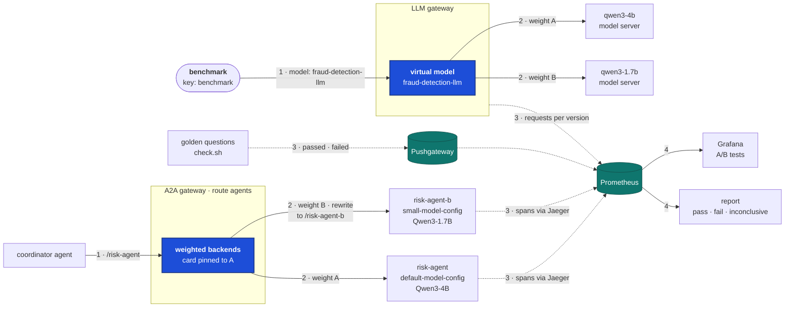
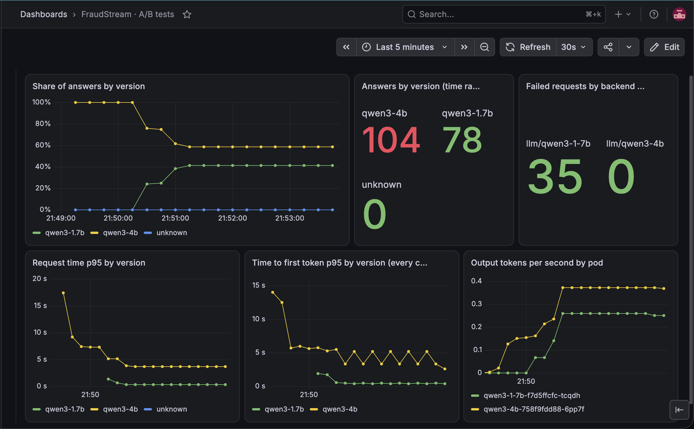
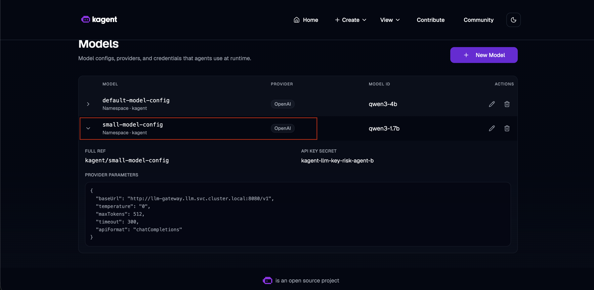
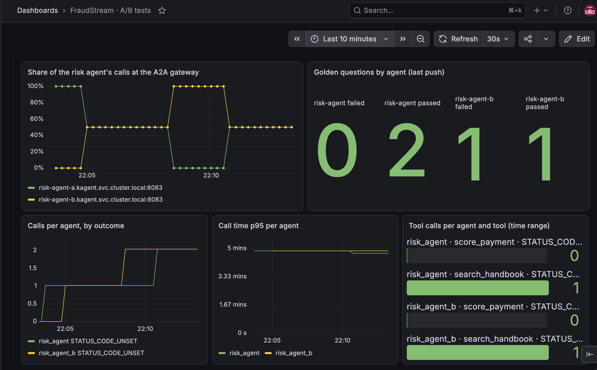

# A/B tests for LLM versions and agent model configs

A new LLM version or a cheaper model for an agent can't be judged from a few hand-picked
questions. It has to take real traffic next to the current one, be measured the same way,
and be judged by fixed rules. Two splits do this here. Each one asks its own question:

- **The LLM split:** does the new version serve requests as well as the current one?
- **The agent split:** does the risk agent still do its job on the cheaper model?

Both tests compare Qwen3-4B, the current model, with Qwen3-1.7B, which is less than half
its size.

## Architecture



Both splits work the same way, in the order of the numbers:

1. **One name.** Callers keep calling one name: the model `fraud-detection-llm`, or the
   path `/risk-agent`. They don't know a test is running.
2. **Weights.** The gateway sends each request to A or B by weight. The weights live in
   Git, so every step of a test is a commit that can be reviewed and reverted.
3. **Measure.** Each variant is counted on its own: the LLM gateway counts requests per
   version, and Jaeger turns each agent's spans into calls, failures and call time. The
   golden questions' results go to the Pushgateway.
4. **Judge.** One Grafana dashboard shows A and B side by side, and a report reads the
   same numbers and says pass, fail or inconclusive.

## How a test runs

| Step | What happens |
|---|---|
| 1. Check B offline | Ask B the golden questions directly, before it takes any traffic. |
| 2. Small share | Send B 10% of the traffic, and judge it. A broken B only touches a few requests. |
| 3. Half | Send B 50%, enough calls for its latency to mean something, and judge again. |
| 4. Decide | Promote B to 100%, or roll back to A. |

Each step is one commit to the weights, applied with `kubectl apply`. A person moves the
weights; the report only judges. An automatic controller would wait for a fixed number
of answers per step, and on this laptop's CPU one agent answer takes 1–5 minutes.

In the run below, the only traffic was our own test traffic, so both tests went straight
to 50%. Nobody was there for a small first step to protect.

### The rules

B fails if any of these holds:

| Rule | Why |
|---|---|
| B fails more than 2 points more often than A | Failures count on any amount of traffic: one broken answer already matters. |
| More than 1% of the LLM calls fail before reaching a version | A broken split hides a version's failures. |
| B passes fewer golden questions than A | The agent split checks the answers, not only how fast they come. |
| B's p95 is more than 1.2 × A's | Judged only once B has 20 LLM calls or 10 agent calls. A p95 from a handful of calls is noise. |

Otherwise B passes, or is **inconclusive** while it has too few calls. Too little
traffic can never pass. The rules are in
[ab_testing.py#L49](../../agents/src/fraudstream_agents/ab_testing.py#L49), and the
numbers they read are in
[ab_testing.py#L82](../../agents/src/fraudstream_agents/ab_testing.py#L82).

## Testing an LLM version

The LLM gateway routes by the `model` field of each request. `fraud-detection-llm` is a
virtual model: a name with weighted targets, each one a real model with its own model
server ([gateway.yaml#L120](../../k8s/llm/gateway.yaml#L120)). Every answer carries the
name of the model that wrote it, so each request is counted for the version that served it.

- **Only the benchmark calls it.** The test traffic uses the benchmark's key, so the
  report and the dashboard can tell test requests from everything else. The agents stay
  on `qwen3-4b`: an agent's conversation makes several LLM calls, and a per-request
  split would mix both versions inside one conversation.
- **Weights must be 1 or more.** So promoting or rolling back removes a target instead
  of setting it to 0.
- **Traffic:** [check-split.sh](../../k8s/llm/check-split.sh) sends short requests and
  counts which version answered each one, next to the live weights. For a full-length workload,
  [bench.sh](../../k8s/llm/bench.sh) runs the platform benchmark against
  `fraud-detection-llm`.

**Result:**
- At 50%, qwen3-1.7b answered 78 requests, and qwen3-4b answered 104.
- qwen3-1.7b also refused 35 requests in a burst within its first 40 seconds. Its
  server closed the connections before answering, and qwen3-4b refused none.
- qwen3-1.7b was much faster (about 0.4 s against 3.7 s at p95), but 35 failures out of
  113 requests is far over the 2-point rule. The test failed, and `fraud-detection-llm`
  was rolled back to qwen3-4b.



## Testing an agent model config

**Variant B, `risk-agent-b`,** is made from the risk agent's own manifest, with one
field changed: its model config
([risk-agent-b.sh#L10](../../k8s/agents/risk-agent-b.sh#L10)). It has the same prompt,
tools and keys. `small-model-config` points at qwen3-1.7b through the LLM gateway, with a
key of its own that may use only that model
([small-model-config.yaml#L8](../../k8s/agents/small-model-config.yaml#L8)). B is a
sandboxed agent like A, so it costs no pod of its own on the agent fleet.



**The split happens at the A2A gateway,** on the risk agent's rule of the `agents` route
([a2a-gateway.yaml#L111](../../k8s/agents/a2a-gateway.yaml#L111)):

- **Two Services, one controller.** `risk-agent-a` and `risk-agent-b` both point at
  kagent's controller, the front door of every sandboxed agent. They are separate only so
  the gateway counts each variant as its own backend.
- **A rewrite for B.** The coordinator always calls `/risk-agent`. On B's backend, the
  gateway rewrites that path to `/risk-agent-b` before forwarding it
  ([a2a-gateway.yaml#L120](../../k8s/agents/a2a-gateway.yaml#L120)).
- **The card is pinned to A.** The coordinator learns an agent's address from its agent
  card. A longer rule, for `/risk-agent/.well-known`, always serves A's card
  ([a2a-gateway.yaml#L131](../../k8s/agents/a2a-gateway.yaml#L131)), and the gateway
  takes the longest matching path. So the coordinator only ever learns the one
  `/risk-agent` address, and every call goes through the split.
- **Calls go through the gateway.** kagent writes the controller's own address into the
  agent cards it serves, unless it is told the gateway's
  ([kagent-values.yaml#L50](../../k8s/agents/kagent-values.yaml#L50)). Without that
  setting, the coordinator called the controller directly and B never got any traffic.

Jaeger counts each agent's calls and, through a second filter, its tool calls
([jaeger.yaml#L56](../../k8s/observability/jaeger.yaml#L56)). After the golden questions,
`check_agent` pushes each agent's passed and failed counts to the Pushgateway
([check_agent.py#L71](../../agents/tools/check_agent.py#L71)).

**Result:**
- At 50%, the coordinator's calls alternated between A and B, and both answered without
  errors.
- B passed only 1 of its 2 golden questions, and A passed both. Asked who has to agree
  before a large payment is blocked, B also stated a fraud model decision, though no
  payment had been scored.
- Their call times were the same, close to five minutes, because both share one CPU.
- The golden rule failed B, so the risk agent's calls went back to A at 100%.



## How to run it

```bash
./k8s/llm/check-split.sh 100                                    # LLM split: traffic, and each version answers
./k8s/agents/check.sh --agent risk-agent --agent risk-agent-b   # golden questions, pushed per agent
./k8s/agents/check.sh --load 4 --agent coordinator-agent --concurrency 2
./k8s/agents/ab-testing-report.sh llm 10m                       # verdict: exit 0 pass, 10 fail, 12 inconclusive
./k8s/agents/ab-testing-report.sh agent 3h
```

To move a split, edit the weights in `k8s/llm/gateway.yaml` or `k8s/agents/a2a-gateway.yaml`,
commit, and apply. Wait about a minute after the traffic before reading the report, so
Prometheus has scraped the new numbers. The dashboard is "FraudStream · A/B tests" in
Grafana.

## Known limits

- **One conversation can span both variants.** The coordinator's calls are split one
  by one, so one conversation may hear from A and then B.
- **LLM failures before a version is chosen** can't be blamed on either version. They
  are counted apart, and judged by the 1% rule.
- **B's prompt is a copy.** After a new risk-agent prompt is deployed, `risk-agent-b.sh`
  has to run again.
- **Both models share one CPU,** so each one's latency includes the other's load. A
  latency rule judged on this laptop says little about production.
- **The Pushgateway keeps the last result** until the next run replaces it. The report
  shows when each result was pushed.
- **Two golden questions** show that B makes things up, but not how often.

## Where things are

| What | Where |
|---|---|
| The LLM split, `fraud-detection-llm` | `k8s/llm/gateway.yaml` |
| The LLM keys, including risk-agent-b's | `k8s/llm/install.sh` |
| Traffic for the LLM split | `k8s/llm/check-split.sh`, `k8s/llm/bench.sh` |
| The agent split, its Services and the pinned card | `k8s/agents/a2a-gateway.yaml` |
| Variant B and its model config | `k8s/agents/risk-agent-b.sh`, `k8s/agents/small-model-config.yaml` |
| The agent cards' gateway address | `k8s/agents/kagent-values.yaml` |
| The golden questions and the push | `agents/tools/check_agent.py`, `k8s/agents/check.sh` |
| The rules and the report | `agents/src/fraudstream_agents/ab_testing.py`, `agents/tools/ab_testing_report.py`, `k8s/agents/ab-testing-report.sh` |
| Tool calls per agent | `k8s/observability/jaeger.yaml` |
| The dashboard | `k8s/observability/dashboards/ab-tests.yaml` |
| Screenshots | `images/llm_ab_testing/` |
