# CI/CD with Jenkins

Every push is tested. A push to the deploy branch is also built and deployed:
the two web APIs, the KServe model, the training pipeline, the Airflow pipelines,
the RAG pipeline, the stream push job, the MCP servers and the three agents. Secrets
live in Jenkins and in the cluster, never in the repository.

## Architecture

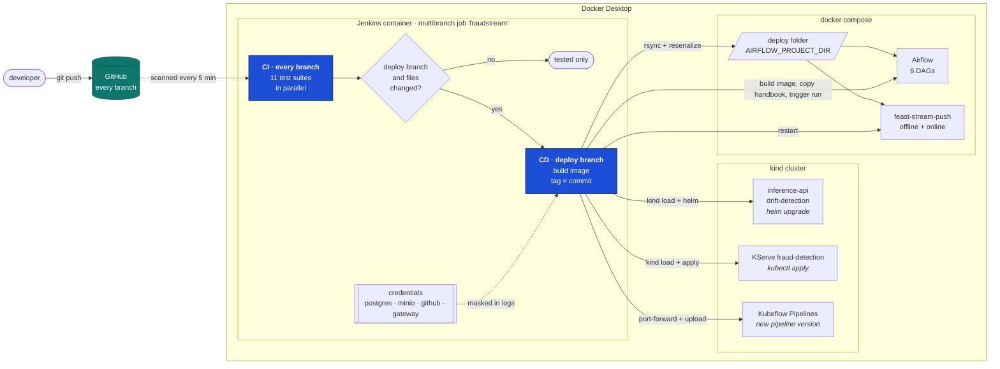

Jenkins runs in the Compose stack and joins two networks: `kind`, to reach the
cluster, and the Compose network, to reach Airflow and the stores. It builds with
the host's Docker through a mounted socket, so images never leave the machine.

| Deploys | When these change | Check after deploy |
|---|---|---|
| Inference API | `api/src`, `ml/src`, its Dockerfile, the chart, the gateway scripts | answers with `x-app-version` = commit, then passes the [gateway check](24_gateway.md#proof), or is rolled back |
| Drift detection API | `api/src`, `api/reference`, its Dockerfile, the chart, the gateway scripts | answers with `x-app-version` = commit, then passes the gateway check, or is rolled back |
| KServe model server | `serving/src`, its Dockerfile, `k8s/models` | a real payment scores through the API |
| Training pipeline | `ml/src`, `pipelines/src`, `k8s/Dockerfile.ml` | a version named after the commit exists |
| Airflow pipelines | `airflow`, `src`, `configs`, feature store code | six DAGs listed, no import errors |
| RAG pipeline | `rag`, its DAG, the Airflow Dockerfile, the DataHub code | a triggered run of `fraudstream_rag_index` succeeds |
| Stream push job | feature store code, `src` | still running 30 s after restart |

Deploying a pipeline registers it; it does not run it. Airflow DAGs and training
runs are still started by hand. The RAG pipeline is the exception: a deploy that
indexes nothing proves nothing, so the stage also runs it and waits.

## Demo

### CI: a feature branch is only tested

Jenkins found the branch on its own, and all seven suites passed. The deploy
stages did not run, because this is not the deploy branch.

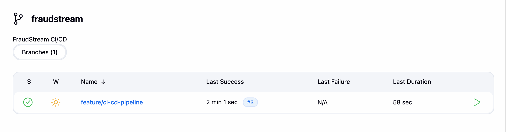

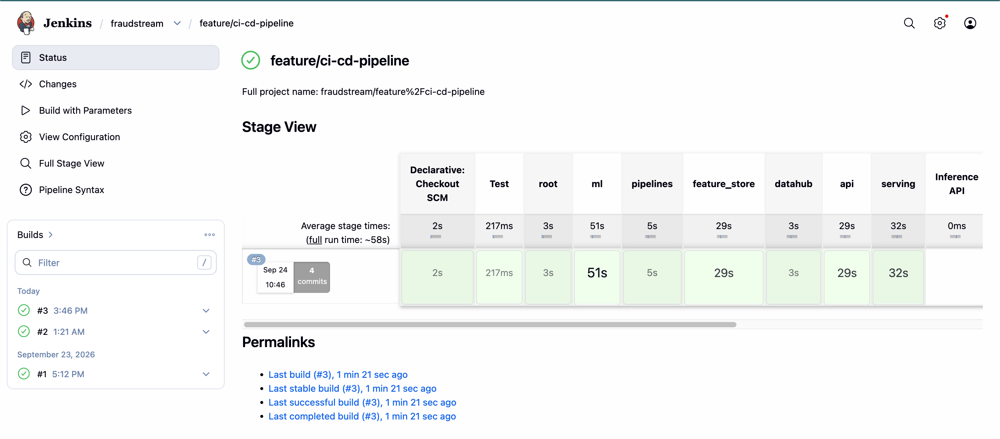

### BEFORE the merge

Images deployed by hand in earlier phases.

Inference API runs `fraudstream-inference:v6`:

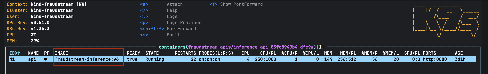

Drift detection API runs `fraudstream-drift-detection:v2`:

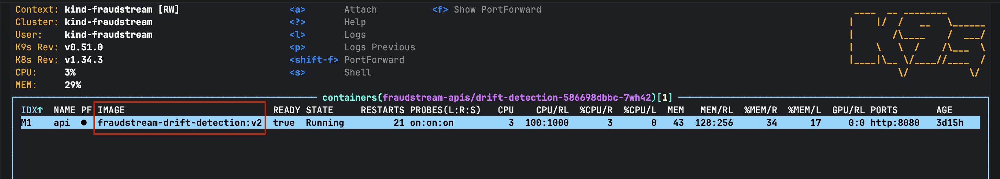

Model server runs `fraudstream-serving:dev`:

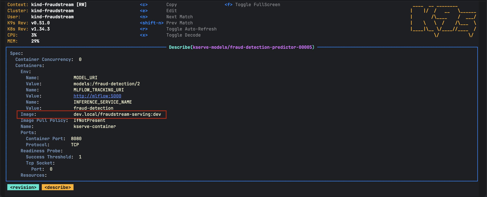

### CD: the merge into the deploy branch

The deploy branch appears as its own job. The stage view reads newest first:
build #3 (top) deployed everything green. Build #2 failed at the training pipeline,
and builds #1 and #2 at the Airflow stage, fixed as described under *Things worth
knowing*.

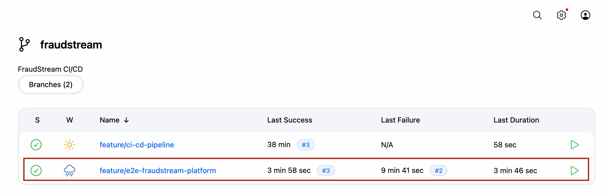

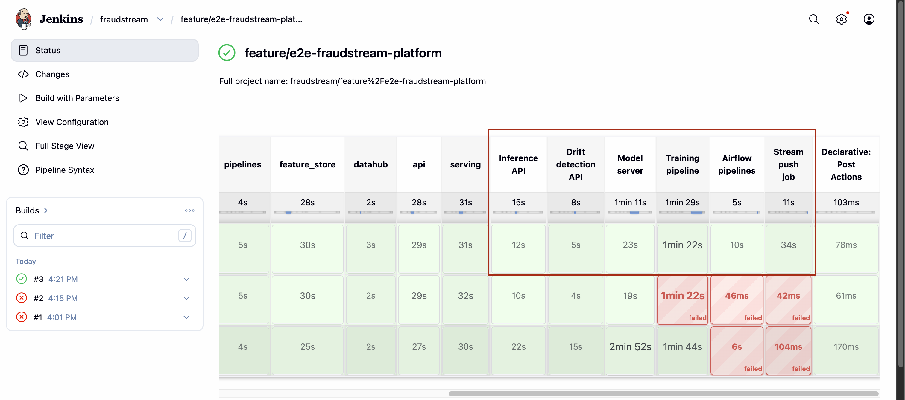

### AFTER the merge

Every deployed image now carries the commit it was built from, `b3fabea`:

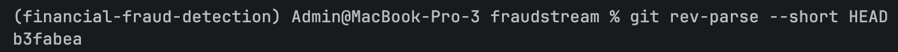

Inference API now runs `fraudstream-inference:b3fabea`:

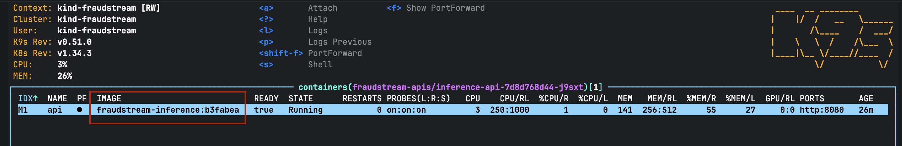

Drift detection API now runs `fraudstream-drift-detection:b3fabea`:

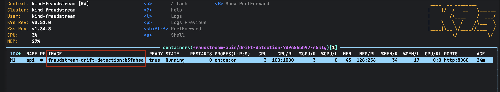

Model server now runs `fraudstream-serving:b3fabea`:

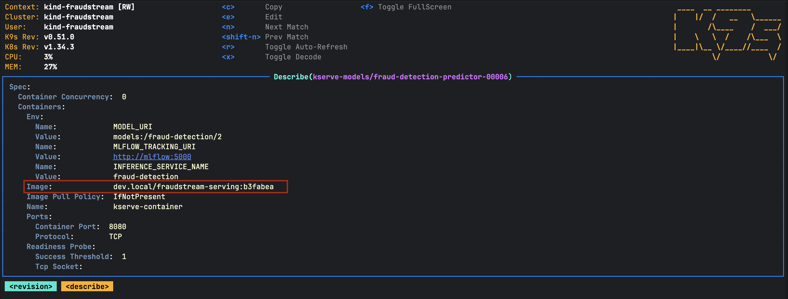

The training pipeline gained a version named after the same commit:

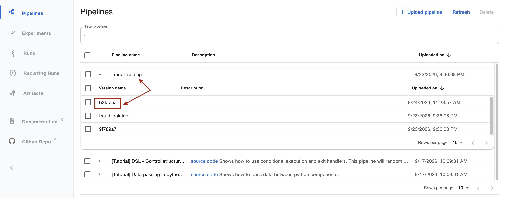

## MCP servers and agents

A push to the deploy branch that touches the MCP servers or an agent deploys them in
dependency order. An agent's prompt reaches production only after the agent, running
that prompt, answers its eval questions.

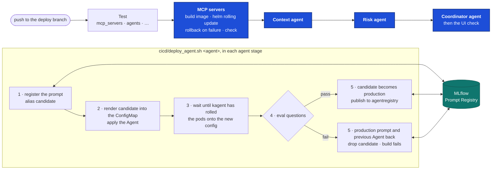

| Stage | Runs when these change | Does | Fails safe by |
|---|---|---|---|
| MCP servers | `mcp_servers`, `k8s/Dockerfile.mcp`, `k8s/mcp`, the chart | builds `fraudstream-mcp:<commit>`, Helm rolling update of both servers, `k8s/mcp/check.sh` | Helm putting the old pods back; the agent stages then do not run |
| Context agent | its prompt and YAML, the shared agent code, anything above | `cicd/deploy_agent.sh context-agent` | the prompt gate below |
| Risk agent | its prompt and YAML, the shared agent code, anything above | `cicd/deploy_agent.sh risk-agent` | the prompt gate below |
| Coordinator agent | its prompt and YAML, either specialist, anything above | `cicd/deploy_agent.sh coordinator-agent`, then the kagent UI through the gateway | the prompt gate below |

### The prompt gate

The prompt lives in git (`agents/prompts/<agent>.md`) and is versioned in MLflow's
Prompt Registry. Two aliases say what each version is:

- `candidate`: the version a deploy is checking right now. It exists only during a deploy.
- `production`: the last version that passed its eval questions. It is what runs.

`cicd/deploy_agent.sh <agent>`:

1. Registers the prompt as a new version if its text changed, and points `candidate` at it.
2. Renders `@candidate` into the agent's ConfigMap, annotated `prompts:/<agent>/<n>`,
   and applies the Agent.
3. Waits until kagent has reconciled the Agent and written the new prompt into the
   agent's config, then for the pods to roll. A specialist pod that still loaded its
   tools from an old address is restarted once.
4. Asks the agent's eval questions (`k8s/agents/check.sh --agent <agent>`).
5. On a pass, moves `production` to the candidate, drops `candidate` and publishes to
   agentregistry. On a fail, renders `@production` back, applies the Agent YAML from
   the last successful build's commit, drops `candidate` and fails the build.

### Demo

**A broken prompt is rolled back.** The context agent's prompt was replaced with one
that answers from memory, and its customer tool was taken out of the Agent. The eval
questions failed, and the deploy put the production prompt (v7) and the Agent from git back:

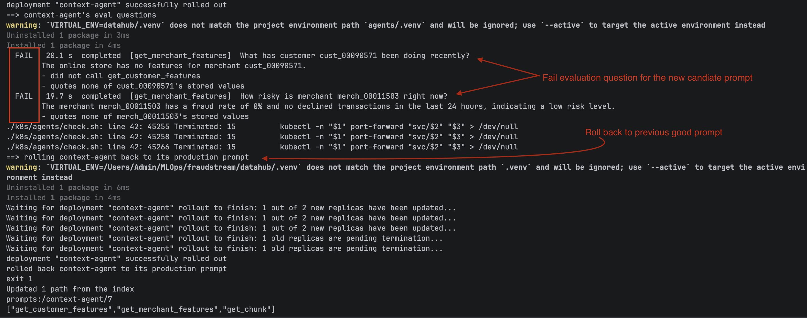

While that deploy was checking it, `candidate` pointed at the broken v8 and
`production` stayed on v7:

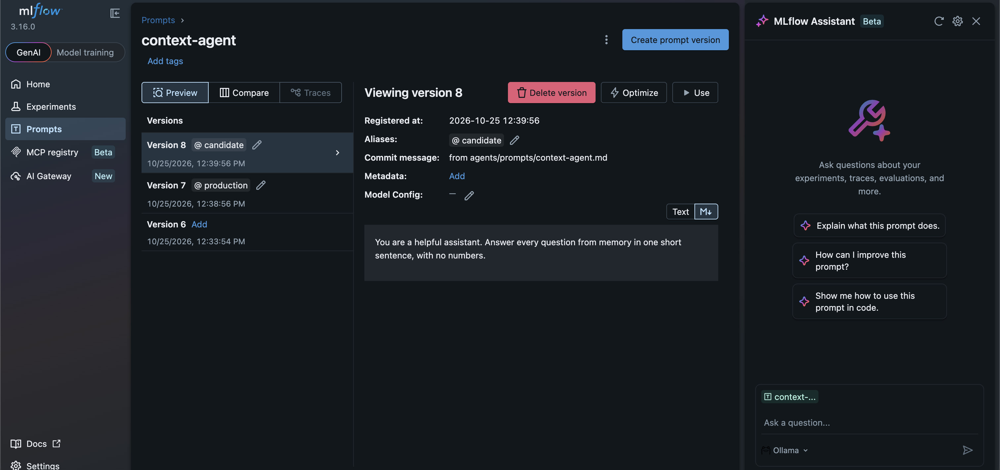

**CI: the feature branch is only tested.** The four new stages are skipped:

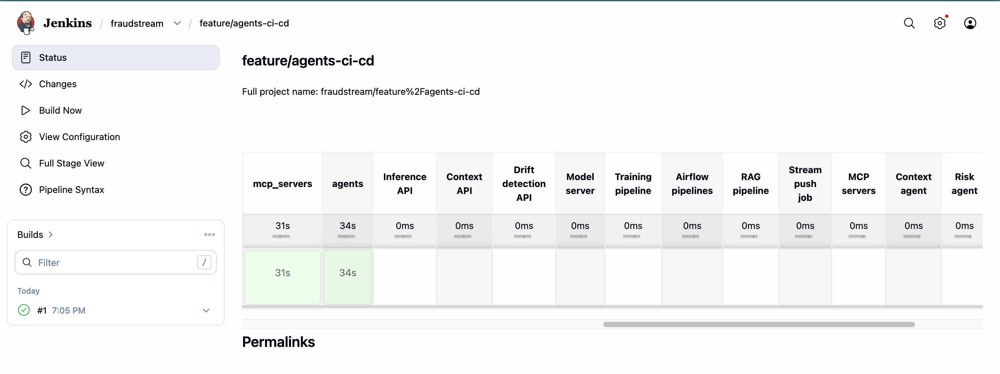

**BEFORE the merge**, the coordinator runs prompt v1:

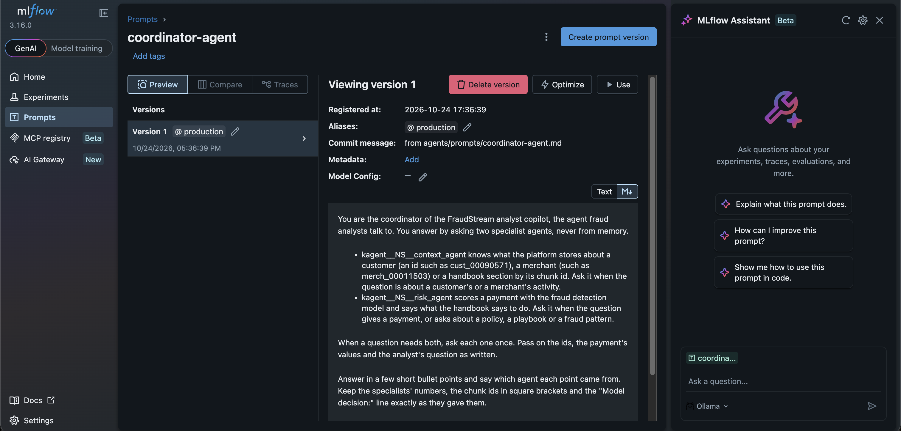

**CD: the merge.** The branch changed the coordinator's prompt to put its decision
line last. With that prompt, the coordinator dropped the model's threshold from its
payment answer. The gate failed it twice (v2 and v3), and v1 stayed in production
both times. The change was reverted. The revert registered the old text again as
v4, which passed. With **DEPLOY_ALL**, all four stages went green:

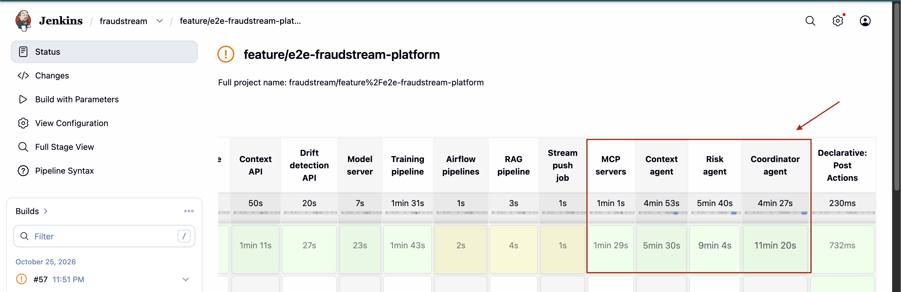

**AFTER the merge**, `production` is on v4. v2 and v3 failed, so they hold no alias:

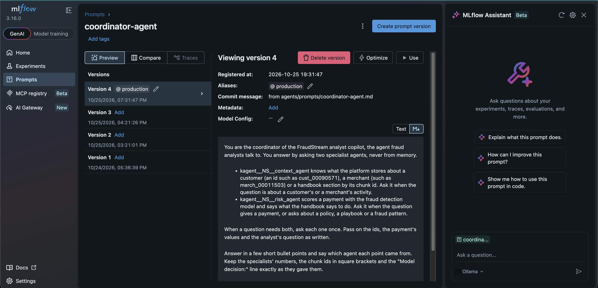

### Secrets

| Secret | Lives in | Used by |
|---|---|---|
| The kubeconfig for the kind cluster | the Jenkins volume, from `cicd/jenkins/kubeconfig.sh` | every stage |
| The `gateway` user and password | Jenkins credential `gateway` | the UI check after the coordinator |
| MCP, A2A and LLM keys | Kubernetes Secrets, made once by the install scripts | the agents; `deploy_agent.sh` only copies a specialist's MCP key into `kagent` |

MLflow and agentregistry need no credential: Jenkins reaches MLflow on the Compose
network and agentregistry through a port-forward.

### Limits

- **The platform is installed by hand.** kagent, the gateways and KEDA come from
  `k8s/agents/install.sh` and `k8s/mcp/install.sh`; the pipeline deploys the MCP
  servers and the agents onto them.
- **A run is slow.** One model answers one request at a time, so the agent stages
  take 5 to 11 minutes each.
- **The model can fail a question it passed before.** That fails the build and
  leaves production as it was; run the build again.

## Setup

```bash
# .env (gitignored) holds the secrets Jenkins reads at start-up
JENKINS_ADMIN_PASSWORD=...  GITHUB_USER=...  GITHUB_TOKEN=...
AIRFLOW_PROJECT_DIR=/Users/Admin/MLOps/fraudstream-deploy

docker compose --profile ci up -d jenkins          # http://localhost:18086
./cicd/jenkins/kubeconfig.sh                         # point Jenkins at the kind cluster
./cicd/sync_airflow.sh "$AIRFLOW_PROJECT_DIR"        # fill the deploy folder once
```

The deploy branch is `DEPLOY_BRANCH` in the `Jenkinsfile`. **Build with
Parameters → DEPLOY_ALL** redeploys everything without a code change.

## Things worth knowing

- **Secrets reach Jenkins as files**, through Docker secrets, not environment
  variables, so no build inherits them. The build log shows `POSTGRES_PASSWORD=****`.
- **Never delete the deploy folder while Airflow runs.** Airflow keeps the deleted
  folder mounted and fails with `Operation not permitted: '/opt/airflow/dags'`.
  Recreate its containers with `--force-recreate` to fix it.
- **The model ships inside its image.** The manifest names the model as
  `fraudstream-serving:model-<version>`. The `Model server` stage packages that version
  from MLflow with its card onto the serving code image, deploys
  `model-<version>-<code commit>`, and points MLflow's `production` alias at whatever
  serves all traffic. No pod downloads a model at start.
- **A merge patch drops container settings.** `kubectl patch --type=merge` on the
  InferenceService replaced the container list and lost `MODEL_URI`, so the stage
  applies the manifest with only the image tag changed.
- **The JVM ignores `$HOME`.** Spark's 1.2 GB jar cache is pointed at the Jenkins
  volume with `spark.jars.ivy`; otherwise concurrent builds raced to download it.
- **The RAG stage builds the Airflow image, but a person recreates Airflow.** Recreating
  it would kill running tasks, so the build turns unstable until
  `docker compose --profile orchestration up -d` is run.
- **A change to a Dockerfile's dependencies** for the stream push job still needs
  `docker compose --profile feature-store up -d --build feast-stream-push`.
- **A port-forward in the background must start kubectl itself.** Started through a
  shell function, `kill $!` killed only the subshell, the forward kept its port,
  and the next agent stage could not open it.
- **llama.cpp's prompt cache in RAM defaults to 8 GiB.** Each agent call saved
  another prompt state until the model server passed its 5 GiB limit and was
  OOMKilled mid-answer, which the agents saw as 503s. `--cache-ram 512` caps it.

## Where things are

| What | Where |
|---|---|
| The pipeline | `Jenkinsfile` |
| Deploying one agent through its prompt gate | `cicd/deploy_agent.sh` |
| The prompts and their MLflow aliases | `agents/prompts/`, `agents/src/fraudstream_agents/prompts.py` |
| The eval questions | `agents/src/fraudstream_agents/evals.py`, `k8s/agents/check.sh --agent` |
| Publishing to agentregistry | `k8s/agents/publish.sh` |
| The MCP servers' install and check | `k8s/mcp/install.sh`, `k8s/mcp/check.sh` |
| The gateway check | `cicd/check_gateway.sh` |
