# A/B Testing: A New Model Next to the Served One

A new model version never replaces the served one in one go. It starts on a share of
real traffic, next to the old version, behind the same address. Both are watched on one
dashboard. Fraud labels arrive weeks later, so the two are compared on what can be seen
right away: failures, speed, how many payments each would block, and how they score.
A person can move the share by hand. A Jenkins job can also step it up on its own. It
checks the numbers at every step, rolls back an unhealthy version, and stops for a
person when the new version behaves differently. Every change of the share is a commit.

## Two versions behind one address

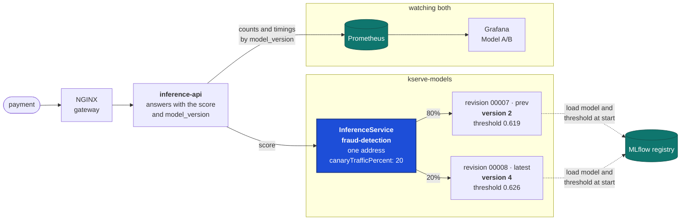

- **One InferenceService, two revisions.** A new model in the manifest's image tag
  (`fraudstream-serving:model-5`) makes KServe start a new revision next to the old one.
  The model ships inside that image, packaged from MLflow when it is built. `canaryTrafficPercent` sends that share of
  requests to the new revision, and the rest to the previous one. The inference API keeps
  calling one address and never knows a test is running.
- **Every answer names its version.** The model server reads its version number and its
  decision threshold from the model card packaged next to the model in its image. It returns both with every
  score. The inference API passes `model_version` back to the caller and labels every
  count and timing with it.
- **Each version decides at its own threshold.** Training picks the threshold, so version
  2 flags at 0.619 and version 4 at 0.626. A flag rate is counted at the version's own
  threshold, the way it would really decide.
- **The split is per request.** One customer can be scored by version 2 on one payment
  and by version 4 on the next.

## What the manifest says, and what KServe does

The whole state of a test lives in two lines of `k8s/models/fraud-detection.yaml`: the
model in the image tag, and `canaryTrafficPercent`. (The demo below ran when the model was
still named in a `MODEL_URI` variable; the steps are the same.)

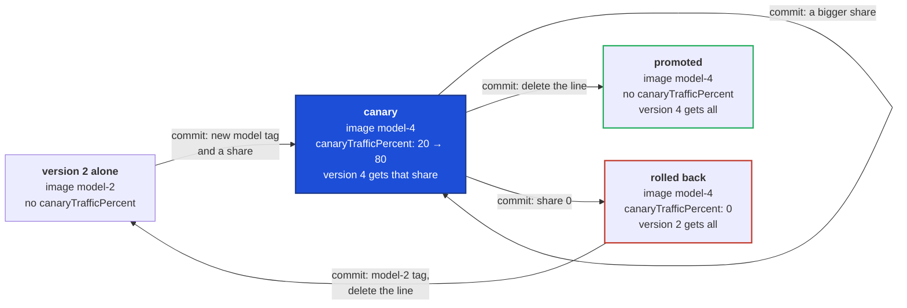

`canaryTrafficPercent: 0` **is** the rollback. Deleting the line does the opposite: with no
canary, the latest revision gets everything, so version 4 would be promoted. Going back to
"version 2 alone" is a separate, deliberate commit.

## Who moves the traffic

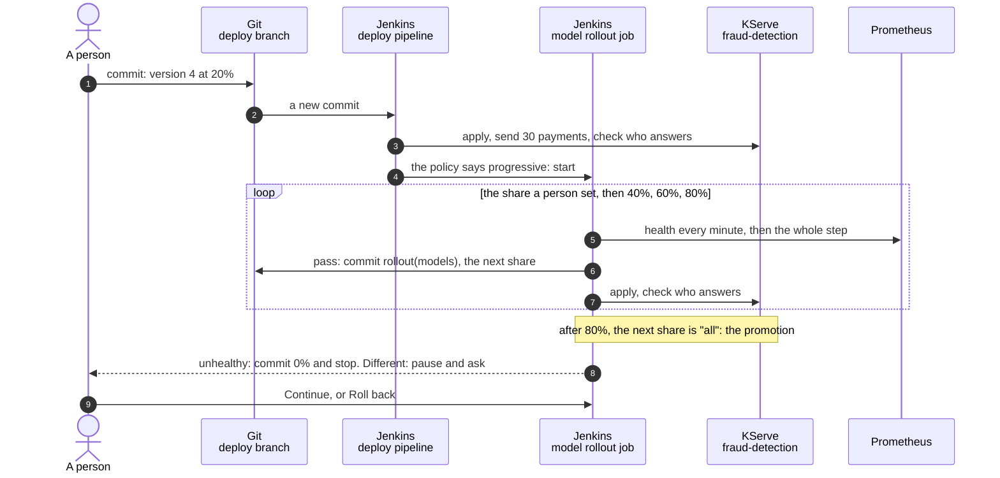

- **A person starts it with one commit.** The deploy pipeline applies the manifest, sends
  30 replayed payments, and checks that the versions answering match the split. If
  `k8s/models/rollout.yaml` says `mode: progressive`, it then starts the rollout job.
  With `mode: manual`, a person commits every step.
- **The rollout is its own Jenkins job.** It can run for 12 hours. The deploy pipeline
  allows 45 minutes and one build at a time, so a long rollout can't live inside it.
- **Every step is a commit, pushed before it is applied.** So Git always says what the
  cluster does, and the history shows who moved the traffic. The job's commits start with
  `rollout(models):` and never start another rollout.
- **Someone else's change wins.** Before each change, the job compares the live share with
  the one it left. If they differ, it stops and touches nothing. It also refuses to start
  while the cluster doesn't serve the share Git names yet.
- **One writer at a time.** The deploy pipeline and the rollout job take the same lock
  before they change the split. A deploy build of an older commit sees the newer one and
  leaves the model alone.
- **A hold waits for a person.** The job pauses with two buttons: **Continue: accept the
  difference** and **Roll back**. Continue goes on from the live share and stops judging
  behaviour for the rest of this rollout. Health still rolls back, and too few answers
  still hold. Jenkins records who pressed which button.

## How one step is judged

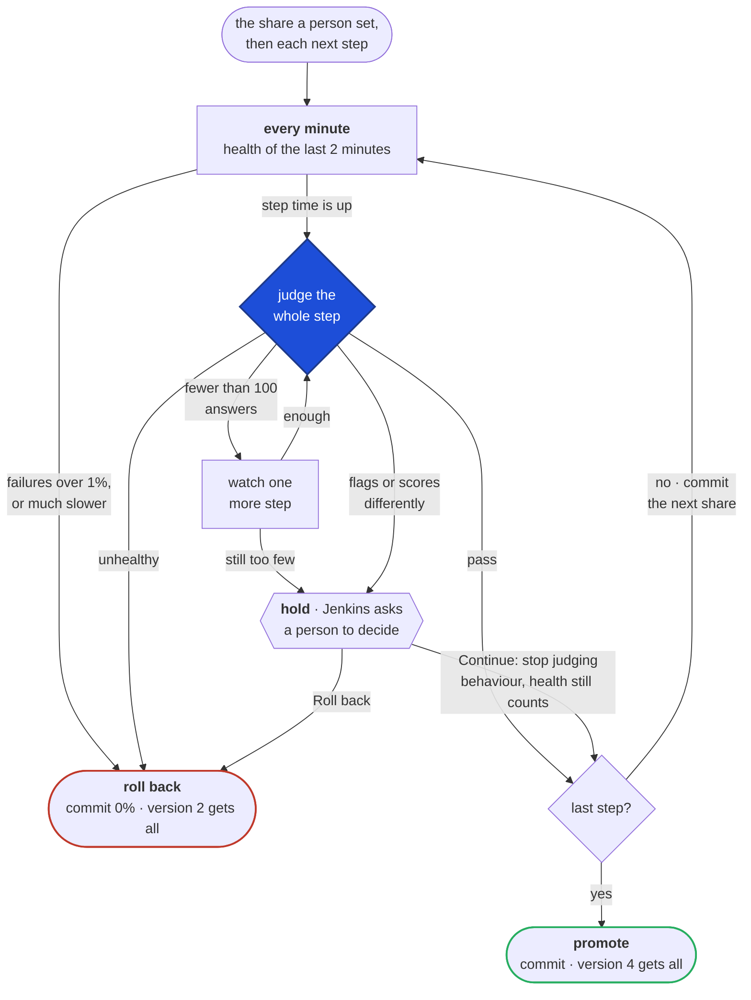

**Health rolls back. Behaviour holds.** Failures and slow answers are bad for any model,
so they roll back at once, in the middle of a step if need be. A different flag rate or
score is another matter. Without labels, nobody can tell whether version 4 is catching
more fraud or blocking more good customers. So the job stops there and leaves the share
where it is, for a person to decide. **Silence never promotes.** A step with too few
answers is looked at once more, then held.

The rules live in `k8s/models/rollout.yaml`, next to the manifest they govern:

| Setting | Default | What it means |
|---|---|---|
| `mode` | `manual` | `progressive` lets the job step the share up |
| `steps` | 20, 40, 60, 80 | The shares after the one a person set. After the last comes promotion |
| `step_minutes`, `check_minutes` | 10, 1 | How long each share is watched, and how often its health is checked |
| `min_answers` | 100 | Answers from the new version needed to judge a step |
| `max_failure_ratio` | 1% | More failed payments than this rolls back |
| `latency_ratio`, `latency_slack_seconds` | 1.2, 50 ms | A model p95 above 1.2 × the served one's + 50 ms rolls back |
| `max_flag_rate_gap` | 2 points | Flag rates further apart than this hold |
| `max_median_shift` | 0.10 | Median scores further apart than this hold |

The 50 ms slack is for fast models. The model answers in about 10 ms, so "20% slower"
alone would be 12 ms, and normal jitter would roll back a good version.

## Comparing two versions without labels

The "FraudStream · Model A/B" dashboard puts the two side by side.

| Panel | What it answers |
|---|---|
| Share of answers by version | Is the split what the manifest says? |
| Payments answered | Are there enough answers to compare? |
| Decision threshold | Where does each version draw the line? |
| Score quantiles by version | Do the two score the same traffic alike? |
| Share of payments scoring at least… | The same, as score bands |
| Flag rate at each version's own threshold | How many payments would each one block? |
| Model answer time by version | Is the new one slower? |
| Failures | Did anything fail? A failed call has no answer, so no version |

## Demo

Every command runs from the repo root, after this setup:

```bash
set -a && . ./.env && set +a
GATEWAY_ADDRESS=127.0.0.1 . ci/gateway.sh            # gateway_curl
split() { kubectl --context kind-fraudstream -n kserve-models get inferenceservice fraud-detection \
  -o jsonpath='{range .status.components.predictor.traffic[*]}{.revisionName} {.percent}% {.tag}{"\n"}{end}'; }
replay() { (cd api && uv run python tools/traffic.py --host inference.fraudstream.localhost \
  --payments tools/payments.jsonl --rate 10 --seconds "${1:-1800}"); }
```

The replay sends real payments: 3,000 from the newest week of the Gold table, made with
`cd api && PYTHONPATH=src:../ml/src uv run --group reference python tools/export_payments.py --count 3000`.

### A test by hand: version 4 on 20%

**Start the canary.** One commit to `k8s/models/fraud-detection.yaml`: the new
`MODEL_URI`, a share, and `minReplicas: 1` so the new version never waits for a cold start.

```yaml
spec:
  predictor:
    minReplicas: 1
    canaryTrafficPercent: 20
    containers:
      - name: kserve-container
        env:
          - name: MODEL_URI
            value: models:/fraud-detection/4
```

**Two revisions, one address.** Revision 00008 (version 4) takes 20%, the previous one
80%. A payment sent through the gateway comes back with the version that scored it.

```bash
split
gateway_curl -s -u "$GATEWAY_USER:$GATEWAY_PASSWORD" -H 'Content-Type: application/json' \
  -d "$(head -1 api/tools/payments.jsonl)" https://inference.fraudstream.localhost/v1/predict
```

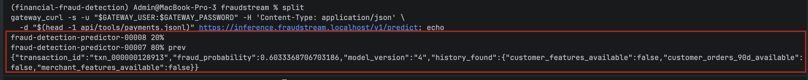

**CI checks who answers.** After applying, the `Model server` stage sends 30 replayed
payments. 27 were answered by version 2 and 3 by version 4, so both versions are live.
The same check runs by hand:

```bash
GATEWAY_ADDRESS=127.0.0.1 ./ci/check_model_split.sh
```

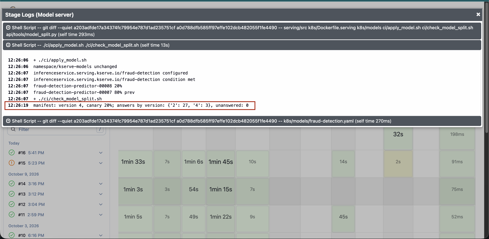

**Thirty minutes of real payments.** 18,000 payments at 10 a second. 17,983 were answered:
14,401 by version 2 and 3,582 by version 4, which is 19.9%. 17 failed at the gateway (13
answered 502, 4 lost the connection).

```bash
replay 1800
```

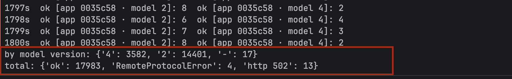

**The two versions score alike.** Open `https://grafana.fraudstream.localhost`, then
Dashboards → FraudStream · Model A/B, last 30 minutes. The share holds at 80/20. Median,
p90 and p99 scores lie on top of each other, around 0.52, 0.63 and 0.69. 54.3% of version
2's payments score 0.5 or more, against 51.7% for version 4, and neither gives any payment
0.75.

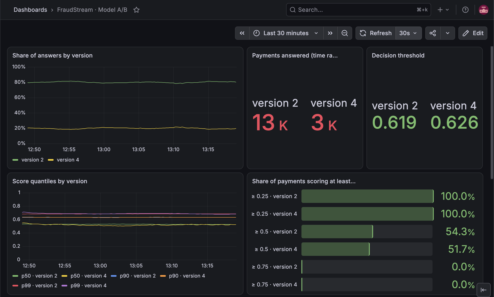

**Health is the same for both.** Version 2 flags about 8% of payments. Version 4 swings
between 6% and 8%, because it sees a quarter as many. Model answer time rose for both
versions at once around 13:10, and the 5xx failures came at the same time. That points at
the platform, not at one model.

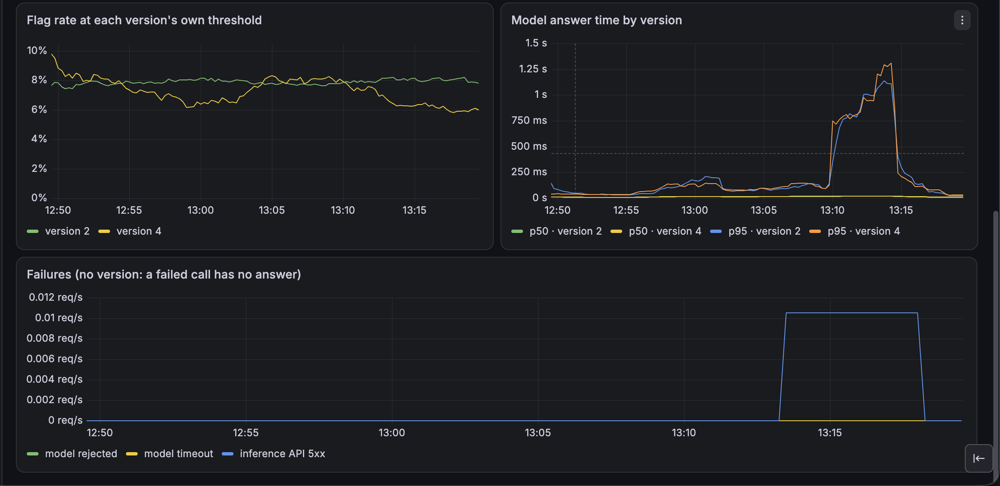

**The decision: roll back.** Version 4 was healthy and scored like version 2, but flagged
a little fewer payments. Without labels, that is a call for the fraud team, not a
measurement. Here the test was rolled back, which also shows the way back. All 30
payments of the check were then answered by version 2.

```bash
sed -i '' 's/canaryTrafficPercent: 20/canaryTrafficPercent: 0/' k8s/models/fraud-detection.yaml
git commit -am "fix(models): roll version 4 back to 0%" && git push
```

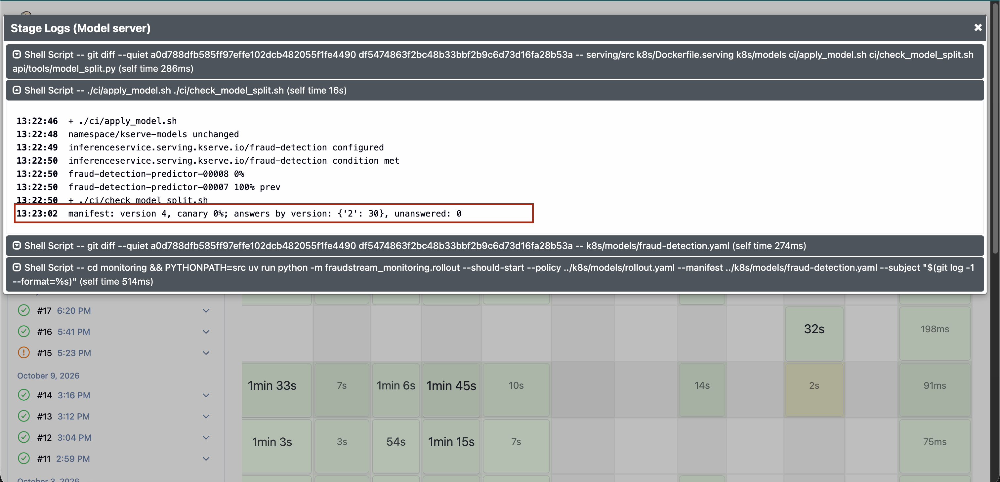

To promote instead, delete the `canaryTrafficPercent` line, set `minReplicas: 0`, commit
and push. The check then expects every answer from version 4.

### A rollout on its own

**Opt in, and start the canary again.** The steps were 3 minutes long for the demo.
Start the replay first, so both versions answer before the job starts watching.

```bash
replay 2400                                            # in a second terminal
sed -i '' -e 's/^mode: manual/mode: progressive/' -e 's/^step_minutes: 10/step_minutes: 3/' k8s/models/rollout.yaml
sed -i '' 's/canaryTrafficPercent: 0/canaryTrafficPercent: 20/' k8s/models/fraud-detection.yaml
git commit -am "feat(models): roll version 4 out step by step from 20%" && git push
```

Then Jenkins → `fraudstream` → **Scan Multibranch Pipeline Now**. Don't press Build Now on
the rollout job. The deploy pipeline starts it once the share is live.

**The deploy pipeline hands over.** It applied 20%, the check saw 22 answers from version
2 and 8 from version 4, and the policy said progressive, so it scheduled
`fraudstream-model-rollout`.

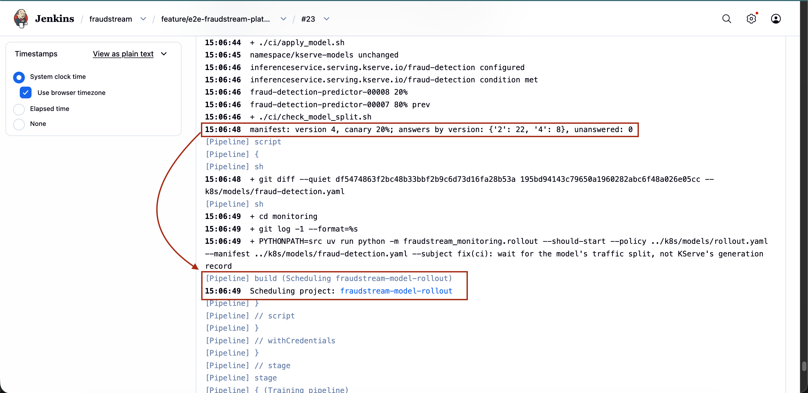

**Two holds, then a promotion.** The rollout took 40 minutes, and a person stepped in
twice:

1. 20% passed. At 40%, the job held: version 4 flagged 5.94% of payments, version 2
   8.49%, more than 2 points apart. Re-running the job held again (6.05% against 8.49%).
   A person accepted the gap and raised `max_flag_rate_gap` to 0.03, in a commit.
2. 40% and 60% passed. The run also stopped twice at 60%, when a deploy build put back
   an older 40% (see "Things worth knowing"). At 80%, the job held again: 7.34% against
   10.90%. This time the gap was noise. Version 2 had only a fifth of the traffic, about 340 answers in a
   3-minute step. Over the whole hour the two flagged 7.96% and 7.11%.
3. Re-running the job judged 80% again on a fresh window. It passed, and the job promoted
   version 4. KServe started revision 00009 for it, and the check saw all 30 answers come
   from version 4.

These holds were handled by changing a threshold in a commit and re-running the job. The
job now asks on a hold instead, as the next section shows.

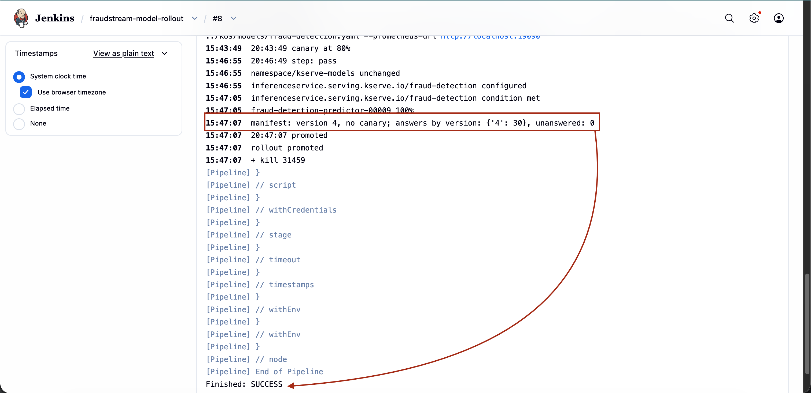

**The share stepping up.** Version 4's share rose 20% → 40% → 60% → 80% → 100% between
15:05 and 15:52. The long flat stretch at 40% is the first hold. Both versions answered
about 14,000 to 15,000 payments, and their score bands still match: 54.0% and 53.6% at
0.5 or more.

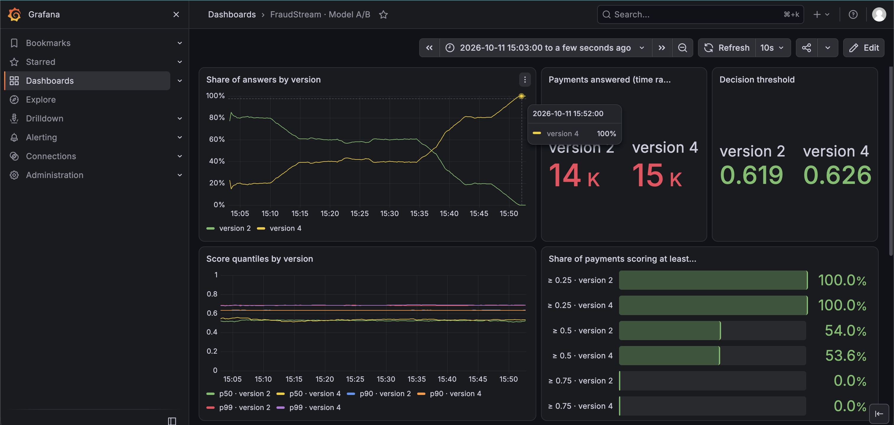

**Every step is in Git.** One person's commit started it. The job wrote 40%, 60%, 80% and
the promotion. The two `fix(ci)` commits in between are fixes found during this run, in
"Things worth knowing" below.

```bash
git pull --rebase && git log --oneline -8
```

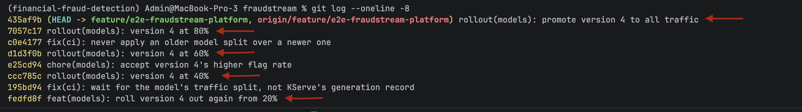

### Deciding on a hold

The job pauses on a hold and asks. To try both answers, the behaviour limits were set to
0, so any difference holds, and version 2 was started as a canary next to version 4.

```bash
replay 2400                                            # in a second terminal
sed -i '' -e 's/max_flag_rate_gap: .*/max_flag_rate_gap: 0.0/' -e 's/max_median_shift: .*/max_median_shift: 0.0/' k8s/models/rollout.yaml
perl -pi -e 's/^(\s*)minReplicas: 0$/$1minReplicas: 1\n$1canaryTrafficPercent: 20/; s#fraud-detection/4#fraud-detection/2#' k8s/models/fraud-detection.yaml
git commit -am "test(models): force a hold to try the decision buttons" && git push
```

**The question.** After the first step, the build pauses. Open `fraudstream-model-rollout`,
then the paused stage (or **Paused for Input** on the build), pick an answer and press
**Decide**. Nobody answering within 4 hours leaves the share where it is.

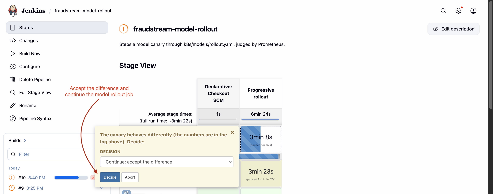

**Roll back.** The job commits 0% with the reason in the message,
`rollout(models): roll version 2 back to 0%, by a person's decision`. All 30 payments of
the check went to version 4. The build ends yellow, with who decided.

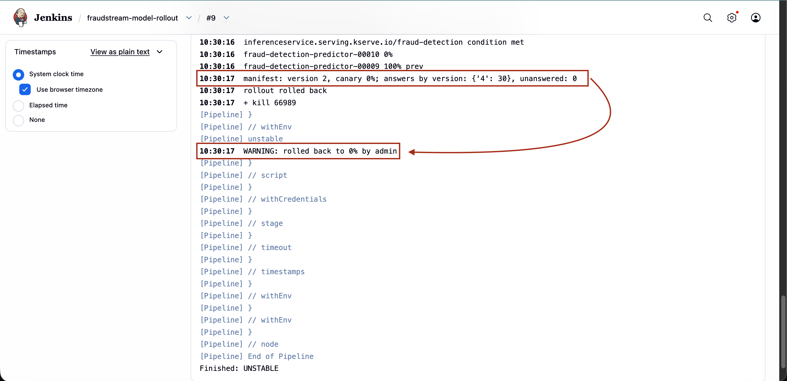

**Continue.** Started again from 0% → 20%, and answered Continue. From then on, every step
still prints its verdict, here a hold on flag rate (9.72% against 7.06% at 40%), followed
by `accepted by a person, so the rollout goes on`. Health was still checked every minute.
The job promoted version 2 at 10:58. KServe started revision 00011 for it, and all 30
answers came from version 2.

```bash
git pull --rebase
sed -i '' 's/canaryTrafficPercent: 0/canaryTrafficPercent: 20/' k8s/models/fraud-detection.yaml
git commit -am "test(models): hold again, then continue" && git push
```

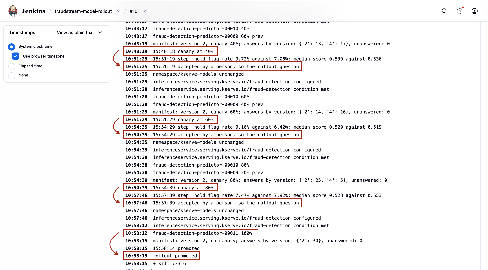

Put version 4 and the limits back afterwards:

```bash
git pull --rebase
perl -pi -e 's#fraud-detection/2#fraud-detection/4#; $_ = "" if /canaryTrafficPercent/; s/minReplicas: 1/minReplicas: 0/' k8s/models/fraud-detection.yaml
sed -i '' -e 's/max_flag_rate_gap: .*/max_flag_rate_gap: 0.03/' -e 's/max_median_shift: .*/max_median_shift: 0.10/' k8s/models/rollout.yaml
git commit -am "chore(models): serve version 4 alone again" && git push
```

### When a step goes wrong

The first automatic run hit a real failure. 20% and 40% passed. At 60%, the laptop's
Docker VM ran out of memory. The kernel killed Prometheus, the Kubernetes API server
restarted, and the gateway answered 502 for about four minutes. The check right after the
move to 60% found 2 of 30 payments unanswered, so the job rolled back to 0%.

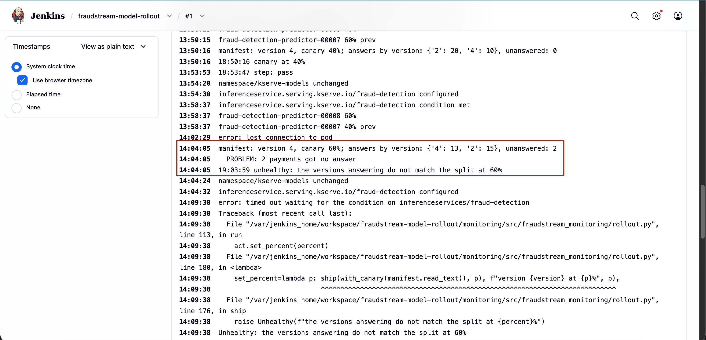

The fault was the platform, not version 4. Rolling back was still right: payments went
unanswered while version 4 held 60%. A failed call has no answer, so no version, and the
job can't tell whose fault a failure is. On the dashboard, version 4's share fell to 0.
Answer times, which had reached 5 seconds, came back down.

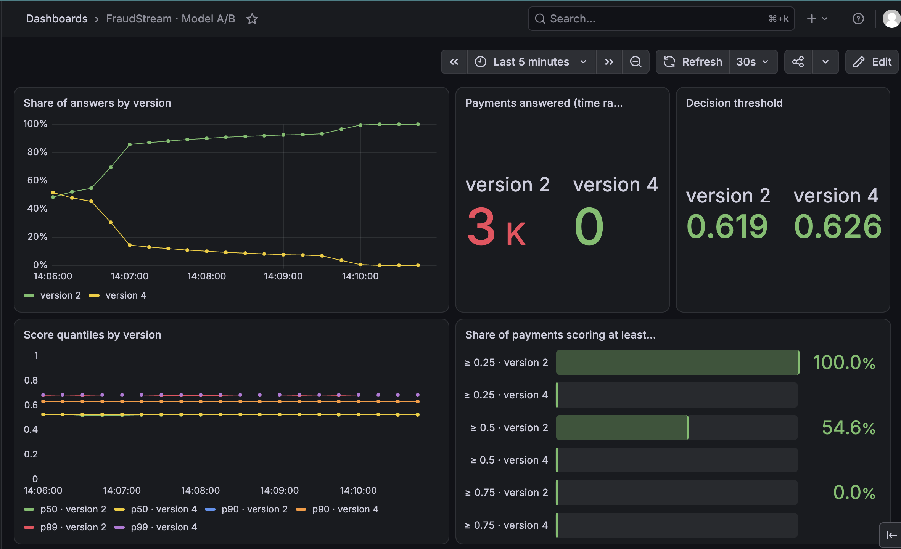

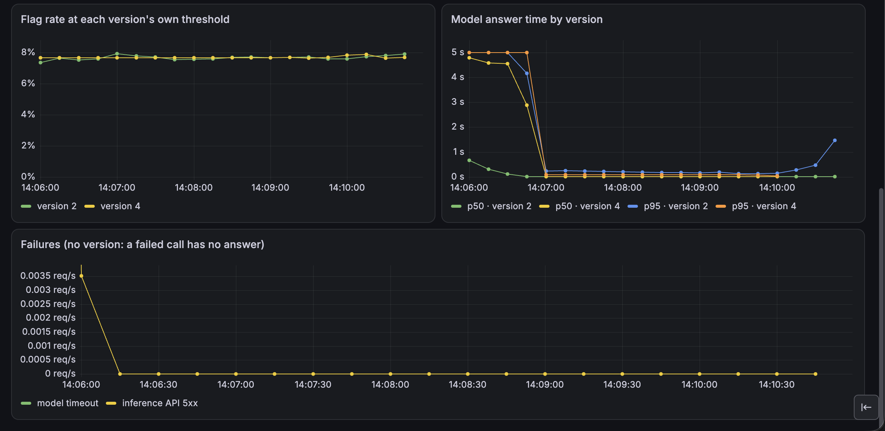

The rollback commit was pushed and applied. The job then waited longer than its 5 minutes
for KServe while the cluster recovered, so it ended as failed. Git and the cluster both
said 0%. To see where the memory goes:

```bash
docker stats --no-stream --format '{{.Name}} {{.MemUsage}}'
kubectl --context kind-fraudstream top pods -A --sort-by=memory | head
docker exec fraudstream-control-plane sh -c 'dmesg | grep -i "out of memory"'
```

## Things worth knowing

**The served model never scales to zero.** A revision keeps the settings it was made
with. When the manifest set `minReplicas: 1` only for a canary, the old revision still
scaled to zero, and its next payment waited about 30 seconds for the model to load. The
manifest now keeps `minReplicas: 1` always, and promotion no longer changes it, so it no
longer makes one more revision either.

**`production` follows the traffic.** After an apply with no canary, `ci/apply_model.sh`
points MLflow's `production` alias at the version serving everything, so the registry
always names the model actually answering. `latest` is MLflow's own name for the newest
version; it can't be set by hand.

**A rollback keeps the policy.** The job only ever changes the traffic share.
`rollout.yaml` stays as it was, so the next canary is stepped the same way.

**Re-running after a hold judges the same way.** A plain re-run looks at the live share
again with the same thresholds, so it holds again. Use the **Continue** button, which tells
the job a person accepted the difference. A paused build keeps one of Jenkins' two
executors until someone answers.

**Short steps are noisy at the edges.** At 20% and at 80%, one version sees a fifth of the
traffic. In a 3-minute step, that is a few hundred payments, and a flag rate from a few
hundred payments moves by points. In production a step usually lasts an hour.

**Pull with rebase.** The job pushes to the deploy branch, so a local copy falls behind
after every rollout. `git config pull.rebase true` makes `git pull` replay local commits
on top.

**A deploy build of an older commit leaves the model alone.** Every push starts a deploy
build, and its tests take a few minutes. During the demo, the build of the policy commit
applied its 40% after the job had moved to 60%, and the job stopped. The `Model server`
stage now takes the split lock, fetches the branch, and skips the model when a newer
commit has changed the manifest. The rollout job holds the same lock from checking the
live share to applying its commit, so nothing moves the split in between. The lock is a
file in Jenkins' home, which works because both jobs run on Jenkins' one node.

**Waiting for Ready waits on the share.** `kubectl wait --for=condition=Ready` also needs
KServe to record that it saw the newest spec. KServe skips that when a change leaves its
status as it was, so the wait never ended. `ci/apply_model.sh` waits until the latest
revision has the manifest's share, then for Ready.

**A manifest-only commit changes no image.** The serving image is tagged with the last
commit that touched the serving code. So a step only moves traffic between revisions that
already exist.

**A new Jenkins job needs a second restart.** Jenkins lists its jobs before it applies
`jenkins.yaml`. The rollout job is written on the first restart and loaded on the second.

**Memory is tight on a laptop.** The whole stack used 17 GiB of Docker's 19.5 GiB. Stop
the Compose services a test doesn't need (Airflow, Kafka, Debezium, Trino) before a long
rollout.

**GKE serves one version.** In the cloud, the model runs as a plain Deployment
(`k8s/gke/fraud-detection.yaml`) without KServe, so there is no canary. A/B tests run on
the local cluster.

## Where things are

| Area | Location |
|---|---|
| The split: model and share | `k8s/models/fraud-detection.yaml` |
| The rollout policy | `k8s/models/rollout.yaml` |
| Version and threshold in every answer | `serving/src/fraudstream_serving/predictor.py` |
| Metrics by version | `api/src/fraudstream_api/inference/telemetry.py` |
| The dashboard | `k8s/observability/dashboards/model-ab.yaml` |
| Package the model into its image | `serving/src/fraudstream_serving/fetch.py`, `k8s/Dockerfile.model` |
| Apply the model, wait for its share, move `production` | `ci/apply_model.sh` |
| Check who answers | `ci/check_model_split.sh`, `api/tools/model_split.py` |
| Deploy, check and start a rollout | `Jenkinsfile` (`Model server` stage) |
| The rollout job | `ci/jenkins/model-rollout.Jenkinsfile`, `ci/jenkins/jenkins.yaml` |
| The step loop | `monitoring/src/fraudstream_monitoring/rollout.py` |
| Verdicts and thresholds | `monitoring/src/fraudstream_monitoring/rollout_analysis.py` |
| Reading Prometheus | `monitoring/src/fraudstream_monitoring/rollout_metrics.py` |
| Editing the manifest | `monitoring/src/fraudstream_monitoring/rollout_manifest.py` |
| Real payments to replay | `api/tools/export_payments.py`, `api/tools/traffic.py`, `api/tools/payments.jsonl` |
