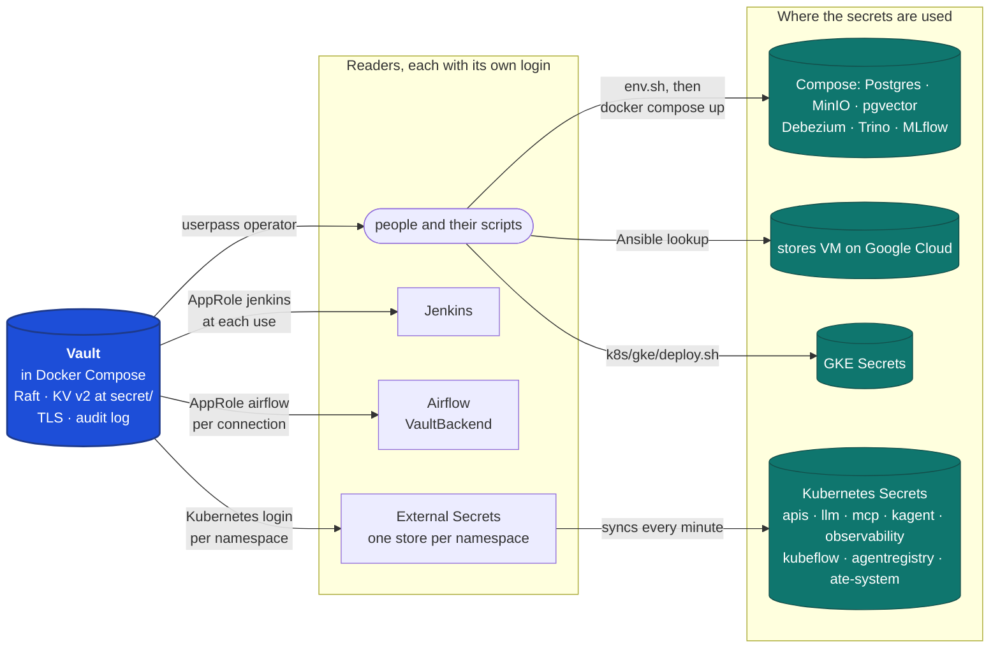
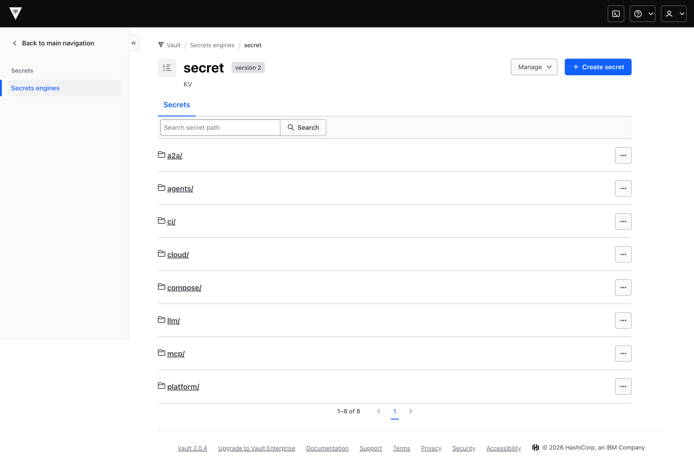
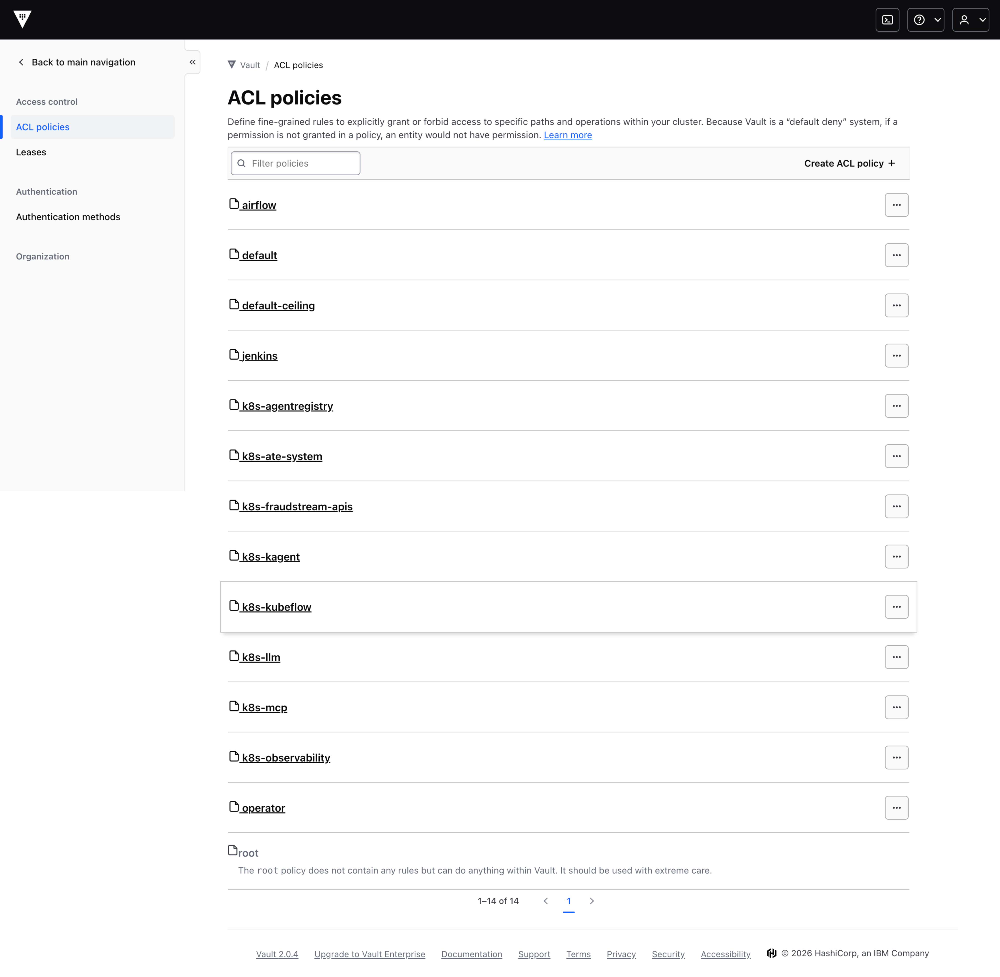
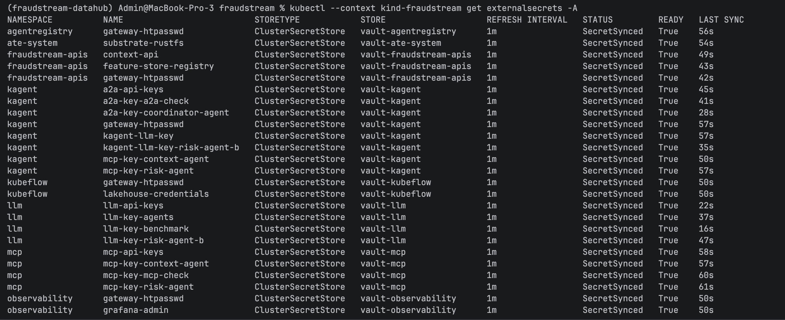
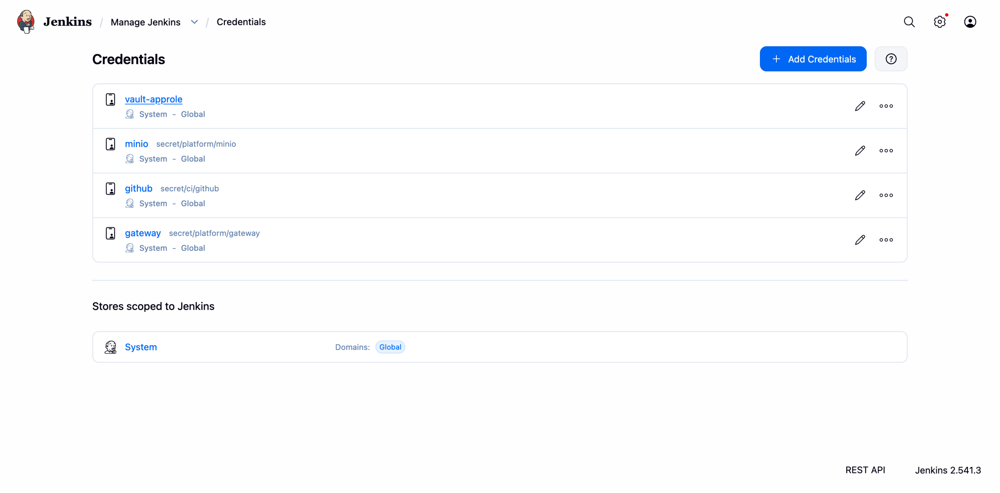
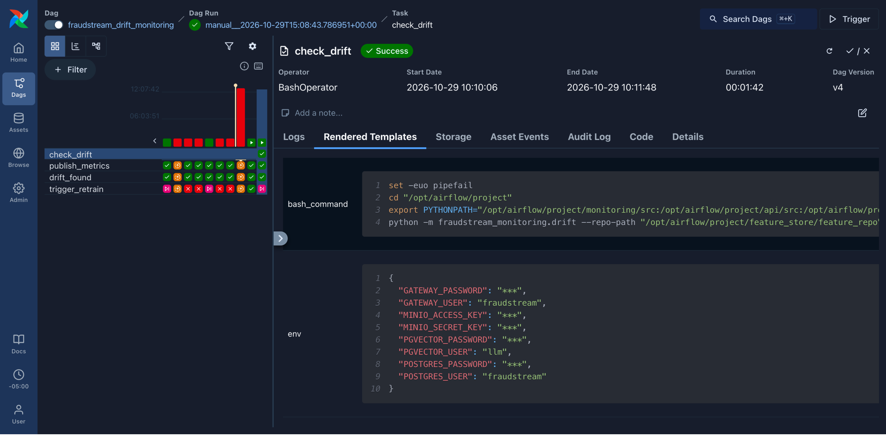
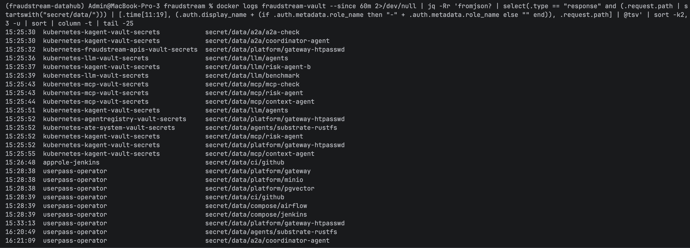
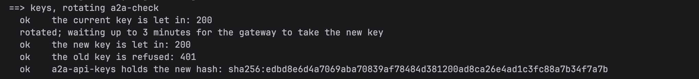

# Security: One Vault for Every Secret

Every password, key and token in the platform lives in one place: a HashiCorp Vault.
Nothing else keeps a copy that anyone writes by hand. The stores' passwords, the
gateway login, the LLM, MCP and A2A keys, CI's GitHub token and the cloud's database
password are all entries in Vault. Every reader has its own login and may read only its
own entries: each Kubernetes namespace, Jenkins, Airflow, and the people who run the
scripts. Vault's audit log records every read, with who made it. The repository and
`.env` hold no secret.

## Architecture



Vault runs in Docker Compose, next to the stores, not in the cluster. Compose's stores
start before kind, so they would need their passwords from a Vault that didn't exist yet.
And deleting the kind cluster would delete Vault's data with it. Pods reach Vault by name,
`https://vault:8200`, because the kind node joins Compose's network.

Vault serves TLS from its own small certificate authority, made by
[`infra/vault/tls.sh`](../../infra/vault/tls.sh#L24). The CA certificate is public. It
reaches the cluster as the ConfigMap `external-secrets/vault-ca`, Jenkins as a truststore
its entrypoint builds, and Airflow as a mounted file.

## Where each secret lives



| Path under `secret/` | Fields | Read by |
|---|---|---|
| `platform/postgres` | `conn_type`, `host`, `port`, `schema`, `login`, `password` | Compose, Airflow, `fraudstream-apis`, `kubeflow` |
| `platform/minio` | `conn_type`, `login`, `password` | Compose, Airflow, Jenkins, `kubeflow` |
| `platform/pgvector` | `conn_type`, `host`, `port`, `schema`, `login`, `password` | Compose, Airflow, `fraudstream-apis` |
| `platform/gateway` | `conn_type`, `login`, `password` | Compose, Airflow, Jenkins, `observability` |
| `platform/gateway-htpasswd` | `htpasswd` | every namespace behind the gateway |
| `ci/github` | `username`, `token` | Jenkins |
| `compose/jenkins`, `compose/airflow` | the admin password; the Fernet, JWT and API keys | Compose |
| `llm/<consumer>`, `mcp/<consumer>`, `a2a/<consumer>` | `key` | `llm`, `mcp`, `kagent` |
| `agents/substrate-rustfs` | `access_key`, `secret_key` | `ate-system` |
| `cloud/postgres` | `password` | the operator: Ansible and the GKE deploy |

The `platform/` entries are shaped like Airflow connections, so one entry serves everyone.
Airflow turns `platform/postgres` into its `postgres` connection, and Jenkins, External
Secrets and Compose read the same `login` and `password` fields. Each password exists once.

## Who may read what

Every reader logs in as itself, and gets a token carrying one policy. A policy lists the
paths that reader may read, and nothing else. Airflow's is the four `platform/` entries:

```hcl
path "secret/data/platform/postgres" {
  capabilities = ["read"]
}
```

| Reader | How it logs in | Policy |
|---|---|---|
| People and their scripts | userpass, the user `operator` | `operator`: reads and writes `secret/`, reads `sys/` |
| Jenkins | AppRole `jenkins` | `jenkins`: `platform/minio`, `platform/gateway`, `ci/github` |
| Airflow | AppRole `airflow` | `airflow`: the four `platform/` connections |
| Each namespace | Kubernetes, with its ServiceAccount `vault-secrets` | `k8s-<namespace>`: only what that namespace uses |



For the Kubernetes login, Vault asks the cluster's API server whether the
ServiceAccount's token is real, using the reviewer account
[`vault-token-reviewer`](../../k8s/secrets/token-reviewer.yaml#L4). A pod in `observability`
that asks for `platform/postgres` is refused with 403.
[`configure.sh`](../../infra/vault/configure.sh#L28) writes the policies, the AppRoles and
the namespace roles. Running it again changes nothing.

## How a secret reaches each reader

**The cluster.** Each namespace has one `ClusterSecretStore`, limited to that namespace by
`conditions`, and one `ExternalSecret` per Kubernetes Secret
([`k8s/apis/secrets.yaml`](../../k8s/apis/secrets.yaml#L8)). External Secrets logs in as
the namespace, reads Vault and writes the Secret, then checks again every minute. The
gateways' key lists are built by a template, which hashes each key as it syncs
([`k8s/llm/secrets.yaml`](../../k8s/llm/secrets.yaml#L105)). Only the key's hash reaches the
gateway's Secret.



**Docker Compose.** `docker-compose.yml` writes every secret as
`${POSTGRES_PASSWORD:?run . infra/vault/env.sh …}`, with no fallback. Sourcing
[`infra/vault/env.sh`](../../infra/vault/env.sh#L16) reads them from Vault into the shell,
so Compose can fill them in. Without it, Compose stops instead of starting with a known
password. The same file serves jobs run by hand.

**Jenkins.** Jenkins logs in with its AppRole
([`cicd/jenkins/jenkins.yaml`](../../cicd/jenkins/jenkins.yaml#L17)). Its credentials
`minio`, `github` and `gateway` are Vault credentials, which Jenkins reads at the moment a
build uses them. The `Jenkinsfile`'s `withCredentials` blocks didn't change.



**Airflow.** Airflow's secrets backend is `VaultBackend`, with its own AppRole
([`docker-compose.yml`](../../docker-compose.yml#L22)). A connection called `postgres` is
read from `secret/platform/postgres` when a task runs. Every task gets its credentials from
those connections through templates such as `{{ conn.postgres.password }}`
([`dag_helpers.py`](../../airflow/include/fraudstream_airflow/dag_helpers.py#L18)). Airflow
shows the passwords and keys as `***` in logs and in the UI, and no password sits in the
scheduler's environment.



**Ansible and GKE.** Neither the stores VM nor GKE can reach the laptop's Vault. Both are
set up from the laptop, by the operator.
- **Ansible** reads the cloud's database password with a lookup
  ([`group_vars/stores.yml`](../../infra/ansible/group_vars/stores.yml#L5)).
- **The GKE deploy** reads Vault, then creates GKE's two Secrets from what it read
  ([`k8s/gke/deploy.sh`](../../k8s/gke/deploy.sh#L14)). It is the one script that still
  makes a Secret by hand, and the check allows only that one.

**Every read is logged.** Vault's audit log goes to the container's output, one JSON line
per request, with who asked, from which address, and for which path. Values are hashed in
the log, never written in clear.



## Making and rotating keys

A new key is made in Vault, once, with check-and-set version 0, so running an install again
never replaces it ([`new-key.sh`](../../infra/vault/new-key.sh#L22)). Rotating writes a new
version, checked against the current one ([`rotate-key.sh`](../../infra/vault/rotate-key.sh#L15)).
External Secrets syncs it within a minute, and the gateway lets the new key in and refuses
the old one. Nothing was redeployed.



## Starting up

Vault comes first, and starts sealed after every restart. It has a Compose file of its
own, [`infra/vault/compose.yml`](../../infra/vault/compose.yml#L1), which needs no secret,
so it can start before anything is read from it. The main `docker-compose.yml` includes it.

```bash
./infra/vault/unseal.sh
vault login -method=userpass username=operator
. infra/vault/env.sh
docker compose up -d
./k8s/bootstrap.sh
```

`unseal.sh` starts Vault if it isn't running, then unseals it. On a new machine, set Vault
up once before that:

```bash
./infra/vault/tls.sh
./infra/vault/init.sh
./infra/vault/configure.sh
./infra/vault/seed.sh
```

`seed.sh` copies what exists into Vault: `.env`'s old values and the cluster's live keys.
It makes a random value for anything missing, except the GitHub token, which you put in
through Vault's UI. A path that exists is left as it is.

Moving an existing Airflow: its stored connections were encrypted with Compose's old
default Fernet key, and Vault now holds a new one. Re-encrypt them once with both keys:

```bash
. infra/vault/env.sh
AIRFLOW_FERNET_KEY="$AIRFLOW_FERNET_KEY,<the old key>" \
  docker compose --profile orchestration run --rm --entrypoint airflow airflow-init rotate-fernet-key
```

## How to run it

```bash
./infra/vault/check.sh server access cluster keys compose jenkins airflow ansible
./infra/vault/check.sh cluster --sealed
./infra/vault/check.sh keys --rotate
```

Each section prints one line per check.
- **server:** Vault is unsealed, uses Raft, and has an audit log.
- **access:** every path exists; each login reads its own paths and is refused the others.
- **cluster:** every synced Secret matches Vault, and no script makes a Secret by hand.
- **keys:** the key hashes match, and making keys again changes none.
- **compose:** `.env` and the code hold no secret.
- **jenkins and airflow:** they read from Vault, and the audit log shows their own containers reading.
- **ansible:** the playbook's variables resolve from Vault.

`--sealed` seals Vault and checks the Secrets stay as they are. `--rotate` rotates a key and
checks the gateway takes the new one.

## Known limits

- **One unseal key, on the laptop.** It lives in `~/.fraudstream/vault-init.json`, with the
  root token. Vault starts sealed after every restart, until `unseal.sh` runs.
- **The root token is kept** for `configure.sh`, which changes policies and logins.
- **A sealed Vault freezes the Secrets.** They stay as they last synced, and Compose and new
  jobs can't start until Vault is unsealed.
- **Agents keep a rotated key until they are redeployed.** They read their key once, at
  start.
- **GKE's Secrets are copies,** made at deploy time. A rotation reaches GKE at the next deploy.
- **The AppRole logins are in Jenkins' and Airflow's environment.** `docker inspect` shows
  them, and with them their policy's paths.

## Where things are

| Area | Location |
|---|---|
| Vault server, TLS, unseal | `infra/vault/compose.yml`, `config.hcl`, `tls.sh`, `init.sh`, `unseal.sh` |
| Policies and logins | `infra/vault/policies/`, `infra/vault/configure.sh` |
| Copying today's secrets in | `infra/vault/seed.sh` |
| Making and rotating keys | `infra/vault/new-key.sh`, `infra/vault/rotate-key.sh` |
| External Secrets | `k8s/secrets/`, `k8s/*/secrets.yaml` |
| Compose's secrets | `infra/vault/env.sh` |
| Jenkins | `cicd/jenkins/jenkins.yaml`, `cicd/jenkins/entrypoint.sh` |
| Airflow | `docker-compose.yml` (`x-airflow-common`), `airflow/include/fraudstream_airflow/dag_helpers.py` |
| Ansible and GKE | `infra/ansible/group_vars/stores.yml`, `k8s/gke/deploy.sh` |
| The checks | `infra/vault/check.sh` |
